---
tags:
  - Windows
  - TryHackMe
  - Facile
  - Nmap
  - RDP
  - OSINT
  - Umbraco
---

# Anthem - TryHackMe

<figure markdown>
  { width="250" }
</figure>

## Informations générales

| | |
|---|---|
| **Plateforme** | TryHackMe |
| **Type** | Offensive / Challenge |
| **Difficulté** | Facile |
| **Thématiques** | Enumération web, OSINT, RDP Windows, escalade de privilèges via fichier caché |
| **Prérequis** | Bases Windows, HTTP, inspection de code source, utilisation de RDP |

## Contexte et objectifs

Cette room Windows met en scène un site sous Umbraco CMS. L'objectif est de trouver plusieurs flags cachés dans les pages et le code source, d'identifier les credentials de l'administrateur via OSINT sur un blog, de se connecter en RDP, puis d'accéder au compte Administrateur grâce à un fichier de sauvegarde caché.

!!! info "À propos de cette room"
    Anthem est une room orientée OSINT et énumération plutôt qu'exploitation technique. Elle apprend à extraire des informations utiles depuis les pages web, le `robots.txt` et le code source HTML, et montre comment des informations anodines (un poème, un email) peuvent mener à une compromission complète.

## Méthodologie

### Étape 1 : Cartographie des services avec Nmap

```bash
nmap -sC -sV -Pn <IP_cible>
```

[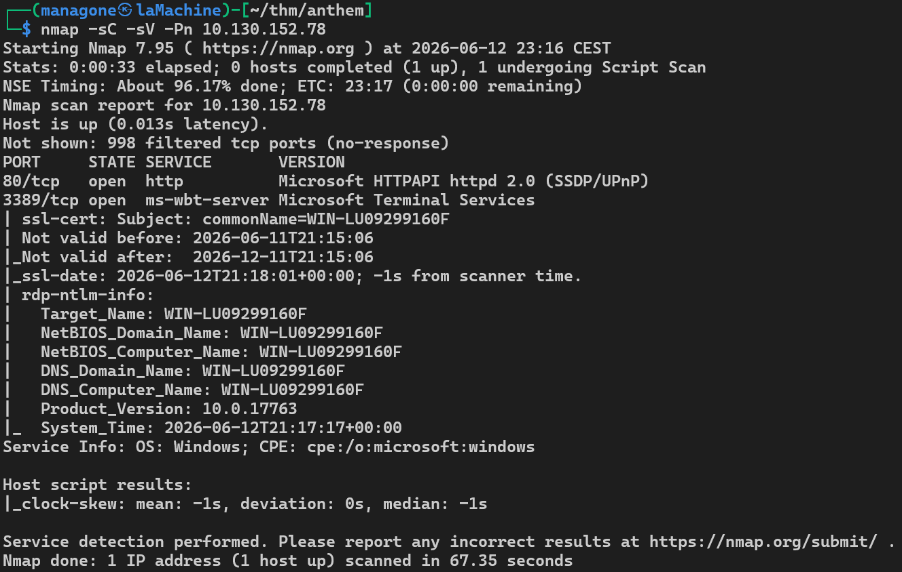](./screen/Anthem/WindowsTerminal_QgDF1gFEA1.png)

!!! tip "Pourquoi le flag -Pn ici ?"
    Par défaut, Nmap envoie d'abord un ping ICMP pour vérifier si l'hôte est actif. Les machines Windows désactivent souvent les réponses ICMP via leur pare-feu. Sans `-Pn`, Nmap conclut que l'hôte est éteint et n'effectue aucun scan. Ce flag force le scan de ports même sans réponse au ping.

Deux ports ouverts :
- **80/tcp** : HTTP
- **3389/tcp** : RDP (Remote Desktop Protocol)

!!! success "Réponse"
    **What port is for the web server?** → `80`

    **What port is for remote desktop service?** → `3389`

### Étape 2 : Analyse du robots.txt

On a trouvé un site web sur le port 80. Avant de l'explorer en profondeur, on consulte `robots.txt`.

```
http://<IP_cible>/robots.txt
```

[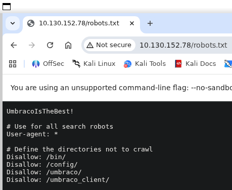](./screen/Anthem/msrdc_ndc09Xvqe2.png)

!!! info "Pourquoi vérifier robots.txt en premier ?"
    Le fichier `robots.txt` est une convention web permettant d'indiquer aux moteurs de recherche quelles pages ne pas indexer. Pour un pentester, c'est une carte des répertoires que l'administrateur considère comme "sensibles" ou "privés". Ironiquement, en listant ce qu'il veut cacher, il le signale directement à quiconque lit ce fichier public.

!!! warning "Observation clé"
    `robots.txt` contient ce qui semble être un mot de passe (`UmbracoIsTheBest!`). C'est une erreur de configuration classique : ne jamais y stocker d'informations sensibles.

!!! success "Réponse"
    **What CMS is the website using?** → `Umbraco`

    **What is the password?** → `UmbracoIsTheBest!`

### Étape 3 : Collecte des flags dans le code source

Avec le CMS identifié et un mot de passe potentiel en main, on explore maintenant le reste du site à la recherche d'autres informations. On parcourt méthodiquement toutes les pages en inspectant le code source de chacune (Ctrl+U dans le navigateur). Les flags sont dissimulés dans les métadonnées HTML, les commentaires et les attributs de page.

!!! tip "Méthodologie d'inspection systématique"
    Sur un site sous CMS, les endroits typiques où chercher des informations cachées sont : les balises `<meta>`, les commentaires HTML `<!-- -->`, les attributs `alt` des images, les `<title>` de page, et les profils utilisateurs. Utiliser Ctrl+F avec `THM{` accélère la recherche dans le code source.

[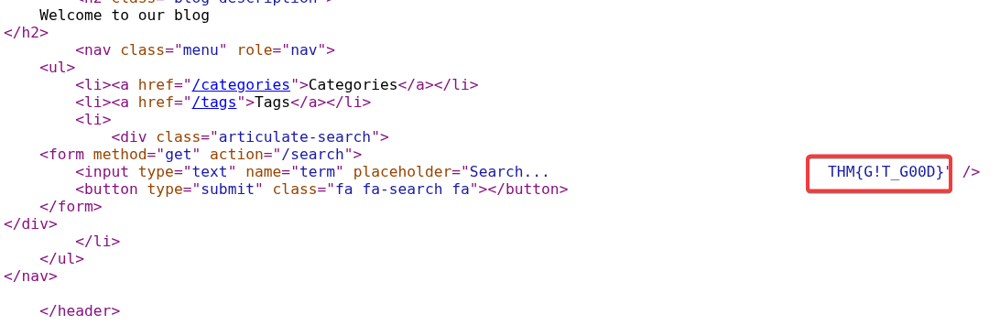](./screen/Anthem/cQ7RxniyhR.png)

[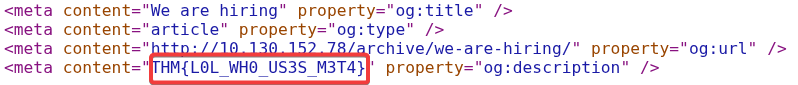](./screen/Anthem/eWCPZ8BIdL.png)

[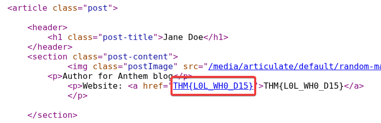](./screen/Anthem/0BKoj0Izu8.png)

[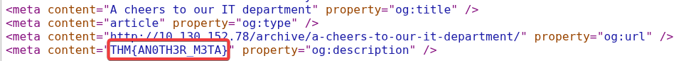](./screen/Anthem/264KBvGcH3.png)

!!! success "Réponse"
    **Flag 1** → `THM{L0L_WH0_US3S_M3T4}`

    **Flag 2** → `THM{G!T_G00D}`

    **Flag 3** → `THM{L0L_WH0_D15}`

    **Flag 4** → `THM{AN0TH3R_M3TA}`

### Étape 4 : Identification de l'administrateur via OSINT

Les quatre flags trouvés, on poursuit l'exploration du site, et notamment de son blog. Il contient un article intitulé **"A cheers to our IT department"** qui inclut un poème en l'honneur de l'administrateur du site. Le poème ne donne pas directement son nom, mais on peut l'identifier en cherchant ses paroles sur Google.

[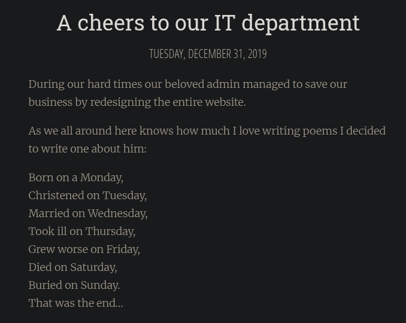](./screen/Anthem/msrdc_WiV1trGYgD.png)

!!! tip "La technique OSINT ici : chercher le texte sur Google"
    On copie quelques lignes du poème et on les colle dans une recherche Google. Le résultat révèle que c'est une comptine anglaise classique sur le personnage **Solomon Grundy**. C'est le nom de l'administrateur que le site célèbre dans cet article.

[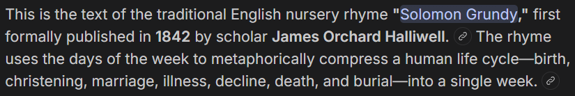](./screen/Anthem/brave_VPz4hn7S7B.png)

Maintenant qu'on a le nom, il faut trouver le format des emails du domaine `anthem.com`. Un second article, **"We Are Hiring"**, liste des employés avec leurs adresses email visibles :
- Jane Doe - `JD@anthem.com`
- James Orchard Halliwell - `JH@anthem.com`

[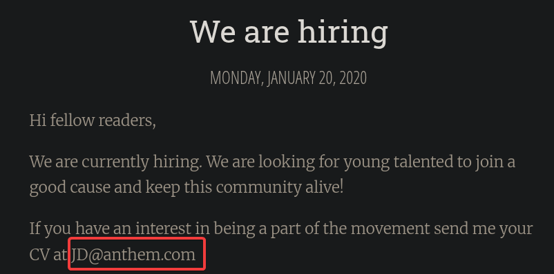](./screen/Anthem/yMdkEjk7lU.png)

Le format est clair : `[Initiale Prénom][Initiale Nom]@anthem.com`. On applique ce format à **Solomon Grundy** :

- S (Solomon) + G (Grundy) = `SG@anthem.com`

!!! info "Qu'est-ce que l'OSINT ?"
    L'OSINT (Open Source Intelligence) consiste à collecter des informations sur une cible depuis des sources publiques. Ici, on combine trois éléments : un poème public, une recherche Google, et la convention de nommage des emails visible sur une autre page. Aucune de ces informations n'est protégée, mais leur combinaison permet d'identifier un compte d'administrateur sans forcer ni pirater quoi que ce soit.

!!! success "Réponse"
    **What is the domain of the website?** → `anthem.com`

    **What is the name of the Administrator?** → `Solomon Grundy`

    **Can you find the full email address of the administrator?** → `SG@anthem.com`

### Étape 5 : Connexion RDP

On a maintenant tous les éléments nécessaires pour se connecter au service RDP repéré à l'étape 1. Avec le nom d'utilisateur `SG` (initiales de Solomon Grundy) et le mot de passe trouvé dans `robots.txt`, on se connecte :

```bash
xfreerdp /v:<IP_cible> /u:sg /p:UmbracoIsTheBest! /cert:ignore +clipboard /dynamic-resolution
```

[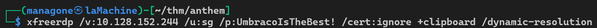](./screen/Anthem/WindowsTerminal_JDDiYZji5S.png)

!!! info "Qu'est-ce que RDP ?"
    RDP (Remote Desktop Protocol) est le protocole Windows natif pour le bureau à distance. Il expose un bureau graphique complet, exactement comme si on était physiquement devant la machine. `xfreerdp` est le client RDP open source disponible sur Linux. L'option `/cert:ignore` accepte le certificat auto-signé sans erreur, et `+clipboard` partage le presse-papier entre notre machine et la cible.

On récupère le flag utilisateur sur le bureau :

[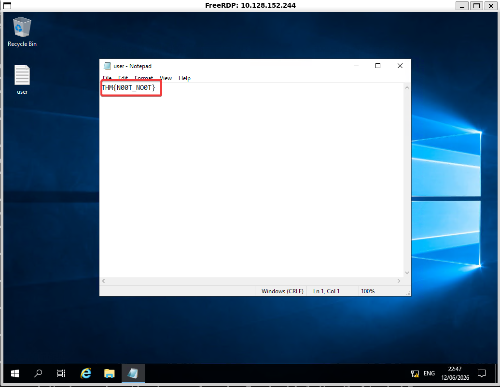](./screen/Anthem/EHYu7Wp0Z4.png)

!!! success "Réponse"
    **User flag** → `THM{N00T_NO0T}`

### Étape 6 : Découverte du fichier de sauvegarde caché

Le compte `sg` n'étant probablement pas administrateur, on cherche maintenant un moyen d'élever ses privilèges. On explore les dossiers de la machine. En naviguant vers `C:\`, rien d'inhabituel n'est visible à première vue. On active l'affichage des éléments cachés dans l'Explorateur Windows (onglet **Affichage**, puis cocher **Éléments masqués**) et un dossier au nom intéressant apparaît : `backup`. À l'intérieur, un fichier `restore.txt` - mais les permissions ne permettent pas de le lire directement.

[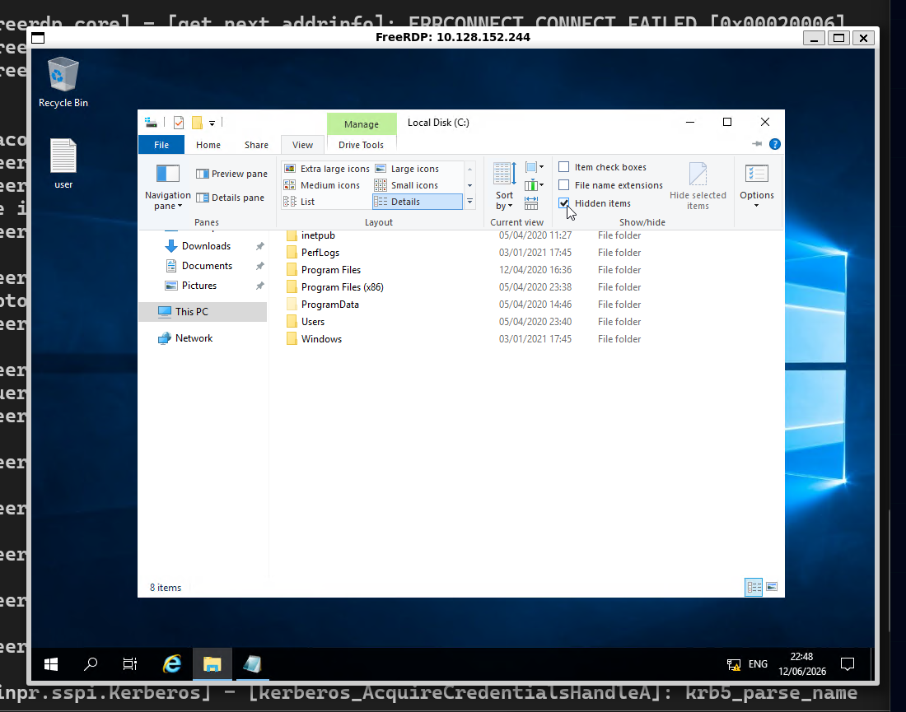](./screen/Anthem/msrdc_4mNUCeUbAT.png)

[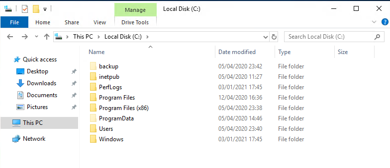](./screen/Anthem/msrdc_fVYMZpyLdx.png)

!!! info "Pourquoi chercher dans C:\\backup ?"
    Les dossiers nommés `backup`, `old`, `restore` ou `archive` sont des cibles prioritaires en post-exploitation. Ils contiennent fréquemment des copies de fichiers de configuration, des exports de bases de données, ou des credentials sauvegardés. Ici, le fichier s'appelle `restore.txt` : un nom qui suggère explicitement des informations de restauration de compte.

Pour lire `restore.txt`, on modifie ses permissions en suivant ces étapes : clic droit sur le fichier, **Propriétés**, onglet **Sécurité**, bouton **Modifier**, puis **Ajouter** pour saisir le nom d'utilisateur `sg`. On lui accorde ensuite les droits de lecture et on valide :

[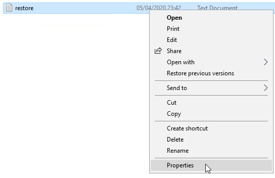](./screen/Anthem/msrdc_ABN6YGkL5j.png)

[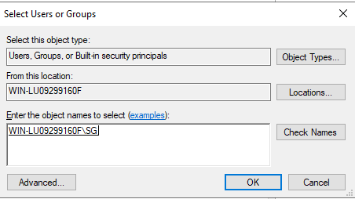](./screen/Anthem/msrdc_evsNAc3CgJ.png)

[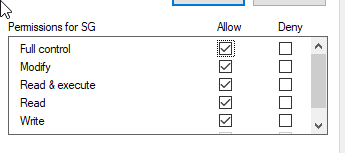](./screen/Anthem/msrdc_5SWwq9Jcds.png)

!!! tip "Pourquoi peut-on modifier ces permissions ?"
    Sur Windows, le propriétaire d'un objet peut toujours modifier ses permissions, même s'il n'a pas de droit de lecture sur le fichier lui-même. C'est un comportement NTFS intentionnel. En ajoutant notre utilisateur `sg` à la liste de contrôle d'accès (ACL), on s'octroie la lecture du fichier sans passer par un compte administrateur.

Le fichier contient un mot de passe : **ChangeMeBaby1MoreTime**, probablement celui du compte Administrator.

[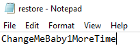](./screen/Anthem/msrdc_6QzJNdynJw.png)

!!! info "Comment sait-on que c'est le mot de passe du compte Administrator ?"
    On ne le sait pas avec certitude avant d'essayer. La logique est la suivante : le fichier est dans un dossier `backup` nommé `restore.txt`, ce qui suggère des credentials de restauration de compte. Sur une machine Windows en CTF, le compte cible est presque toujours `Administrator`. On tente donc `xfreerdp /u:Administrator` avec ce mot de passe, et la connexion réussit, ce qui confirme l'hypothèse. En pentest réel, on testerait ce mot de passe sur tous les comptes existants.

### Étape 7 : Connexion en Administrateur et flag root

On se déconnecte et on se reconnecte en RDP avec le compte `Administrator` :

```bash
xfreerdp /v:<IP_cible> /u:Administrator /p:ChangeMeBaby1MoreTime /cert:ignore +clipboard /dynamic-resolution
```

[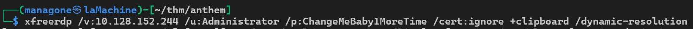](./screen/Anthem/WindowsTerminal_9GySOorFGK.png)

Une fois connecté, le fichier `root.txt` est directement visible sur le bureau. Un double-clic suffit pour lire le flag.

[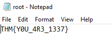](./screen/Anthem/msrdc_yzZi0DCgjg.png)

!!! success "Réponse"
    **Root flag** → `THM{Y0U_4R3_1337}`

## Synthèse technique

| Catégorie | Détails |
|-----------|---------|
| **Vulnérabilités identifiées** | Mot de passe en clair dans robots.txt, flags dans le code source HTML, nom d'administrateur exposé, mot de passe admin dans fichier backup accessible |
| **Techniques utilisées** | Inspection de code source, OSINT sur blog, connexion RDP, modification de permissions NTFS |
| **Outils employés** | Nmap, navigateur, xfreerdp |

!!! abstract "Ce qu'il faut retenir"
    1. `robots.txt` est un fichier public : ne jamais y stocker de mots de passe, chemins sensibles ou informations confidentielles.
    2. Les commentaires HTML et métadonnées sont visibles de tous : un attaquant qui inspecte le code source peut y trouver des données critiques.
    3. Les fichiers de sauvegarde (`backup`, `restore`, `old`) sont des cibles prioritaires en post-exploitation : ils contiennent souvent des credentials en clair.
    4. Les informations personnelles publiques (nom, email) permettent souvent de déduire des identifiants par convention de nommage.
