---
tags:
  - Crypto
  - TryHackMe
  - Facile
  - Hashcat
  - John
---

# Crack the Hash - TryHackMe

<figure markdown>
  { width="250" }
</figure>

## Informations générales

| | |
|---|---|
| **Plateforme** | TryHackMe |
| **Type** | Offensive ou Defensive / Challenge |
| **Difficulté** | Facile |
| **Thématiques** | Hash, brute force, wordlists |
| **Prérequis** | Bases sur les algorithmes de hachage, utilisation de hashcat/John, manipulation de wordlists |

## Contexte et objectifs

Dans cette room, l'objectif est de retrouver les mots de passe à partir de différents types de hachages. Les challenges sont divisés en deux niveaux : le premier se concentre sur des algorithmes classiques et des outils en ligne, tandis que le second introduit des hachages plus complexes, parfois salés, nécessitant des outils spécialisés comme hashcat ou John the Ripper.

!!! info "À propos de cette room"
    Cette room permet de se familiariser avec l'identification des algorithmes de hachage, l'utilisation de wordlists, et les techniques de brute force. C'est une excellente introduction à la cryptanalyse appliquée et à la sécurité des mots de passe.

## Méthodologie

### Étape 1 : Identifier le type de hachage

Avant de tenter de "craquer" un hash, il faut savoir de quel algorithme il s'agit. La longueur et le format du hash donnent souvent des indices. Pour automatiser cette étape, on peut utiliser des outils comme `hashid`.

```bash
hashid 48bb6e862e54f2a795ffc4e541caed4d
```

[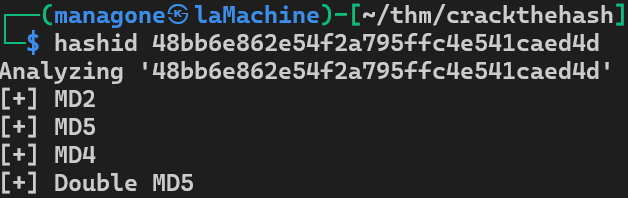](./screen/crackthehash/WindowsTerminal_kzjOKiLipP.png)

!!! tip "Pourquoi cette commande ?"
    Identifier l’algorithme permet de choisir le bon mode dans hashcat ou John, et d’éviter de perdre du temps sur de mauvaises pistes.

Pour le hash `48bb6e862e54f2a795ffc4e541caed4d`, l’outil indique qu’il s’agit probablement d’un hash MD5.


### Étape 2 : Utiliser des outils en ligne pour les hachages courants

Quand le hash n’est pas salé et utilise un algorithme classique (MD5, SHA1, SHA256…), il est souvent possible de le retrouver dans des bases de données publiques.

On peut tester sur des sites comme CrackStation ou dcode.fr :

- https://crackstation.net/
- https://www.dcode.fr/cipher-identifier

Après avoir collé le hash MD5, on obtient le mot de passe original.

[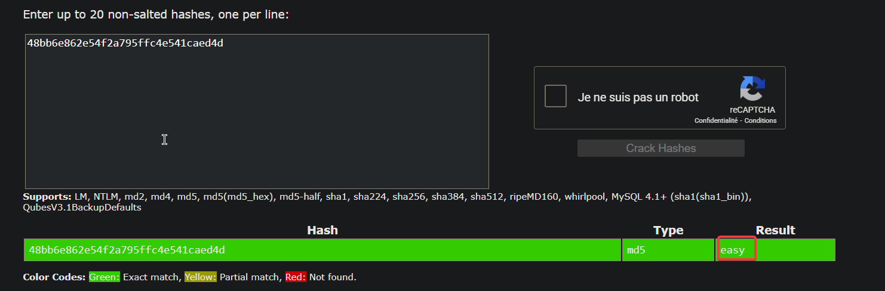](./screen/crackthehash/2eQn5fI601.png)

!!! success "Réponse"
    **Hash : 48bb6e862e54f2a795ffc4e541caed4d** → `easy`

### Étape 3 : Répéter l’identification et le test pour d’autres algorithmes

Pour le hash suivant, `CBFDAC6008F9CAB4083784CBD1874F76618D2A97`, la longueur (40 caractères hexadécimaux) suggère SHA1.

On vérifie avec hashid :

```bash
hashid CBFDAC6008F9CAB4083784CBD1874F76618D2A97
```

[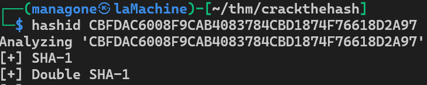](./screen/crackthehash/WindowsTerminal_vNdeEBTQlk.png)

Puis on teste sur CrackStation. Si le hash n’est pas trouvé, il faut passer à une attaque par dictionnaire.

[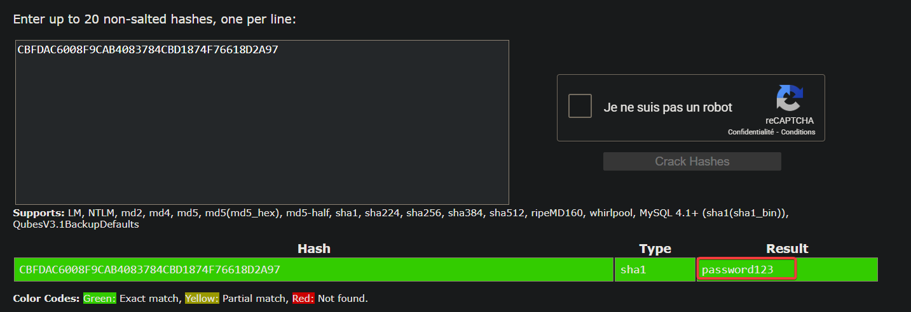](./screen/crackthehash/Xe4x1owXFO.png)

!!! success "Réponse"
    **Hash : CBFDAC6008F9CAB4083784CBD1874F76618D2A97** → `password123`

### Étape 4 : Utiliser hashcat pour les hachages non trouvés en ligne

Quand les outils en ligne échouent, il faut cracker le hash localement avec une wordlist. Ici, on utilise hashcat, un outil de brute force très performant.

!!! info "Qu’est-ce que hashcat ?"
    Hashcat est un outil de craquage de mots de passe qui exploite la puissance du processeur ou du GPU pour tester rapidement des millions de combinaisons.

!!! info "Comment trouver le bon numéro de mode hashcat (-m) ?"
    Une fois le type de hash identifié par hashid, il faut trouver le numéro de mode correspondant dans hashcat. La commande suivante liste tous les modes disponibles et permet de filtrer :
    ```bash
    hashcat --help | grep -i "md5"
    hashcat --help | grep -i "sha256"
    ```
    Les modes les plus courants à retenir :

    | Algorithme       | Mode hashcat |
    |------------------|-------------|
    | MD5              | 0           |
    | SHA-1            | 100         |
    | SHA-256          | 1400        |
    | SHA-512          | 1700        |
    | NTLM             | 1000        |
    | bcrypt           | 3200        |
    | SHA-512crypt Unix| 1800        |
    | HMAC-SHA1        | 160         |
    | MD4              | 900         |
    
Pour un hash SHA256 (64 caractères hexadécimaux), on utilise la commande suivante :

```bash
echo "1C8BFE8F801D79745C4631D09FFF36C82AA37FC4CCE4FC946683D7B336B63032" > hash.txt
hashcat -m 1400 hash.txt /usr/share/wordlists/rockyou.txt
```

!!! tip "Comment utiliser hashcat ?"
    La syntaxe de base est `hashcat -m <mode> <fichier_hash> <wordlist>` :

    - `-m 1400` : le mode hashcat correspondant à l'algorithme (ici SHA256, voir le tableau ci-dessus)
    - `hash.txt` : le fichier contenant le hash à craquer
    - `/usr/share/wordlists/rockyou.txt` : la wordlist testée mot par mot contre le hash

[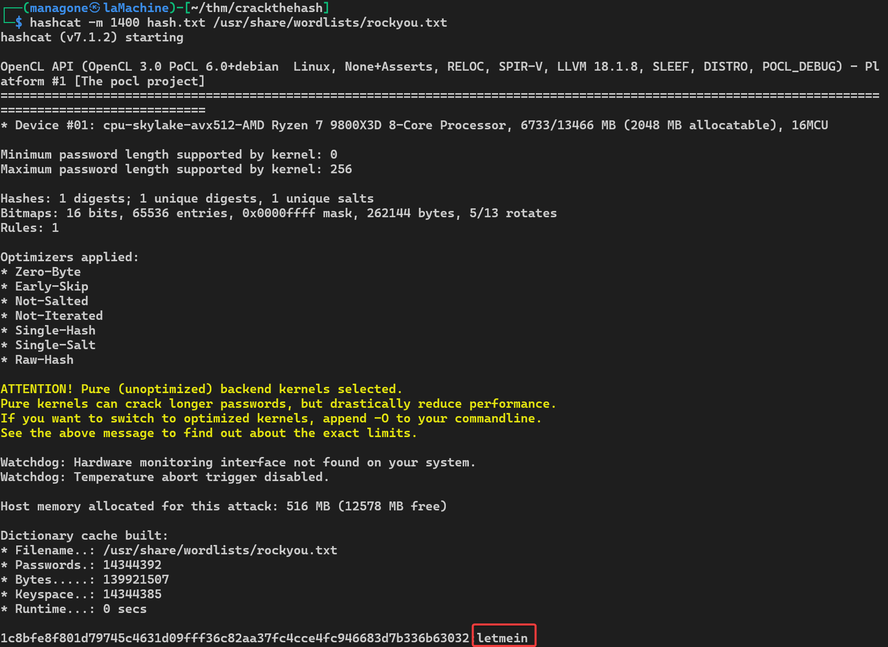](./screen/crackthehash/2TOA9i6X0k.png)

!!! success "Réponse"
    **Hash : 1C8BFE8F801D79745C4631D09FFF36C82AA37FC4CCE4FC946683D7B336B63032** → `letmein`

### Étape 5 : Gérer les hachages salés ou complexes (bcrypt, SHA512 crypt, etc.)

Certains hachages affichent un format particulier, par exemple `$2y$12$...` pour bcrypt ou `$6$...` pour SHA512 crypt. Ces formats incluent des informations sur l’algorithme, le coût (nombre d’itérations) et parfois le sel.

!!! info "Qu’est-ce qu’un sel ?"
    Un sel est une valeur aléatoire ajoutée au mot de passe avant le hachage. Il garantit que deux mots de passe identiques produisent des hashs différents, ce qui empêche notamment l’utilisation de tables précalculées (rainbow tables) pour retrouver le mot de passe d’origine.

Pour bcrypt :

```bash
echo '$2y$12$Dwt1BZj6pcyc3Dy1FWZ5ieeUznr71EeNkJkUlypTsgbX1H68wsRom' > bcrypt.hash
hashcat -m 3200 bcrypt.hash /usr/share/wordlists/rockyou.txt
```

!!! tip "Pourquoi filtrer la wordlist ?"
    La room TryHackMe précise que le mot de passe attendu fait 4 caractères. Avec cette information, il est judicieux de filtrer la wordlist pour accélérer le craquage :
    ```bash
    grep -x '.\{4\}' /usr/share/wordlists/rockyou.txt > rockyou-4.txt
    hashcat -m 3200 bcrypt.hash rockyou-4.txt
    ```

[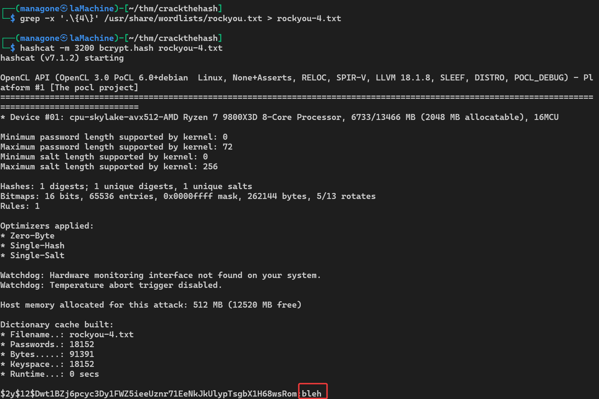](./screen/crackthehash/VzQ1Cr6Vru.png)

!!! success "Réponse"
    **Hash : $2y$12$Dwt1BZj6pcyc3Dy1FWZ5ieeUznr71EeNkJkUlypTsgbX1H68wsRom** → `bleh`

### Étape 6 : Craquer un hash MD4

Pour le hash `279412f945939ba78ce0758d3fd83daa`, hashid indique MD4. On peut tester en ligne encore une fois avec Crackstation :

[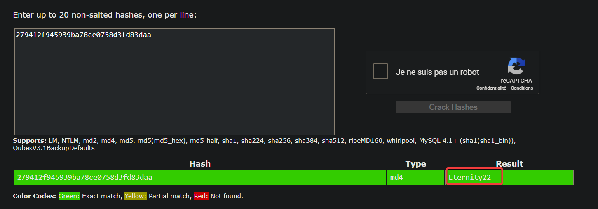](./screen/crackthehash/CCx6fRjo48.png)

!!! success "Réponse"
    **Hash : 279412f945939ba78ce0758d3fd83daa** → `Eternity22`

---

## Niveau 2 : Hachages avancés et salés

### Étape 7 : Craquer un hash SHA256 non trouvé en ligne

Pour le hash `F09EDCB1FCEFC6DFB23DC3505A882655FF77375ED8AA2D1C13F640FCCC2D0C85`, les outils en ligne échouent. On utilise hashcat avec le bon mode :

```bash
echo "F09EDCB1FCEFC6DFB23DC3505A882655FF77375ED8AA2D1C13F640FCCC2D0C85" > sha256.hash
hashcat -m 1400 sha256.hash /usr/share/wordlists/rockyou.txt
```

[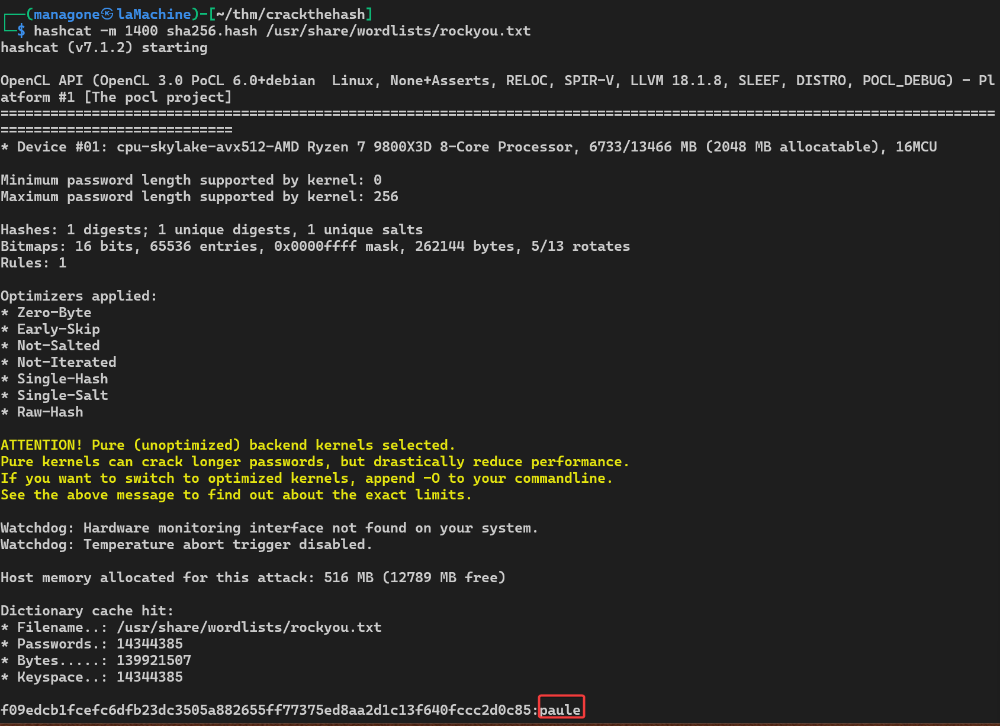](./screen/crackthehash/5WlSIZ9BP6.png)

!!! success "Réponse"
    **Hash : F09EDCB1FCEFC6DFB23DC3505A882655FF77375ED8AA2D1C13F640FCCC2D0C85** → `paule`

### Étape 8 : Identifier et attaquer un hash NTLM

Le hash `1DFECA0C002AE40B8619ECF94819CC1B` ne correspond ni à MD5 ni à SHA1. Après vérification, il s’agit d’un hash NTLM (utilisé par Windows). On utilise hashcat avec le mode 1000 :

```bash
echo "1DFECA0C002AE40B8619ECF94819CC1B" > ntlm.hash
hashcat -m 1000 ntlm.hash /usr/share/wordlists/rockyou.txt
```

[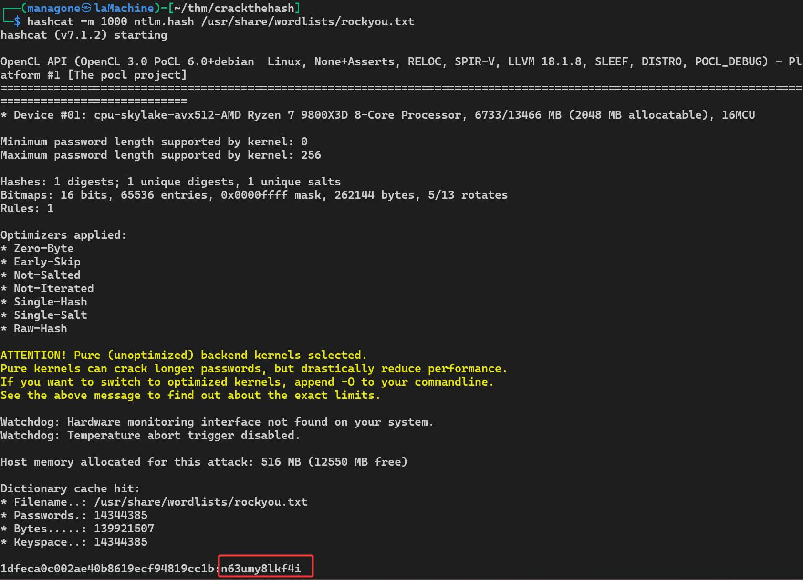](./screen/crackthehash/oQ2bvXsGp8.png)

!!! success "Réponse"
    **Hash : 1DFECA0C002AE40B8619ECF94819CC1B** → `n63umy8lkf4i`

### Étape 9 : Craquer un hash SHA512 crypt (format Unix)

Le hash `$6$aReallyHardSalt$6WKUTqzq.UQQmrm0p/T7MPpMbGNnzXPMAXi4bJMl9be.cfi3/qxIf.hsGpS41BqMhSrHVXgMpdjS6xeKZAs02.` indique un hash SHA512 crypté avec le sel `aReallyHardSalt`.

!!! info "Le sel est déjà intégré dans le hash"
    Pour les formats Unix comme `$6$...` (SHA512crypt) ou `$2y$...` (bcrypt), le sel est **directement inclus dans la chaîne du hash** entre les `$`. Il n'y a donc rien de spécial à faire : on met le hash complet dans le fichier et hashcat extrait le sel automatiquement.

```bash
echo '$6$aReallyHardSalt$6WKUTqzq.UQQmrm0p/T7MPpMbGNnzXPMAXi4bJMl9be.cfi3/qxIf.hsGpS41BqMhSrHVXgMpdjS6xeKZAs02.' > sha512crypt.hash
hashcat -m 1800 sha512crypt.hash /usr/share/wordlists/rockyou.txt
```

!!! tip "Optimiser la wordlist"
    Si le mot de passe attendu fait 6 caractères, filtrer la wordlist :
    ```bash
    grep -x '.\{6\}' /usr/share/wordlists/rockyou.txt > rockyou-6.txt
    hashcat -m 1800 sha512crypt.hash rockyou-6.txt
    ```

[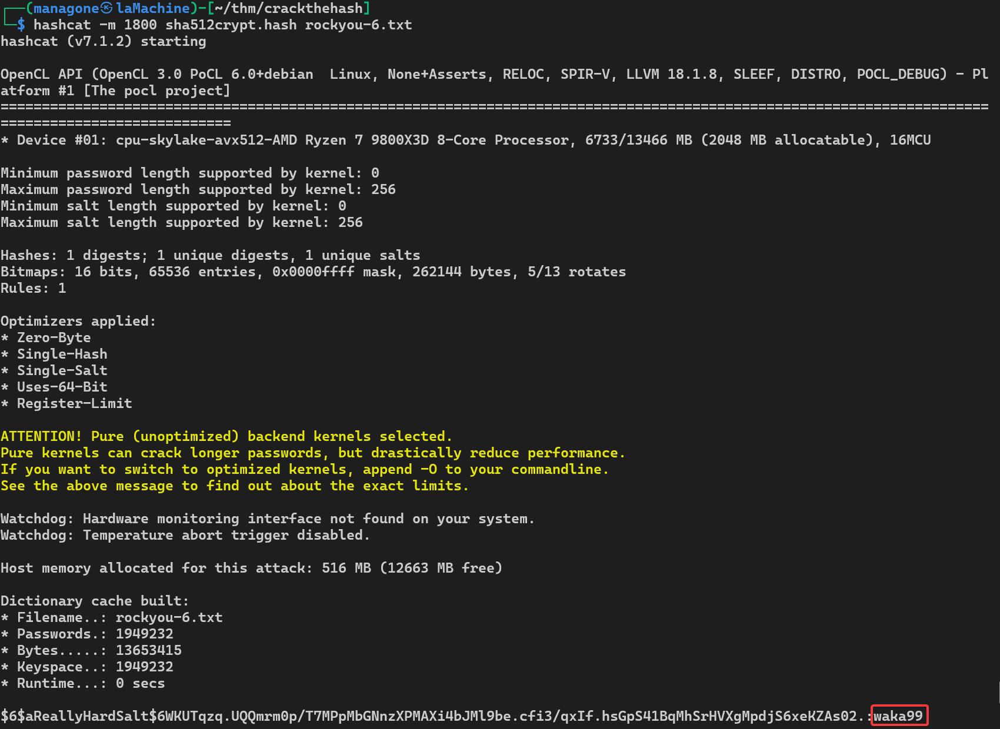](./screen/crackthehash/fOxm31QUWC.png)

!!! success "Réponse"
    **Hash : $6$aReallyHardSalt$6WKUTqzq.UQQmrm0p/T7MPpMbGNnzXPMAXi4bJMl9be.cfi3/qxIf.hsGpS41BqMhSrHVXgMpdjS6xeKZAs02.** → `waka99`

### Étape 10 : Craquer un hash HMAC-SHA1 salé

Le hash `e5d8870e5bdd26602cab8dbe07a942c8669e56d6` est accompagné du sel `tryhackme`. Ici, il s’agit d’un HMAC-SHA1 (un hash SHA1 utilisant une clé, ici le sel).

!!! info "Comment ajouter le sel pour hashcat"
    Contrairement au SHA512crypt, le sel n’est pas intégré dans le hash. Il faut le fournir manuellement en l’ajoutant après le hash, séparé par `:` dans le fichier :
    ```
    <hash>:<sel>
    ```
    Hashcat reconnaît ce format et utilise automatiquement le sel lors du calcul.

Hashcat peut gérer ce format avec le mode 160 :

```bash
echo "e5d8870e5bdd26602cab8dbe07a942c8669e56d6:tryhackme" > hmacsha1.hash
hashcat -m 160 hmacsha1.hash /usr/share/wordlists/rockyou.txt
```

[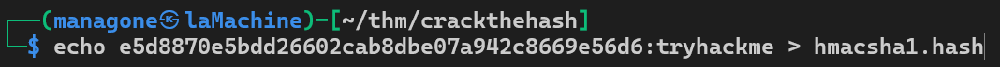](./screen/crackthehash/WindowsTerminal_JKzZBajTtM.png)

[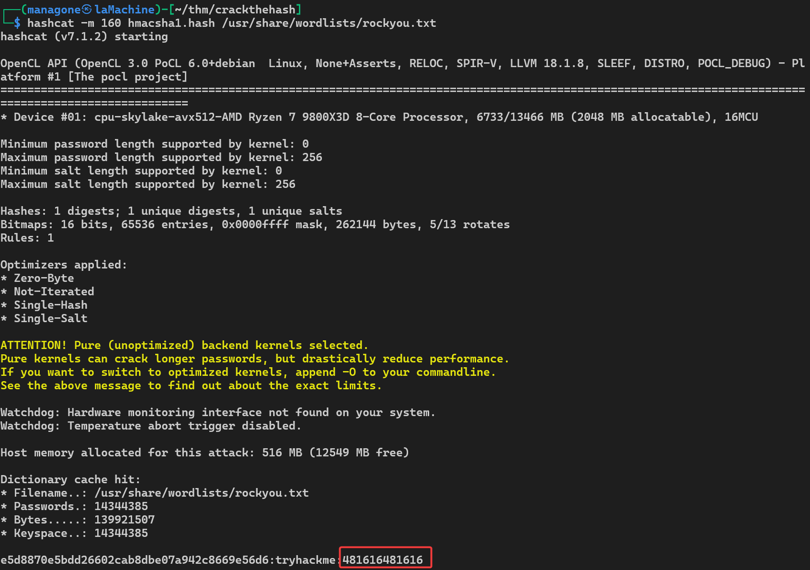](./screen/crackthehash/N86CZjkIgc.png)

!!! success "Réponse"
    **Hash : e5d8870e5bdd26602cab8dbe07a942c8669e56d6 (salt: tryhackme)** → `481616481616`

---

## Synthèse technique

| Catégorie | Détails |
|-----------|---------|
| **Vulnérabilités identifiées** | Utilisation de hachages faibles (MD5, SHA1, NTLM), absence de sel, mots de passe faibles |
| **Techniques utilisées** | Identification d’algorithme, attaque par dictionnaire, filtrage de wordlist, script HMAC |
| **Outils employés** | hashid, hashcat, CrackStation, dcode.fr |

!!! abstract "Ce qu'il faut retenir"
    1. Toujours identifier précisément le type de hash avant d’attaquer.
    2. Les outils en ligne suffisent pour les hachages classiques et non salés, mais hashcat/John sont indispensables pour les formats avancés.
    3. Adapter la wordlist et la méthode (filtrage, script) permet de gagner beaucoup de temps et d’efficacité.