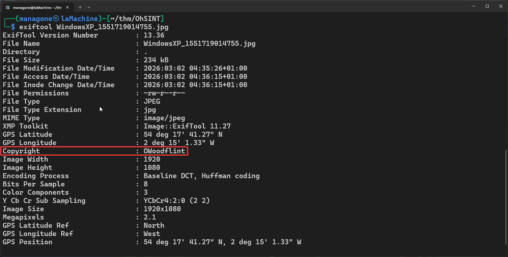
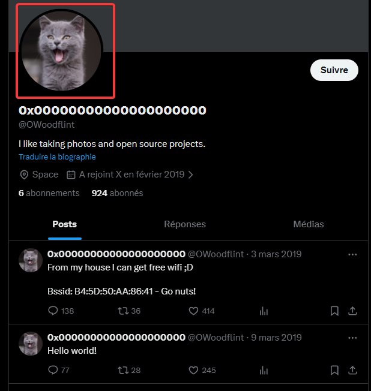
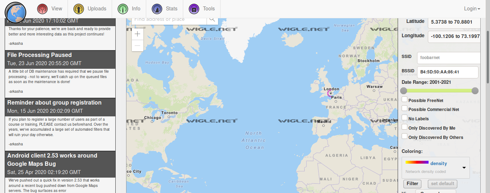
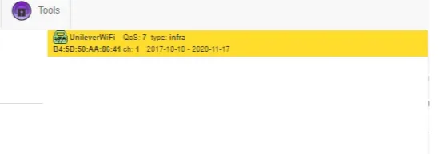
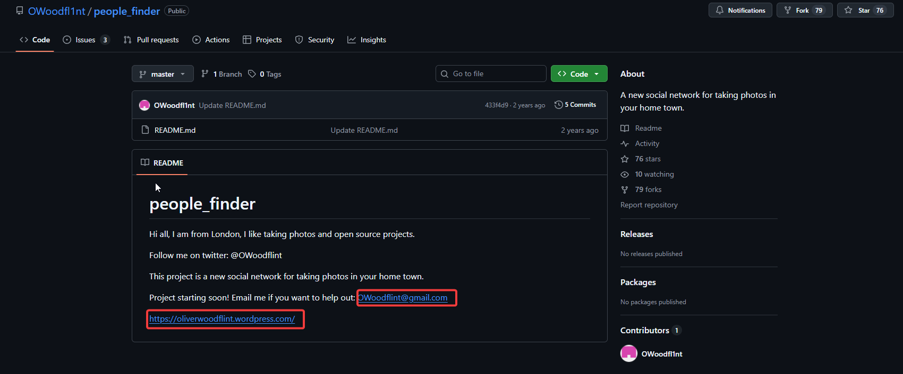
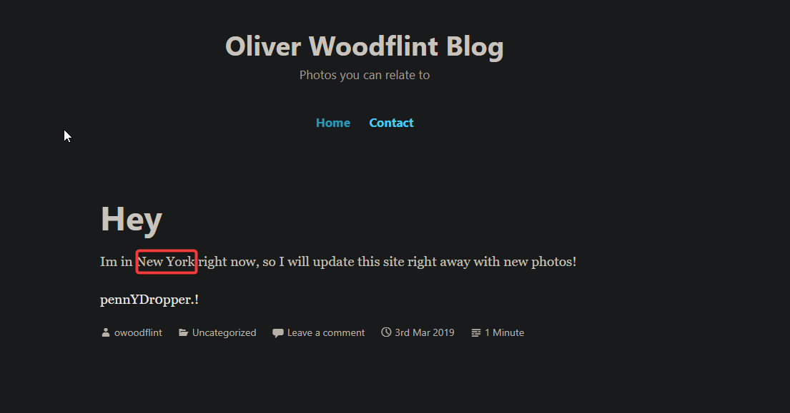
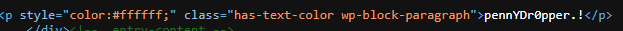

---
tags:
  - OSINT
  - TryHackMe
  - Facile
  - Exiftool
  - Wigle.net
---

# OhSINT - TryHackMe

<figure markdown>
  { width="250" }
</figure>

## Informations générales

| | |
|---|---|
| **Plateforme** | TryHackMe |
| **Type** | Offensive / Challenge |
| **Difficulté** | Facile |
| **Thématiques** | OSINT, métadonnées, réseaux sociaux, recherche passive |
| **Prérequis** | Bases de l’OSINT, utilisation d’Exiftool, recherche sur internet, inspection de code source |

## Contexte et objectifs

Dans cette room, le seul point de départ est une image. L’objectif est d’utiliser des techniques d’OSINT (Open Source Intelligence) pour retrouver des informations personnelles sur une cible, en exploitant les métadonnées, les réseaux sociaux, les bases de données Wi-Fi et l’inspection de pages web.

!!! info "À propos de cette room"
    OhSINT est une excellente introduction à l’OSINT. Elle montre comment, à partir d’un simple fichier, on peut remonter à des informations sensibles en croisant plusieurs outils et méthodes. Ces compétences sont essentielles pour comprendre les risques liés à la fuite d’informations publiques.

## Méthodologie

### Étape 1 : Extraction des métadonnées de l’image
[](./screen/OhSINT/WindowsXP_1551719014755.png)

Nous commençons avec une cette belle image de Windows XP, sans autre contexte. La première étape logique est d’extraire ses métadonnées, car elles peuvent contenir des informations cachées comme l’auteur, la localisation ou des commentaires.

```bash
exiftool WindowsXP_1551719014755.jpg
```
[](./screen/OhSINT/46gyvnvN02.png)

!!! tip "Pourquoi cette commande ?"
    Les métadonnées d’une image peuvent révéler l’identité de l’auteur, la date de création, voire des coordonnées GPS. C’est souvent un point de départ en OSINT.

Dans les résultats, on trouve un champ Copyright avec la valeur `OWoodflint`. Ce pseudo va nous servir d’indice principal pour la suite.

### Étape 2 : Recherche du pseudo sur internet

Maintenant que nous avons le pseudo `OWoodflint`, il est pertinent de rechercher où cette personne est active en ligne. Les réseaux sociaux et plateformes de développement sont de bons points de départ.

Une simple recherche Google sur `OWoodflint` fait ressortir plusieurs profils, notamment sur Twitter, GitHub et un blog WordPress.

Sur le profil Twitter, la photo de profil attire l’attention.

[](./screen/OhSINT/Gcx42LezGr.png)

!!! success "Réponse"
    **What is this user's avatar of?** → `Cat`

### Étape 3 : Analyse des tweets pour des informations techniques

Après avoir identifié le profil Twitter, il est utile de parcourir les tweets à la recherche d’informations techniques ou personnelles. Un tweet mentionne :

> "From my house I can get free wifi ;D  
> Bssid: B4:5D:50:AA:86:41 - Go nuts!"

!!! info "Qu'est-ce qu'un BSSID ?"
    Le BSSID est l’identifiant unique d’un point d’accès Wi-Fi. Il permet, via certaines bases de données publiques, de retrouver la localisation géographique d’un réseau.

Ce type d’information peut révéler une localisation précise grâce à des bases de données comme Wigle.net, qui recense les réseaux Wi-Fi à travers le monde.

### Étape 4 : Recherche du BSSID sur Wigle.net

Sur [wigle.net](https://wigle.net), il suffit d’entrer le BSSID dans la recherche avancée pour localiser le point d’accès.
[](./screen/OhSINT/fvxvdxfvx0.png)
La carte indique que le réseau se trouve à Londres.

!!! success "Réponse"
    **What city is this person in?** → `London`
[](./screen/OhSINT/fdsfdsi054fds.png)
En consultant la fiche du point d’accès, on découvre également le nom du réseau Wi-Fi (SSID).

!!! success "Réponse"
    **What is the SSID of the WAP he connected to?** → `UnileverWiFi`

### Étape 5 : Recherche de l’email sur les autres profils

La recherche du pseudo effectuée à l'étape 2 a aussi fait ressortir des profils GitHub et WordPress associés. GitHub est souvent une bonne source pour trouver des adresses email publiques, car elles sont parfois affichées dans les projets ou les profils.

Sur le profil GitHub d’OWoodflint, dans le projet "people_finder", on trouve la mention :

> "Email me if you want to help out: OWoodflint@gmail.com"
[](./screen/OhSINT/nzeTxlBgsF.png)
!!! success "Réponse"
    **What is his personal email address?** → `OWoodflint@gmail.com`

!!! success "Réponse"
    **What site did you find his email address on?** → `Github`

### Étape 6 : Recherche d’informations personnelles sur le blog

Il reste des questions sans réponse, notamment sur les voyages de la personne. Le blog WordPress trouvé à l'étape 2 peut contenir des informations personnelles.

En parcourant le blog, un article mentionne un voyage à New York.
[](./screen/OhSINT/diFn2S6Ipr.png)
!!! success "Réponse"
    **Where has he gone on holiday?** → `New York`

### Étape 7 : Inspection du code source du blog pour trouver un mot de passe

Les informations visibles sur le blog ne suffisent pas pour la dernière question. En OSINT, il est courant de vérifier le code source des pages web pour trouver des éléments cachés ou obfusqués.  

!!! info "Petite précision"
    Dans mon cas, c'était un peu particulier car étant donné que j'ai une extension navigateur pour mettre tout le contenu en mode sombre, le mot de passe était déjà affiché sans devoir aller dans le code source.

En inspectant le code source de la page (clic droit > "Afficher le code source"), on trouve une ligne :
[](./screen/OhSINT/brave_fCYZDn5D8M.png)
```html
<p style="color:#ffffff;" class="has-text-color">pennYDr0pper.!</p>
```

Le texte est en principe de la même couleur que le fond, donc invisible à l’œil nu, mais bien présent dans le code.

!!! success "Réponse"
    **What is the person’s password?** → `pennYDr0pper.!`

## Synthèse technique

| Catégorie | Détails |
|-----------|---------|
| **Vulnérabilités identifiées** | Fuite de métadonnées, exposition de BSSID, informations personnelles publiques, mot de passe caché dans le code source |
| **Techniques utilisées** | Extraction de métadonnées, recherche de pseudo, analyse de réseaux sociaux, recherche de BSSID, inspection de code source |
| **Outils employés** | Exiftool, Google, Wigle.net, inspection de page web, GitHub, WordPress |

!!! abstract "Ce qu'il faut retenir"
    1. Les métadonnées d’un simple fichier peuvent révéler des informations sensibles.
    2. Croiser plusieurs sources publiques permet de reconstituer le profil d’une personne.
    3. Toujours inspecter le code source d’une page web pour détecter des informations cachées.

