---
tags:
  - Web
  - TryHackMe
  - Facile
  - Gobuster
  - Nmap
  - Nikto
---

# Pickle Rick - TryHackMe

<figure markdown>
  { width="250" }
</figure>

## Informations générales

|                    |                                               |
|--------------------|-----------------------------------------------|
| **Plateforme**     | TryHackMe                                     |
| **Type**           | Offensive / Challenge                       |
| **Difficulté**     | Facile                                        |
| **Thématiques**    | Web, Enumeration, Command Injection, Linux    |
| **Prérequis**      | Bases Linux, HTTP, utilisation de nmap/gobuster |

## Contexte et objectifs

Dans cette room inspirée de Rick & Morty, l'objectif est d'aider Rick à redevenir humain en retrouvant trois ingrédients secrets cachés sur un serveur web vulnérable. Pour cela, il faut explorer le site, trouver des identifiants, accéder à une interface d'exécution de commandes et fouiller le système de fichiers.

!!! info "À propos de cette room"
    Cette room est idéale pour s'entraîner à l'énumération web, à l'exploitation de failles simples et à la manipulation de commandes Linux. Elle met l'accent sur la logique d'exploration et la résolution de problèmes, des compétences essentielles en cybersécurité offensive.

## Méthodologie

### Étape 1 : Cartographie des services avec Nmap

Avant toute chose, il est important de savoir quels services sont accessibles sur la machine cible. Un scan de ports permet d'identifier les points d'entrée.

```bash
nmap -sC -sV <IP_cible>
```
[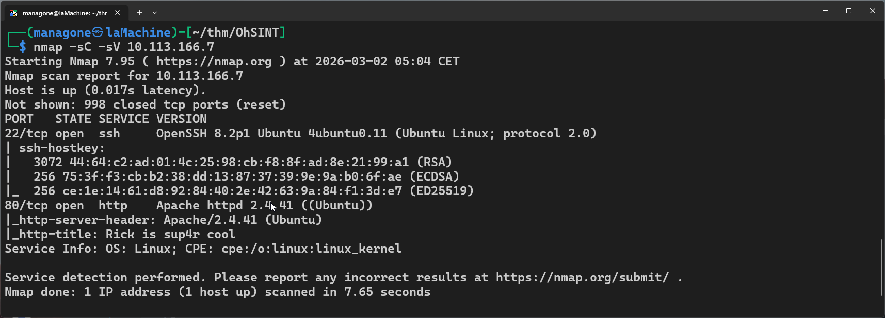](./screen/PickleRick/WindowsTerminal_YctfhyjARK.png)

Cette commande révèle deux ports ouverts :
- 22/tcp (SSH)
- 80/tcp (HTTP)

!!! tip "Pourquoi commencer par Nmap ?"
    Nmap permet de cartographier rapidement les services disponibles. Ici, le port 80 (HTTP) sera notre cible principale, car l'accès SSH nécessite des identifiants que nous n'avons pas encore.

### Étape 2 : Inspection de la page d'accueil

Maintenant que nous savons qu'un site web est accessible, ouvrons-le dans un navigateur pour voir ce qu'il affiche.

En visitant `http://<IP_cible>`, on tombe sur une page d'accueil avec un message de Rick. Rien d'exploitable en apparence.

[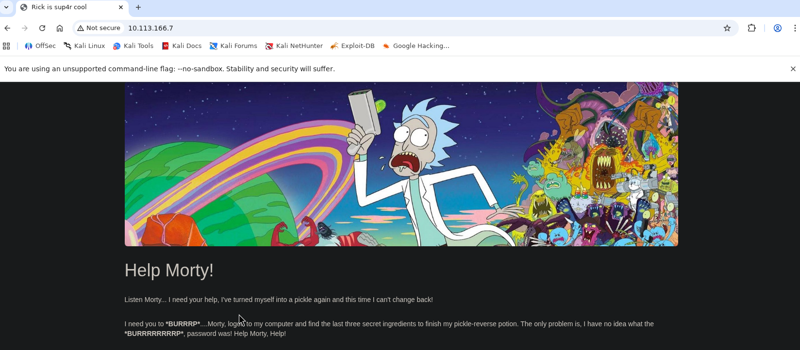](./screen/PickleRick/msrdc_Prv9DLNnEK.png)

### Étape 3 : Recherche d'indices dans le code source HTML

Quand une page web ne livre pas d'informations visibles, il est courant de vérifier le code source pour y trouver des commentaires ou des éléments cachés.

Affichons le code source (clic droit > "Afficher le code source" ou `Ctrl+U`).

Dans les commentaires HTML, on trouve un nom d'utilisateur :

[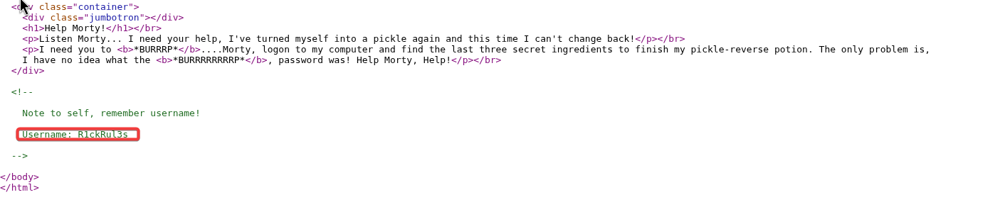](./screen/PickleRick/OjGeOgWj9m.png)

```
<!--
Note to self, remember username!
Username: R1ckRul3s
-->
```

!!! tip "Pourquoi regarder le code source ?"
    Les développeurs laissent parfois des informations sensibles dans les commentaires HTML, oubliant qu'ils sont accessibles à tous.

### Étape 4 : Enumération des répertoires avec Gobuster

Nous avons donc un nom d'utilisateur, mais il nous manque un mot de passe et un point d'entrée pour l'utiliser. La page d'accueil ne révèle rien de plus. On lance une énumération de répertoires pour découvrir des pages cachées.

```bash
gobuster dir -u http://<IP_cible> -w /usr/share/wordlists/dirbuster/directory-list-2.3-medium.txt
```
[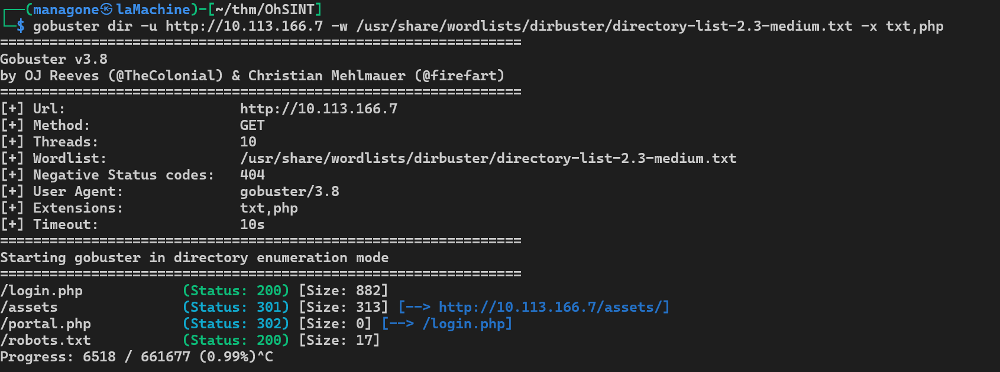](./screen/PickleRick/WindowsTerminal_4u4azmTevK.png)

Gobuster trouve plusieurs ressources :
- `/robots.txt` - fichier d'exclusion des moteurs de recherche, parfois source d'indices
- `/login.php` - formulaire de connexion
- `/assets/` - répertoire de ressources statiques

### Étape 5 : Analyse du fichier robots.txt

Le fichier `robots.txt` sert normalement à indiquer aux moteurs de recherche les pages à ne pas indexer, mais il contient parfois des informations sensibles.

Accédons à `http://<IP_cible>/robots.txt`.

[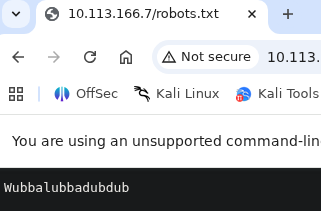](./screen/PickleRick/msrdc_baudEQoMK4.png)

On y trouve :
```
Wubbalubbadubdub
```

Ce texte ressemble fortement à un mot de passe potentiel.

### Étape 6 : Connexion au portail

Nous avons maintenant un couple identifiant/mot de passe potentiel (`R1ckRul3s` / `Wubbalubbadubdub`). Gobuster a trouvé `/login.php` à l'étape précédente. On s'y rend :

Allons sur `http://<IP_cible>/login.php`

[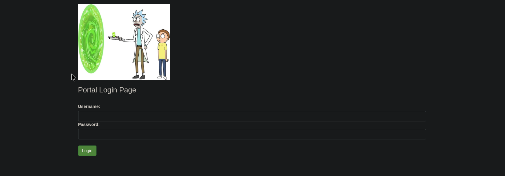](./screen/PickleRick/msrdc_Mdq9c1H1nw.png)

Un formulaire de connexion s'affiche.

### Étape 7 : Connexion avec les identifiants trouvés

Essayons de nous connecter avec les identifiants récoltés.

[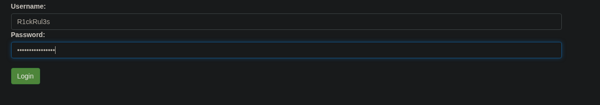](./screen/PickleRick/msrdc_lLhEZcquBM.png)

- **Nom d'utilisateur** : R1ckRul3s
- **Mot de passe** : Wubbalubbadubdub

La connexion fonctionne et on accède à une interface permettant d'exécuter des commandes sur le serveur.

!!! info "Qu'est-ce qu'une interface d'exécution de commandes ?"
    Il s'agit d'un champ où l'utilisateur peut entrer une commande Linux, qui sera exécutée côté serveur. C'est une faille critique si elle n'est pas correctement sécurisée.

### Étape 8 : Exploration du système de fichiers

Maintenant que nous pouvons exécuter des commandes, listons les fichiers présents dans le répertoire courant.

```bash
ls
```
[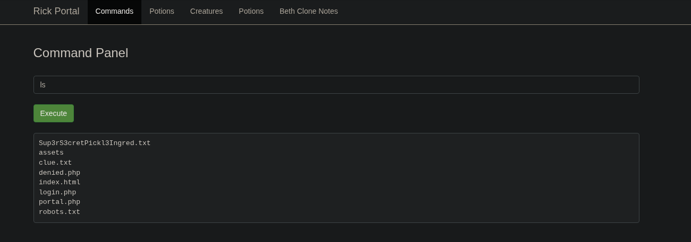](./screen/PickleRick/msrdc_08oKHtxFNg.png)

On découvre plusieurs fichiers, dont :
- `Sup3rS3cretPickl3Ingred.txt`
- `clue.txt`
- ainsi que d'autres fichiers système

### Étape 9 : Lecture du premier ingrédient

On tente de lire le contenu du fichier avec `cat` :

```bash
cat Sup3rS3cretPickl3Ingred.txt
```
[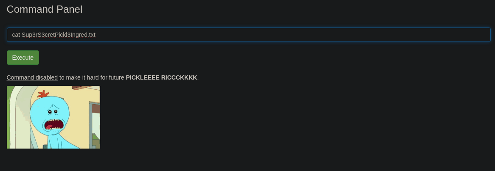](./screen/PickleRick/msrdc_VEKBRQUKGo.png)

`cat` est bloquée par un filtre, elle fait sûrement partie des commandes d'une liste noire. On utilise `less` à la place, qui remplit la même fonction mais n'est pas bloqué :

```bash
less Sup3rS3cretPickl3Ingred.txt
```
[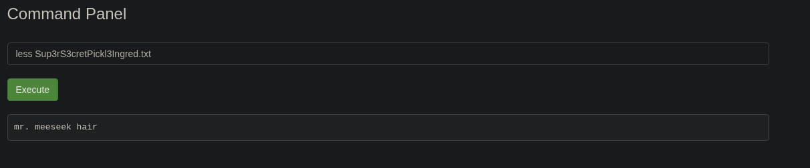](./screen/PickleRick/msrdc_cdlSJWdjzy.png)

Le contenu du fichier s'affiche : c'est le **premier ingrédient**.

!!! success "Réponse"
    **Quel est le premier ingrédient secret ?** → `mr. meeseek hair`

!!! tip "Pourquoi utiliser less ?"
    Certains environnements restreignent l'usage de commandes comme `cat` pour limiter la fuite d'informations, mais oublient parfois d'autres commandes comme `less` ou `more`.

### Étape 10 : Recherche du deuxième ingrédient

Pour trouver les autres ingrédients, lisons le fichier `clue.txt` :

```bash
less clue.txt
```
[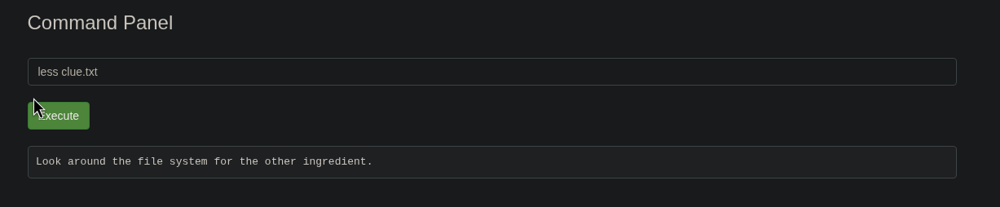](./screen/PickleRick/msrdc_puPwSN0Cld.png)

Ce fichier suggère de fouiller le système de fichiers pour trouver les autres ingrédients.

### Étape 11 : Exploration des répertoires utilisateurs

Cherchons dans le dossier `/home` qui contient généralement les répertoires des utilisateurs.

```bash
ls /home
```

On y trouve un dossier `rick`. Explorons-le :

```bash
ls /home/rick
```
[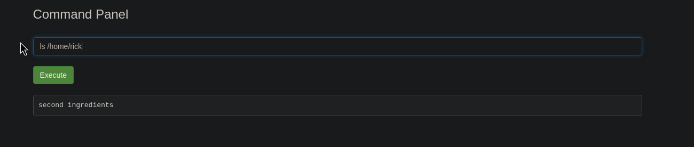](./screen/PickleRick/msrdc_oHTCAEBsPU.png)

Un fichier nommé `second ingredients` apparaît.

Essayons de le lire :

```bash
less /home/rick/second\ ingredients
```

!!! tip "Pourquoi le backslash ?"
    Le nom du fichier contient un espace, qui sert normalement à séparer les arguments dans le shell. Le backslash (`\`) échappe cet espace pour indiquer qu'il fait partie du nom de fichier et non une séparation entre deux arguments.
[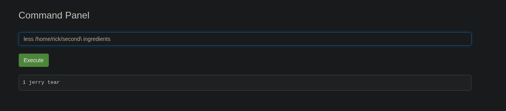](./screen/PickleRick/msrdc_XQgi31yQWA.png)

On obtient le **deuxième ingrédient**.

!!! success "Réponse"
    **Quel est le deuxième ingrédient secret ?** → `1 jerry tear`

### Étape 12 : Recherche du troisième ingrédient dans /root

Les deux premiers ingrédients étaient dans le répertoire web et dans `/home/rick`. Le troisième se trouve probablement dans `/root`, le répertoire de l'administrateur, mais il est normalement inaccessible aux utilisateurs ordinaires. Avant de supposer qu'on ne peut pas y accéder, on vérifie si l'utilisateur courant dispose de droits sudo :

```bash
sudo -l
```
[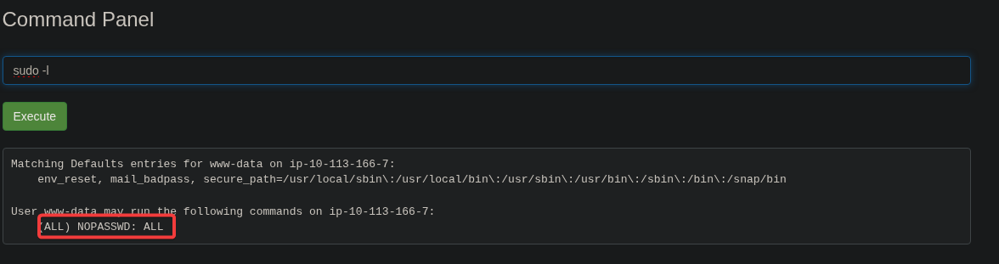](./screen/PickleRick/AyEmwYXYm5.png)

La sortie indique que nous pouvons utiliser `sudo` sans mot de passe.

Listons le contenu de `/root` avec sudo :

```bash
sudo ls /root
```
[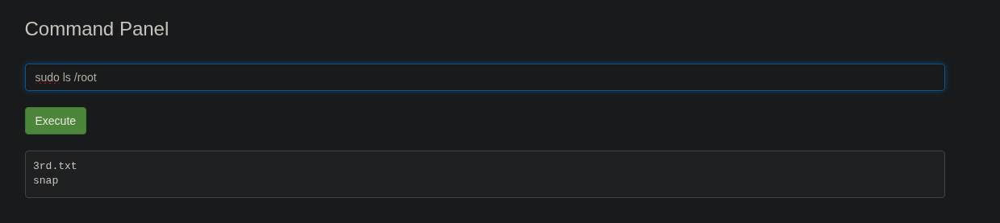](./screen/PickleRick/msrdc_0AD91RoIeN.png)

On trouve un fichier `3rd.txt`. Lisons-le :

```bash
sudo less /root/3rd.txt
```
[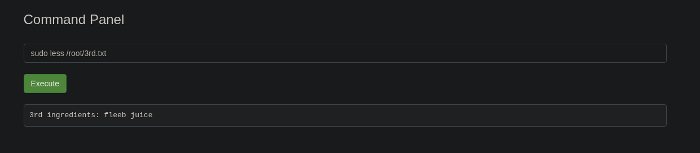](./screen/PickleRick/msrdc_n1SDsSxhKQ.png)

Le **troisième ingrédient** s'affiche.

!!! success "Réponse"
    **Quel est le troisième ingrédient secret ?** → `fleeb juice`

## Synthèse technique

| Catégorie                    | Détails                                                |
|------------------------------|--------------------------------------------------------|
| **Vulnérabilités identifiées** | Command injection, informations sensibles dans robots.txt et commentaires HTML, mauvaise gestion des droits sudo |
| **Techniques utilisées**      | Énumération de services, brute force de répertoires, lecture de fichiers système, élévation de privilèges via sudo |
| **Outils employés**           | Nmap, Gobuster, navigateur web, less, sudo            |

!!! abstract "Ce qu'il faut retenir"
    1. Toujours inspecter le code source et les fichiers classiques comme robots.txt lors d'une énumération web.
    2. Les interfaces d'exécution de commandes sont très dangereuses si elles ne sont pas correctement filtrées.
    3. L'élévation de privilèges via sudo mal configuré permet d'accéder à des fichiers normalement protégés.
